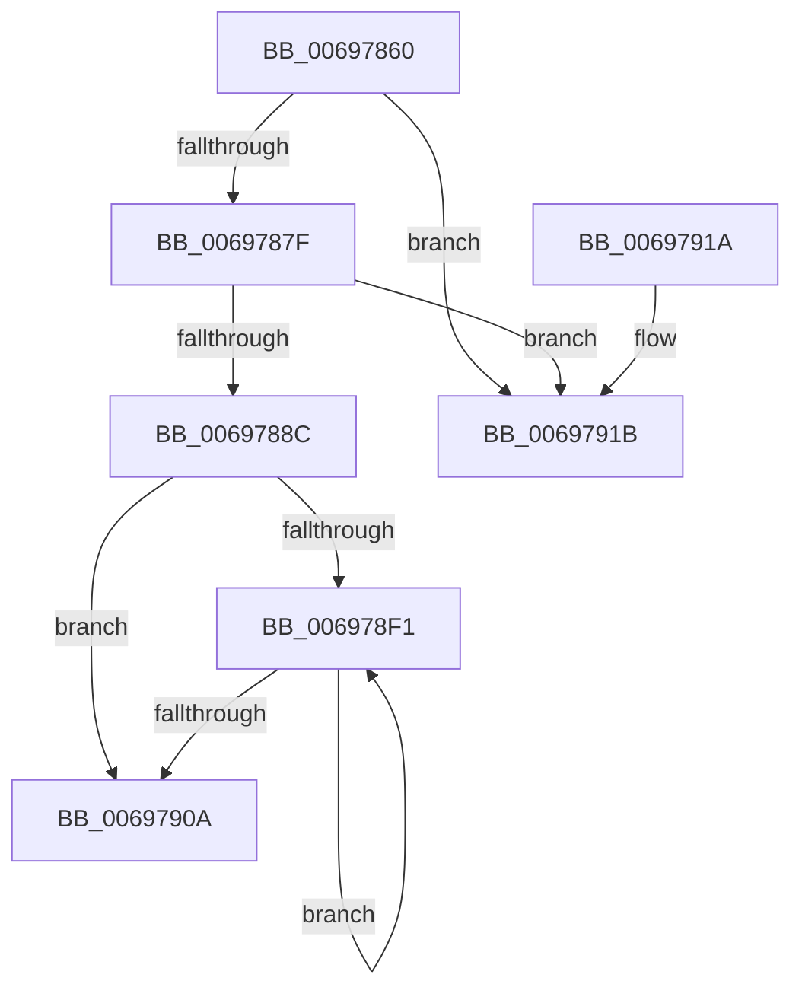

# MiUnlinkAccelerator

- RVA: `0x00697860`–`0x00697922` (길이 `194` bytes)
- VA: `0x0000000140697860`
- 실행 섹션: `.text`
- PDB 이름 있음: `예`; PDB Function 태그: `아니요`
- unwind 정보 RVA: `0x0006383C`
- 디코드: `48`개 명령, `194/194` bytes 표시
- 미해석 바이트: `0` (있으면 어셈블리에 `.byte`로 보존)

> 이 문서는 커널 이미지의 기계어와 PDB 기호를 분석해 생성했습니다. 4번과 5번은 함수 원형과 자료형을 바이너리 사용 방식에서 추정한 C 해석이며 원본 소스 복구 결과는 아닙니다.

## 1. Dependencies

- 직접 호출 지점: **3**; 고유 호출 대상: **3**
- 직접 호출자로 확인된 함수: **2**
- RIP 상대 이미지 참조: **5**

### Outgoing calls
- `0x006978BF` → [ExAcquireSpinLockExclusiveAtDpcLevel](../24/ExAcquireSpinLockExclusiveAtDpcLevel_function_00248E80.md) (function, `0x00248E80`)
- `0x006978E3` → [ExReleaseSpinLockExclusiveFromDpcLevel](../24/ExReleaseSpinLockExclusiveFromDpcLevel_function_002497E0.md) (function, `0x002497E0`)
- `0x006978FD` → [KeSignalGate](../2C/KeSignalGate_function_002C748C.md) (function, `0x002C748C`)

### Direct callers
- [MiDeleteAcceleratorDescriptor](../2C/MiDeleteAcceleratorDescriptor_function_002CA560.md) at `0x002CA5A9`
- [MiDeleteHardwareAccelerators](MiDeleteHardwareAccelerators_function_006972DC.md) at `0x0069743E`

### Static image references
- `0x00697893` → RVA `0x00E37550` (`.data`; read)
- `0x0069789B` → RVA `0x00E37550` (`.data`; write)
- `0x006978A8` → RVA `0x00E2DBF8` (`.data`; read)
- `0x006978D5` → RVA `0x00E2DBEA` (`.data`; read/write)
- `0x006978DC` → RVA `0x00E2DBF0` (`.data`; read/write)

## 2. Other-region calls and transfers

- 다른 실행 섹션으로 향하는 call: **0**
- 별도 외부 분기/꼬리 이동을 확인하지 못했습니다.

## 3. Assembly (complete function range)

```asm
00697860  48 89 5C 24 08                  mov qword ptr [rsp + 8], rbx
00697865  48 89 74 24 10                  mov qword ptr [rsp + 0x10], rsi
0069786A  57                              push rdi
0069786B  48 83 EC 20                     sub rsp, 0x20
0069786F  48 8B F1                        mov rsi, rcx
00697872  48 8B 09                        mov rcx, qword ptr [rcx]
00697875  48 39 71 08                     cmp qword ptr [rcx + 8], rsi
00697879  0F 85 9C 00 00 00               jne 0x14069791b
0069787F  48 8B 46 08                     mov rax, qword ptr [rsi + 8]
00697883  48 39 30                        cmp qword ptr [rax], rsi
00697886  0F 85 8F 00 00 00               jne 0x14069791b
0069788C  48 89 08                        mov qword ptr [rax], rcx
0069788F  48 89 41 08                     mov qword ptr [rcx + 8], rax
00697893  8B 05 B7 FC 79 00               mov eax, dword ptr [rip + 0x79fcb7]
00697899  FF C8                           dec eax
0069789B  89 05 AF FC 79 00               mov dword ptr [rip + 0x79fcaf], eax
006978A1  8B 46 18                        mov eax, dword ptr [rsi + 0x18]
006978A4  48 8D 0C 40                     lea rcx, [rax + rax*2]
006978A8  48 8B 05 49 63 79 00            mov rax, qword ptr [rip + 0x796349]
006978AF  48 C1 E1 07                     shl rcx, 7
006978B3  48 8B 9C 01 78 01 00 00         mov rbx, qword ptr [rcx + rax + 0x178]
006978BB  48 8D 4B 40                     lea rcx, [rbx + 0x40]
006978BF  E8 BC 15 BB FF                  call 0x140248e80
006978C4  B8 FF FF 00 00                  mov eax, 0xffff
006978C9  48 8D 4B 40                     lea rcx, [rbx + 0x40]
006978CD  66 01 43 12                     add word ptr [rbx + 0x12], ax
006978D1  66 01 43 18                     add word ptr [rbx + 0x18], ax
006978D5  66 01 05 0E 63 79 00            add word ptr [rip + 0x79630e], ax
006978DC  66 01 05 0D 63 79 00            add word ptr [rip + 0x79630d], ax
006978E3  E8 F8 1E BB FF                  call 0x1402497e0
006978E8  48 8B 4E 28                     mov rcx, qword ptr [rsi + 0x28]
006978EC  48 85 C9                        test rcx, rcx
006978EF  74 19                           je 0x14069790a
006978F1  48 8B 19                        mov rbx, qword ptr [rcx]
006978F4  BA 01 00 00 00                  mov edx, 1
006978F9  48 83 C1 08                     add rcx, 8
006978FD  E8 8A FB C2 FF                  call 0x1402c748c
00697902  48 8B CB                        mov rcx, rbx
00697905  48 85 DB                        test rbx, rbx
00697908  75 E7                           jne 0x1406978f1
0069790A  48 8B 5C 24 30                  mov rbx, qword ptr [rsp + 0x30]
0069790F  48 8B 74 24 38                  mov rsi, qword ptr [rsp + 0x38]
00697914  48 83 C4 20                     add rsp, 0x20
00697918  5F                              pop rdi
00697919  C3                              ret
0069791A  CC                              int3
0069791B  B9 03 00 00 00                  mov ecx, 3
00697920  CD 29                           int 0x29
```

## 4. C-style interpretation (structured pseudocode)

```c
__int64 __fastcall MiUnlinkAccelerator(__int64 a1)
{
    __int64 result;
    __int64 v_rsp;
    unsigned __int64 v_stack_p10;
    unsigned __int64 v_stack_p8;

    v_stack_p8 = v_rbx;
    v_stack_p10 = v_rsi;
    v_rsp = (v_rsp) - (32);
    if ((*(unsigned __int64 *)(*(unsigned __int64 *)(a1) + 8)) != a1) goto loc_0069791B;
    if ((*(unsigned __int64 *)(*(unsigned __int64 *)(a1 + 8))) != a1) goto loc_0069791B;
    *(unsigned __int64 *)(*(unsigned __int64 *)(a1 + 8)) = *(unsigned __int64 *)(a1);
    *(unsigned __int64 *)(*(unsigned __int64 *)(a1) + 8) = *(unsigned __int64 *)(a1 + 8);
    result = (unsigned int)(((unsigned int)(*(unsigned int *)(v_rip + 7994551))) - 1);
    *(unsigned int *)(v_rip + 7994543) = (unsigned int)(result);
    a1 = ((unsigned int)(*(unsigned int *)(a1 + 24)) + (unsigned int)(*(unsigned int *)(a1 + 24)) * 2) << (7);
    result = ExAcquireSpinLockExclusiveAtDpcLevel(*(unsigned __int64 *)(a1 + *(unsigned __int64 *)(v_rip + 7955273) * 1 + 376) + 64, a2, a3, a4);
    result = ExReleaseSpinLockExclusiveFromDpcLevel(*(unsigned __int64 *)(a1 + *(unsigned __int64 *)(v_rip + 7955273) * 1 + 376) + 64, a2, a3, a4);
    if (*(unsigned __int64 *)(a1 + 40) == 0) goto loc_0069790A;
loc_006978F1:
    a1 = (*(unsigned __int64 *)(a1 + 40)) + (8);
    result = KeSignalGate(a1, 1, a3, a4);
    if (*(unsigned __int64 *)(*(unsigned __int64 *)(a1 + 40)) != 0) goto loc_006978F1;
loc_0069790A:
    v_rsp = (v_rsp) + (32);
    return result;
loc_0069791B:
    return result;
}
```

## 5. (Beta) C Style

```c
int64_t MiUnlinkAccelerator(void *Arg1)
{
    uint8_t *arg1 = (uint8_t *)Arg1;

    int64_t result;
    int64_t local_rsp;
    uint64_t v_stack_p10;
    uint64_t v_stack_p8;

    v_stack_p8 = local_rbx;
    v_stack_p10 = local_rsi;
    local_rsp = (local_rsp) - (32);
    if ((*(uint64_t *)(*(uint64_t *)(arg1) + 0x8)) != Arg1) goto loc_0069791B;
    if ((*(uint64_t *)(*(uint64_t *)(arg1 + 0x8))) != Arg1) goto loc_0069791B;
    *(uint64_t *)(*(uint64_t *)(arg1 + 0x8)) = *(uint64_t *)(arg1);
    *(uint64_t *)(*(uint64_t *)(arg1) + 0x8) = *(uint64_t *)(arg1 + 0x8);
    result = (uint32_t)(((uint32_t)(*(uint32_t *)(v_rip + 0x79FCB7))) - 1);
    *(uint32_t *)(v_rip + 0x79FCAF) = (uint32_t)(result);
    Arg1 = ((uint32_t)(*(uint32_t *)(arg1 + 0x18)) + (uint32_t)(*(uint32_t *)(arg1 + 0x18)) * 2) << (7);
    result = ExAcquireSpinLockExclusiveAtDpcLevel(*(uint64_t *)(arg1 + *(uint64_t *)(v_rip + 0x796349) * 1 + 0x178) + 64, a2, a3, a4);
    result = ExReleaseSpinLockExclusiveFromDpcLevel(*(uint64_t *)(arg1 + *(uint64_t *)(v_rip + 0x796349) * 1 + 0x178) + 64, a2, a3, a4);
    if (*(uint64_t *)(arg1 + 0x28) == 0) goto loc_0069790A;
loc_006978F1:
    Arg1 = (*(uint64_t *)(arg1 + 0x28)) + (8);
    result = KeSignalGate(Arg1, 1, a3, a4);
    if (*(uint64_t *)(*(uint64_t *)(arg1 + 0x28)) != 0) goto loc_006978F1;
loc_0069790A:
    local_rsp = (local_rsp) + (32);
    return result;
loc_0069791B:
    return result;
}
```

### 관측된 메모리 오프셋

구조체 형식이 확인되지 않은 접근은 인자 기준의 오프셋으로만 기록했습니다.

| 기준 인자 | 오프셋 표현 | 폭 (bit) | 접근 |
|---|---:|---:|---|
| `Arg1` | `+ 0x0` | `64` | `R` |
| `Arg1` | `+ 0x8` | `64` | `R` |
| `Arg1` | `+ 0x18` | `32` | `R` |
| `Arg1` | `+ 0x28` | `64` | `R` |

## 6. Execution-region graph

[열기: 2D/3D 그래프와 함수 탐색 컨트롤 패널](../../../control-panel.html?section=text&rva=0x00697860&view=graph)

- 2D 그래프는 위에서 아래로 흐르고, 3D 그래프는 빈 공간을 드래그해 회전합니다. Shift+드래그는 이동, 휠은 확대·축소, 함수 노드 선택은 대상 보고서 이동입니다.

### Static fallback


