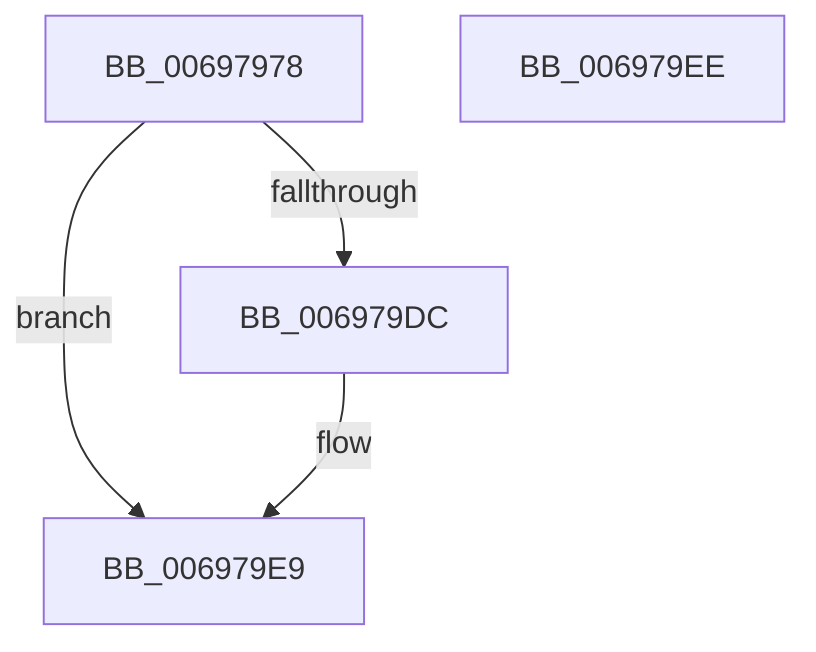

# MiUnloadSystemImageSoftWsles

- RVA: `0x00697978`–`0x006979EF` (길이 `119` bytes)
- VA: `0x0000000140697978`
- 실행 섹션: `.text`
- PDB 이름 있음: `예`; PDB Function 태그: `아니요`
- unwind 정보 RVA: `0x0005C788`
- 디코드: `28`개 명령, `119/119` bytes 표시
- 미해석 바이트: `0` (있으면 어셈블리에 `.byte`로 보존)

> 이 문서는 커널 이미지의 기계어와 PDB 기호를 분석해 생성했습니다. 4번과 5번은 함수 원형과 자료형을 바이너리 사용 방식에서 추정한 C 해석이며 원본 소스 복구 결과는 아닙니다.

## 1. Dependencies

- 직접 호출 지점: **2**; 고유 호출 대상: **2**
- 직접 호출자로 확인된 함수: **1**
- RIP 상대 이미지 참조: **1**

### Outgoing calls
- `0x00697984` → [MiGetAnyMultiplexedVm](../44/MiGetAnyMultiplexedVm_function_00448BD0.md) (function, `0x00448BD0`)
- `0x006979E4` → [memset](../6C/memset_function_006C6C40.md) (function, `0x006C6C40`)

### Direct callers
- [MiUnloadSystemImage](../../page/AA/MiUnloadSystemImage_function_00AA2FD4.md) at `0x00AA3306`

### Static image references
- `0x00697993` → RVA `0x00E38C58` (`.data`; read)

## 2. Other-region calls and transfers

- 다른 실행 섹션으로 향하는 call: **0**
- 별도 외부 분기/꼬리 이동을 확인하지 못했습니다.

## 3. Assembly (complete function range)

```asm
00697978  48 83 EC 28                     sub rsp, 0x28
0069797C  4C 8B C9                        mov r9, rcx
0069797F  B9 01 00 00 00                  mov ecx, 1
00697984  E8 47 12 DB FF                  call 0x140448bd0
00697989  49 C1 E1 19                     shl r9, 0x19
0069798D  8B 80 B8 00 00 00               mov eax, dword ptr [rax + 0xb8]
00697993  4C 8B 05 BE 12 7A 00            mov r8, qword ptr [rip + 0x7a12be]
0069799A  48 B9 00 00 00 00 80 F6 FF FF   movabs rcx, 0xfffff68000000000
006979A4  48 C1 E1 19                     shl rcx, 0x19
006979A8  4C 2B C9                        sub r9, rcx
006979AB  48 B9 00 F0 FF FF FF FF 00 00   movabs rcx, 0xfffffffff000
006979B5  49 C1 F9 10                     sar r9, 0x10
006979B9  4C 23 C9                        and r9, rcx
006979BC  49 C1 E9 0C                     shr r9, 0xc
006979C0  A8 0F                           test al, 0xf
006979C2  48 B8 00 00 00 00 80 00 00 00   movabs rax, 0x8000000000
006979CC  49 8D 04 00                     lea rax, [r8 + rax]
006979D0  49 0F 45 C0                     cmovne rax, r8
006979D4  4C 03 C8                        add r9, rax
006979D7  48 85 D2                        test rdx, rdx
006979DA  74 0D                           je 0x1406979e9
006979DC  4C 8B C2                        mov r8, rdx
006979DF  49 8B C9                        mov rcx, r9
006979E2  B2 0A                           mov dl, 0xa
006979E4  E8 57 F2 02 00                  call 0x1406c6c40
006979E9  48 83 C4 28                     add rsp, 0x28
006979ED  C3                              ret
006979EE  CC                              int3
```

## 4. C-style interpretation (structured pseudocode)

```c
__int64 __fastcall MiUnloadSystemImageSoftWsles(__int64 a1, __int64 a2)
{
    __int64 result;
    __int64 v_rsp;

    v_rsp = (v_rsp) - (40);
    result = MiGetAnyMultiplexedVm(1, a2, a3, a1);
    a4 = (a1) << (25);
    a1 = (1) << (25);
    a4 = (a4) - (a1);
    a4 = (a4) >> (16);
    a4 = (a4) & (a1);
    a4 = (a4) >> (12);
    result = *(unsigned __int64 *)(v_rip + 8000190) + (unsigned int)(*(unsigned int *)(result + 184)) * 1;
    if ((((unsigned __int8)((unsigned int)(*(unsigned int *)(result + 184)))) & (15)) != 0) { result = *(unsigned __int64 *)(v_rip + 8000190); }
    a4 = (a4) + (result);
    if (a2 != 0) {
        a3 = a2;
        a1 = a4;
        a2 = 10;
        result = memset(a1, a2, a3, a4);
    }
    v_rsp = (v_rsp) + (40);
    return result;
}
```

## 5. (Beta) C Style

```c
int64_t MiUnloadSystemImageSoftWsles(int64_t Arg1, int64_t Arg2)
{
    int64_t result;
    int64_t local_rsp;

    local_rsp = (local_rsp) - (40);
    result = MiGetAnyMultiplexedVm(1, Arg2, a3, Arg1);
    a4 = (Arg1) << (25);
    Arg1 = (1) << (25);
    a4 = (a4) - (Arg1);
    a4 = (a4) >> (16);
    a4 = (a4) & (Arg1);
    a4 = (a4) >> (12);
    result = *(uint64_t *)(v_rip + 0x7A12BE) + (uint32_t)(*(uint32_t *)(result + 0xB8)) * 1;
    if ((((uint8_t)((uint32_t)(*(uint32_t *)(result + 0xB8)))) & (15)) != 0) { result = *(uint64_t *)(v_rip + 0x7A12BE); }
    a4 = (a4) + (result);
    if (Arg2 != 0) {
        a3 = Arg2;
        Arg1 = a4;
        Arg2 = 10;
        result = memset(Arg1, Arg2, a3, a4);
    }
    local_rsp = (local_rsp) + (40);
    return result;
}
```

## 6. Execution-region graph

[열기: 2D/3D 그래프와 함수 탐색 컨트롤 패널](../../../control-panel.html?section=text&rva=0x00697978&view=graph)

- 2D 그래프는 위에서 아래로 흐르고, 3D 그래프는 빈 공간을 드래그해 회전합니다. Shift+드래그는 이동, 휠은 확대·축소, 함수 노드 선택은 대상 보고서 이동입니다.

### Static fallback


