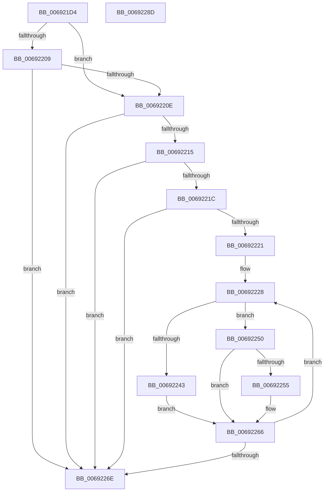

# MiUpdatePartitionChildPageCounts

- RVA: `0x006921D4`–`0x0069228E` (길이 `186` bytes)
- VA: `0x00000001406921D4`
- 실행 섹션: `.text`
- PDB 이름 있음: `예`; PDB Function 태그: `아니요`
- unwind 정보 RVA: `0x0005FEF8`
- 디코드: `57`개 명령, `186/186` bytes 표시
- 미해석 바이트: `0` (있으면 어셈블리에 `.byte`로 보존)

> 이 문서는 커널 이미지의 기계어와 PDB 기호를 분석해 생성했습니다. 4번과 5번은 함수 원형과 자료형을 바이너리 사용 방식에서 추정한 C 해석이며 원본 소스 복구 결과는 아닙니다.

## 1. Dependencies

- 직접 호출 지점: **2**; 고유 호출 대상: **2**
- 직접 호출자로 확인된 함수: **4**
- RIP 상대 이미지 참조: **2**

### Outgoing calls
- `0x0069222E` → [MiRestrictRangeToNode](../40/MiRestrictRangeToNode_function_0040199C.md) (function, `0x0040199C`)
- `0x00692239` → [MiPageToNode](../33/MiPageToNode_function_00338CD0.md) (function, `0x00338CD0`)

### Direct callers
- [MiInitializeDynamicPfns](../67/MiInitializeDynamicPfns_function_00672BD0.md) at `0x00672D58`
- [MiInitializeDynamicPfns](../67/MiInitializeDynamicPfns_function_00672BD0.md) at `0x00672F5B`
- [MiActOnPartitionNodePages](../68/MiActOnPartitionNodePages_function_0068F7F4.md) at `0x0068FCF0`
- [MiMoveBadPagePartition](MiMoveBadPagePartition_function_00691924.md) at `0x006919FE`
- [MiTransferPartitionPageRun](MiTransferPartitionPageRun_function_00691DCC.md) at `0x00692146`

### Static image references
- `0x006921F1` → RVA `0x00E38D00` (`.data`; read)
- `0x00692221` → RVA `0x00E2CB40` (`.data`; read)

## 2. Other-region calls and transfers

- 다른 실행 섹션으로 향하는 call: **0**
- 별도 외부 분기/꼬리 이동을 확인하지 못했습니다.

## 3. Assembly (complete function range)

```asm
006921D4  48 8B C4                        mov rax, rsp
006921D7  48 89 58 08                     mov qword ptr [rax + 8], rbx
006921DB  48 89 68 10                     mov qword ptr [rax + 0x10], rbp
006921DF  48 89 70 18                     mov qword ptr [rax + 0x18], rsi
006921E3  48 89 78 20                     mov qword ptr [rax + 0x20], rdi
006921E7  41 54                           push r12
006921E9  41 56                           push r14
006921EB  41 57                           push r15
006921ED  48 83 EC 20                     sub rsp, 0x20
006921F1  4C 8D 3D 08 6B 7A 00            lea r15, [rip + 0x7a6b08]
006921F8  49 8B D9                        mov rbx, r9
006921FB  49 8B E8                        mov rbp, r8
006921FE  4C 8B F2                        mov r14, rdx
00692201  48 8B F1                        mov rsi, rcx
00692204  49 3B D7                        cmp rdx, r15
00692207  74 05                           je 0x14069220e
00692209  49 3B CF                        cmp rcx, r15
0069220C  75 60                           jne 0x14069226e
0069220E  8B 42 04                        mov eax, dword ptr [rdx + 4]
00692211  84 C0                           test al, al
00692213  78 59                           js 0x14069226e
00692215  8B 41 04                        mov eax, dword ptr [rcx + 4]
00692218  84 C0                           test al, al
0069221A  78 52                           js 0x14069226e
0069221C  48 85 DB                        test rbx, rbx
0069221F  74 4D                           je 0x14069226e
00692221  4C 8D 25 18 A9 79 00            lea r12, [rip + 0x79a918]
00692228  48 8B D3                        mov rdx, rbx
0069222B  48 8B CD                        mov rcx, rbp
0069222E  E8 69 F7 D6 FF                  call 0x14040199c
00692233  48 8B CD                        mov rcx, rbp
00692236  48 8B F8                        mov rdi, rax
00692239  E8 92 6A CA FF                  call 0x140338cd0
0069223E  4D 3B F7                        cmp r14, r15
00692241  75 0D                           jne 0x140692250
00692243  8B C8                           mov ecx, eax
00692245  F0 49 01 BC CC C0 AB 00 00      lock add qword ptr [r12 + rcx*8 + 0xabc0], rdi
0069224E  EB 16                           jmp 0x140692266
00692250  49 3B F7                        cmp rsi, r15
00692253  75 11                           jne 0x140692266
00692255  48 8B D7                        mov rdx, rdi
00692258  8B C8                           mov ecx, eax
0069225A  48 F7 DA                        neg rdx
0069225D  F0 49 01 94 CC C0 AB 00 00      lock add qword ptr [r12 + rcx*8 + 0xabc0], rdx
00692266  48 03 EF                        add rbp, rdi
00692269  48 2B DF                        sub rbx, rdi
0069226C  75 BA                           jne 0x140692228
0069226E  48 8B 5C 24 40                  mov rbx, qword ptr [rsp + 0x40]
00692273  48 8B 6C 24 48                  mov rbp, qword ptr [rsp + 0x48]
00692278  48 8B 74 24 50                  mov rsi, qword ptr [rsp + 0x50]
0069227D  48 8B 7C 24 58                  mov rdi, qword ptr [rsp + 0x58]
00692282  48 83 C4 20                     add rsp, 0x20
00692286  41 5F                           pop r15
00692288  41 5E                           pop r14
0069228A  41 5C                           pop r12
0069228C  C3                              ret
0069228D  CC                              int3
```

## 4. C-style interpretation (structured pseudocode)

```c
__int64 __fastcall MiUpdatePartitionChildPageCounts(__int64 a1, __int64 a2, __int64 a3, __int64 a4)
{
    __int64 result;
    __int64 v_rbp;
    __int64 v_rbx;
    __int64 v_rsp;
    unsigned __int64 v_stack_p10;
    unsigned __int64 v_stack_p18;
    unsigned __int64 v_stack_p20;
    unsigned __int64 v_stack_p8;

    *(unsigned __int64 *)(v_rsp + 8) = v_rbx;
    *(unsigned __int64 *)(v_rsp + 16) = v_rbp;
    *(unsigned __int64 *)(v_rsp + 24) = v_rsi;
    *(unsigned __int64 *)(v_rsp + 32) = v_rdi;
    v_rsp = (v_rsp) - (32);
    if (a2 == (v_rip + 8022792)) goto loc_0069220E;
    if (a1 != (v_rip + 8022792)) goto loc_0069226E;
loc_0069220E:
    if (sign_flag) goto loc_0069226E;
    if (sign_flag) goto loc_0069226E;
    if (a4 == 0) goto loc_0069226E;
loc_00692228:
    result = MiRestrictRangeToNode(a3, a4, a3, a4);
    result = MiPageToNode(a3, a4, a3, a4);
    if (a2 != (v_rip + 8022792)) goto loc_00692250;
    goto loc_00692266;
loc_00692250:
    if (a1 == (v_rip + 8022792)) {
        a2 = result;
        a1 = (unsigned int)(result);
        a2 = -(a2);
    }
    v_rbp = (a3) + (result);
    v_rbx = (a4) - (result);
    if (condition_is_not_equal) goto loc_00692228;
loc_0069226E:
    v_rsp = (v_rsp) + (32);
    return result;
}
```

## 5. (Beta) C Style

```c
int64_t MiUpdatePartitionChildPageCounts(int64_t Arg1, int64_t Arg2, int64_t Arg3, int64_t Arg4)
{
    int64_t result;
    int64_t local_rbp;
    int64_t local_rbx;
    int64_t local_rsp;
    uint64_t v_stack_p10;
    uint64_t v_stack_p18;
    uint64_t v_stack_p20;
    uint64_t v_stack_p8;

    *(uint64_t *)(local_rsp + 0x8) = local_rbx;
    *(uint64_t *)(local_rsp + 0x10) = local_rbp;
    *(uint64_t *)(local_rsp + 0x18) = local_rsi;
    *(uint64_t *)(local_rsp + 0x20) = local_rdi;
    local_rsp = (local_rsp) - (32);
    if (Arg2 == (v_rip + 8022792)) goto loc_0069220E;
    if (Arg1 != (v_rip + 8022792)) goto loc_0069226E;
loc_0069220E:
    if (sign_flag) goto loc_0069226E;
    if (sign_flag) goto loc_0069226E;
    if (Arg4 == 0) goto loc_0069226E;
loc_00692228:
    result = MiRestrictRangeToNode(Arg3, Arg4, Arg3, Arg4);
    result = MiPageToNode(Arg3, Arg4, Arg3, Arg4);
    if (Arg2 != (v_rip + 8022792)) goto loc_00692250;
    goto loc_00692266;
loc_00692250:
    if (Arg1 == (v_rip + 8022792)) {
        Arg2 = result;
        Arg1 = (uint32_t)(result);
        Arg2 = -(Arg2);
    }
    local_rbp = (Arg3) + (result);
    local_rbx = (Arg4) - (result);
    if (condition_is_not_equal) goto loc_00692228;
loc_0069226E:
    local_rsp = (local_rsp) + (32);
    return result;
}
```

## 6. Execution-region graph

[열기: 2D/3D 그래프와 함수 탐색 컨트롤 패널](../../../control-panel.html?section=text&rva=0x006921D4&view=graph)

- 2D 그래프는 위에서 아래로 흐르고, 3D 그래프는 빈 공간을 드래그해 회전합니다. Shift+드래그는 이동, 휠은 확대·축소, 함수 노드 선택은 대상 보고서 이동입니다.

### Static fallback


