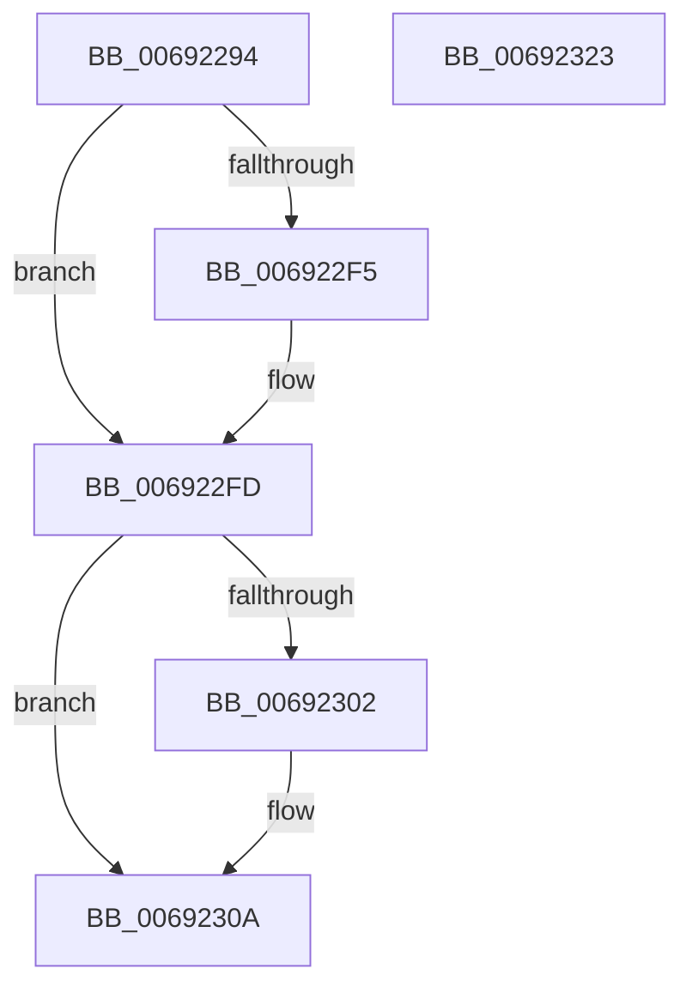

# MiUpdatePartitionMemory

- RVA: `0x00692294`–`0x00692324` (길이 `144` bytes)
- VA: `0x0000000140692294`
- 실행 섹션: `.text`
- PDB 이름 있음: `예`; PDB Function 태그: `아니요`
- unwind 정보 RVA: `0x00060300`
- 디코드: `42`개 명령, `144/144` bytes 표시
- 미해석 바이트: `0` (있으면 어셈블리에 `.byte`로 보존)

> 이 문서는 커널 이미지의 기계어와 PDB 기호를 분석해 생성했습니다. 4번과 5번은 함수 원형과 자료형을 바이너리 사용 방식에서 추정한 C 해석이며 원본 소스 복구 결과는 아닙니다.

## 1. Dependencies

- 직접 호출 지점: **5**; 고유 호출 대상: **4**
- 직접 호출자로 확인된 함수: **1**
- RIP 상대 이미지 참조: **0**

### Outgoing calls
- `0x006922BF` → [ExAcquireSpinLockExclusive](../24/ExAcquireSpinLockExclusive_function_00248690.md) (function, `0x00248690`)
- `0x006922E1` → [MiReleaseSpinLockExclusive](../24/MiReleaseSpinLockExclusive_function_002482C0.md) (function, `0x002482C0`)
- `0x006922EB` → [MiComputeNodeMemory](../67/MiComputeNodeMemory_function_00671AA4.md) (function, `0x00671AA4`)
- `0x006922F8` → [MiDereferencePageRuns](../3B/MiDereferencePageRuns_function_003BD388.md) (function, `0x003BD388`)
- `0x00692305` → [MiDereferencePageRuns](../3B/MiDereferencePageRuns_function_003BD388.md) (function, `0x003BD388`)

### Direct callers
- [MiMakePartitionMemoryBlock](../../page/80/MiMakePartitionMemoryBlock_function_0080D94C.md) at `0x0080DB26`

### Static image references
- 디코드된 RIP-relative 메모리 참조가 없습니다.

## 2. Other-region calls and transfers

- 다른 실행 섹션으로 향하는 call: **0**
- 별도 외부 분기/꼬리 이동을 확인하지 못했습니다.

## 3. Assembly (complete function range)

```asm
00692294  48 89 5C 24 08                  mov qword ptr [rsp + 8], rbx
00692299  48 89 6C 24 10                  mov qword ptr [rsp + 0x10], rbp
0069229E  48 89 74 24 18                  mov qword ptr [rsp + 0x18], rsi
006922A3  57                              push rdi
006922A4  41 56                           push r14
006922A6  41 57                           push r15
006922A8  48 83 EC 20                     sub rsp, 0x20
006922AC  48 8D B9 C8 00 00 00            lea rdi, [rcx + 0xc8]
006922B3  48 8B F1                        mov rsi, rcx
006922B6  48 8B CF                        mov rcx, rdi
006922B9  41 8B E8                        mov ebp, r8d
006922BC  48 8B DA                        mov rbx, rdx
006922BF  E8 CC 63 BB FF                  call 0x140248690
006922C4  48 8B 53 10                     mov rdx, qword ptr [rbx + 0x10]
006922C8  48 8B CF                        mov rcx, rdi
006922CB  4C 8B 7E 20                     mov r15, qword ptr [rsi + 0x20]
006922CF  4C 8B 4B 08                     mov r9, qword ptr [rbx + 8]
006922D3  4C 8B 76 50                     mov r14, qword ptr [rsi + 0x50]
006922D7  48 89 56 20                     mov qword ptr [rsi + 0x20], rdx
006922DB  8A D0                           mov dl, al
006922DD  4C 89 4E 50                     mov qword ptr [rsi + 0x50], r9
006922E1  E8 DA 5F BB FF                  call 0x1402482c0
006922E6  8B D5                           mov edx, ebp
006922E8  48 8B CE                        mov rcx, rsi
006922EB  E8 B4 F7 FD FF                  call 0x140671aa4
006922F0  4D 85 FF                        test r15, r15
006922F3  74 08                           je 0x1406922fd
006922F5  49 8B CF                        mov rcx, r15
006922F8  E8 8B B0 D2 FF                  call 0x1403bd388
006922FD  4D 85 F6                        test r14, r14
00692300  74 08                           je 0x14069230a
00692302  49 8B CE                        mov rcx, r14
00692305  E8 7E B0 D2 FF                  call 0x1403bd388
0069230A  48 8B 5C 24 40                  mov rbx, qword ptr [rsp + 0x40]
0069230F  48 8B 6C 24 48                  mov rbp, qword ptr [rsp + 0x48]
00692314  48 8B 74 24 50                  mov rsi, qword ptr [rsp + 0x50]
00692319  48 83 C4 20                     add rsp, 0x20
0069231D  41 5F                           pop r15
0069231F  41 5E                           pop r14
00692321  5F                              pop rdi
00692322  C3                              ret
00692323  CC                              int3
```

## 4. C-style interpretation (structured pseudocode)

```c
__int64 __fastcall MiUpdatePartitionMemory(__int64 a1, __int64 a2, int a3)
{
    __int64 result;
    __int64 v_rsp;
    unsigned __int64 v_stack_p10;
    unsigned __int64 v_stack_p18;
    unsigned __int64 v_stack_p8;

    v_stack_p8 = v_rbx;
    v_stack_p10 = v_rbp;
    v_stack_p18 = v_rsi;
    v_rsp = (v_rsp) - (32);
    result = ExAcquireSpinLockExclusive(a1 + 200, a2, a3, a4);
    *(unsigned __int64 *)(a1 + 32) = *(unsigned __int64 *)(a2 + 16);
    *(unsigned __int64 *)(a1 + 80) = *(unsigned __int64 *)(a2 + 8);
    result = MiReleaseSpinLockExclusive(a1 + 200, (unsigned __int8)(result), a3, *(unsigned __int64 *)(a2 + 8));
    result = MiComputeNodeMemory(a1, (unsigned int)((unsigned int)((unsigned int)(a3))), a3, *(unsigned __int64 *)(a2 + 8));
    if (*(unsigned __int64 *)(a1 + 32) != 0) {
        a1 = *(unsigned __int64 *)(a1 + 32);
        result = MiDereferencePageRuns(a1, (unsigned int)((unsigned int)((unsigned int)(a3))), a3, *(unsigned __int64 *)(a2 + 8));
    }
    if (*(unsigned __int64 *)(a1 + 80) != 0) {
        a1 = *(unsigned __int64 *)(a1 + 80);
        result = MiDereferencePageRuns(a1, (unsigned int)((unsigned int)((unsigned int)(a3))), a3, *(unsigned __int64 *)(a2 + 8));
    }
    v_rsp = (v_rsp) + (32);
    return result;
}
```

## 5. (Beta) C Style

```c
int64_t MiUpdatePartitionMemory(void *Arg1, void *Arg2, int32_t Arg3)
{
    uint8_t *arg1 = (uint8_t *)Arg1;
    uint8_t *arg2 = (uint8_t *)Arg2;

    int64_t result;
    int64_t local_rsp;
    uint64_t v_stack_p10;
    uint64_t v_stack_p18;
    uint64_t v_stack_p8;

    v_stack_p8 = local_rbx;
    v_stack_p10 = local_rbp;
    v_stack_p18 = local_rsi;
    local_rsp = (local_rsp) - (32);
    result = ExAcquireSpinLockExclusive(Arg1 + 200, Arg2, Arg3, a4);
    *(uint64_t *)(arg1 + 0x20) = *(uint64_t *)(arg2 + 0x10);
    *(uint64_t *)(arg1 + 0x50) = *(uint64_t *)(arg2 + 0x8);
    result = MiReleaseSpinLockExclusive(Arg1 + 200, (uint8_t)(result), Arg3, *(uint64_t *)(arg2 + 0x8));
    result = MiComputeNodeMemory(Arg1, (uint32_t)((uint32_t)((uint32_t)(Arg3))), Arg3, *(uint64_t *)(arg2 + 0x8));
    if (*(uint64_t *)(arg1 + 0x20) != 0) {
        Arg1 = *(uint64_t *)(arg1 + 0x20);
        result = MiDereferencePageRuns(Arg1, (uint32_t)((uint32_t)((uint32_t)(Arg3))), Arg3, *(uint64_t *)(arg2 + 0x8));
    }
    if (*(uint64_t *)(arg1 + 0x50) != 0) {
        Arg1 = *(uint64_t *)(arg1 + 0x50);
        result = MiDereferencePageRuns(Arg1, (uint32_t)((uint32_t)((uint32_t)(Arg3))), Arg3, *(uint64_t *)(arg2 + 0x8));
    }
    local_rsp = (local_rsp) + (32);
    return result;
}
```

### 관측된 메모리 오프셋

구조체 형식이 확인되지 않은 접근은 인자 기준의 오프셋으로만 기록했습니다.

| 기준 인자 | 오프셋 표현 | 폭 (bit) | 접근 |
|---|---:|---:|---|
| `Arg1` | `+ 0x20` | `64` | `R` |
| `Arg1` | `+ 0x20` | `64` | `W` |
| `Arg1` | `+ 0x50` | `64` | `R` |
| `Arg1` | `+ 0x50` | `64` | `W` |
| `Arg1` | `+ 0xC8` | `64` | `R` |
| `Arg2` | `+ 0x8` | `64` | `R` |
| `Arg2` | `+ 0x10` | `64` | `R` |

## 6. Execution-region graph

[열기: 2D/3D 그래프와 함수 탐색 컨트롤 패널](../../../control-panel.html?section=text&rva=0x00692294&view=graph)

- 2D 그래프는 위에서 아래로 흐르고, 3D 그래프는 빈 공간을 드래그해 회전합니다. Shift+드래그는 이동, 휠은 확대·축소, 함수 노드 선택은 대상 보고서 이동입니다.

### Static fallback


