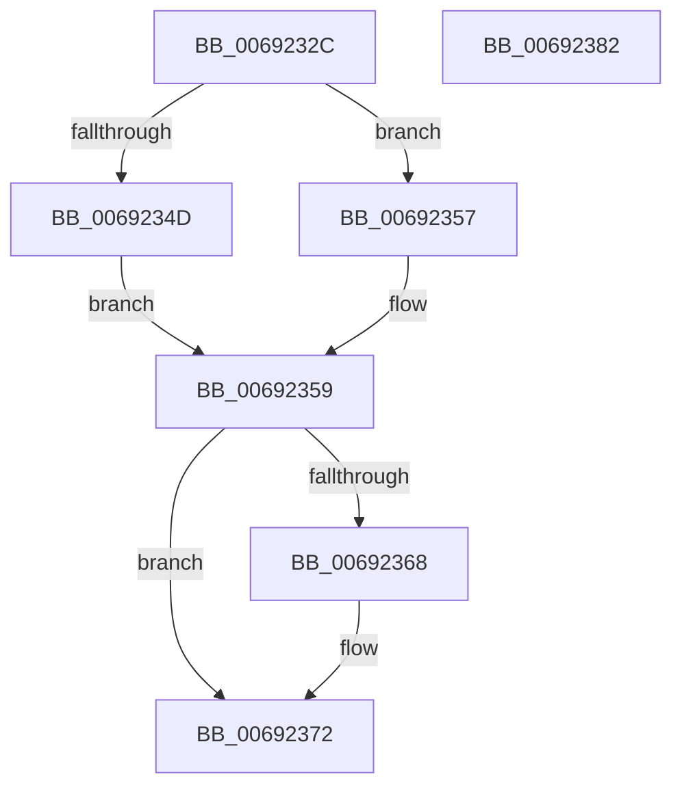

# MiUpdatePhysicalPages

- RVA: `0x0069232C`–`0x00692383` (길이 `87` bytes)
- VA: `0x000000014069232C`
- 실행 섹션: `.text`
- PDB 이름 있음: `예`; PDB Function 태그: `아니요`
- unwind 정보 RVA: `0x00060BC4`
- 디코드: `26`개 명령, `87/87` bytes 표시
- 미해석 바이트: `0` (있으면 어셈블리에 `.byte`로 보존)

> 이 문서는 커널 이미지의 기계어와 PDB 기호를 분석해 생성했습니다. 4번과 5번은 함수 원형과 자료형을 바이너리 사용 방식에서 추정한 C 해석이며 원본 소스 복구 결과는 아닙니다.

## 1. Dependencies

- 직접 호출 지점: **2**; 고유 호출 대상: **2**
- 직접 호출자로 확인된 함수: **2**
- RIP 상대 이미지 참조: **0**

### Outgoing calls
- `0x00692350` → [ExAcquireSpinLockExclusive](../24/ExAcquireSpinLockExclusive_function_00248690.md) (function, `0x00248690`)
- `0x0069236D` → [MiReleaseSpinLockExclusive](../24/MiReleaseSpinLockExclusive_function_002482C0.md) (function, `0x002482C0`)

### Direct callers
- [MiInitializeDynamicPfns](../67/MiInitializeDynamicPfns_function_00672BD0.md) at `0x00672C6A`
- [MiPerformMemoryChange](../67/MiPerformMemoryChange_function_006733A8.md) at `0x006734FE`

### Static image references
- 디코드된 RIP-relative 메모리 참조가 없습니다.

## 2. Other-region calls and transfers

- 다른 실행 섹션으로 향하는 call: **0**
- 별도 외부 분기/꼬리 이동을 확인하지 못했습니다.

## 3. Assembly (complete function range)

```asm
0069232C  48 89 5C 24 08                  mov qword ptr [rsp + 8], rbx
00692331  48 89 74 24 10                  mov qword ptr [rsp + 0x10], rsi
00692336  57                              push rdi
00692337  48 83 EC 20                     sub rsp, 0x20
0069233B  48 8D B9 C8 00 00 00            lea rdi, [rcx + 0xc8]
00692342  48 8B F2                        mov rsi, rdx
00692345  48 8B D9                        mov rbx, rcx
00692348  45 85 C0                        test r8d, r8d
0069234B  74 0A                           je 0x140692357
0069234D  48 8B CF                        mov rcx, rdi
00692350  E8 3B 63 BB FF                  call 0x140248690
00692355  EB 02                           jmp 0x140692359
00692357  B0 11                           mov al, 0x11
00692359  48 01 B3 50 48 00 00            add qword ptr [rbx + 0x4850], rsi
00692360  C6 43 0C 01                     mov byte ptr [rbx + 0xc], 1
00692364  3C 11                           cmp al, 0x11
00692366  74 0A                           je 0x140692372
00692368  8A D0                           mov dl, al
0069236A  48 8B CF                        mov rcx, rdi
0069236D  E8 4E 5F BB FF                  call 0x1402482c0
00692372  48 8B 5C 24 30                  mov rbx, qword ptr [rsp + 0x30]
00692377  48 8B 74 24 38                  mov rsi, qword ptr [rsp + 0x38]
0069237C  48 83 C4 20                     add rsp, 0x20
00692380  5F                              pop rdi
00692381  C3                              ret
00692382  CC                              int3
```

## 4. C-style interpretation (structured pseudocode)

```c
__int64 __fastcall MiUpdatePhysicalPages(__int64 a1, __int64 a2, int a3)
{
    __int64 result;
    __int64 v_rsp;
    unsigned __int64 v_stack_p10;
    unsigned __int64 v_stack_p8;

    v_stack_p8 = v_rbx;
    v_stack_p10 = v_rsi;
    v_rsp = (v_rsp) - (32);
    if (a3 == 0) goto loc_00692357;
    result = ExAcquireSpinLockExclusive(a1 + 200, a2, a3, a4);
    goto loc_00692359;
loc_00692357:
loc_00692359:
    *(unsigned __int8 *)(a1 + 12) = 1;
    result = 17;
    if (17 != 17) {
        a2 = 17;
        a1 = a1 + 200;
        result = MiReleaseSpinLockExclusive(a1, a2, a3, a4);
    }
    v_rsp = (v_rsp) + (32);
    return result;
}
```

## 5. (Beta) C Style

```c
int64_t MiUpdatePhysicalPages(void *Arg1, int64_t Arg2, int32_t Arg3)
{
    uint8_t *arg1 = (uint8_t *)Arg1;

    int64_t result;
    int64_t local_rsp;
    uint64_t v_stack_p10;
    uint64_t v_stack_p8;

    v_stack_p8 = local_rbx;
    v_stack_p10 = local_rsi;
    local_rsp = (local_rsp) - (32);
    if (Arg3 == 0) goto loc_00692357;
    result = ExAcquireSpinLockExclusive(Arg1 + 200, Arg2, Arg3, a4);
    goto loc_00692359;
loc_00692357:
loc_00692359:
    *(uint8_t *)(arg1 + 0xC) = 1;
    result = 17;
    if (17 != 17) {
        Arg2 = 17;
        Arg1 = Arg1 + 200;
        result = MiReleaseSpinLockExclusive(Arg1, Arg2, Arg3, a4);
    }
    local_rsp = (local_rsp) + (32);
    return result;
}
```

### 관측된 메모리 오프셋

구조체 형식이 확인되지 않은 접근은 인자 기준의 오프셋으로만 기록했습니다.

| 기준 인자 | 오프셋 표현 | 폭 (bit) | 접근 |
|---|---:|---:|---|
| `Arg1` | `+ 0xC` | `8` | `W` |
| `Arg1` | `+ 0xC8` | `64` | `R` |
| `Arg1` | `+ 0x4850` | `64` | `R/W` |

## 6. Execution-region graph

[열기: 2D/3D 그래프와 함수 탐색 컨트롤 패널](../../../control-panel.html?section=text&rva=0x0069232C&view=graph)

- 2D 그래프는 위에서 아래로 흐르고, 3D 그래프는 빈 공간을 드래그해 회전합니다. Shift+드래그는 이동, 휠은 확대·축소, 함수 노드 선택은 대상 보고서 이동입니다.

### Static fallback


