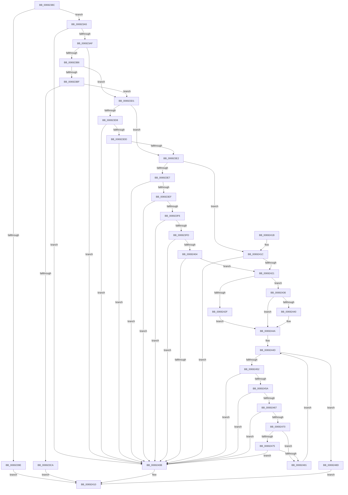

# MiValidatePartitionInitialAddMemory

- RVA: `0x0069238C`–`0x00692494` (길이 `264` bytes)
- VA: `0x000000014069238C`
- 실행 섹션: `.text`
- PDB 이름 있음: `예`; PDB Function 태그: `아니요`
- unwind 정보 RVA: `0x000D9038`
- 디코드: `85`개 명령, `264/264` bytes 표시
- 미해석 바이트: `0` (있으면 어셈블리에 `.byte`로 보존)

> 이 문서는 커널 이미지의 기계어와 PDB 기호를 분석해 생성했습니다. 4번과 5번은 함수 원형과 자료형을 바이너리 사용 방식에서 추정한 C 해석이며 원본 소스 복구 결과는 아닙니다.

## 1. Dependencies

- 직접 호출 지점: **0**; 고유 호출 대상: **0**
- 직접 호출자로 확인된 함수: **1**
- RIP 상대 이미지 참조: **1**

### Outgoing calls
- 직접 디코드된 call 명령이 없습니다.

### Direct callers
- [MmManagePartitionInitialAddMemory](../../page/80/MmManagePartitionInitialAddMemory_function_0080E144.md) at `0x0080E170`

### Static image references
- `0x006923BF` → RVA `0x00FC6B30` (`ALMOSTRO`; read)

## 2. Other-region calls and transfers

- 다른 실행 섹션으로 향하는 call: **0**
- 별도 외부 분기/꼬리 이동을 확인하지 못했습니다.

## 3. Assembly (complete function range)

```asm
0069238C  48 89 5C 24 08                  mov qword ptr [rsp + 8], rbx
00692391  48 89 7C 24 10                  mov qword ptr [rsp + 0x10], rdi
00692396  4D 8B D0                        mov r10, r8
00692399  45 84 C9                        test r9b, r9b
0069239C  74 07                           je 0x1406923a5
0069239E  B8 61 00 00 C0                  mov eax, 0xc0000061
006923A3  EB 6B                           jmp 0x140692410
006923A5  8B 0A                           mov ecx, dword ptr [rdx]
006923A7  F7 C1 80 FF FF FF               test ecx, 0xffffff80
006923AD  75 5C                           jne 0x14069240b
006923AF  8B 7A 04                        mov edi, dword ptr [rdx + 4]
006923B2  85 FF                           test edi, edi
006923B4  74 55                           je 0x14069240b
006923B6  44 8B C1                        mov r8d, ecx
006923B9  41 83 E0 04                     and r8d, 4
006923BD  74 12                           je 0x1406923d1
006923BF  48 0F BA 25 68 47 93 00 25      bt qword ptr [rip + 0x934768], 0x25
006923C8  72 07                           jb 0x1406923d1
006923CA  B8 BB 00 00 C0                  mov eax, 0xc00000bb
006923CF  EB 3F                           jmp 0x140692410
006923D1  8B C1                           mov eax, ecx
006923D3  83 E0 60                        and eax, 0x60
006923D6  74 0A                           je 0x1406923e2
006923D8  45 85 C0                        test r8d, r8d
006923DB  75 2E                           jne 0x14069240b
006923DD  83 F8 60                        cmp eax, 0x60
006923E0  74 29                           je 0x14069240b
006923E2  F6 C1 10                        test cl, 0x10
006923E5  74 35                           je 0x14069241c
006923E7  F7 C1 E9 FF FF FF               test ecx, 0xffffffe9
006923ED  75 1C                           jne 0x14069240b
006923EF  48 83 7A 10 00                  cmp qword ptr [rdx + 0x10], 0
006923F4  74 15                           je 0x14069240b
006923F6  48 83 7A 18 00                  cmp qword ptr [rdx + 0x18], 0
006923FB  74 0E                           je 0x14069240b
006923FD  48 83 7A 20 00                  cmp qword ptr [rdx + 0x20], 0
00692402  74 07                           je 0x14069240b
00692404  48 83 7A 28 00                  cmp qword ptr [rdx + 0x28], 0
00692409  75 16                           jne 0x140692421
0069240B  B8 0D 00 00 C0                  mov eax, 0xc000000d
00692410  48 8B 5C 24 08                  mov rbx, qword ptr [rsp + 8]
00692415  48 8B 7C 24 10                  mov rdi, qword ptr [rsp + 0x10]
0069241A  C3                              ret
0069241B  CC                              int3
0069241C  F6 C1 07                        test cl, 7
0069241F  74 EA                           je 0x14069240b
00692421  45 33 DB                        xor r11d, r11d
00692424  4D 8D 4A 30                     lea r9, [r10 + 0x30]
00692428  33 DB                           xor ebx, ebx
0069242A  F6 C1 20                        test cl, 0x20
0069242D  74 07                           je 0x140692436
0069242F  B9 00 02 00 00                  mov ecx, 0x200
00692434  EB 14                           jmp 0x14069244a
00692436  F6 C1 40                        test cl, 0x40
00692439  B9 00 00 04 00                  mov ecx, 0x40000
0069243E  75 0A                           jne 0x14069244a
00692440  33 C0                           xor eax, eax
00692442  45 85 C0                        test r8d, r8d
00692445  0F 45 C1                        cmovne eax, ecx
00692448  8B C8                           mov ecx, eax
0069244A  45 33 C0                        xor r8d, r8d
0069244D  44 3B C7                        cmp r8d, edi
00692450  73 3B                           jae 0x14069248d
00692452  49 8B 01                        mov rax, qword ptr [r9]
00692455  49 3B C3                        cmp rax, r11
00692458  72 B1                           jb 0x14069240b
0069245A  49 8B 51 08                     mov rdx, qword ptr [r9 + 8]
0069245E  4C 8D 1C 02                     lea r11, [rdx + rax]
00692462  4C 3B D8                        cmp r11, rax
00692465  76 A4                           jbe 0x14069240b
00692467  4C 8D 14 1A                     lea r10, [rdx + rbx]
0069246B  4C 3B D3                        cmp r10, rbx
0069246E  76 9B                           jbe 0x14069240b
00692470  48 85 C9                        test rcx, rcx
00692473  74 0C                           je 0x140692481
00692475  48 0B D0                        or rdx, rax
00692478  48 8D 41 FF                     lea rax, [rcx - 1]
0069247C  48 85 D0                        test rax, rdx
0069247F  75 8A                           jne 0x14069240b
00692481  41 FF C0                        inc r8d
00692484  49 8B DA                        mov rbx, r10
00692487  49 83 C1 10                     add r9, 0x10
0069248B  EB C0                           jmp 0x14069244d
0069248D  33 C0                           xor eax, eax
0069248F  E9 7C FF FF FF                  jmp 0x140692410
```

## 4. C-style interpretation (structured pseudocode)

```c
__int64 __fastcall MiValidatePartitionInitialAddMemory(__int64 a1, __int64 a2, __int64 a3, unsigned __int8 a4)
{
    __int64 result;
    __int64 v_r11;
    __int64 v_rbx;
    unsigned __int64 v_stack_p10;
    unsigned __int64 v_stack_p8;

    v_stack_p8 = v_rbx;
    v_stack_p10 = v_rdi;
    if (a4 == 0) goto loc_006923A5;
    goto loc_00692410;
loc_006923A5:
    if ((((unsigned int)((unsigned int)(*(unsigned int *)(a2)))) & (0xFFFFFF80ULL)) != 0) goto loc_0069240B;
    if ((unsigned int)((unsigned int)(*(unsigned int *)(a2 + 4))) == 0) goto loc_0069240B;
    a3 = (unsigned int)(((unsigned int)((unsigned int)((unsigned int)(*(unsigned int *)(a2))))) & (4));
    if (condition_is_equal) goto loc_006923D1;
    if (condition_is_below) goto loc_006923D1;
    goto loc_00692410;
loc_006923D1:
    result = (unsigned int)(((unsigned int)((unsigned int)((unsigned int)(*(unsigned int *)(a2))))) & (96));
    if (condition_is_equal) goto loc_006923E2;
    if ((unsigned int)(a3) != 0) goto loc_0069240B;
    if (((unsigned int)(result)) == 96) goto loc_0069240B;
loc_006923E2:
    if ((((unsigned __int8)((unsigned int)(*(unsigned int *)(a2)))) & (16)) == 0) goto loc_0069241C;
    if ((((unsigned int)((unsigned int)(*(unsigned int *)(a2)))) & (0xFFFFFFE9ULL)) != 0) goto loc_0069240B;
    if ((*(unsigned __int64 *)(a2 + 16)) == 0) goto loc_0069240B;
    if ((*(unsigned __int64 *)(a2 + 24)) == 0) goto loc_0069240B;
    if ((*(unsigned __int64 *)(a2 + 32)) == 0) goto loc_0069240B;
    if ((*(unsigned __int64 *)(a2 + 40)) != 0) goto loc_00692421;
loc_0069240B:
loc_00692410:
    return (unsigned int)(0xC000000DULL);
loc_0069241C:
    if ((((unsigned __int8)((unsigned int)(*(unsigned int *)(a2)))) & (7)) == 0) goto loc_0069240B;
loc_00692421:
    v_r11 = 0;
    v_rbx = 0;
    if ((((unsigned __int8)((unsigned int)(*(unsigned int *)(a2)))) & (32)) == 0) goto loc_00692436;
    goto loc_0069244A;
loc_00692436:
    result = (unsigned int)(0xC000000DULL);
    if (((512) & (64)) == 0) {
        result = 0;
        if ((unsigned int)(a3) != 0) { result = (unsigned int)((unsigned int)(0x40000ULL)); }
        a1 = (unsigned int)(result);
    }
    a3 = 0;
loc_0069244D:
    if (0 >= ((unsigned int)(v_stack_p10))) goto loc_0069248D;
    if ((*(unsigned __int64 *)(a3 + 48)) < 0) goto loc_0069240B;
    if ((*(unsigned __int64 *)(a3 + 48 + 8) + *(unsigned __int64 *)(a3 + 48) * 1) <= (*(unsigned __int64 *)(a3 + 48))) goto loc_0069240B;
    if ((*(unsigned __int64 *)(a3 + 48 + 8) + v_rbx * 1) <= 0) goto loc_0069240B;
    if (a1 == 0) goto loc_00692481;
    a2 = (*(unsigned __int64 *)(a3 + 48 + 8)) | (*(unsigned __int64 *)(a3 + 48));
    if (((a1 - 1) & (a2)) != 0) goto loc_0069240B;
loc_00692481:
    a3 = (unsigned int)((a3) + 1);
    a4 = (a3 + 48) + (16);
    goto loc_0069244D;
loc_0069248D:
    result = 0;
    goto loc_00692410;
}
```

## 5. (Beta) C Style

```c
int64_t MiValidatePartitionInitialAddMemory(int64_t Arg1, void *Arg2, void *Arg3, uint8_t Arg4)
{
    uint8_t *arg2 = (uint8_t *)Arg2;
    uint8_t *arg3 = (uint8_t *)Arg3;

    int64_t result;
    int64_t local_r11;
    int64_t local_rbx;
    uint64_t v_stack_p10;
    uint64_t v_stack_p8;

    v_stack_p8 = local_rbx;
    v_stack_p10 = local_rdi;
    if (Arg4 == 0) goto loc_006923A5;
    goto loc_00692410;
loc_006923A5:
    if ((((uint32_t)((uint32_t)(*(uint32_t *)(arg2)))) & (0xFFFFFF80ULL)) != 0) goto loc_0069240B;
    if ((uint32_t)((uint32_t)(*(uint32_t *)(arg2 + 0x4))) == 0) goto loc_0069240B;
    Arg3 = (uint32_t)(((uint32_t)((uint32_t)((uint32_t)(*(uint32_t *)(arg2))))) & (4));
    if (condition_is_equal) goto loc_006923D1;
    if (condition_is_below) goto loc_006923D1;
    goto loc_00692410;
loc_006923D1:
    result = (uint32_t)(((uint32_t)((uint32_t)((uint32_t)(*(uint32_t *)(arg2))))) & (96));
    if (condition_is_equal) goto loc_006923E2;
    if ((uint32_t)(Arg3) != 0) goto loc_0069240B;
    if (((uint32_t)(result)) == 96) goto loc_0069240B;
loc_006923E2:
    if ((((uint8_t)((uint32_t)(*(uint32_t *)(arg2)))) & (16)) == 0) goto loc_0069241C;
    if ((((uint32_t)((uint32_t)(*(uint32_t *)(arg2)))) & (0xFFFFFFE9ULL)) != 0) goto loc_0069240B;
    if ((*(uint64_t *)(arg2 + 0x10)) == 0) goto loc_0069240B;
    if ((*(uint64_t *)(arg2 + 0x18)) == 0) goto loc_0069240B;
    if ((*(uint64_t *)(arg2 + 0x20)) == 0) goto loc_0069240B;
    if ((*(uint64_t *)(arg2 + 0x28)) != 0) goto loc_00692421;
loc_0069240B:
loc_00692410:
    return (uint32_t)(0xC000000DULL);
loc_0069241C:
    if ((((uint8_t)((uint32_t)(*(uint32_t *)(arg2)))) & (7)) == 0) goto loc_0069240B;
loc_00692421:
    local_r11 = 0;
    local_rbx = 0;
    if ((((uint8_t)((uint32_t)(*(uint32_t *)(arg2)))) & (32)) == 0) goto loc_00692436;
    goto loc_0069244A;
loc_00692436:
    result = (uint32_t)(0xC000000DULL);
    if (((512) & (64)) == 0) {
        result = 0;
        if ((uint32_t)(Arg3) != 0) { result = (uint32_t)((uint32_t)(0x40000ULL)); }
        Arg1 = (uint32_t)(result);
    }
    Arg3 = 0;
loc_0069244D:
    if (0 >= ((uint32_t)(v_stack_p10))) goto loc_0069248D;
    if ((*(uint64_t *)(arg3 + 0x30)) < 0) goto loc_0069240B;
    if ((*(uint64_t *)(arg3 + 0x30 + 0x8) + *(uint64_t *)(arg3 + 0x30) * 1) <= (*(uint64_t *)(arg3 + 0x30))) goto loc_0069240B;
    if ((*(uint64_t *)(arg3 + 0x30 + 0x8) + local_rbx * 1) <= 0) goto loc_0069240B;
    if (Arg1 == 0) goto loc_00692481;
    Arg2 = (*(uint64_t *)(arg3 + 0x30 + 0x8)) | (*(uint64_t *)(arg3 + 0x30));
    if (((Arg1 - 1) & (Arg2)) != 0) goto loc_0069240B;
loc_00692481:
    Arg3 = (uint32_t)((Arg3) + 1);
    Arg4 = (Arg3 + 48) + (16);
    goto loc_0069244D;
loc_0069248D:
    result = 0;
    goto loc_00692410;
}
```

### 관측된 메모리 오프셋

구조체 형식이 확인되지 않은 접근은 인자 기준의 오프셋으로만 기록했습니다.

| 기준 인자 | 오프셋 표현 | 폭 (bit) | 접근 |
|---|---:|---:|---|
| `Arg2` | `+ 0x0` | `32` | `R` |
| `Arg2` | `+ 0x4` | `32` | `R` |
| `Arg2` | `+ 0x10` | `64` | `R` |
| `Arg2` | `+ 0x18` | `64` | `R` |
| `Arg2` | `+ 0x20` | `64` | `R` |
| `Arg2` | `+ 0x28` | `64` | `R` |
| `Arg3` | `+ 0x0` | `64` | `R` |
| `Arg3` | `+ 0x8` | `64` | `R` |
| `Arg3` | `+ 0x30` | `64` | `R` |

## 6. Execution-region graph

[열기: 2D/3D 그래프와 함수 탐색 컨트롤 패널](../../../control-panel.html?section=text&rva=0x0069238C&view=graph)

- 2D 그래프는 위에서 아래로 흐르고, 3D 그래프는 빈 공간을 드래그해 회전합니다. Shift+드래그는 이동, 휠은 확대·축소, 함수 노드 선택은 대상 보고서 이동입니다.

### Static fallback


