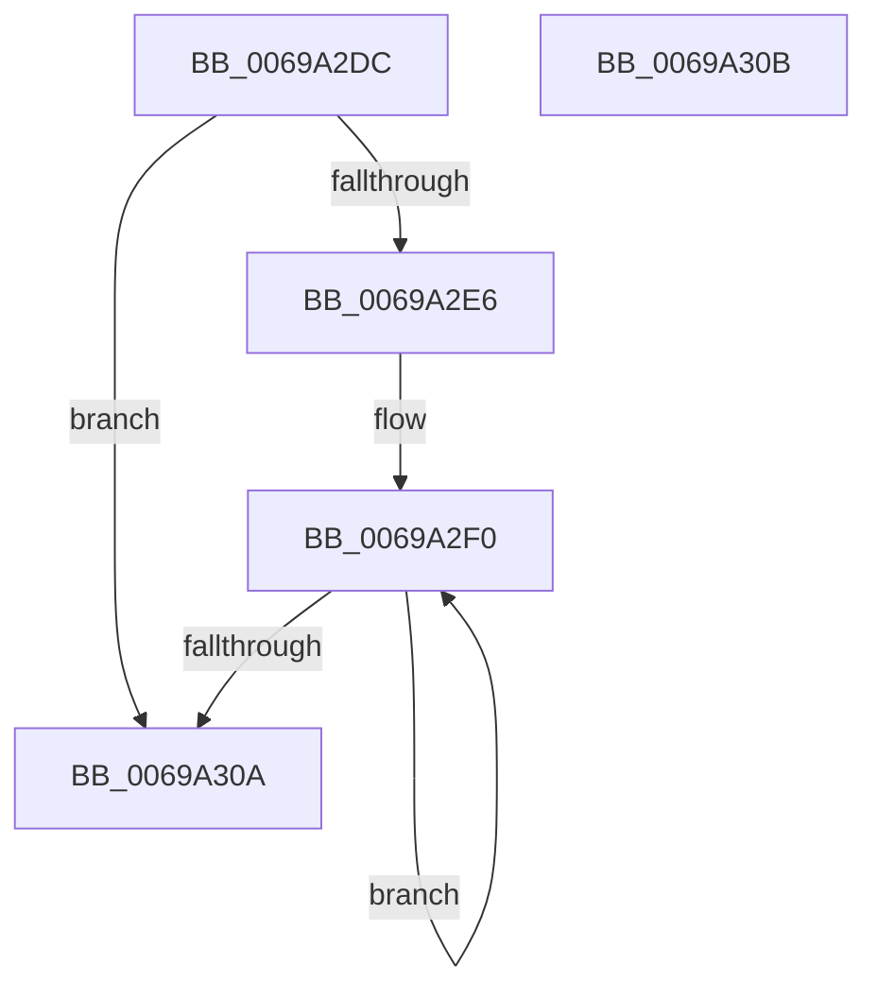

# MiWakeAllZeroCalibrationProcessors

- RVA: `0x0069A2DC`–`0x0069A30C` (길이 `48` bytes)
- VA: `0x000000014069A2DC`
- 실행 섹션: `.text`
- PDB 이름 있음: `예`; PDB Function 태그: `아니요`
- unwind 정보 RVA: `0x000DB714`
- 디코드: `13`개 명령, `48/48` bytes 표시
- 미해석 바이트: `0` (있으면 어셈블리에 `.byte`로 보존)

> 이 문서는 커널 이미지의 기계어와 PDB 기호를 분석해 생성했습니다. 4번과 5번은 함수 원형과 자료형을 바이너리 사용 방식에서 추정한 C 해석이며 원본 소스 복구 결과는 아닙니다.

## 1. Dependencies

- 직접 호출 지점: **0**; 고유 호출 대상: **0**
- 직접 호출자로 확인된 함수: **1**
- RIP 상대 이미지 참조: **2**

### Outgoing calls
- 직접 디코드된 call 명령이 없습니다.

### Direct callers
- [MiZeroPageCalibrateDpc](MiZeroPageCalibrateDpc_function_0069AA90.md) at `0x0069AB81`
- [MiZeroPageCalibrateDpc](MiZeroPageCalibrateDpc_function_0069AA90.md) at `0x0069ABDE`

### Static image references
- `0x0069A2DC` → RVA `0x00FC6A80` (`ALMOSTRO`; read)
- `0x0069A2E6` → RVA `0x00FC8C40` (`ALMOSTRO`; read)

## 2. Other-region calls and transfers

- 다른 실행 섹션으로 향하는 call: **0**
- 별도 외부 분기/꼬리 이동을 확인하지 못했습니다.

## 3. Assembly (complete function range)

```asm
0069A2DC  8B 05 9E C7 92 00               mov eax, dword ptr [rip + 0x92c79e]
0069A2E2  85 C0                           test eax, eax
0069A2E4  74 24                           je 0x14069a30a
0069A2E6  4C 8D 05 53 E9 92 00            lea r8, [rip + 0x92e953]
0069A2ED  44 8B C8                        mov r9d, eax
0069A2F0  49 8B 00                        mov rax, qword ptr [r8]
0069A2F3  4D 8D 40 08                     lea r8, [r8 + 8]
0069A2F7  48 8B 90 38 88 00 00            mov rdx, qword ptr [rax + 0x8838]
0069A2FE  89 8A C0 00 00 00               mov dword ptr [rdx + 0xc0], ecx
0069A304  49 83 E9 01                     sub r9, 1
0069A308  75 E6                           jne 0x14069a2f0
0069A30A  C3                              ret
0069A30B  CC                              int3
```

## 4. C-style interpretation (structured pseudocode)

```c
__int64 __fastcall MiWakeAllZeroCalibrationProcessors(int a1)
{
    if ((unsigned int)((unsigned int)(*(unsigned int *)(v_rip + 9619358))) == 0) goto loc_0069A30A;
loc_0069A2F0:
    *(unsigned int *)(*(unsigned __int64 *)(*(unsigned __int64 *)(v_rip + 9627987) + 34872) + 192) = a1;
    a4 = ((unsigned int)((unsigned int)((unsigned int)(*(unsigned int *)(v_rip + 9619358))))) - (1);
    if (condition_is_not_equal) goto loc_0069A2F0;
loc_0069A30A:
    return *(unsigned __int64 *)(v_rip + 9627987);
}
```

## 5. (Beta) C Style

```c
int64_t MiWakeAllZeroCalibrationProcessors(int32_t Arg1)
{
    if ((uint32_t)((uint32_t)(*(uint32_t *)(v_rip + 0x92C79E))) == 0) goto loc_0069A30A;
loc_0069A2F0:
    *(uint32_t *)(*(uint64_t *)(*(uint64_t *)(v_rip + 0x92E953) + 0x8838) + 0xC0) = Arg1;
    a4 = ((uint32_t)((uint32_t)((uint32_t)(*(uint32_t *)(v_rip + 0x92C79E))))) - (1);
    if (condition_is_not_equal) goto loc_0069A2F0;
loc_0069A30A:
    return *(uint64_t *)(v_rip + 0x92E953);
}
```

## 6. Execution-region graph

[열기: 2D/3D 그래프와 함수 탐색 컨트롤 패널](../../../control-panel.html?section=text&rva=0x0069A2DC&view=graph)

- 2D 그래프는 위에서 아래로 흐르고, 3D 그래프는 빈 공간을 드래그해 회전합니다. Shift+드래그는 이동, 휠은 확대·축소, 함수 노드 선택은 대상 보고서 이동입니다.

### Static fallback


