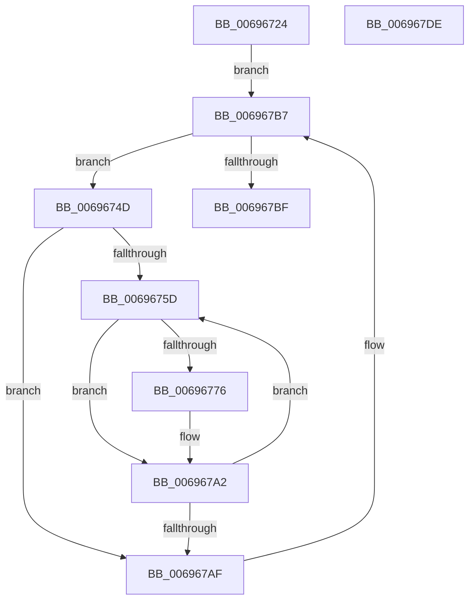

# MiWakeAllZeroConductors

- RVA: `0x00696724`–`0x006967DF` (길이 `187` bytes)
- VA: `0x0000000140696724`
- 실행 섹션: `.text`
- PDB 이름 있음: `예`; PDB Function 태그: `아니요`
- unwind 정보 RVA: `0x0005FEF8`
- 디코드: `52`개 명령, `187/187` bytes 표시
- 미해석 바이트: `0` (있으면 어셈블리에 `.byte`로 보존)

> 이 문서는 커널 이미지의 기계어와 PDB 기호를 분석해 생성했습니다. 4번과 5번은 함수 원형과 자료형을 바이너리 사용 방식에서 추정한 C 해석이며 원본 소스 복구 결과는 아닙니다.

## 1. Dependencies

- 직접 호출 지점: **5**; 고유 호출 대상: **4**
- 직접 호출자로 확인된 함수: **1**
- RIP 상대 이미지 참조: **1**

### Outgoing calls
- `0x00696743` → [PsGetNextPartition](../3B/PsGetNextPartition_function_003B9D5C.md) (function, `0x003B9D5C`)
- `0x0069677D` → [ExAcquireSpinLockExclusive](../24/ExAcquireSpinLockExclusive_function_00248690.md) (function, `0x00248690`)
- `0x0069678E` → [KeSetEvent](../33/KeSetEvent_function_0033F310.md) (function, `0x0033F310`)
- `0x0069679D` → [MiReleaseSpinLockExclusive](../24/MiReleaseSpinLockExclusive_function_002482C0.md) (function, `0x002482C0`)
- `0x006967B2` → [PsGetNextPartition](../3B/PsGetNextPartition_function_003B9D5C.md) (function, `0x003B9D5C`)

### Direct callers
- [MiDeleteHardwareAccelerators](MiDeleteHardwareAccelerators_function_006972DC.md) at `0x00697348`
- [MiDeleteHardwareAccelerators](MiDeleteHardwareAccelerators_function_006972DC.md) at `0x006973EB`

### Static image references
- `0x0069674D` → RVA `0x00FC5000` (`ALMOSTRO`; read)

## 2. Other-region calls and transfers

- 다른 실행 섹션으로 향하는 call: **0**
- 별도 외부 분기/꼬리 이동을 확인하지 못했습니다.

## 3. Assembly (complete function range)

```asm
00696724  48 8B C4                        mov rax, rsp
00696727  48 89 58 08                     mov qword ptr [rax + 8], rbx
0069672B  48 89 68 10                     mov qword ptr [rax + 0x10], rbp
0069672F  48 89 70 18                     mov qword ptr [rax + 0x18], rsi
00696733  48 89 78 20                     mov qword ptr [rax + 0x20], rdi
00696737  41 54                           push r12
00696739  41 56                           push r14
0069673B  41 57                           push r15
0069673D  48 83 EC 20                     sub rsp, 0x20
00696741  33 C9                           xor ecx, ecx
00696743  E8 14 36 D2 FF                  call 0x1403b9d5c
00696748  45 33 E4                        xor r12d, r12d
0069674B  EB 6A                           jmp 0x1406967b7
0069674D  66 44 3B 25 AB E8 92 00         cmp r12w, word ptr [rip + 0x92e8ab]
00696755  41 8B DC                        mov ebx, r12d
00696758  4D 8B 3E                        mov r15, qword ptr [r14]
0069675B  73 52                           jae 0x1406967af
0069675D  8B C3                           mov eax, ebx
0069675F  48 69 F0 80 DF 00 00            imul rsi, rax, 0xdf80
00696766  49 03 77 10                     add rsi, qword ptr [r15 + 0x10]
0069676A  48 8B AE A8 3B 00 00            mov rbp, qword ptr [rsi + 0x3ba8]
00696771  48 85 ED                        test rbp, rbp
00696774  74 2C                           je 0x1406967a2
00696776  48 8D 8E B0 3B 00 00            lea rcx, [rsi + 0x3bb0]
0069677D  E8 0E 1F BB FF                  call 0x140248690
00696782  48 8D 4D 58                     lea rcx, [rbp + 0x58]
00696786  45 33 C0                        xor r8d, r8d
00696789  33 D2                           xor edx, edx
0069678B  40 8A F8                        mov dil, al
0069678E  E8 7D 8B CA FF                  call 0x14033f310
00696793  40 8A D7                        mov dl, dil
00696796  48 8D 8E B0 3B 00 00            lea rcx, [rsi + 0x3bb0]
0069679D  E8 1E 1B BB FF                  call 0x1402482c0
006967A2  0F B7 05 57 E8 92 00            movzx eax, word ptr [rip + 0x92e857]
006967A9  FF C3                           inc ebx
006967AB  3B D8                           cmp ebx, eax
006967AD  72 AE                           jb 0x14069675d
006967AF  49 8B CE                        mov rcx, r14
006967B2  E8 A5 35 D2 FF                  call 0x1403b9d5c
006967B7  4C 8B F0                        mov r14, rax
006967BA  48 85 C0                        test rax, rax
006967BD  75 8E                           jne 0x14069674d
006967BF  48 8B 5C 24 40                  mov rbx, qword ptr [rsp + 0x40]
006967C4  48 8B 6C 24 48                  mov rbp, qword ptr [rsp + 0x48]
006967C9  48 8B 74 24 50                  mov rsi, qword ptr [rsp + 0x50]
006967CE  48 8B 7C 24 58                  mov rdi, qword ptr [rsp + 0x58]
006967D3  48 83 C4 20                     add rsp, 0x20
006967D7  41 5F                           pop r15
006967D9  41 5E                           pop r14
006967DB  41 5C                           pop r12
006967DD  C3                              ret
006967DE  CC                              int3
```

## 4. C-style interpretation (structured pseudocode)

```c
__int64 __fastcall MiWakeAllZeroConductors(int a1, int a2, int a3)
{
    __int64 result;
    __int64 v_r12;
    __int64 v_rbx;
    __int64 v_rdi;
    __int64 v_rsi;
    __int64 v_rsp;
    unsigned __int64 v_stack_p10;
    unsigned __int64 v_stack_p18;
    unsigned __int64 v_stack_p20;
    unsigned __int64 v_stack_p8;

    *(unsigned __int64 *)(v_rsp + 8) = v_rbx;
    *(unsigned __int64 *)(v_rsp + 16) = v_rbp;
    *(unsigned __int64 *)(v_rsp + 24) = v_rsi;
    *(unsigned __int64 *)(v_rsp + 32) = v_rdi;
    v_rsp = (v_rsp) - (32);
    a1 = 0;
    result = PsGetNextPartition(a1, a2, a3, a4);
    v_r12 = 0;
    goto loc_006967B7;
loc_0069674D:
    if (0 >= (*(unsigned __int16 *)(v_rip + 9627819))) goto loc_006967AF;
loc_0069675D:
    v_rsi = (v_rsi) * (0);
    v_rsi = (v_rsi) + (*(unsigned __int64 *)(*(unsigned __int64 *)(v_r14) + 16));
    result = 0;
    if (*(unsigned __int64 *)(v_rsi + 15272) != 0) {
        a1 = v_rsi + 15280;
        result = ExAcquireSpinLockExclusive(a1, a2, a3, a4);
        a1 = *(unsigned __int64 *)(v_rsi + 15272) + 88;
        a3 = 0;
        a2 = 0;
        v_rdi = (unsigned __int8)(result);
        result = KeSetEvent(a1, a2, a3, a4);
        a2 = (unsigned __int8)(v_rdi);
        a1 = v_rsi + 15280;
        result = MiReleaseSpinLockExclusive(a1, a2, a3, a4);
    }
    v_rbx = (unsigned int)((0) + 1);
    if (((unsigned int)(v_rbx)) < ((unsigned int)(*(unsigned __int16 *)(v_rip + 9627735)))) goto loc_0069675D;
loc_006967AF:
    result = PsGetNextPartition(v_r14, a2, a3, a4);
loc_006967B7:
    if (result != 0) goto loc_0069674D;
    v_rsp = (v_rsp) + (32);
    return result;
}
```

## 5. (Beta) C Style

```c
int64_t MiWakeAllZeroConductors(int32_t Arg1, int32_t Arg2, int32_t Arg3)
{
    int64_t result;
    int64_t local_r12;
    int64_t local_rbx;
    int64_t local_rdi;
    int64_t local_rsi;
    int64_t local_rsp;
    uint64_t v_stack_p10;
    uint64_t v_stack_p18;
    uint64_t v_stack_p20;
    uint64_t v_stack_p8;

    *(uint64_t *)(local_rsp + 0x8) = local_rbx;
    *(uint64_t *)(local_rsp + 0x10) = local_rbp;
    *(uint64_t *)(local_rsp + 0x18) = local_rsi;
    *(uint64_t *)(local_rsp + 0x20) = local_rdi;
    local_rsp = (local_rsp) - (32);
    Arg1 = 0;
    result = PsGetNextPartition(Arg1, Arg2, Arg3, a4);
    local_r12 = 0;
    goto loc_006967B7;
loc_0069674D:
    if (0 >= (*(uint16_t *)(v_rip + 0x92E8AB))) goto loc_006967AF;
loc_0069675D:
    local_rsi = (local_rsi) * (0);
    local_rsi = (local_rsi) + (*(uint64_t *)(*(uint64_t *)(local_r14) + 0x10));
    result = 0;
    if (*(uint64_t *)(local_rsi + 0x3BA8) != 0) {
        Arg1 = local_rsi + 15280;
        result = ExAcquireSpinLockExclusive(Arg1, Arg2, Arg3, a4);
        Arg1 = *(uint64_t *)(local_rsi + 0x3BA8) + 88;
        Arg3 = 0;
        Arg2 = 0;
        local_rdi = (uint8_t)(result);
        result = KeSetEvent(Arg1, Arg2, Arg3, a4);
        Arg2 = (uint8_t)(local_rdi);
        Arg1 = local_rsi + 15280;
        result = MiReleaseSpinLockExclusive(Arg1, Arg2, Arg3, a4);
    }
    local_rbx = (uint32_t)((0) + 1);
    if (((uint32_t)(local_rbx)) < ((uint32_t)(*(uint16_t *)(v_rip + 0x92E857)))) goto loc_0069675D;
loc_006967AF:
    result = PsGetNextPartition(local_r14, Arg2, Arg3, a4);
loc_006967B7:
    if (result != 0) goto loc_0069674D;
    local_rsp = (local_rsp) + (32);
    return result;
}
```

## 6. Execution-region graph

[열기: 2D/3D 그래프와 함수 탐색 컨트롤 패널](../../../control-panel.html?section=text&rva=0x00696724&view=graph)

- 2D 그래프는 위에서 아래로 흐르고, 3D 그래프는 빈 공간을 드래그해 회전합니다. Shift+드래그는 이동, 휠은 확대·축소, 함수 노드 선택은 대상 보고서 이동입니다.

### Static fallback


