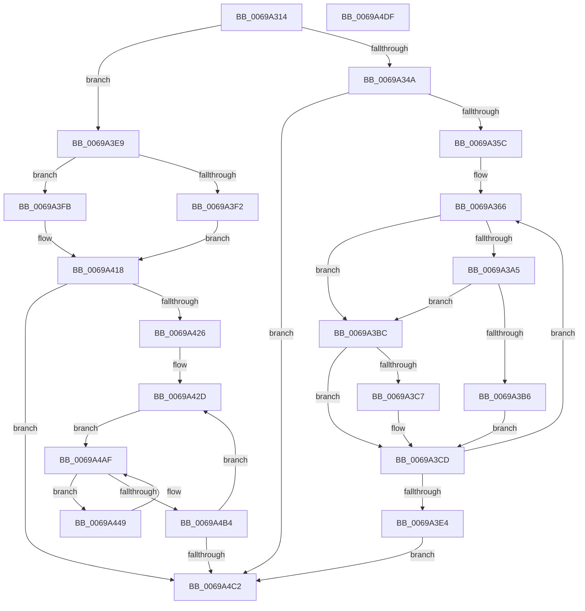

# MiWakeOnlyParticipatingProcessorsFromAssignedNode

- RVA: `0x0069A314`–`0x0069A4E0` (길이 `460` bytes)
- VA: `0x000000014069A314`
- 실행 섹션: `.text`
- PDB 이름 있음: `예`; PDB Function 태그: `아니요`
- unwind 정보 RVA: `0x0008C20C`
- 디코드: `117`개 명령, `460/460` bytes 표시
- 미해석 바이트: `0` (있으면 어셈블리에 `.byte`로 보존)

> 이 문서는 커널 이미지의 기계어와 PDB 기호를 분석해 생성했습니다. 4번과 5번은 함수 원형과 자료형을 바이너리 사용 방식에서 추정한 C 해석이며 원본 소스 복구 결과는 아닙니다.

## 1. Dependencies

- 직접 호출 지점: **2**; 고유 호출 대상: **2**
- 직접 호출자로 확인된 함수: **1**
- RIP 상대 이미지 참조: **4**

### Outgoing calls
- `0x0069A3AC` → [ExpInterlockedPopEntrySList](../6B/ExpInterlockedPopEntrySList_function_006BA570.md) (function, `0x006BA570`)
- `0x0069A44E` → [KeFindFirstSetRightGroupAffinity](../2C/KeFindFirstSetRightGroupAffinity_function_002CFB10.md) (function, `0x002CFB10`)

### Direct callers
- [MiZeroPageCalibrateDpc](MiZeroPageCalibrateDpc_function_0069AA90.md) at `0x0069AC05`

### Static image references
- `0x0069A35F` → RVA `0x00FC8C40` (`ALMOSTRO`; read)
- `0x0069A3C7` → RVA `0x00EF5088` (`.data`; read/write)
- `0x0069A3F2` → RVA `0x00E2DBD8` (`.data`; read)
- `0x0069A405` → RVA `0x00E2DBF8` (`.data`; read)

## 2. Other-region calls and transfers

- 다른 실행 섹션으로 향하는 call: **0**
- 별도 외부 분기/꼬리 이동을 확인하지 못했습니다.

## 3. Assembly (complete function range)

```asm
0069A314  48 8B C4                        mov rax, rsp
0069A317  48 89 58 08                     mov qword ptr [rax + 8], rbx
0069A31B  48 89 68 10                     mov qword ptr [rax + 0x10], rbp
0069A31F  48 89 70 18                     mov qword ptr [rax + 0x18], rsi
0069A323  57                              push rdi
0069A324  41 54                           push r12
0069A326  41 55                           push r13
0069A328  41 56                           push r14
0069A32A  41 57                           push r15
0069A32C  48 83 EC 30                     sub rsp, 0x30
0069A330  48 8B 29                        mov rbp, qword ptr [rcx]
0069A333  45 33 ED                        xor r13d, r13d
0069A336  0F 57 C0                        xorps xmm0, xmm0
0069A339  48 8B D9                        mov rbx, rcx
0069A33C  0F 11 40 C8                     movups xmmword ptr [rax - 0x38], xmm0
0069A340  44 39 6D 00                     cmp dword ptr [rbp], r13d
0069A344  0F 85 9F 00 00 00               jne 0x14069a3e9
0069A34A  8B B1 C0 00 00 00               mov esi, dword ptr [rcx + 0xc0]
0069A350  41 8B ED                        mov ebp, r13d
0069A353  83 C6 01                        add esi, 1
0069A356  0F 84 66 01 00 00               je 0x14069a4c2
0069A35C  45 8B FD                        mov r15d, r13d
0069A35F  4C 8D 35 DA E8 92 00            lea r14, [rip + 0x92e8da]
0069A366  49 8B 06                        mov rax, qword ptr [r14]
0069A369  49 8B CF                        mov rcx, r15
0069A36C  48 8B B8 38 88 00 00            mov rdi, qword ptr [rax + 0x8838]
0069A373  48 81 C7 C0 00 00 00            add rdi, 0xc0
0069A37A  89 6F 44                        mov dword ptr [rdi + 0x44], ebp
0069A37D  8B 43 08                        mov eax, dword ptr [rbx + 8]
0069A380  89 47 40                        mov dword ptr [rdi + 0x40], eax
0069A383  48 8B 83 28 01 00 00            mov rax, qword ptr [rbx + 0x128]
0069A38A  48 0F AF C8                     imul rcx, rax
0069A38E  48 89 47 50                     mov qword ptr [rdi + 0x50], rax
0069A392  48 03 8B 10 01 00 00            add rcx, qword ptr [rbx + 0x110]
0069A399  48 89 4F 48                     mov qword ptr [rdi + 0x48], rcx
0069A39D  48 8B 03                        mov rax, qword ptr [rbx]
0069A3A0  44 39 28                        cmp dword ptr [rax], r13d
0069A3A3  75 17                           jne 0x14069a3bc
0069A3A5  48 8D 8B 30 01 00 00            lea rcx, [rbx + 0x130]
0069A3AC  E8 BF 01 02 00                  call 0x1406ba570
0069A3B1  48 85 C0                        test rax, rax
0069A3B4  74 06                           je 0x14069a3bc
0069A3B6  48 8D 48 20                     lea rcx, [rax + 0x20]
0069A3BA  EB 11                           jmp 0x14069a3cd
0069A3BC  48 8B 03                        mov rax, qword ptr [rbx]
0069A3BF  49 8B CD                        mov rcx, r13
0069A3C2  44 39 28                        cmp dword ptr [rax], r13d
0069A3C5  75 06                           jne 0x14069a3cd
0069A3C7  FF 05 BB AC 85 00               inc dword ptr [rip + 0x85acbb]
0069A3CD  FF C5                           inc ebp
0069A3CF  48 89 4F 58                     mov qword ptr [rdi + 0x58], rcx
0069A3D3  49 FF C7                        inc r15
0069A3D6  C7 07 01 00 00 00               mov dword ptr [rdi], 1
0069A3DC  49 83 C6 08                     add r14, 8
0069A3E0  3B EE                           cmp ebp, esi
0069A3E2  72 82                           jb 0x14069a366
0069A3E4  E9 D9 00 00 00                  jmp 0x14069a4c2
0069A3E9  45 8B E5                        mov r12d, r13d
0069A3EC  44 38 6D 24                     cmp byte ptr [rbp + 0x24], r13b
0069A3F0  74 09                           je 0x14069a3fb
0069A3F2  48 8D 35 DF 37 79 00            lea rsi, [rip + 0x7937df]
0069A3F9  EB 1D                           jmp 0x14069a418
0069A3FB  8B 81 0C 01 00 00               mov eax, dword ptr [rcx + 0x10c]
0069A401  48 8D 0C 40                     lea rcx, [rax + rax*2]
0069A405  48 8B 05 EC 37 79 00            mov rax, qword ptr [rip + 0x7937ec]
0069A40C  48 C1 E1 07                     shl rcx, 7
0069A410  48 8B B4 01 78 01 00 00         mov rsi, qword ptr [rcx + rax + 0x178]
0069A418  41 8B FD                        mov edi, r13d
0069A41B  66 44 3B 6E 10                  cmp r13w, word ptr [rsi + 0x10]
0069A420  0F 83 9C 00 00 00               jae 0x14069a4c2
0069A426  4C 8D 35 13 E8 92 00            lea r14, [rip + 0x92e813]
0069A42D  48 8B 85 98 00 00 00            mov rax, qword ptr [rbp + 0x98]
0069A434  8B CF                           mov ecx, edi
0069A436  48 03 C9                        add rcx, rcx
0069A439  0F 10 04 C8                     movups xmm0, xmmword ptr [rax + rcx*8]
0069A43D  0F 11 44 24 20                  movups xmmword ptr [rsp + 0x20], xmm0
0069A442  66 49 0F 7E C7                  movq r15, xmm0
0069A447  EB 66                           jmp 0x14069a4af
0069A449  48 8D 4C 24 20                  lea rcx, [rsp + 0x20]
0069A44E  E8 BD 56 C3 FF                  call 0x1402cfb10
0069A453  8B C8                           mov ecx, eax
0069A455  49 8B 14 CE                     mov rdx, qword ptr [r14 + rcx*8]
0069A459  41 8B CC                        mov ecx, r12d
0069A45C  4C 8B 82 38 88 00 00            mov r8, qword ptr [rdx + 0x8838]
0069A463  48 8B 82 C8 00 00 00            mov rax, qword ptr [rdx + 0xc8]
0069A46A  49 81 C0 C0 00 00 00            add r8, 0xc0
0069A471  48 F7 D0                        not rax
0069A474  4C 23 F8                        and r15, rax
0069A477  4C 89 7C 24 20                  mov qword ptr [rsp + 0x20], r15
0069A47C  45 89 60 44                     mov dword ptr [r8 + 0x44], r12d
0069A480  8B 43 08                        mov eax, dword ptr [rbx + 8]
0069A483  41 89 40 40                     mov dword ptr [r8 + 0x40], eax
0069A487  48 8B 83 28 01 00 00            mov rax, qword ptr [rbx + 0x128]
0069A48E  48 0F AF C8                     imul rcx, rax
0069A492  49 89 40 50                     mov qword ptr [r8 + 0x50], rax
0069A496  48 03 8B 10 01 00 00            add rcx, qword ptr [rbx + 0x110]
0069A49D  49 89 48 48                     mov qword ptr [r8 + 0x48], rcx
0069A4A1  41 FF C4                        inc r12d
0069A4A4  4D 89 68 58                     mov qword ptr [r8 + 0x58], r13
0069A4A8  41 C7 00 01 00 00 00            mov dword ptr [r8], 1
0069A4AF  4D 85 FF                        test r15, r15
0069A4B2  75 95                           jne 0x14069a449
0069A4B4  0F B7 46 10                     movzx eax, word ptr [rsi + 0x10]
0069A4B8  FF C7                           inc edi
0069A4BA  3B F8                           cmp edi, eax
0069A4BC  0F 82 6B FF FF FF               jb 0x14069a42d
0069A4C2  48 8B 5C 24 60                  mov rbx, qword ptr [rsp + 0x60]
0069A4C7  48 8B 6C 24 68                  mov rbp, qword ptr [rsp + 0x68]
0069A4CC  48 8B 74 24 70                  mov rsi, qword ptr [rsp + 0x70]
0069A4D1  48 83 C4 30                     add rsp, 0x30
0069A4D5  41 5F                           pop r15
0069A4D7  41 5E                           pop r14
0069A4D9  41 5D                           pop r13
0069A4DB  41 5C                           pop r12
0069A4DD  5F                              pop rdi
0069A4DE  C3                              ret
0069A4DF  CC                              int3
```

## 4. C-style interpretation (structured pseudocode)

```c
__int64 __fastcall MiWakeOnlyParticipatingProcessorsFromAssignedNode(__int64 a1)
{
    __int64 result;
    __int64 v_r12;
    __int64 v_r13;
    __int64 v_r14;
    __int64 v_r15;
    __int64 v_rbp;
    __int64 v_rdi;
    __int64 v_rsi;
    __int64 v_rsp;
    unsigned __int64 v_stack_m38;
    unsigned __int64 v_stack_p10;
    unsigned __int64 v_stack_p18;
    unsigned __int64 v_stack_p8;

    *(unsigned __int64 *)(v_rsp + 8) = v_rbx;
    *(unsigned __int64 *)(v_rsp + 16) = v_rbp;
    *(unsigned __int64 *)(v_rsp + 24) = v_rsi;
    v_rsp = (v_rsp) - (48);
    v_r13 = 0;
    *(unsigned __int64 *)(v_rsp - 56) = v_xmm0;
    if ((*(unsigned int *)(*(unsigned __int64 *)(a1))) != 0) goto loc_0069A3E9;
    v_rsi = (unsigned int)(((unsigned int)(*(unsigned int *)(a1 + 192))) + (1));
    if (condition_is_equal) goto loc_0069A4C2;
loc_0069A366:
    v_rdi = (*(unsigned __int64 *)(*(unsigned __int64 *)(v_rip + 9627866) + 34872)) + (192);
    *(unsigned int *)(v_rdi + 68) = 0;
    *(unsigned int *)(v_rdi + 64) = (unsigned int)((unsigned int)(*(unsigned int *)(a1 + 8)));
    a1 = (0) * (*(unsigned __int64 *)(a1 + 296));
    *(unsigned __int64 *)(v_rdi + 80) = *(unsigned __int64 *)(a1 + 296);
    a1 = (a1) + (*(unsigned __int64 *)(a1 + 272));
    *(unsigned __int64 *)(v_rdi + 72) = a1;
    if ((*(unsigned int *)(*(unsigned __int64 *)(a1))) != 0) goto loc_0069A3BC;
    result = ExpInterlockedPopEntrySList(a1 + 304, a2, a3, a4);
    if (result == 0) goto loc_0069A3BC;
    goto loc_0069A3CD;
loc_0069A3BC:
    if ((*(unsigned int *)(*(unsigned __int64 *)(a1))) == 0) {
    }
    v_rbp = (unsigned int)((0) + 1);
    *(unsigned __int64 *)(v_rdi + 88) = 0;
    v_r15 = (0) + 1;
    *(unsigned int *)(v_rdi) = 1;
    v_r14 = (v_rip + 9627866) + (8);
    if (((unsigned int)(v_rbp)) < ((unsigned int)(v_rsi))) goto loc_0069A366;
    goto loc_0069A4C2;
loc_0069A3E9:
    if ((*(unsigned __int8 *)(v_rbp + 36)) == 0) goto loc_0069A3FB;
    goto loc_0069A418;
loc_0069A3FB:
    a1 = ((unsigned int)(*(unsigned int *)(0 + 268)) + (unsigned int)(*(unsigned int *)(0 + 268)) * 2) << (7);
loc_0069A418:
    if (0 >= (*(unsigned __int16 *)(*(unsigned __int64 *)(a1 + *(unsigned __int64 *)(v_rip + 7944172) * 1 + 376) + 16))) goto loc_0069A4C2;
loc_0069A42D:
    a1 = (0) + (0);
    v_stack_m38 = v_xmm0;
    goto loc_0069A4AF;
loc_0069A449:
    result = KeFindFirstSetRightGroupAffinity(v_stack_m38, a2, a3, a4);
    a3 = (*(unsigned __int64 *)(*(unsigned __int64 *)(v_rip + 9627667 + (unsigned int)((unsigned int)(result)) * 8) + 34872)) + (192);
    result = ~(*(unsigned __int64 *)(*(unsigned __int64 *)(v_rip + 9627667 + (unsigned int)((unsigned int)(result)) * 8) + 200));
    v_r15 = (v_r15) & (result);
    v_stack_m38 = v_r15;
    *(unsigned int *)(a3 + 68) = 0;
    *(unsigned int *)(a3 + 64) = (unsigned int)((unsigned int)(*(unsigned int *)(a1 + 8)));
    a1 = (0) * (*(unsigned __int64 *)(a1 + 296));
    *(unsigned __int64 *)(a3 + 80) = *(unsigned __int64 *)(a1 + 296);
    a1 = (a1) + (*(unsigned __int64 *)(a1 + 272));
    *(unsigned __int64 *)(a3 + 72) = a1;
    v_r12 = (unsigned int)((0) + 1);
    *(unsigned __int64 *)(a3 + 88) = 0;
    *(unsigned int *)(a3) = 1;
loc_0069A4AF:
    if (v_r15 != 0) goto loc_0069A449;
    v_rdi = (unsigned int)((0) + 1);
    if (((unsigned int)(v_rdi)) < ((unsigned int)(*(unsigned __int16 *)(*(unsigned __int64 *)(a1 + *(unsigned __int64 *)(v_rip + 7944172) * 1 + 376) + 16)))) goto loc_0069A42D;
loc_0069A4C2:
    v_rsp = (v_rsp) + (48);
    return *(unsigned __int16 *)(*(unsigned __int64 *)(a1 + *(unsigned __int64 *)(v_rip + 7944172) * 1 + 376) + 16);
}
```

## 5. (Beta) C Style

```c
int64_t MiWakeOnlyParticipatingProcessorsFromAssignedNode(void *Arg1)
{
    uint8_t *arg1 = (uint8_t *)Arg1;

    int64_t result;
    int64_t local_r12;
    int64_t local_r13;
    int64_t local_r14;
    int64_t local_r15;
    int64_t local_rbp;
    int64_t local_rdi;
    int64_t local_rsi;
    int64_t local_rsp;
    uint64_t v_stack_m38;
    uint64_t v_stack_p10;
    uint64_t v_stack_p18;
    uint64_t v_stack_p8;

    *(uint64_t *)(local_rsp + 0x8) = local_rbx;
    *(uint64_t *)(local_rsp + 0x10) = local_rbp;
    *(uint64_t *)(local_rsp + 0x18) = local_rsi;
    local_rsp = (local_rsp) - (48);
    local_r13 = 0;
    *(uint64_t *)(local_rsp - 0x38) = v_xmm0;
    if ((*(uint32_t *)(*(uint64_t *)(arg1))) != 0) goto loc_0069A3E9;
    local_rsi = (uint32_t)(((uint32_t)(*(uint32_t *)(arg1 + 0xC0))) + (1));
    if (condition_is_equal) goto loc_0069A4C2;
loc_0069A366:
    local_rdi = (*(uint64_t *)(*(uint64_t *)(v_rip + 0x92E8DA) + 0x8838)) + (192);
    *(uint32_t *)(local_rdi + 0x44) = 0;
    *(uint32_t *)(local_rdi + 0x40) = (uint32_t)((uint32_t)(*(uint32_t *)(arg1 + 0x8)));
    Arg1 = (0) * (*(uint64_t *)(arg1 + 0x128));
    *(uint64_t *)(local_rdi + 0x50) = *(uint64_t *)(arg1 + 0x128);
    Arg1 = (Arg1) + (*(uint64_t *)(arg1 + 0x110));
    *(void **)(local_rdi + 0x48) = Arg1;
    if ((*(uint32_t *)(*(uint64_t *)(arg1))) != 0) goto loc_0069A3BC;
    result = ExpInterlockedPopEntrySList(Arg1 + 304, a2, a3, a4);
    if (result == 0) goto loc_0069A3BC;
    goto loc_0069A3CD;
loc_0069A3BC:
    if ((*(uint32_t *)(*(uint64_t *)(arg1))) == 0) {
    }
    local_rbp = (uint32_t)((0) + 1);
    *(uint64_t *)(local_rdi + 0x58) = 0;
    local_r15 = (0) + 1;
    *(uint32_t *)(local_rdi) = 1;
    local_r14 = (v_rip + 9627866) + (8);
    if (((uint32_t)(local_rbp)) < ((uint32_t)(local_rsi))) goto loc_0069A366;
    goto loc_0069A4C2;
loc_0069A3E9:
    if ((*(uint8_t *)(local_rbp + 0x24)) == 0) goto loc_0069A3FB;
    goto loc_0069A418;
loc_0069A3FB:
    Arg1 = ((uint32_t)(*(uint32_t *)(0 + 0x10C)) + (uint32_t)(*(uint32_t *)(0 + 0x10C)) * 2) << (7);
loc_0069A418:
    if (0 >= (*(uint16_t *)(*(uint64_t *)(arg1 + *(uint64_t *)(v_rip + 0x7937EC) * 1 + 0x178) + 0x10))) goto loc_0069A4C2;
loc_0069A42D:
    Arg1 = (0) + (0);
    v_stack_m38 = v_xmm0;
    goto loc_0069A4AF;
loc_0069A449:
    result = KeFindFirstSetRightGroupAffinity(v_stack_m38, a2, a3, a4);
    a3 = (*(uint64_t *)(*(uint64_t *)(v_rip + 0x92E813 + (uint32_t)((uint32_t)(result)) * 8) + 0x8838)) + (192);
    result = ~(*(uint64_t *)(*(uint64_t *)(v_rip + 0x92E813 + (uint32_t)((uint32_t)(result)) * 8) + 0xC8));
    local_r15 = (local_r15) & (result);
    v_stack_m38 = local_r15;
    *(uint32_t *)(a3 + 0x44) = 0;
    *(uint32_t *)(a3 + 0x40) = (uint32_t)((uint32_t)(*(uint32_t *)(arg1 + 0x8)));
    Arg1 = (0) * (*(uint64_t *)(arg1 + 0x128));
    *(uint64_t *)(a3 + 0x50) = *(uint64_t *)(arg1 + 0x128);
    Arg1 = (Arg1) + (*(uint64_t *)(arg1 + 0x110));
    *(void **)(a3 + 0x48) = Arg1;
    local_r12 = (uint32_t)((0) + 1);
    *(uint64_t *)(a3 + 0x58) = 0;
    *(uint32_t *)(a3) = 1;
loc_0069A4AF:
    if (local_r15 != 0) goto loc_0069A449;
    local_rdi = (uint32_t)((0) + 1);
    if (((uint32_t)(local_rdi)) < ((uint32_t)(*(uint16_t *)(*(uint64_t *)(arg1 + *(uint64_t *)(v_rip + 0x7937EC) * 1 + 0x178) + 0x10)))) goto loc_0069A42D;
loc_0069A4C2:
    local_rsp = (local_rsp) + (48);
    return *(uint16_t *)(*(uint64_t *)(arg1 + *(uint64_t *)(v_rip + 0x7937EC) * 1 + 0x178) + 0x10);
}
```

### 관측된 메모리 오프셋

구조체 형식이 확인되지 않은 접근은 인자 기준의 오프셋으로만 기록했습니다.

| 기준 인자 | 오프셋 표현 | 폭 (bit) | 접근 |
|---|---:|---:|---|
| `Arg1` | `+ 0x0` | `64` | `R` |
| `Arg1` | `+ 0x8` | `32` | `R` |
| `Arg1` | `+ 0xC0` | `32` | `R` |
| `Arg1` | `+ 0x10C` | `32` | `R` |
| `Arg1` | `+ 0x110` | `64` | `R` |
| `Arg1` | `+ 0x128` | `64` | `R` |
| `Arg1` | `+ 0x130` | `64` | `R` |

## 6. Execution-region graph

[열기: 2D/3D 그래프와 함수 탐색 컨트롤 패널](../../../control-panel.html?section=text&rva=0x0069A314&view=graph)

- 2D 그래프는 위에서 아래로 흐르고, 3D 그래프는 빈 공간을 드래그해 회전합니다. Shift+드래그는 이동, 휠은 확대·축소, 함수 노드 선택은 대상 보고서 이동입니다.

### Static fallback


