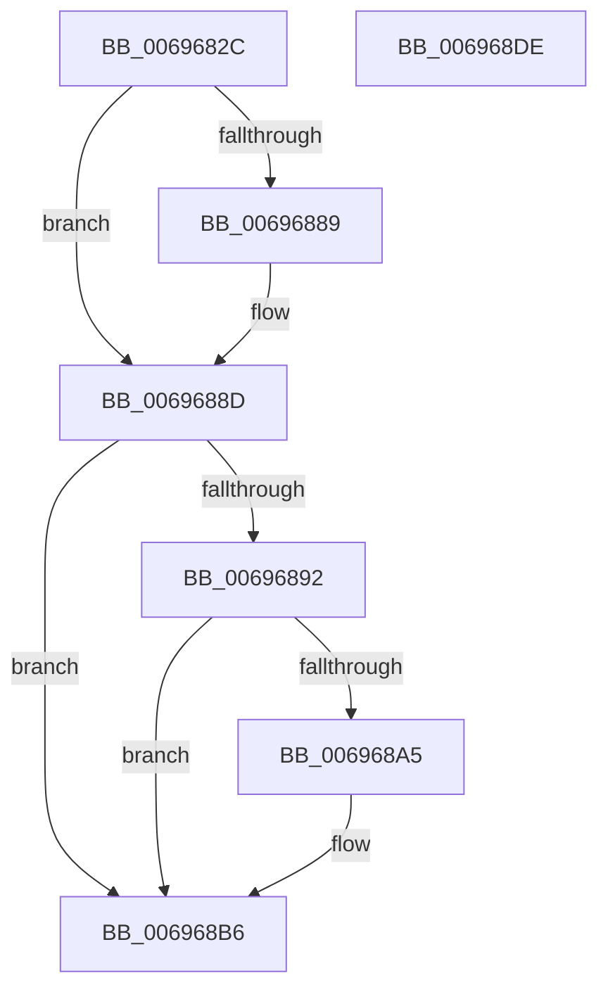

# MiZeroEngineSetOptimalCount

- RVA: `0x0069682C`–`0x006968DF` (길이 `179` bytes)
- VA: `0x000000014069682C`
- 실행 섹션: `.text`
- PDB 이름 있음: `예`; PDB Function 태그: `아니요`
- unwind 정보 RVA: `0x00060300`
- 디코드: `49`개 명령, `179/179` bytes 표시
- 미해석 바이트: `0` (있으면 어셈블리에 `.byte`로 보존)

> 이 문서는 커널 이미지의 기계어와 PDB 기호를 분석해 생성했습니다. 4번과 5번은 함수 원형과 자료형을 바이너리 사용 방식에서 추정한 C 해석이며 원본 소스 복구 결과는 아닙니다.

## 1. Dependencies

- 직접 호출 지점: **3**; 고유 호출 대상: **3**
- 직접 호출자로 확인된 함수: **1**
- RIP 상대 이미지 참조: **0**

### Outgoing calls
- `0x00696869` → [ExAcquireSpinLockExclusive](../24/ExAcquireSpinLockExclusive_function_00248690.md) (function, `0x00248690`)
- `0x006968B1` → [KeSetEvent](../33/KeSetEvent_function_0033F310.md) (function, `0x0033F310`)
- `0x006968C0` → [MiReleaseSpinLockExclusive](../24/MiReleaseSpinLockExclusive_function_002482C0.md) (function, `0x002482C0`)

### Direct callers
- [MiInitializeZeroEngines](../../page/81/MiInitializeZeroEngines_function_008106F4.md) at `0x0081083C`

### Static image references
- 디코드된 RIP-relative 메모리 참조가 없습니다.

## 2. Other-region calls and transfers

- 다른 실행 섹션으로 향하는 call: **0**
- 별도 외부 분기/꼬리 이동을 확인하지 못했습니다.

## 3. Assembly (complete function range)

```asm
0069682C  48 89 5C 24 08                  mov qword ptr [rsp + 8], rbx
00696831  48 89 6C 24 10                  mov qword ptr [rsp + 0x10], rbp
00696836  48 89 74 24 18                  mov qword ptr [rsp + 0x18], rsi
0069683B  57                              push rdi
0069683C  41 56                           push r14
0069683E  41 57                           push r15
00696840  48 83 EC 20                     sub rsp, 0x20
00696844  48 8B 99 B0 00 00 00            mov rbx, qword ptr [rcx + 0xb0]
0069684B  48 8B F1                        mov rsi, rcx
0069684E  8B FA                           mov edi, edx
00696850  8B 43 38                        mov eax, dword ptr [rbx + 0x38]
00696853  48 8B 6B 30                     mov rbp, qword ptr [rbx + 0x30]
00696857  4C 69 F0 80 DF 00 00            imul r14, rax, 0xdf80
0069685E  4C 03 75 10                     add r14, qword ptr [rbp + 0x10]
00696862  49 8D 8E B0 3B 00 00            lea rcx, [r14 + 0x3bb0]
00696869  E8 22 1E BB FF                  call 0x140248690
0069686E  8B 4B 38                        mov ecx, dword ptr [rbx + 0x38]
00696871  BA 01 00 00 00                  mov edx, 1
00696876  39 4E 70                        cmp dword ptr [rsi + 0x70], ecx
00696879  44 8A F8                        mov r15b, al
0069687C  0F 44 D7                        cmove edx, edi
0069687F  33 C0                           xor eax, eax
00696881  89 56 08                        mov dword ptr [rsi + 8], edx
00696884  38 46 1C                        cmp byte ptr [rsi + 0x1c], al
00696887  75 04                           jne 0x14069688d
00696889  C6 46 1C 01                     mov byte ptr [rsi + 0x1c], 1
0069688D  38 46 1D                        cmp byte ptr [rsi + 0x1d], al
00696890  74 24                           je 0x1406968b6
00696892  88 46 1D                        mov byte ptr [rsi + 0x1d], al
00696895  83 C8 FF                        or eax, 0xffffffff
00696898  F0 0F C1 85 34 42 00 00         lock xadd dword ptr [rbp + 0x4234], eax
006968A0  83 F8 01                        cmp eax, 1
006968A3  75 11                           jne 0x1406968b6
006968A5  48 8D 8D 38 42 00 00            lea rcx, [rbp + 0x4238]
006968AC  45 33 C0                        xor r8d, r8d
006968AF  33 D2                           xor edx, edx
006968B1  E8 5A 8A CA FF                  call 0x14033f310
006968B6  41 8A D7                        mov dl, r15b
006968B9  49 8D 8E B0 3B 00 00            lea rcx, [r14 + 0x3bb0]
006968C0  E8 FB 19 BB FF                  call 0x1402482c0
006968C5  48 8B 5C 24 40                  mov rbx, qword ptr [rsp + 0x40]
006968CA  48 8B 6C 24 48                  mov rbp, qword ptr [rsp + 0x48]
006968CF  48 8B 74 24 50                  mov rsi, qword ptr [rsp + 0x50]
006968D4  48 83 C4 20                     add rsp, 0x20
006968D8  41 5F                           pop r15
006968DA  41 5E                           pop r14
006968DC  5F                              pop rdi
006968DD  C3                              ret
006968DE  CC                              int3
```

## 4. C-style interpretation (structured pseudocode)

```c
__int64 __fastcall MiZeroEngineSetOptimalCount(__int64 a1, int a2, int a3)
{
    __int64 result;
    __int64 v_r14;
    __int64 v_rsp;
    unsigned __int64 v_stack_p10;
    unsigned __int64 v_stack_p18;
    unsigned __int64 v_stack_p8;

    v_stack_p8 = v_rbx;
    v_stack_p10 = v_rbp;
    v_stack_p18 = v_rsi;
    v_rsp = (v_rsp) - (32);
    v_r14 = (v_r14) * ((unsigned int)(*(unsigned int *)(*(unsigned __int64 *)(a1 + 176) + 56)));
    v_r14 = (v_r14) + (*(unsigned __int64 *)(*(unsigned __int64 *)(*(unsigned __int64 *)(a1 + 176) + 48) + 16));
    result = ExAcquireSpinLockExclusive(v_r14 + 15280, a2, a3, a4);
    a2 = 1;
    if ((*(unsigned int *)(a1 + 112)) == ((unsigned int)((unsigned int)(*(unsigned int *)(*(unsigned __int64 *)(a1 + 176) + 56))))) { a2 = (unsigned int)((unsigned int)(a2)); }
    result = 0;
    *(unsigned int *)(a1 + 8) = a2;
    if ((*(unsigned __int8 *)(a1 + 28)) == 0) {
        *(unsigned __int8 *)(a1 + 28) = 1;
    }
    if ((*(unsigned __int8 *)(a1 + 29)) == 0) goto loc_006968B6;
    *(unsigned __int8 *)(a1 + 29) = 0;
    result = (unsigned int)((result) | (0xFFFFFFFFULL));
    if (((unsigned int)(result)) == 1) {
        a1 = *(unsigned __int64 *)(*(unsigned __int64 *)(a1 + 176) + 48) + 16952;
        a3 = 0;
        a2 = 0;
        result = KeSetEvent(a1, a2, a3, a4);
    }
    result = MiReleaseSpinLockExclusive(v_r14 + 15280, (unsigned __int8)((unsigned __int8)(result)), a3, a4);
    v_rsp = (v_rsp) + (32);
    return result;
}
```

## 5. (Beta) C Style

```c
int64_t MiZeroEngineSetOptimalCount(void *Arg1, int32_t Arg2, int32_t Arg3)
{
    uint8_t *arg1 = (uint8_t *)Arg1;

    int64_t result;
    int64_t local_r14;
    int64_t local_rsp;
    uint64_t v_stack_p10;
    uint64_t v_stack_p18;
    uint64_t v_stack_p8;

    v_stack_p8 = local_rbx;
    v_stack_p10 = local_rbp;
    v_stack_p18 = local_rsi;
    local_rsp = (local_rsp) - (32);
    local_r14 = (local_r14) * ((uint32_t)(*(uint32_t *)(*(uint64_t *)(arg1 + 0xB0) + 0x38)));
    local_r14 = (local_r14) + (*(uint64_t *)(*(uint64_t *)(*(uint64_t *)(arg1 + 0xB0) + 0x30) + 0x10));
    result = ExAcquireSpinLockExclusive(local_r14 + 15280, Arg2, Arg3, a4);
    Arg2 = 1;
    if ((*(uint32_t *)(arg1 + 0x70)) == ((uint32_t)((uint32_t)(*(uint32_t *)(*(uint64_t *)(arg1 + 0xB0) + 0x38))))) { Arg2 = (uint32_t)((uint32_t)(Arg2)); }
    result = 0;
    *(uint32_t *)(arg1 + 0x8) = Arg2;
    if ((*(uint8_t *)(arg1 + 0x1C)) == 0) {
        *(uint8_t *)(arg1 + 0x1C) = 1;
    }
    if ((*(uint8_t *)(arg1 + 0x1D)) == 0) goto loc_006968B6;
    *(uint8_t *)(arg1 + 0x1D) = 0;
    result = (uint32_t)((result) | (0xFFFFFFFFULL));
    if (((uint32_t)(result)) == 1) {
        Arg1 = *(uint64_t *)(*(uint64_t *)(arg1 + 0xB0) + 0x30) + 16952;
        Arg3 = 0;
        Arg2 = 0;
        result = KeSetEvent(Arg1, Arg2, Arg3, a4);
    }
    result = MiReleaseSpinLockExclusive(local_r14 + 15280, (uint8_t)((uint8_t)(result)), Arg3, a4);
    local_rsp = (local_rsp) + (32);
    return result;
}
```

### 관측된 메모리 오프셋

구조체 형식이 확인되지 않은 접근은 인자 기준의 오프셋으로만 기록했습니다.

| 기준 인자 | 오프셋 표현 | 폭 (bit) | 접근 |
|---|---:|---:|---|
| `Arg1` | `+ 0x8` | `32` | `W` |
| `Arg1` | `+ 0x1C` | `8` | `R` |
| `Arg1` | `+ 0x1C` | `8` | `W` |
| `Arg1` | `+ 0x1D` | `8` | `R` |
| `Arg1` | `+ 0x1D` | `8` | `W` |
| `Arg1` | `+ 0x70` | `32` | `R` |
| `Arg1` | `+ 0xB0` | `64` | `R` |

## 6. Execution-region graph

[열기: 2D/3D 그래프와 함수 탐색 컨트롤 패널](../../../control-panel.html?section=text&rva=0x0069682C&view=graph)

- 2D 그래프는 위에서 아래로 흐르고, 3D 그래프는 빈 공간을 드래그해 회전합니다. Shift+드래그는 이동, 휠은 확대·축소, 함수 노드 선택은 대상 보고서 이동입니다.

### Static fallback


