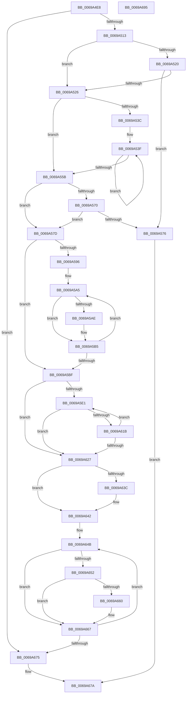

# MiZeroInflectionPointReached

- RVA: `0x0069A4E8`–`0x0069A696` (길이 `430` bytes)
- VA: `0x000000014069A4E8`
- 실행 섹션: `.text`
- PDB 이름 있음: `예`; PDB Function 태그: `아니요`
- unwind 정보 RVA: `0x000D0D58`
- 디코드: `126`개 명령, `430/430` bytes 표시
- 미해석 바이트: `0` (있으면 어셈블리에 `.byte`로 보존)

> 이 문서는 커널 이미지의 기계어와 PDB 기호를 분석해 생성했습니다. 4번과 5번은 함수 원형과 자료형을 바이너리 사용 방식에서 추정한 C 해석이며 원본 소스 복구 결과는 아닙니다.

## 1. Dependencies

- 직접 호출 지점: **0**; 고유 호출 대상: **0**
- 직접 호출자로 확인된 함수: **1**
- RIP 상대 이미지 참조: **0**

### Outgoing calls
- 직접 디코드된 call 명령이 없습니다.

### Direct callers
- [MiZeroPageCalibrateLastDpcProcessorDone](MiZeroPageCalibrateLastDpcProcessorDone_function_0069AC78.md) at `0x0069AD07`

### Static image references
- 디코드된 RIP-relative 메모리 참조가 없습니다.

## 2. Other-region calls and transfers

- 다른 실행 섹션으로 향하는 call: **0**
- 별도 외부 분기/꼬리 이동을 확인하지 못했습니다.

## 3. Assembly (complete function range)

```asm
0069A4E8  48 8B C4                        mov rax, rsp
0069A4EB  48 89 58 08                     mov qword ptr [rax + 8], rbx
0069A4EF  48 89 68 10                     mov qword ptr [rax + 0x10], rbp
0069A4F3  48 89 70 18                     mov qword ptr [rax + 0x18], rsi
0069A4F7  48 89 78 20                     mov qword ptr [rax + 0x20], rdi
0069A4FB  41 54                           push r12
0069A4FD  41 56                           push r14
0069A4FF  41 57                           push r15
0069A501  48 63 79 08                     movsxd rdi, dword ptr [rcx + 8]
0069A505  4C 8B C9                        mov r9, rcx
0069A508  80 7C 0F 26 00                  cmp byte ptr [rdi + rcx + 0x26], 0
0069A50D  0F 85 62 01 00 00               jne 0x14069a675
0069A513  44 8B 91 C0 00 00 00            mov r10d, dword ptr [rcx + 0xc0]
0069A51A  41 83 FA 04                     cmp r10d, 4
0069A51E  73 06                           jae 0x14069a526
0069A520  44 3B 51 20                     cmp r10d, dword ptr [rcx + 0x20]
0069A524  75 50                           jne 0x14069a576
0069A526  48 8B 59 50                     mov rbx, qword ptr [rcx + 0x50]
0069A52A  48 83 CD FF                     or rbp, 0xffffffffffffffff
0069A52E  45 33 C0                        xor r8d, r8d
0069A531  48 8B CD                        mov rcx, rbp
0069A534  48 8B D3                        mov rdx, rbx
0069A537  45 85 D2                        test r10d, r10d
0069A53A  74 1F                           je 0x14069a55b
0069A53C  49 8B F2                        mov rsi, r10
0069A53F  48 8B 04 FA                     mov rax, qword ptr [rdx + rdi*8]
0069A543  48 3B C1                        cmp rax, rcx
0069A546  48 0F 43 C1                     cmovae rax, rcx
0069A54A  4C 0F 42 C2                     cmovb r8, rdx
0069A54E  48 83 C2 10                     add rdx, 0x10
0069A552  48 8B C8                        mov rcx, rax
0069A555  48 83 EE 01                     sub rsi, 1
0069A559  75 E4                           jne 0x14069a53f
0069A55B  4D 8B D8                        mov r11, r8
0069A55E  4C 2B DB                        sub r11, rbx
0069A561  49 8B C3                        mov rax, r11
0069A564  48 C1 F8 04                     sar rax, 4
0069A568  83 C0 04                        add eax, 4
0069A56B  41 3B C2                        cmp eax, r10d
0069A56E  76 0D                           jbe 0x14069a57d
0069A570  45 3B 51 20                     cmp r10d, dword ptr [r9 + 0x20]
0069A574  74 07                           je 0x14069a57d
0069A576  33 C0                           xor eax, eax
0069A578  E9 FD 00 00 00                  jmp 0x14069a67a
0069A57D  48 B8 CD CC CC CC CC CC CC CC   movabs rax, 0xcccccccccccccccd
0069A587  48 F7 E1                        mul rcx
0069A58A  48 C1 EA 03                     shr rdx, 3
0069A58E  48 03 D1                        add rdx, rcx
0069A591  4C 3B C3                        cmp r8, rbx
0069A594  76 29                           jbe 0x14069a5bf
0069A596  49 8D 43 FF                     lea rax, [r11 - 1]
0069A59A  48 C1 E8 04                     shr rax, 4
0069A59E  49 8D 48 F0                     lea rcx, [r8 - 0x10]
0069A5A2  48 FF C0                        inc rax
0069A5A5  4C 8B 1C F9                     mov r11, qword ptr [rcx + rdi*8]
0069A5A9  4D 85 DB                        test r11, r11
0069A5AC  74 07                           je 0x14069a5b5
0069A5AE  4C 3B DA                        cmp r11, rdx
0069A5B1  4C 0F 42 C1                     cmovb r8, rcx
0069A5B5  48 83 E9 10                     sub rcx, 0x10
0069A5B9  48 83 E8 01                     sub rax, 1
0069A5BD  75 E6                           jne 0x14069a5a5
0069A5BF  4D 8B D8                        mov r11, r8
0069A5C2  48 8B F3                        mov rsi, rbx
0069A5C5  4C 2B DB                        sub r11, rbx
0069A5C8  41 BF 00 00 00 00               mov r15d, 0
0069A5CE  49 C1 FB 04                     sar r11, 4
0069A5D2  41 83 C3 01                     add r11d, 1
0069A5D6  45 89 5C B9 48                  mov dword ptr [r9 + rdi*4 + 0x48], r11d
0069A5DB  4C 8B 24 FB                     mov r12, qword ptr [rbx + rdi*8]
0069A5DF  74 46                           je 0x14069a627
0069A5E1  41 8D 47 01                     lea eax, [r15 + 1]
0069A5E5  33 D2                           xor edx, edx
0069A5E7  8B C8                           mov ecx, eax
0069A5E9  44 8B F8                        mov r15d, eax
0069A5EC  49 8B C4                        mov rax, r12
0069A5EF  48 F7 F1                        div rcx
0069A5F2  48 8B C8                        mov rcx, rax
0069A5F5  48 B8 93 24 49 92 24 49 92 24   movabs rax, 0x2492492492492493
0069A5FF  48 F7 E1                        mul rcx
0069A602  48 8B C1                        mov rax, rcx
0069A605  48 2B C2                        sub rax, rdx
0069A608  48 D1 E8                        shr rax, 1
0069A60B  48 03 C2                        add rax, rdx
0069A60E  48 C1 E8 02                     shr rax, 2
0069A612  48 03 C1                        add rax, rcx
0069A615  48 39 04 FE                     cmp qword ptr [rsi + rdi*8], rax
0069A619  77 0C                           ja 0x14069a627
0069A61B  4C 8B C6                        mov r8, rsi
0069A61E  48 83 C6 10                     add rsi, 0x10
0069A622  45 3B FB                        cmp r15d, r11d
0069A625  72 BA                           jb 0x14069a5e1
0069A627  4C 2B C3                        sub r8, rbx
0069A62A  49 C1 F8 04                     sar r8, 4
0069A62E  41 FF C0                        inc r8d
0069A631  45 89 44 B9 40                  mov dword ptr [r9 + rdi*4 + 0x40], r8d
0069A636  45 3B 51 20                     cmp r10d, dword ptr [r9 + 0x20]
0069A63A  74 06                           je 0x14069a642
0069A63C  42 C6 44 0F 26 01               mov byte ptr [rdi + r9 + 0x26], 1
0069A642  33 D2                           xor edx, edx
0069A644  4D 8D 41 40                     lea r8, [r9 + 0x40]
0069A648  45 33 D2                        xor r10d, r10d
0069A64B  41 8B 00                        mov eax, dword ptr [r8]
0069A64E  85 C0                           test eax, eax
0069A650  74 15                           je 0x14069a667
0069A652  49 8D 0C 42                     lea rcx, [r10 + rax*2]
0069A656  4C 8B 5C CB F0                  mov r11, qword ptr [rbx + rcx*8 - 0x10]
0069A65B  4C 3B DD                        cmp r11, rbp
0069A65E  73 07                           jae 0x14069a667
0069A660  49 8B EB                        mov rbp, r11
0069A663  41 88 51 24                     mov byte ptr [r9 + 0x24], dl
0069A667  FF C2                           inc edx
0069A669  49 FF C2                        inc r10
0069A66C  49 83 C0 04                     add r8, 4
0069A670  83 FA 01                        cmp edx, 1
0069A673  7E D6                           jle 0x14069a64b
0069A675  B8 01 00 00 00                  mov eax, 1
0069A67A  48 8B 5C 24 20                  mov rbx, qword ptr [rsp + 0x20]
0069A67F  48 8B 6C 24 28                  mov rbp, qword ptr [rsp + 0x28]
0069A684  48 8B 74 24 30                  mov rsi, qword ptr [rsp + 0x30]
0069A689  48 8B 7C 24 38                  mov rdi, qword ptr [rsp + 0x38]
0069A68E  41 5F                           pop r15
0069A690  41 5E                           pop r14
0069A692  41 5C                           pop r12
0069A694  C3                              ret
0069A695  CC                              int3
```

## 4. C-style interpretation (structured pseudocode)

```c
__int64 __fastcall MiZeroInflectionPointReached(__int64 a1, __int64 a2, int a3)
{
    __int64 result;
    __int64 v_r10;
    __int64 v_r11;
    __int64 v_rbp;
    __int64 v_rsi;
    unsigned __int64 v_stack_p10;
    unsigned __int64 v_stack_p18;
    unsigned __int64 v_stack_p20;
    unsigned __int64 v_stack_p8;

    *(unsigned __int64 *)(v_rsp + 8) = v_rbx;
    *(unsigned __int64 *)(v_rsp + 16) = v_rbp;
    *(unsigned __int64 *)(v_rsp + 24) = v_rsi;
    *(unsigned __int64 *)(v_rsp + 32) = v_rdi;
    if ((*(unsigned __int8 *)((int)(*(unsigned int *)(a1 + 8)) + a1 * 1 + 38)) != 0) goto loc_0069A675;
    if (((unsigned int)((unsigned int)(*(unsigned int *)(a1 + 192)))) >= 4) goto loc_0069A526;
    if (((unsigned int)((unsigned int)(*(unsigned int *)(a1 + 192)))) != (*(unsigned int *)(a1 + 32))) goto loc_0069A576;
loc_0069A526:
    v_rbp = (v_rbp) | (-1);
    a3 = 0;
    if ((unsigned int)((unsigned int)(*(unsigned int *)(a1 + 192))) == 0) goto loc_0069A55B;
loc_0069A53F:
    result = *(unsigned __int64 *)(*(unsigned __int64 *)(a1 + 80) + (int)(*(unsigned int *)(a1 + 8)) * 8);
    if ((*(unsigned __int64 *)(*(unsigned __int64 *)(a1 + 80) + (int)(*(unsigned int *)(a1 + 8)) * 8)) >= v_rbp) { result = v_rbp; }
    if ((*(unsigned __int64 *)(*(unsigned __int64 *)(a1 + 80) + (int)(*(unsigned int *)(a1 + 8)) * 8)) < v_rbp) { a3 = *(unsigned __int64 *)(a1 + 80); }
    a2 = (*(unsigned __int64 *)(a1 + 80)) + (16);
    v_rsi = ((unsigned int)(*(unsigned int *)(a1 + 192))) - (1);
    if (condition_is_not_equal) goto loc_0069A53F;
loc_0069A55B:
    v_r11 = (a3) - (*(unsigned __int64 *)(a1 + 80));
    result = (v_r11) >> (4);
    result = (unsigned int)((result) + (4));
    if (((unsigned int)(result)) <= ((unsigned int)((unsigned int)(*(unsigned int *)(a1 + 192))))) goto loc_0069A57D;
    if (((unsigned int)((unsigned int)(*(unsigned int *)(a1 + 192)))) == (*(unsigned int *)(a1 + 32))) goto loc_0069A57D;
loc_0069A576:
    result = 0;
    goto loc_0069A67A;
loc_0069A57D:
    a2 = (a2) >> (3);
    a2 = (a2) + (0);
    if (a3 <= (*(unsigned __int64 *)(a1 + 80))) goto loc_0069A5BF;
    result = (v_r11 - 1) >> (4);
    result = (result) + 1;
loc_0069A5A5:
    if (*(unsigned __int64 *)(a3 - 16 + (int)(*(unsigned int *)(a1 + 8)) * 8) != 0) {
        if ((*(unsigned __int64 *)(a3 - 16 + (int)(*(unsigned int *)(a1 + 8)) * 8)) < a2) { a3 = a3 - 16; }
    }
    a1 = (a3 - 16) - (16);
    result = (result) - (1);
    if (condition_is_not_equal) goto loc_0069A5A5;
loc_0069A5BF:
    v_r11 = (a3) - (*(unsigned __int64 *)(a1 + 80));
    v_r11 = (v_r11) >> (4);
    v_r11 = (unsigned int)((v_r11) + (1));
    *(unsigned int *)(a1 + (int)(*(unsigned int *)(a1 + 8)) * 4 + 72) = (unsigned int)(v_r11);
    if (condition_is_equal) goto loc_0069A627;
loc_0069A5E1:
    a2 = 0;
    result = (*(unsigned __int64 *)(*(unsigned __int64 *)(a1 + 80) + (int)(*(unsigned int *)(a1 + 8)) * 8)) - (0);
    result = (result) >> (1);
    result = (result) + (0);
    result = (result) >> (2);
    result = (result) + (*(unsigned __int64 *)(*(unsigned __int64 *)(a1 + 80) + (int)(*(unsigned int *)(a1 + 8)) * 8));
    if ((*(unsigned __int64 *)(*(unsigned __int64 *)(a1 + 80) + (int)(*(unsigned int *)(a1 + 8)) * 8)) > result) goto loc_0069A627;
    v_rsi = (*(unsigned __int64 *)(a1 + 80)) + (16);
    if (((unsigned int)((unsigned int)((unsigned int)(0 + 1)))) < ((unsigned int)(v_r11))) goto loc_0069A5E1;
loc_0069A627:
    a3 = (*(unsigned __int64 *)(a1 + 80)) - (*(unsigned __int64 *)(a1 + 80));
    a3 = (a3) >> (4);
    a3 = (unsigned int)((a3) + 1);
    *(unsigned int *)(a1 + (int)(*(unsigned int *)(a1 + 8)) * 4 + 64) = a3;
    if (((unsigned int)((unsigned int)(*(unsigned int *)(a1 + 192)))) != (*(unsigned int *)(a1 + 32))) {
        *(unsigned __int8 *)((int)(*(unsigned int *)(a1 + 8)) + a1 * 1 + 38) = 1;
    }
    a2 = 0;
    v_r10 = 0;
loc_0069A64B:
    if ((unsigned int)((unsigned int)(*(unsigned int *)(a1 + 64))) == 0) goto loc_0069A667;
    if ((*(unsigned __int64 *)(*(unsigned __int64 *)(a1 + 80) + v_r10 + (unsigned int)(*(unsigned int *)(a1 + 64)) * 2 * 8 - 16)) < v_rbp) {
        v_rbp = *(unsigned __int64 *)(*(unsigned __int64 *)(a1 + 80) + v_r10 + (unsigned int)(*(unsigned int *)(a1 + 64)) * 2 * 8 - 16);
        *(unsigned __int8 *)(a1 + 36) = 0;
    }
    a2 = (unsigned int)((a2) + 1);
    v_r10 = (v_r10) + 1;
    a3 = (a1 + 64) + (4);
    if (((unsigned int)(a2)) <= 1) goto loc_0069A64B;
loc_0069A675:
loc_0069A67A:
    return 1;
}
```

## 5. (Beta) C Style

```c
int64_t MiZeroInflectionPointReached(void *Arg1, int64_t Arg2, int32_t Arg3)
{
    uint8_t *arg1 = (uint8_t *)Arg1;

    int64_t result;
    int64_t local_r10;
    int64_t local_r11;
    int64_t local_rbp;
    int64_t local_rsi;
    uint64_t v_stack_p10;
    uint64_t v_stack_p18;
    uint64_t v_stack_p20;
    uint64_t v_stack_p8;

    *(uint64_t *)(local_rsp + 0x8) = local_rbx;
    *(uint64_t *)(local_rsp + 0x10) = local_rbp;
    *(uint64_t *)(local_rsp + 0x18) = local_rsi;
    *(uint64_t *)(local_rsp + 0x20) = local_rdi;
    if ((*(uint8_t *)((int32_t)(*(uint32_t *)(arg1 + 0x8)) + arg1 * 1 + 0x26)) != 0) goto loc_0069A675;
    if (((uint32_t)((uint32_t)(*(uint32_t *)(arg1 + 0xC0)))) >= 4) goto loc_0069A526;
    if (((uint32_t)((uint32_t)(*(uint32_t *)(arg1 + 0xC0)))) != (*(uint32_t *)(arg1 + 0x20))) goto loc_0069A576;
loc_0069A526:
    local_rbp = (local_rbp) | (-1);
    Arg3 = 0;
    if ((uint32_t)((uint32_t)(*(uint32_t *)(arg1 + 0xC0))) == 0) goto loc_0069A55B;
loc_0069A53F:
    result = *(uint64_t *)(*(uint64_t *)(arg1 + 0x50) + (int32_t)(*(uint32_t *)(arg1 + 0x8)) * 8);
    if ((*(uint64_t *)(*(uint64_t *)(arg1 + 0x50) + (int32_t)(*(uint32_t *)(arg1 + 0x8)) * 8)) >= local_rbp) { result = local_rbp; }
    if ((*(uint64_t *)(*(uint64_t *)(arg1 + 0x50) + (int32_t)(*(uint32_t *)(arg1 + 0x8)) * 8)) < local_rbp) { Arg3 = *(uint64_t *)(arg1 + 0x50); }
    Arg2 = (*(uint64_t *)(arg1 + 0x50)) + (16);
    local_rsi = ((uint32_t)(*(uint32_t *)(arg1 + 0xC0))) - (1);
    if (condition_is_not_equal) goto loc_0069A53F;
loc_0069A55B:
    local_r11 = (Arg3) - (*(uint64_t *)(arg1 + 0x50));
    result = (local_r11) >> (4);
    result = (uint32_t)((result) + (4));
    if (((uint32_t)(result)) <= ((uint32_t)((uint32_t)(*(uint32_t *)(arg1 + 0xC0))))) goto loc_0069A57D;
    if (((uint32_t)((uint32_t)(*(uint32_t *)(arg1 + 0xC0)))) == (*(uint32_t *)(arg1 + 0x20))) goto loc_0069A57D;
loc_0069A576:
    result = 0;
    goto loc_0069A67A;
loc_0069A57D:
    Arg2 = (Arg2) >> (3);
    Arg2 = (Arg2) + (0);
    if (Arg3 <= (*(uint64_t *)(arg1 + 0x50))) goto loc_0069A5BF;
    result = (local_r11 - 1) >> (4);
    result = (result) + 1;
loc_0069A5A5:
    if (*(uint64_t *)(Arg3 - 0x10 + (int32_t)(*(uint32_t *)(arg1 + 0x8)) * 8) != 0) {
        if ((*(uint64_t *)(Arg3 - 0x10 + (int32_t)(*(uint32_t *)(arg1 + 0x8)) * 8)) < Arg2) { Arg3 = Arg3 - 16; }
    }
    Arg1 = (Arg3 - 16) - (16);
    result = (result) - (1);
    if (condition_is_not_equal) goto loc_0069A5A5;
loc_0069A5BF:
    local_r11 = (Arg3) - (*(uint64_t *)(arg1 + 0x50));
    local_r11 = (local_r11) >> (4);
    local_r11 = (uint32_t)((local_r11) + (1));
    *(uint32_t *)(arg1 + (int32_t)(*(uint32_t *)(arg1 + 0x8)) * 4 + 0x48) = (uint32_t)(local_r11);
    if (condition_is_equal) goto loc_0069A627;
loc_0069A5E1:
    Arg2 = 0;
    result = (*(uint64_t *)(*(uint64_t *)(arg1 + 0x50) + (int32_t)(*(uint32_t *)(arg1 + 0x8)) * 8)) - (0);
    result = (result) >> (1);
    result = (result) + (0);
    result = (result) >> (2);
    result = (result) + (*(uint64_t *)(*(uint64_t *)(arg1 + 0x50) + (int32_t)(*(uint32_t *)(arg1 + 0x8)) * 8));
    if ((*(uint64_t *)(*(uint64_t *)(arg1 + 0x50) + (int32_t)(*(uint32_t *)(arg1 + 0x8)) * 8)) > result) goto loc_0069A627;
    local_rsi = (*(uint64_t *)(arg1 + 0x50)) + (16);
    if (((uint32_t)((uint32_t)((uint32_t)(0 + 1)))) < ((uint32_t)(local_r11))) goto loc_0069A5E1;
loc_0069A627:
    Arg3 = (*(uint64_t *)(arg1 + 0x50)) - (*(uint64_t *)(arg1 + 0x50));
    Arg3 = (Arg3) >> (4);
    Arg3 = (uint32_t)((Arg3) + 1);
    *(uint32_t *)(arg1 + (int32_t)(*(uint32_t *)(arg1 + 0x8)) * 4 + 0x40) = Arg3;
    if (((uint32_t)((uint32_t)(*(uint32_t *)(arg1 + 0xC0)))) != (*(uint32_t *)(arg1 + 0x20))) {
        *(uint8_t *)((int32_t)(*(uint32_t *)(arg1 + 0x8)) + arg1 * 1 + 0x26) = 1;
    }
    Arg2 = 0;
    local_r10 = 0;
loc_0069A64B:
    if ((uint32_t)((uint32_t)(*(uint32_t *)(arg1 + 0x40))) == 0) goto loc_0069A667;
    if ((*(uint64_t *)(*(uint64_t *)(arg1 + 0x50) + local_r10 + (uint32_t)(*(uint32_t *)(arg1 + 0x40)) * 2 * 8 - 0x10)) < local_rbp) {
        local_rbp = *(uint64_t *)(*(uint64_t *)(arg1 + 0x50) + local_r10 + (uint32_t)(*(uint32_t *)(arg1 + 0x40)) * 2 * 8 - 0x10);
        *(uint8_t *)(arg1 + 0x24) = 0;
    }
    Arg2 = (uint32_t)((Arg2) + 1);
    local_r10 = (local_r10) + 1;
    Arg3 = (Arg1 + 64) + (4);
    if (((uint32_t)(Arg2)) <= 1) goto loc_0069A64B;
loc_0069A675:
loc_0069A67A:
    return 1;
}
```

### 관측된 메모리 오프셋

구조체 형식이 확인되지 않은 접근은 인자 기준의 오프셋으로만 기록했습니다.

| 기준 인자 | 오프셋 표현 | 폭 (bit) | 접근 |
|---|---:|---:|---|
| `Arg1` | `+ 0x0` | `32` | `R` |
| `Arg1` | `+ 0x8` | `32` | `R` |
| `Arg1` | `+ 0x20` | `32` | `R` |
| `Arg1` | `+ 0x24` | `8` | `W` |
| `Arg1` | `+ 0x40` | `64` | `R` |
| `Arg1` | `+ 0x40 + rdi*4` | `32` | `W` |
| `Arg1` | `+ 0x48 + rdi*4` | `32` | `W` |
| `Arg1` | `+ 0x50` | `64` | `R` |
| `Arg1` | `+ 0xC0` | `32` | `R` |

## 6. Execution-region graph

[열기: 2D/3D 그래프와 함수 탐색 컨트롤 패널](../../../control-panel.html?section=text&rva=0x0069A4E8&view=graph)

- 2D 그래프는 위에서 아래로 흐르고, 3D 그래프는 빈 공간을 드래그해 회전합니다. Shift+드래그는 이동, 휠은 확대·축소, 함수 노드 선택은 대상 보고서 이동입니다.

### Static fallback


