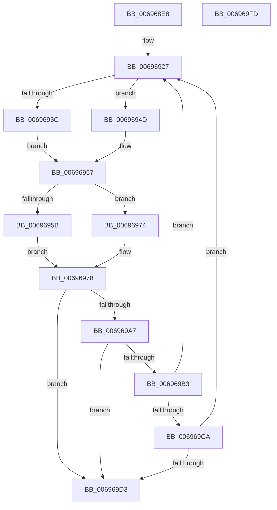

# MiZeroNodeConductorWait

- RVA: `0x006968E8`–`0x006969FE` (길이 `278` bytes)
- VA: `0x00000001406968E8`
- 실행 섹션: `.text`
- PDB 이름 있음: `예`; PDB Function 태그: `아니요`
- unwind 정보 RVA: `0x000C6AF0`
- 디코드: `79`개 명령, `278/278` bytes 표시
- 미해석 바이트: `0` (있으면 어셈블리에 `.byte`로 보존)

> 이 문서는 커널 이미지의 기계어와 PDB 기호를 분석해 생성했습니다. 4번과 5번은 함수 원형과 자료형을 바이너리 사용 방식에서 추정한 C 해석이며 원본 소스 복구 결과는 아닙니다.

## 1. Dependencies

- 직접 호출 지점: **3**; 고유 호출 대상: **3**
- 직접 호출자로 확인된 함수: **2**
- RIP 상대 이미지 참조: **1**

### Outgoing calls
- `0x0069699C` → [KeWaitForMultipleObjects](../20/KeWaitForMultipleObjects_function_0020D110.md) (function, `0x0020D110`)
- `0x006969BA` → [MiDeleteThreadContext](MiDeleteThreadContext_function_00695E54.md) (function, `0x00695E54`)
- `0x006969E0` → [_security_check_cookie](../6A/_security_check_cookie_function_006AC640.md) (function, `0x006AC640`)

### Direct callers
- [MiZeroNodeExiting](MiZeroNodeExiting_function_00696A04.md) at `0x00696A68`
- [MiNodeZeroConductor](../../page/81/MiNodeZeroConductor_function_00810AC0.md) at `0x00810BCA`

### Static image references
- `0x006968FD` → RVA `0x00E0A740` (`.data`; read)

## 2. Other-region calls and transfers

- 다른 실행 섹션으로 향하는 call: **0**
- 별도 외부 분기/꼬리 이동을 확인하지 못했습니다.

## 3. Assembly (complete function range)

```asm
006968E8  48 89 5C 24 18                  mov qword ptr [rsp + 0x18], rbx
006968ED  48 89 6C 24 20                  mov qword ptr [rsp + 0x20], rbp
006968F2  56                              push rsi
006968F3  57                              push rdi
006968F4  41 56                           push r14
006968F6  48 81 EC 00 01 00 00            sub rsp, 0x100
006968FD  48 8B 05 3C 3E 77 00            mov rax, qword ptr [rip + 0x773e3c]
00696904  48 33 C4                        xor rax, rsp
00696907  48 89 84 24 F0 00 00 00         mov qword ptr [rsp + 0xf0], rax
0069690F  0F 57 C0                        xorps xmm0, xmm0
00696912  33 C0                           xor eax, eax
00696914  48 8B D9                        mov rbx, rcx
00696917  48 89 44 24 50                  mov qword ptr [rsp + 0x50], rax
0069691C  8B 49 3C                        mov ecx, dword ptr [rcx + 0x3c]
0069691F  4C 8B F2                        mov r14, rdx
00696922  0F 11 44 24 40                  movups xmmword ptr [rsp + 0x40], xmm0
00696927  8A 53 51                        mov dl, byte ptr [rbx + 0x51]
0069692A  8A C2                           mov al, dl
0069692C  F6 D8                           neg al
0069692E  1B F6                           sbb esi, esi
00696930  F7 D6                           not esi
00696932  83 E6 03                        and esi, 3
00696935  44 8B D6                        mov r10d, esi
00696938  85 C9                           test ecx, ecx
0069693A  74 11                           je 0x14069694d
0069693C  48 8B 7B 48                     mov rdi, qword ptr [rbx + 0x48]
00696940  44 03 D1                        add r10d, ecx
00696943  48 83 C1 03                     add rcx, 3
00696947  48 8D 0C CF                     lea rcx, [rdi + rcx*8]
0069694B  EB 0A                           jmp 0x140696957
0069694D  48 8D 7C 24 40                  lea rdi, [rsp + 0x40]
00696952  48 8D 4C 24 60                  lea rcx, [rsp + 0x60]
00696957  84 D2                           test dl, dl
00696959  75 19                           jne 0x140696974
0069695B  48 8B 43 30                     mov rax, qword ptr [rbx + 0x30]
0069695F  48 83 C0 58                     add rax, 0x58
00696963  48 89 5F 10                     mov qword ptr [rdi + 0x10], rbx
00696967  48 89 07                        mov qword ptr [rdi], rax
0069696A  48 8D 43 58                     lea rax, [rbx + 0x58]
0069696E  48 89 47 08                     mov qword ptr [rdi + 8], rax
00696972  EB 04                           jmp 0x140696978
00696974  48 83 C7 18                     add rdi, 0x18
00696978  48 89 4C 24 38                  mov qword ptr [rsp + 0x38], rcx
0069697D  41 B9 08 00 00 00               mov r9d, 8
00696983  4C 89 74 24 30                  mov qword ptr [rsp + 0x30], r14
00696988  48 8B D7                        mov rdx, rdi
0069698B  C6 44 24 28 00                  mov byte ptr [rsp + 0x28], 0
00696990  41 8B CA                        mov ecx, r10d
00696993  C6 44 24 20 00                  mov byte ptr [rsp + 0x20], 0
00696998  45 8D 41 F9                     lea r8d, [r9 - 7]
0069699C  E8 6F 67 B7 FF                  call 0x14020d110
006969A1  8B E8                           mov ebp, eax
006969A3  3B C6                           cmp eax, esi
006969A5  72 2C                           jb 0x1406969d3
006969A7  44 8B 43 3C                     mov r8d, dword ptr [rbx + 0x3c]
006969AB  44 03 C6                        add r8d, esi
006969AE  41 3B E8                        cmp ebp, r8d
006969B1  73 20                           jae 0x1406969d3
006969B3  48 8B 14 EF                     mov rdx, qword ptr [rdi + rbp*8]
006969B7  48 8B CB                        mov rcx, rbx
006969BA  E8 95 F4 FF FF                  call 0x140695e54
006969BF  8B 4B 3C                        mov ecx, dword ptr [rbx + 0x3c]
006969C2  85 C9                           test ecx, ecx
006969C4  0F 85 5D FF FF FF               jne 0x140696927
006969CA  38 4B 51                        cmp byte ptr [rbx + 0x51], cl
006969CD  0F 84 54 FF FF FF               je 0x140696927
006969D3  8B C5                           mov eax, ebp
006969D5  48 8B 8C 24 F0 00 00 00         mov rcx, qword ptr [rsp + 0xf0]
006969DD  48 33 CC                        xor rcx, rsp
006969E0  E8 5B 5C 01 00                  call 0x1406ac640
006969E5  4C 8D 9C 24 00 01 00 00         lea r11, [rsp + 0x100]
006969ED  49 8B 5B 30                     mov rbx, qword ptr [r11 + 0x30]
006969F1  49 8B 6B 38                     mov rbp, qword ptr [r11 + 0x38]
006969F5  49 8B E3                        mov rsp, r11
006969F8  41 5E                           pop r14
006969FA  5F                              pop rdi
006969FB  5E                              pop rsi
006969FC  C3                              ret
006969FD  CC                              int3
```

## 4. C-style interpretation (structured pseudocode)

```c
__int64 __fastcall MiZeroNodeConductorWait(__int64 a1, __int64 a2)
{
    __int64 result;
    __int64 v_r10;
    __int64 v_rdi;
    __int64 v_rsi;
    __int64 v_rsp;
    unsigned __int64 v_stack_m18;
    unsigned __int64 v_stack_m28;
    unsigned __int64 v_stack_mB8;
    unsigned __int64 v_stack_mC8;
    unsigned __int64 v_stack_mD8;
    unsigned __int64 v_stack_mE0;
    unsigned __int64 v_stack_mE8;
    unsigned __int8 v_stack_mF0;
    unsigned __int8 v_stack_mF8;
    unsigned __int64 v_stack_p18;
    unsigned __int64 v_stack_p20;

    v_stack_p18 = v_rbx;
    v_stack_p20 = v_rbp;
    v_rsp = (v_rsp) - (256);
    result = (*(unsigned __int64 *)(v_rip + 7814716)) ^ (v_rsp);
    v_stack_m28 = result;
    result = 0;
    v_stack_mC8 = 0;
    v_stack_mD8 = v_xmm0;
loc_00696927:
    result = (unsigned __int8)(-((unsigned __int8)(*(unsigned __int8 *)(a1 + 81))));
    v_rsi = (unsigned int)(~(v_rsi));
    v_rsi = (unsigned int)((v_rsi) & (3));
    if ((unsigned int)((unsigned int)(*(unsigned int *)(a1 + 60))) == 0) goto loc_0069694D;
    v_r10 = (unsigned int)(((unsigned int)((unsigned int)(v_rsi))) + ((unsigned int)((unsigned int)(*(unsigned int *)(a1 + 60)))));
    a1 = ((unsigned int)(*(unsigned int *)(a1 + 60))) + (3);
    goto loc_00696957;
loc_0069694D:
loc_00696957:
    if ((unsigned __int8)(*(unsigned __int8 *)(a1 + 81)) != 0) goto loc_00696974;
    result = (*(unsigned __int64 *)(a1 + 48)) + (88);
    *(unsigned __int64 *)(v_stack_mD8 + 16) = a1;
    *(unsigned __int64 *)(v_stack_mD8) = result;
    *(unsigned __int64 *)(v_stack_mD8 + 8) = a1 + 88;
    goto loc_00696978;
loc_00696974:
    v_rdi = (v_stack_mD8) + (24);
loc_00696978:
    v_stack_mE0 = v_stack_mB8;
    v_stack_mE8 = a2;
    v_stack_mF0 = 0;
    v_stack_mF8 = 0;
    result = KeWaitForMultipleObjects((unsigned int)((unsigned int)(v_r10)), v_rdi, 8 - 7, 8);
    if (((unsigned int)(result)) < ((unsigned int)(v_rsi))) goto loc_006969D3;
    a3 = (unsigned int)(((unsigned int)(*(unsigned int *)(a1 + 60))) + ((unsigned int)(v_rsi)));
    if (((unsigned int)((unsigned int)((unsigned int)(result)))) >= ((unsigned int)(a3))) goto loc_006969D3;
    result = MiDeleteThreadContext(a1, *(unsigned __int64 *)(v_rdi + (unsigned int)((unsigned int)(result)) * 8), a3, 8);
    if ((unsigned int)((unsigned int)(*(unsigned int *)(a1 + 60))) != 0) goto loc_00696927;
    if ((*(unsigned __int8 *)(a1 + 81)) == ((unsigned __int8)((unsigned int)(*(unsigned int *)(a1 + 60))))) goto loc_00696927;
loc_006969D3:
    a1 = (v_stack_m28) ^ (v_rsp);
    result = _security_check_cookie(a1, *(unsigned __int64 *)(v_rdi + (unsigned int)((unsigned int)(result)) * 8), a3, 8);
    return result;
}
```

## 5. (Beta) C Style

```c
int64_t MiZeroNodeConductorWait(void *Arg1, int64_t Arg2)
{
    uint8_t *arg1 = (uint8_t *)Arg1;

    int64_t result;
    int64_t local_r10;
    int64_t local_rdi;
    int64_t local_rsi;
    int64_t local_rsp;
    uint64_t v_stack_m18;
    uint64_t v_stack_m28;
    uint64_t v_stack_mB8;
    uint64_t v_stack_mC8;
    uint64_t v_stack_mD8;
    uint64_t v_stack_mE0;
    uint64_t v_stack_mE8;
    uint8_t v_stack_mF0;
    uint8_t v_stack_mF8;
    uint64_t v_stack_p18;
    uint64_t v_stack_p20;

    v_stack_p18 = local_rbx;
    v_stack_p20 = local_rbp;
    local_rsp = (local_rsp) - (256);
    result = (*(uint64_t *)(v_rip + 0x773E3C)) ^ (local_rsp);
    v_stack_m28 = result;
    result = 0;
    v_stack_mC8 = 0;
    v_stack_mD8 = v_xmm0;
loc_00696927:
    result = (uint8_t)(-((uint8_t)(*(uint8_t *)(arg1 + 0x51))));
    local_rsi = (uint32_t)(~(local_rsi));
    local_rsi = (uint32_t)((local_rsi) & (3));
    if ((uint32_t)((uint32_t)(*(uint32_t *)(arg1 + 0x3C))) == 0) goto loc_0069694D;
    local_r10 = (uint32_t)(((uint32_t)((uint32_t)(local_rsi))) + ((uint32_t)((uint32_t)(*(uint32_t *)(arg1 + 0x3C)))));
    Arg1 = ((uint32_t)(*(uint32_t *)(arg1 + 0x3C))) + (3);
    goto loc_00696957;
loc_0069694D:
loc_00696957:
    if ((uint8_t)(*(uint8_t *)(arg1 + 0x51)) != 0) goto loc_00696974;
    result = (*(uint64_t *)(arg1 + 0x30)) + (88);
    *(void **)(v_stack_mD8 + 0x10) = Arg1;
    *(uint64_t *)(v_stack_mD8) = result;
    *(void **)(v_stack_mD8 + 0x8) = Arg1 + 88;
    goto loc_00696978;
loc_00696974:
    local_rdi = (v_stack_mD8) + (24);
loc_00696978:
    v_stack_mE0 = v_stack_mB8;
    v_stack_mE8 = Arg2;
    v_stack_mF0 = 0;
    v_stack_mF8 = 0;
    result = KeWaitForMultipleObjects((uint32_t)((uint32_t)(local_r10)), local_rdi, 8 - 7, 8);
    if (((uint32_t)(result)) < ((uint32_t)(local_rsi))) goto loc_006969D3;
    a3 = (uint32_t)(((uint32_t)(*(uint32_t *)(arg1 + 0x3C))) + ((uint32_t)(local_rsi)));
    if (((uint32_t)((uint32_t)((uint32_t)(result)))) >= ((uint32_t)(a3))) goto loc_006969D3;
    result = MiDeleteThreadContext(Arg1, *(uint64_t *)(local_rdi + (uint32_t)((uint32_t)(result)) * 8), a3, 8);
    if ((uint32_t)((uint32_t)(*(uint32_t *)(arg1 + 0x3C))) != 0) goto loc_00696927;
    if ((*(uint8_t *)(arg1 + 0x51)) == ((uint8_t)((uint32_t)(*(uint32_t *)(arg1 + 0x3C))))) goto loc_00696927;
loc_006969D3:
    Arg1 = (v_stack_m28) ^ (local_rsp);
    result = _security_check_cookie(Arg1, *(uint64_t *)(local_rdi + (uint32_t)((uint32_t)(result)) * 8), a3, 8);
    return result;
}
```

### 관측된 메모리 오프셋

구조체 형식이 확인되지 않은 접근은 인자 기준의 오프셋으로만 기록했습니다.

| 기준 인자 | 오프셋 표현 | 폭 (bit) | 접근 |
|---|---:|---:|---|
| `Arg1` | `+ 0x30` | `64` | `R` |
| `Arg1` | `+ 0x3C` | `32` | `R` |
| `Arg1` | `+ 0x48` | `64` | `R` |
| `Arg1` | `+ 0x51` | `8` | `R` |
| `Arg1` | `+ 0x58` | `64` | `R` |

## 6. Execution-region graph

[열기: 2D/3D 그래프와 함수 탐색 컨트롤 패널](../../../control-panel.html?section=text&rva=0x006968E8&view=graph)

- 2D 그래프는 위에서 아래로 흐르고, 3D 그래프는 빈 공간을 드래그해 회전합니다. Shift+드래그는 이동, 휠은 확대·축소, 함수 노드 선택은 대상 보고서 이동입니다.

### Static fallback


