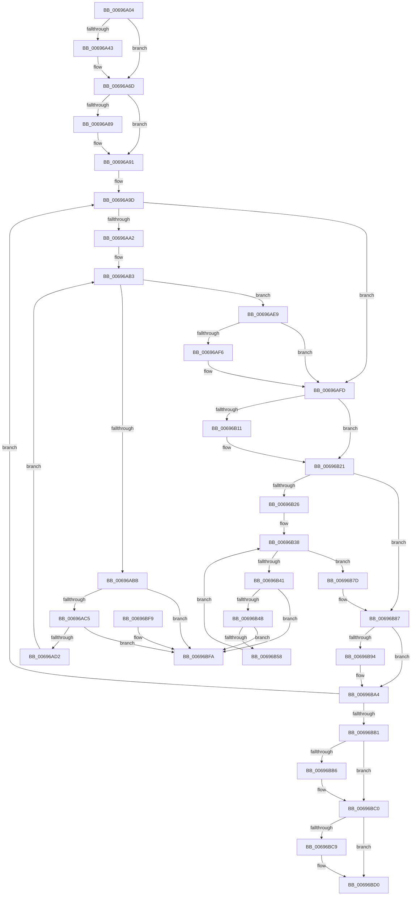

# MiZeroNodeExiting

- RVA: `0x00696A04`–`0x00696C01` (길이 `509` bytes)
- VA: `0x0000000140696A04`
- 실행 섹션: `.text`
- PDB 이름 있음: `예`; PDB Function 태그: `아니요`
- unwind 정보 RVA: `0x000C45E0`
- 디코드: `132`개 명령, `509/509` bytes 표시
- 미해석 바이트: `0` (있으면 어셈블리에 `.byte`로 보존)

> 이 문서는 커널 이미지의 기계어와 PDB 기호를 분석해 생성했습니다. 4번과 5번은 함수 원형과 자료형을 바이너리 사용 방식에서 추정한 C 해석이며 원본 소스 복구 결과는 아닙니다.

## 1. Dependencies

- 직접 호출 지점: **18**; 고유 호출 대상: **6**
- 직접 호출자로 확인된 함수: **1**
- RIP 상대 이미지 참조: **0**

### Outgoing calls
- `0x00696A4A` → [ExAcquireSpinLockExclusive](../24/ExAcquireSpinLockExclusive_function_00248690.md) (function, `0x00248690`)
- `0x00696A54` → [MiWakeZeroingThreads](../2C/MiWakeZeroingThreads_function_002CBEC0.md) (function, `0x002CBEC0`)
- `0x00696A5E` → [MiReleaseSpinLockExclusive](../24/MiReleaseSpinLockExclusive_function_002482C0.md) (function, `0x002482C0`)
- `0x00696A68` → [MiZeroNodeConductorWait](MiZeroNodeConductorWait_function_006968E8.md) (function, `0x006968E8`)
- `0x00696A70` → [ExAcquireSpinLockExclusive](../24/ExAcquireSpinLockExclusive_function_00248690.md) (function, `0x00248690`)
- `0x00696A96` → [MiReleaseSpinLockExclusive](../24/MiReleaseSpinLockExclusive_function_002482C0.md) (function, `0x002482C0`)
- `0x00696AE2` → [ExFreePoolWithTag](../../poolcode/B8/ExFreePoolWithTag_function_00B82870.md) (function, `0x00B82870`)
- `0x00696AF8` → [ExFreePoolWithTag](../../poolcode/B8/ExFreePoolWithTag_function_00B82870.md) (function, `0x00B82870`)
- `0x00696B13` → [ExFreePoolWithTag](../../poolcode/B8/ExFreePoolWithTag_function_00B82870.md) (function, `0x00B82870`)
- `0x00696B29` → [ExAcquireSpinLockExclusive](../24/ExAcquireSpinLockExclusive_function_00248690.md) (function, `0x00248690`)
- `0x00696B65` → [MiReleaseSpinLockExclusive](../24/MiReleaseSpinLockExclusive_function_002482C0.md) (function, `0x002482C0`)
- `0x00696B6E` → [MiDeleteAcceleratorDescriptor](../2C/MiDeleteAcceleratorDescriptor_function_002CA560.md) (function, `0x002CA560`)
- `0x00696B76` → [ExAcquireSpinLockExclusive](../24/ExAcquireSpinLockExclusive_function_00248690.md) (function, `0x00248690`)
- `0x00696B82` → [MiReleaseSpinLockExclusive](../24/MiReleaseSpinLockExclusive_function_002482C0.md) (function, `0x002482C0`)
- `0x00696B96` → [ExFreePoolWithTag](../../poolcode/B8/ExFreePoolWithTag_function_00B82870.md) (function, `0x00B82870`)
- `0x00696BBB` → [ExFreePoolWithTag](../../poolcode/B8/ExFreePoolWithTag_function_00B82870.md) (function, `0x00B82870`)
- `0x00696BCB` → [ExFreePoolWithTag](../../poolcode/B8/ExFreePoolWithTag_function_00B82870.md) (function, `0x00B82870`)
- `0x00696BD5` → [ExFreePoolWithTag](../../poolcode/B8/ExFreePoolWithTag_function_00B82870.md) (function, `0x00B82870`)

### Direct callers
- [MiNodeZeroConductor](../../page/81/MiNodeZeroConductor_function_00810AC0.md) at `0x00810C3F`

### Static image references
- 디코드된 RIP-relative 메모리 참조가 없습니다.

## 2. Other-region calls and transfers

- 다른 실행 섹션으로 향하는 call: **7**
  - `0x00696AE2` → [ExFreePoolWithTag](../../poolcode/B8/ExFreePoolWithTag_function_00B82870.md) (`.text` → `POOLCODE`)
  - `0x00696AF8` → [ExFreePoolWithTag](../../poolcode/B8/ExFreePoolWithTag_function_00B82870.md) (`.text` → `POOLCODE`)
  - `0x00696B13` → [ExFreePoolWithTag](../../poolcode/B8/ExFreePoolWithTag_function_00B82870.md) (`.text` → `POOLCODE`)
  - `0x00696B96` → [ExFreePoolWithTag](../../poolcode/B8/ExFreePoolWithTag_function_00B82870.md) (`.text` → `POOLCODE`)
  - `0x00696BBB` → [ExFreePoolWithTag](../../poolcode/B8/ExFreePoolWithTag_function_00B82870.md) (`.text` → `POOLCODE`)
  - `0x00696BCB` → [ExFreePoolWithTag](../../poolcode/B8/ExFreePoolWithTag_function_00B82870.md) (`.text` → `POOLCODE`)
  - `0x00696BD5` → [ExFreePoolWithTag](../../poolcode/B8/ExFreePoolWithTag_function_00B82870.md) (`.text` → `POOLCODE`)
- 별도 외부 분기/꼬리 이동을 확인하지 못했습니다.

## 3. Assembly (complete function range)

```asm
00696A04  48 8B C4                        mov rax, rsp
00696A07  48 89 58 08                     mov qword ptr [rax + 8], rbx
00696A0B  48 89 68 10                     mov qword ptr [rax + 0x10], rbp
00696A0F  48 89 70 18                     mov qword ptr [rax + 0x18], rsi
00696A13  48 89 78 20                     mov qword ptr [rax + 0x20], rdi
00696A17  41 54                           push r12
00696A19  41 56                           push r14
00696A1B  41 57                           push r15
00696A1D  48 83 EC 20                     sub rsp, 0x20
00696A21  8B 41 38                        mov eax, dword ptr [rcx + 0x38]
00696A24  48 8B F9                        mov rdi, rcx
00696A27  48 69 F0 80 DF 00 00            imul rsi, rax, 0xdf80
00696A2E  48 8B 41 30                     mov rax, qword ptr [rcx + 0x30]
00696A32  48 03 70 10                     add rsi, qword ptr [rax + 0x10]
00696A36  83 79 3C 00                     cmp dword ptr [rcx + 0x3c], 0
00696A3A  48 8D AE B0 3B 00 00            lea rbp, [rsi + 0x3bb0]
00696A41  74 2A                           je 0x140696a6d
00696A43  C6 41 51 01                     mov byte ptr [rcx + 0x51], 1
00696A47  48 8B CD                        mov rcx, rbp
00696A4A  E8 41 1C BB FF                  call 0x140248690
00696A4F  48 8B CF                        mov rcx, rdi
00696A52  8A D8                           mov bl, al
00696A54  E8 67 54 C3 FF                  call 0x1402cbec0
00696A59  8A D3                           mov dl, bl
00696A5B  48 8B CD                        mov rcx, rbp
00696A5E  E8 5D 18 BB FF                  call 0x1402482c0
00696A63  33 D2                           xor edx, edx
00696A65  48 8B CF                        mov rcx, rdi
00696A68  E8 7B FE FF FF                  call 0x1406968e8
00696A6D  48 8B CD                        mov rcx, rbp
00696A70  E8 1B 1C BB FF                  call 0x140248690
00696A75  48 83 A6 A8 3B 00 00 00         and qword ptr [rsi + 0x3ba8], 0
00696A7D  48 8B 9E A0 3B 00 00            mov rbx, qword ptr [rsi + 0x3ba0]
00696A84  48 85 DB                        test rbx, rbx
00696A87  74 08                           je 0x140696a91
00696A89  48 83 A6 A0 3B 00 00 00         and qword ptr [rsi + 0x3ba0], 0
00696A91  8A D0                           mov dl, al
00696A93  48 8B CD                        mov rcx, rbp
00696A96  E8 25 18 BB FF                  call 0x1402482c0
00696A9B  33 F6                           xor esi, esi
00696A9D  48 85 DB                        test rbx, rbx
00696AA0  74 5B                           je 0x140696afd
00696AA2  4C 69 FE 30 01 00 00            imul r15, rsi, 0x130
00696AA9  4C 8D B3 48 01 00 00            lea r14, [rbx + 0x148]
00696AB0  4D 03 F7                        add r14, r15
00696AB3  49 8B 0E                        mov rcx, qword ptr [r14]
00696AB6  49 3B CE                        cmp rcx, r14
00696AB9  74 2E                           je 0x140696ae9
00696ABB  4C 39 71 08                     cmp qword ptr [rcx + 8], r14
00696ABF  0F 85 35 01 00 00               jne 0x140696bfa
00696AC5  48 8B 01                        mov rax, qword ptr [rcx]
00696AC8  48 39 48 08                     cmp qword ptr [rax + 8], rcx
00696ACC  0F 85 28 01 00 00               jne 0x140696bfa
00696AD2  49 89 06                        mov qword ptr [r14], rax
00696AD5  48 81 C1 60 FE FF FF            add rcx, -0x1a0
00696ADC  33 D2                           xor edx, edx
00696ADE  4C 89 70 08                     mov qword ptr [rax + 8], r14
00696AE2  E8 89 BD 4E 00                  call 0x140b82870
00696AE7  EB CA                           jmp 0x140696ab3
00696AE9  49 8B 8C 1F B0 01 00 00         mov rcx, qword ptr [r15 + rbx + 0x1b0]
00696AF1  48 85 C9                        test rcx, rcx
00696AF4  74 07                           je 0x140696afd
00696AF6  33 D2                           xor edx, edx
00696AF8  E8 73 BD 4E 00                  call 0x140b82870
00696AFD  4C 69 F6 30 01 00 00            imul r14, rsi, 0x130
00696B04  49 8B 8C 3E B0 01 00 00         mov rcx, qword ptr [r14 + rdi + 0x1b0]
00696B0C  48 85 C9                        test rcx, rcx
00696B0F  74 10                           je 0x140696b21
00696B11  33 D2                           xor edx, edx
00696B13  E8 58 BD 4E 00                  call 0x140b82870
00696B18  49 83 A4 3E B0 01 00 00 00      and qword ptr [r14 + rdi + 0x1b0], 0
00696B21  48 85 F6                        test rsi, rsi
00696B24  75 61                           jne 0x140696b87
00696B26  48 8B CD                        mov rcx, rbp
00696B29  E8 62 1B BB FF                  call 0x140248690
00696B2E  4C 8D A7 00 01 00 00            lea r12, [rdi + 0x100]
00696B35  4D 03 E6                        add r12, r14
00696B38  4D 8B 3C 24                     mov r15, qword ptr [r12]
00696B3C  4D 3B FC                        cmp r15, r12
00696B3F  74 3C                           je 0x140696b7d
00696B41  4D 39 67 08                     cmp qword ptr [r15 + 8], r12
00696B45  0F 85 AF 00 00 00               jne 0x140696bfa
00696B4B  49 8B 0F                        mov rcx, qword ptr [r15]
00696B4E  4C 39 79 08                     cmp qword ptr [rcx + 8], r15
00696B52  0F 85 A2 00 00 00               jne 0x140696bfa
00696B58  49 89 0C 24                     mov qword ptr [r12], rcx
00696B5C  8A D0                           mov dl, al
00696B5E  4C 89 61 08                     mov qword ptr [rcx + 8], r12
00696B62  48 8B CD                        mov rcx, rbp
00696B65  E8 56 17 BB FF                  call 0x1402482c0
00696B6A  49 8D 4F 20                     lea rcx, [r15 + 0x20]
00696B6E  E8 ED 39 C3 FF                  call 0x1402ca560
00696B73  48 8B CD                        mov rcx, rbp
00696B76  E8 15 1B BB FF                  call 0x140248690
00696B7B  EB BB                           jmp 0x140696b38
00696B7D  8A D0                           mov dl, al
00696B7F  48 8B CD                        mov rcx, rbp
00696B82  E8 39 17 BB FF                  call 0x1402482c0
00696B87  49 8B 8C 3E 18 01 00 00         mov rcx, qword ptr [r14 + rdi + 0x118]
00696B8F  48 85 C9                        test rcx, rcx
00696B92  74 10                           je 0x140696ba4
00696B94  33 D2                           xor edx, edx
00696B96  E8 D5 BC 4E 00                  call 0x140b82870
00696B9B  49 83 A4 3E 18 01 00 00 00      and qword ptr [r14 + rdi + 0x118], 0
00696BA4  48 FF C6                        inc rsi
00696BA7  48 83 FE 03                     cmp rsi, 3
00696BAB  0F 8C EC FE FF FF               jl 0x140696a9d
00696BB1  48 85 DB                        test rbx, rbx
00696BB4  74 0A                           je 0x140696bc0
00696BB6  33 D2                           xor edx, edx
00696BB8  48 8B CB                        mov rcx, rbx
00696BBB  E8 B0 BC 4E 00                  call 0x140b82870
00696BC0  48 8B 4F 48                     mov rcx, qword ptr [rdi + 0x48]
00696BC4  48 85 C9                        test rcx, rcx
00696BC7  74 07                           je 0x140696bd0
00696BC9  33 D2                           xor edx, edx
00696BCB  E8 A0 BC 4E 00                  call 0x140b82870
00696BD0  33 D2                           xor edx, edx
00696BD2  48 8B CF                        mov rcx, rdi
00696BD5  E8 96 BC 4E 00                  call 0x140b82870
00696BDA  48 8B 5C 24 40                  mov rbx, qword ptr [rsp + 0x40]
00696BDF  48 8B 6C 24 48                  mov rbp, qword ptr [rsp + 0x48]
00696BE4  48 8B 74 24 50                  mov rsi, qword ptr [rsp + 0x50]
00696BE9  48 8B 7C 24 58                  mov rdi, qword ptr [rsp + 0x58]
00696BEE  48 83 C4 20                     add rsp, 0x20
00696BF2  41 5F                           pop r15
00696BF4  41 5E                           pop r14
00696BF6  41 5C                           pop r12
00696BF8  C3                              ret
00696BF9  CC                              int3
00696BFA  B9 03 00 00 00                  mov ecx, 3
00696BFF  CD 29                           int 0x29
```

## 4. C-style interpretation (structured pseudocode)

```c
__int64 __fastcall MiZeroNodeExiting(__int64 a1)
{
    __int64 result;
    __int64 v_r12;
    __int64 v_r14;
    __int64 v_r15;
    __int64 v_rbx;
    __int64 v_rsi;
    __int64 v_rsp;
    unsigned __int64 v_stack_p10;
    unsigned __int64 v_stack_p18;
    unsigned __int64 v_stack_p20;
    unsigned __int64 v_stack_p8;

    *(unsigned __int64 *)(v_rsp + 8) = v_rbx;
    *(unsigned __int64 *)(v_rsp + 16) = v_rbp;
    *(unsigned __int64 *)(v_rsp + 24) = v_rsi;
    *(unsigned __int64 *)(v_rsp + 32) = v_rdi;
    v_rsp = (v_rsp) - (32);
    v_rsi = (v_rsi) * ((unsigned int)(*(unsigned int *)(a1 + 56)));
    v_rsi = (v_rsi) + (*(unsigned __int64 *)(*(unsigned __int64 *)(a1 + 48) + 16));
    result = *(unsigned __int64 *)(a1 + 48);
    if ((*(unsigned int *)(a1 + 60)) != 0) {
        *(unsigned __int8 *)(a1 + 81) = 1;
        a1 = v_rsi + 15280;
        result = ExAcquireSpinLockExclusive(a1, a2, a3, a4);
        a1 = a1;
        v_rbx = (unsigned __int8)(result);
        result = MiWakeZeroingThreads(a1, a2, a3, a4);
        a2 = (unsigned __int8)(v_rbx);
        a1 = v_rsi + 15280;
        result = MiReleaseSpinLockExclusive(a1, a2, a3, a4);
        a2 = 0;
        a1 = a1;
        result = MiZeroNodeConductorWait(a1, a2, a3, a4);
    }
    result = ExAcquireSpinLockExclusive(v_rsi + 15280, a2, a3, a4);
    if (*(unsigned __int64 *)(v_rsi + 15264) != 0) {
    }
    result = MiReleaseSpinLockExclusive(v_rsi + 15280, (unsigned __int8)(result), a3, a4);
    v_rsi = 0;
loc_00696A9D:
    if (*(unsigned __int64 *)(v_rsi + 15264) == 0) goto loc_00696AFD;
    v_r15 = (v_r15) * (0);
    v_r14 = (*(unsigned __int64 *)(v_rsi + 15264) + 328) + (v_r15);
loc_00696AB3:
    if ((*(unsigned __int64 *)(v_r14)) == v_r14) goto loc_00696AE9;
    if ((*(unsigned __int64 *)(*(unsigned __int64 *)(v_r14) + 8)) != v_r14) goto loc_00696BFA;
    if ((*(unsigned __int64 *)(*(unsigned __int64 *)(*(unsigned __int64 *)(v_r14)) + 8)) != (*(unsigned __int64 *)(v_r14))) goto loc_00696BFA;
    *(unsigned __int64 *)(v_r14) = *(unsigned __int64 *)(*(unsigned __int64 *)(v_r14));
    a1 = (*(unsigned __int64 *)(v_r14)) + (-416);
    a2 = 0;
    *(unsigned __int64 *)(*(unsigned __int64 *)(*(unsigned __int64 *)(v_r14)) + 8) = v_r14;
    result = ExFreePoolWithTag(a1, a2, a3, a4);
    goto loc_00696AB3;
loc_00696AE9:
    if (*(unsigned __int64 *)(v_r15 + *(unsigned __int64 *)(v_rsi + 15264) * 1 + 432) != 0) {
        a2 = 0;
        result = ExFreePoolWithTag(*(unsigned __int64 *)(v_r15 + *(unsigned __int64 *)(v_rsi + 15264) * 1 + 432), a2, a3, a4);
    }
    v_r14 = (v_r14) * (0);
    if (*(unsigned __int64 *)(v_r14 + a1 * 1 + 432) != 0) {
        a2 = 0;
        result = ExFreePoolWithTag(*(unsigned __int64 *)(v_r14 + a1 * 1 + 432), a2, a3, a4);
    }
    if (0 != 0) goto loc_00696B87;
    result = ExAcquireSpinLockExclusive(v_rsi + 15280, a2, a3, a4);
    v_r12 = (a1 + 256) + (v_r14);
loc_00696B38:
    if ((*(unsigned __int64 *)(v_r12)) == v_r12) goto loc_00696B7D;
    if ((*(unsigned __int64 *)(*(unsigned __int64 *)(v_r12) + 8)) != v_r12) goto loc_00696BFA;
    if ((*(unsigned __int64 *)(*(unsigned __int64 *)(*(unsigned __int64 *)(v_r12)) + 8)) != (*(unsigned __int64 *)(v_r12))) goto loc_00696BFA;
    *(unsigned __int64 *)(v_r12) = *(unsigned __int64 *)(*(unsigned __int64 *)(v_r12));
    *(unsigned __int64 *)(*(unsigned __int64 *)(*(unsigned __int64 *)(v_r12)) + 8) = v_r12;
    result = MiReleaseSpinLockExclusive(v_rsi + 15280, (unsigned __int8)(result), a3, a4);
    result = MiDeleteAcceleratorDescriptor(*(unsigned __int64 *)(v_r12) + 32, (unsigned __int8)(result), a3, a4);
    result = ExAcquireSpinLockExclusive(v_rsi + 15280, (unsigned __int8)(result), a3, a4);
    goto loc_00696B38;
loc_00696B7D:
    result = MiReleaseSpinLockExclusive(v_rsi + 15280, (unsigned __int8)(result), a3, a4);
loc_00696B87:
    if (*(unsigned __int64 *)(v_r14 + a1 * 1 + 280) != 0) {
        a2 = 0;
        result = ExFreePoolWithTag(*(unsigned __int64 *)(v_r14 + a1 * 1 + 280), a2, a3, a4);
    }
    v_rsi = (v_rsi) + 1;
    if (v_rsi < 3) goto loc_00696A9D;
    if (*(unsigned __int64 *)(v_rsi + 15264) != 0) {
        a2 = 0;
        a1 = *(unsigned __int64 *)(v_rsi + 15264);
        result = ExFreePoolWithTag(a1, a2, a3, a4);
    }
    if (*(unsigned __int64 *)(a1 + 72) != 0) {
        a2 = 0;
        result = ExFreePoolWithTag(*(unsigned __int64 *)(a1 + 72), a2, a3, a4);
    }
    a2 = 0;
    result = ExFreePoolWithTag(a1, a2, a3, a4);
    v_rsp = (v_rsp) + (32);
    return result;
loc_00696BFA:
    return result;
}
```

## 5. (Beta) C Style

```c
int64_t MiZeroNodeExiting(void *Arg1)
{
    uint8_t *arg1 = (uint8_t *)Arg1;

    int64_t result;
    int64_t local_r12;
    int64_t local_r14;
    int64_t local_r15;
    int64_t local_rbx;
    int64_t local_rsi;
    int64_t local_rsp;
    uint64_t v_stack_p10;
    uint64_t v_stack_p18;
    uint64_t v_stack_p20;
    uint64_t v_stack_p8;

    *(uint64_t *)(local_rsp + 0x8) = local_rbx;
    *(uint64_t *)(local_rsp + 0x10) = local_rbp;
    *(uint64_t *)(local_rsp + 0x18) = local_rsi;
    *(uint64_t *)(local_rsp + 0x20) = local_rdi;
    local_rsp = (local_rsp) - (32);
    local_rsi = (local_rsi) * ((uint32_t)(*(uint32_t *)(arg1 + 0x38)));
    local_rsi = (local_rsi) + (*(uint64_t *)(*(uint64_t *)(arg1 + 0x30) + 0x10));
    result = *(uint64_t *)(arg1 + 0x30);
    if ((*(uint32_t *)(arg1 + 0x3C)) != 0) {
        *(uint8_t *)(arg1 + 0x51) = 1;
        Arg1 = local_rsi + 15280;
        result = ExAcquireSpinLockExclusive(Arg1, a2, a3, a4);
        Arg1 = Arg1;
        local_rbx = (uint8_t)(result);
        result = MiWakeZeroingThreads(Arg1, a2, a3, a4);
        a2 = (uint8_t)(local_rbx);
        Arg1 = local_rsi + 15280;
        result = MiReleaseSpinLockExclusive(Arg1, a2, a3, a4);
        a2 = 0;
        Arg1 = Arg1;
        result = MiZeroNodeConductorWait(Arg1, a2, a3, a4);
    }
    result = ExAcquireSpinLockExclusive(local_rsi + 15280, a2, a3, a4);
    if (*(uint64_t *)(local_rsi + 0x3BA0) != 0) {
    }
    result = MiReleaseSpinLockExclusive(local_rsi + 15280, (uint8_t)(result), a3, a4);
    local_rsi = 0;
loc_00696A9D:
    if (*(uint64_t *)(local_rsi + 0x3BA0) == 0) goto loc_00696AFD;
    local_r15 = (local_r15) * (0);
    local_r14 = (*(uint64_t *)(local_rsi + 0x3BA0) + 328) + (local_r15);
loc_00696AB3:
    if ((*(uint64_t *)(local_r14)) == local_r14) goto loc_00696AE9;
    if ((*(uint64_t *)(*(uint64_t *)(local_r14) + 0x8)) != local_r14) goto loc_00696BFA;
    if ((*(uint64_t *)(*(uint64_t *)(*(uint64_t *)(local_r14)) + 0x8)) != (*(uint64_t *)(local_r14))) goto loc_00696BFA;
    *(uint64_t *)(local_r14) = *(uint64_t *)(*(uint64_t *)(local_r14));
    Arg1 = (*(uint64_t *)(local_r14)) + (-416);
    a2 = 0;
    *(uint64_t *)(*(uint64_t *)(*(uint64_t *)(local_r14)) + 0x8) = local_r14;
    result = ExFreePoolWithTag(Arg1, a2, a3, a4);
    goto loc_00696AB3;
loc_00696AE9:
    if (*(uint64_t *)(local_r15 + *(uint64_t *)(local_rsi + 0x3BA0) * 1 + 0x1B0) != 0) {
        a2 = 0;
        result = ExFreePoolWithTag(*(uint64_t *)(local_r15 + *(uint64_t *)(local_rsi + 0x3BA0) * 1 + 0x1B0), a2, a3, a4);
    }
    local_r14 = (local_r14) * (0);
    if (*(uint64_t *)(local_r14 + arg1 * 1 + 0x1B0) != 0) {
        a2 = 0;
        result = ExFreePoolWithTag(*(uint64_t *)(local_r14 + arg1 * 1 + 0x1B0), a2, a3, a4);
    }
    if (0 != 0) goto loc_00696B87;
    result = ExAcquireSpinLockExclusive(local_rsi + 15280, a2, a3, a4);
    local_r12 = (Arg1 + 256) + (local_r14);
loc_00696B38:
    if ((*(uint64_t *)(local_r12)) == local_r12) goto loc_00696B7D;
    if ((*(uint64_t *)(*(uint64_t *)(local_r12) + 0x8)) != local_r12) goto loc_00696BFA;
    if ((*(uint64_t *)(*(uint64_t *)(*(uint64_t *)(local_r12)) + 0x8)) != (*(uint64_t *)(local_r12))) goto loc_00696BFA;
    *(uint64_t *)(local_r12) = *(uint64_t *)(*(uint64_t *)(local_r12));
    *(uint64_t *)(*(uint64_t *)(*(uint64_t *)(local_r12)) + 0x8) = local_r12;
    result = MiReleaseSpinLockExclusive(local_rsi + 15280, (uint8_t)(result), a3, a4);
    result = MiDeleteAcceleratorDescriptor(*(uint64_t *)(local_r12) + 32, (uint8_t)(result), a3, a4);
    result = ExAcquireSpinLockExclusive(local_rsi + 15280, (uint8_t)(result), a3, a4);
    goto loc_00696B38;
loc_00696B7D:
    result = MiReleaseSpinLockExclusive(local_rsi + 15280, (uint8_t)(result), a3, a4);
loc_00696B87:
    if (*(uint64_t *)(local_r14 + arg1 * 1 + 0x118) != 0) {
        a2 = 0;
        result = ExFreePoolWithTag(*(uint64_t *)(local_r14 + arg1 * 1 + 0x118), a2, a3, a4);
    }
    local_rsi = (local_rsi) + 1;
    if (local_rsi < 3) goto loc_00696A9D;
    if (*(uint64_t *)(local_rsi + 0x3BA0) != 0) {
        a2 = 0;
        Arg1 = *(uint64_t *)(local_rsi + 0x3BA0);
        result = ExFreePoolWithTag(Arg1, a2, a3, a4);
    }
    if (*(uint64_t *)(arg1 + 0x48) != 0) {
        a2 = 0;
        result = ExFreePoolWithTag(*(uint64_t *)(arg1 + 0x48), a2, a3, a4);
    }
    a2 = 0;
    result = ExFreePoolWithTag(Arg1, a2, a3, a4);
    local_rsp = (local_rsp) + (32);
    return result;
loc_00696BFA:
    return result;
}
```

### 관측된 메모리 오프셋

구조체 형식이 확인되지 않은 접근은 인자 기준의 오프셋으로만 기록했습니다.

| 기준 인자 | 오프셋 표현 | 폭 (bit) | 접근 |
|---|---:|---:|---|
| `Arg1` | `+ 0x0` | `64` | `R` |
| `Arg1` | `+ 0x0` | `64` | `W` |
| `Arg1` | `+ 0x30` | `64` | `R` |
| `Arg1` | `+ 0x38` | `32` | `R` |
| `Arg1` | `+ 0x3C` | `32` | `R` |
| `Arg1` | `+ 0x48` | `64` | `R` |
| `Arg1` | `+ 0x51` | `8` | `W` |
| `Arg1` | `+ 0x100` | `64` | `R` |

## 6. Execution-region graph

[열기: 2D/3D 그래프와 함수 탐색 컨트롤 패널](../../../control-panel.html?section=text&rva=0x00696A04&view=graph)

- 2D 그래프는 위에서 아래로 흐르고, 3D 그래프는 빈 공간을 드래그해 회전합니다. Shift+드래그는 이동, 휠은 확대·축소, 함수 노드 선택은 대상 보고서 이동입니다.

### Static fallback


