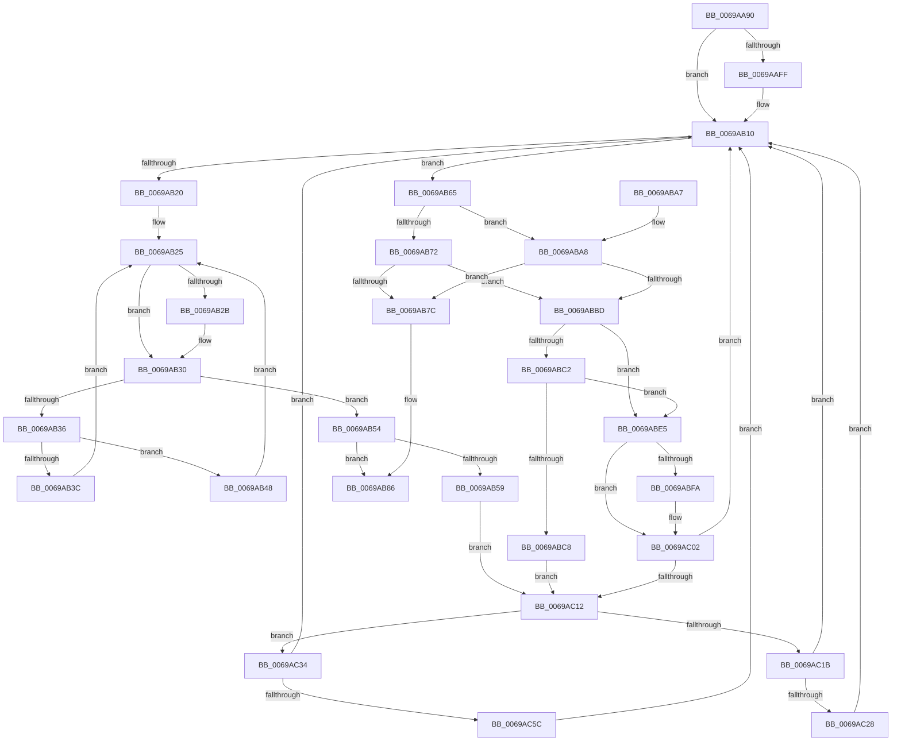

# MiZeroPageCalibrateDpc

- RVA: `0x0069AA90`–`0x0069AC71` (길이 `481` bytes)
- VA: `0x000000014069AA90`
- 실행 섹션: `.text`
- PDB 이름 있음: `예`; PDB Function 태그: `아니요`
- unwind 정보 RVA: `0x000D96BC`
- 디코드: `127`개 명령, `481/481` bytes 표시
- 미해석 바이트: `0` (있으면 어셈블리에 `.byte`로 보존)

> 이 문서는 커널 이미지의 기계어와 PDB 기호를 분석해 생성했습니다. 4번과 5번은 함수 원형과 자료형을 바이너리 사용 방식에서 추정한 C 해석이며 원본 소스 복구 결과는 아닙니다.

## 1. Dependencies

- 직접 호출 지점: **9**; 고유 호출 대상: **8**
- 직접 호출자로 확인된 함수: **0**
- RIP 상대 이미지 참조: **2**

### Outgoing calls
- `0x0069AB4D` → [KeYieldProcessorEx](../3F/KeYieldProcessorEx_function_003FBD00.md) (function, `0x003FBD00`)
- `0x0069AB81` → [MiWakeAllZeroCalibrationProcessors](MiWakeAllZeroCalibrationProcessors_function_0069A2DC.md) (function, `0x0069A2DC`)
- `0x0069ABB3` → [MiZeroPageCalibrateLastDpcProcessorDone](MiZeroPageCalibrateLastDpcProcessorDone_function_0069AC78.md) (function, `0x0069AC78`)
- `0x0069ABDE` → [MiWakeAllZeroCalibrationProcessors](MiWakeAllZeroCalibrationProcessors_function_0069A2DC.md) (function, `0x0069A2DC`)
- `0x0069ABEF` → [MiStartDpcZeroingRound](MiStartDpcZeroingRound_function_0069A24C.md) (function, `0x0069A24C`)
- `0x0069AC05` → [MiWakeOnlyParticipatingProcessorsFromAssignedNode](MiWakeOnlyParticipatingProcessorsFromAssignedNode_function_0069A314.md) (function, `0x0069A314`)
- `0x0069AC1B` → [KeShouldYieldProcessor](../27/KeShouldYieldProcessor_function_002773E0.md) (function, `0x002773E0`)
- `0x0069AC4A` → [MiFillMemory](../2C/MiFillMemory_function_002C7BD0.md) (function, `0x002C7BD0`)
- `0x0069AC67` → [ExpInterlockedPushEntrySList](../6B/ExpInterlockedPushEntrySList_function_006BA5B0.md) (function, `0x006BA5B0`)

### Direct callers
- 이 함수 시작 RVA로 연결되는 직접 call은 확인되지 않았습니다. 간접 호출은 완전히 역산할 수 없습니다.

### Static image references
- `0x0069AACD` → RVA `0x00FC6B60` (`ALMOSTRO`; read)
- `0x0069AAF2` → RVA `0x00FC6A80` (`ALMOSTRO`; read)

## 2. Other-region calls and transfers

- 다른 실행 섹션으로 향하는 call: **0**
- 별도 외부 분기/꼬리 이동을 확인하지 못했습니다.

## 3. Assembly (complete function range)

```asm
0069AA90  48 89 5C 24 08                  mov qword ptr [rsp + 8], rbx
0069AA95  48 89 6C 24 18                  mov qword ptr [rsp + 0x18], rbp
0069AA9A  48 89 74 24 20                  mov qword ptr [rsp + 0x20], rsi
0069AA9F  57                              push rdi
0069AAA0  41 54                           push r12
0069AAA2  41 55                           push r13
0069AAA4  41 56                           push r14
0069AAA6  41 57                           push r15
0069AAA8  48 83 EC 30                     sub rsp, 0x30
0069AAAC  65 48 8B 04 25 20 00 00 00      mov rax, qword ptr gs:[0x20]
0069AAB5  45 33 E4                        xor r12d, r12d
0069AAB8  4D 8B F0                        mov r14, r8
0069AABB  48 8B DA                        mov rbx, rdx
0069AABE  45 8B FC                        mov r15d, r12d
0069AAC1  48 8B B0 38 88 00 00            mov rsi, qword ptr [rax + 0x8838]
0069AAC8  45 8D 6C 24 01                  lea r13d, [r12 + 1]
0069AACD  48 8B 05 8C C0 92 00            mov rax, qword ptr [rip + 0x92c08c]
0069AAD4  48 81 C6 C0 00 00 00            add rsi, 0xc0
0069AADB  25 00 00 80 00                  and eax, 0x800000
0069AAE0  41 8B CD                        mov ecx, r13d
0069AAE3  48 89 46 08                     mov qword ptr [rsi + 8], rax
0069AAE7  44 89 26                        mov dword ptr [rsi], r12d
0069AAEA  F0 0F C1 8A 08 01 00 00         lock xadd dword ptr [rdx + 0x108], ecx
0069AAF2  8B 05 88 BF 92 00               mov eax, dword ptr [rip + 0x92bf88]
0069AAF8  41 03 CD                        add ecx, r13d
0069AAFB  3B C8                           cmp ecx, eax
0069AAFD  75 11                           jne 0x14069ab10
0069AAFF  8B 05 7B BF 92 00               mov eax, dword ptr [rip + 0x92bf7b]
0069AB05  F7 D0                           not eax
0069AB07  F7 D8                           neg eax
0069AB09  F0 01 82 80 00 00 00            lock add dword ptr [rdx + 0x80], eax
0069AB10  83 C8 FF                        or eax, 0xffffffff
0069AB13  F0 0F C1 83 80 00 00 00         lock xadd dword ptr [rbx + 0x80], eax
0069AB1B  41 3B C5                        cmp eax, r13d
0069AB1E  74 45                           je 0x14069ab65
0069AB20  44 89 64 24 68                  mov dword ptr [rsp + 0x68], r12d
0069AB25  4C 39 66 08                     cmp qword ptr [rsi + 8], r12
0069AB29  74 05                           je 0x14069ab30
0069AB2B  F3 48 0F AE F6                  umonitor rsi
0069AB30  8B 06                           mov eax, dword ptr [rsi]
0069AB32  85 C0                           test eax, eax
0069AB34  75 1E                           jne 0x14069ab54
0069AB36  4C 39 66 08                     cmp qword ptr [rsi + 8], r12
0069AB3A  74 0C                           je 0x14069ab48
0069AB3C  83 C8 FF                        or eax, 0xffffffff
0069AB3F  0B D0                           or edx, eax
0069AB41  F2 41 0F AE F4                  umwait r12d
0069AB46  EB DD                           jmp 0x14069ab25
0069AB48  48 8D 4C 24 68                  lea rcx, [rsp + 0x68]
0069AB4D  E8 AE 11 D6 FF                  call 0x1403fbd00
0069AB52  EB D1                           jmp 0x14069ab25
0069AB54  83 F8 02                        cmp eax, 2
0069AB57  74 2D                           je 0x14069ab86
0069AB59  48 8D BB 00 01 00 00            lea rdi, [rbx + 0x100]
0069AB60  E9 AD 00 00 00                  jmp 0x14069ac12
0069AB65  48 8D BB 00 01 00 00            lea rdi, [rbx + 0x100]
0069AB6C  8B 07                           mov eax, dword ptr [rdi]
0069AB6E  85 C0                           test eax, eax
0069AB70  74 36                           je 0x14069aba8
0069AB72  8B 83 04 01 00 00               mov eax, dword ptr [rbx + 0x104]
0069AB78  85 C0                           test eax, eax
0069AB7A  74 41                           je 0x14069abbd
0069AB7C  B9 02 00 00 00                  mov ecx, 2
0069AB81  E8 56 F7 FF FF                  call 0x14069a2dc
0069AB86  F0 41 FF 0E                     lock dec dword ptr [r14]
0069AB8A  48 8B 5C 24 60                  mov rbx, qword ptr [rsp + 0x60]
0069AB8F  48 8B 6C 24 70                  mov rbp, qword ptr [rsp + 0x70]
0069AB94  48 8B 74 24 78                  mov rsi, qword ptr [rsp + 0x78]
0069AB99  48 83 C4 30                     add rsp, 0x30
0069AB9D  41 5F                           pop r15
0069AB9F  41 5E                           pop r14
0069ABA1  41 5D                           pop r13
0069ABA3  41 5C                           pop r12
0069ABA5  5F                              pop rdi
0069ABA6  C3                              ret
0069ABA7  CC                              int3
0069ABA8  44 38 63 18                     cmp byte ptr [rbx + 0x18], r12b
0069ABAC  48 8B CB                        mov rcx, rbx
0069ABAF  45 0F 45 FD                     cmovne r15d, r13d
0069ABB3  E8 C0 00 00 00                  call 0x14069ac78
0069ABB8  83 F8 02                        cmp eax, 2
0069ABBB  74 BF                           je 0x14069ab7c
0069ABBD  45 85 FF                        test r15d, r15d
0069ABC0  74 23                           je 0x14069abe5
0069ABC2  8B 07                           mov eax, dword ptr [rdi]
0069ABC4  85 C0                           test eax, eax
0069ABC6  75 1D                           jne 0x14069abe5
0069ABC8  44 89 AB 00 01 00 00            mov dword ptr [rbx + 0x100], r13d
0069ABCF  41 8B CD                        mov ecx, r13d
0069ABD2  8B 05 A8 BE 92 00               mov eax, dword ptr [rip + 0x92bea8]
0069ABD8  89 83 80 00 00 00               mov dword ptr [rbx + 0x80], eax
0069ABDE  E8 F9 F6 FF FF                  call 0x14069a2dc
0069ABE3  EB 2D                           jmp 0x14069ac12
0069ABE5  48 8B CB                        mov rcx, rbx
0069ABE8  44 89 A3 00 01 00 00            mov dword ptr [rbx + 0x100], r12d
0069ABEF  E8 58 F6 FF FF                  call 0x14069a24c
0069ABF4  8B E8                           mov ebp, eax
0069ABF6  85 C0                           test eax, eax
0069ABF8  75 08                           jne 0x14069ac02
0069ABFA  F0 44 01 AB 80 00 00 00         lock add dword ptr [rbx + 0x80], r13d
0069AC02  48 8B CB                        mov rcx, rbx
0069AC05  E8 0A F7 FF FF                  call 0x14069a314
0069AC0A  85 ED                           test ebp, ebp
0069AC0C  0F 84 FE FE FF FF               je 0x14069ab10
0069AC12  44 89 26                        mov dword ptr [rsi], r12d
0069AC15  8B 07                           mov eax, dword ptr [rdi]
0069AC17  85 C0                           test eax, eax
0069AC19  74 19                           je 0x14069ac34
0069AC1B  E8 C0 C7 BD FF                  call 0x1402773e0
0069AC20  85 C0                           test eax, eax
0069AC22  0F 84 E8 FE FF FF               je 0x14069ab10
0069AC28  44 89 AB 04 01 00 00            mov dword ptr [rbx + 0x104], r13d
0069AC2F  E9 DC FE FF FF                  jmp 0x14069ab10
0069AC34  8B 46 40                        mov eax, dword ptr [rsi + 0x40]
0069AC37  45 33 C9                        xor r9d, r9d
0069AC3A  4C 8B 46 50                     mov r8, qword ptr [rsi + 0x50]
0069AC3E  48 8B 56 48                     mov rdx, qword ptr [rsi + 0x48]
0069AC42  48 8B 4E 58                     mov rcx, qword ptr [rsi + 0x58]
0069AC46  89 44 24 20                     mov dword ptr [rsp + 0x20], eax
0069AC4A  E8 81 CF C2 FF                  call 0x1402c7bd0
0069AC4F  48 8B 56 58                     mov rdx, qword ptr [rsi + 0x58]
0069AC53  48 85 D2                        test rdx, rdx
0069AC56  0F 84 B4 FE FF FF               je 0x14069ab10
0069AC5C  48 83 C2 E0                     add rdx, -0x20
0069AC60  48 8D 8B 30 01 00 00            lea rcx, [rbx + 0x130]
0069AC67  E8 44 F9 01 00                  call 0x1406ba5b0
0069AC6C  E9 9F FE FF FF                  jmp 0x14069ab10
```

## 4. C-style interpretation (structured pseudocode)

```c
__int64 __fastcall MiZeroPageCalibrateDpc(__int64 a1, __int64 a2, __int64 a3, int a4)
{
    __int64 result;
    __int64 v_r12;
    __int64 v_r15;
    __int64 v_rsi;
    __int64 v_rsp;
    unsigned int v_stack_p10;
    unsigned __int64 v_stack_p18;
    unsigned __int64 v_stack_p20;
    unsigned __int64 v_stack_p8;

    v_stack_p8 = v_rbx;
    v_stack_p18 = v_rbp;
    v_stack_p20 = v_rsi;
    v_rsp = (v_rsp) - (48);
    v_r12 = 0;
    v_rsi = (*(unsigned __int64 *)(*(unsigned __int64 *)(gs_base + (0 + 32)) + 34872)) + (192);
    result = (unsigned int)((*(unsigned __int64 *)(v_rip + 9617548)) & (0x800000ULL));
    *(unsigned __int64 *)(v_rsi + 8) = result;
    *(unsigned int *)(v_rsi) = 0;
    a1 = (unsigned int)(((unsigned int)((unsigned int)(v_r12 + 1))) + ((unsigned int)(v_r12 + 1)));
    result = (unsigned int)(*(unsigned int *)(v_rip + 9617288));
    if (((unsigned int)(a1)) == ((unsigned int)((unsigned int)(*(unsigned int *)(v_rip + 9617288))))) {
        result = *(unsigned int *)(v_rip + 9617275);
        result = (unsigned int)(~(result));
        result = (unsigned int)(-(result));
    }
    result = (unsigned int)((result) | (0xFFFFFFFFULL));
    if (((unsigned int)(result)) == ((unsigned int)(v_r12 + 1))) goto loc_0069AB65;
    v_stack_p10 = 0;
loc_0069AB25:
    if ((*(unsigned __int64 *)(v_rsi + 8)) != 0) {
    }
    if ((unsigned int)((unsigned int)(*(unsigned int *)(v_rsi))) != 0) goto loc_0069AB54;
    if ((*(unsigned __int64 *)(v_rsi + 8)) == 0) goto loc_0069AB48;
    result = (unsigned int)(((unsigned int)(*(unsigned int *)(v_rsi))) | (0xFFFFFFFFULL));
    a2 = (unsigned int)((a2) | ((unsigned int)(result)));
    goto loc_0069AB25;
loc_0069AB48:
    result = KeYieldProcessorEx(v_stack_p10, a2, a3, a4);
    goto loc_0069AB25;
loc_0069AB54:
    if (((unsigned int)(result)) == 2) goto loc_0069AB86;
    goto loc_0069AC12;
loc_0069AB65:
    if ((unsigned int)((unsigned int)(*(unsigned int *)(a2 + 256))) == 0) goto loc_0069ABA8;
    if ((unsigned int)((unsigned int)(*(unsigned int *)(a2 + 260))) == 0) goto loc_0069ABBD;
loc_0069AB7C:
    result = MiWakeAllZeroCalibrationProcessors(2, a2, a3, a4);
loc_0069AB86:
    v_rsp = (v_rsp) + (48);
    return result;
loc_0069ABA8:
    v_r15 = 0;
    if ((*(unsigned __int8 *)(v_stack_p8 + 24)) != 0) { v_r15 = (unsigned int)(v_r12 + 1); }
    result = MiZeroPageCalibrateLastDpcProcessorDone(v_stack_p8, a2, a3, a4);
    if (((unsigned int)(result)) == 2) goto loc_0069AB7C;
loc_0069ABBD:
    if ((unsigned int)(v_r15) == 0) goto loc_0069ABE5;
    if ((unsigned int)((unsigned int)(*(unsigned int *)(a2 + 256))) != 0) goto loc_0069ABE5;
    *(unsigned int *)(v_stack_p8 + 256) = (unsigned int)(v_r12 + 1);
    *(unsigned int *)(v_stack_p8 + 128) = (unsigned int)((unsigned int)(*(unsigned int *)(v_rip + 9617064)));
    result = MiWakeAllZeroCalibrationProcessors((unsigned int)((unsigned int)(v_r12 + 1)), a2, a3, a4);
    goto loc_0069AC12;
loc_0069ABE5:
    *(unsigned int *)(v_stack_p8 + 256) = 0;
    result = MiStartDpcZeroingRound(v_stack_p8, a2, a3, a4);
    if ((unsigned int)(result) == 0) {
    }
    result = MiWakeOnlyParticipatingProcessorsFromAssignedNode(v_stack_p8, a2, a3, a4);
    if ((unsigned int)((unsigned int)((unsigned int)(result))) == 0) goto loc_0069AB10;
loc_0069AC12:
    *(unsigned int *)(v_stack_p20) = 0;
    if ((unsigned int)((unsigned int)(*(unsigned int *)(a2 + 256))) == 0) goto loc_0069AC34;
    result = KeShouldYieldProcessor(v_stack_p8, a2, a3, a4);
    if ((unsigned int)(result) == 0) goto loc_0069AB10;
    *(unsigned int *)(v_stack_p8 + 260) = (unsigned int)(v_r12 + 1);
    goto loc_0069AB10;
loc_0069AC34:
    a4 = 0;
    v_stack_p20 = (unsigned int)((unsigned int)(*(unsigned int *)(v_stack_p20 + 64)));
    result = MiFillMemory(*(unsigned __int64 *)(v_stack_p20 + 88), *(unsigned __int64 *)(v_stack_p20 + 72), *(unsigned __int64 *)(v_stack_p20 + 80), a4);
    if (*(unsigned __int64 *)(v_stack_p20 + 88) == 0) goto loc_0069AB10;
    a2 = (*(unsigned __int64 *)(v_stack_p20 + 88)) + (-32);
    result = ExpInterlockedPushEntrySList(v_stack_p8 + 304, a2, *(unsigned __int64 *)(v_stack_p20 + 80), a4);
    goto loc_0069AB10;
}
```

## 5. (Beta) C Style

```c
int64_t MiZeroPageCalibrateDpc(int64_t Arg1, void *Arg2, void *Arg3, int32_t Arg4)
{
    uint8_t *arg2 = (uint8_t *)Arg2;
    uint8_t *arg3 = (uint8_t *)Arg3;

    int64_t result;
    int64_t local_r12;
    int64_t local_r15;
    int64_t local_rsi;
    int64_t local_rsp;
    uint32_t v_stack_p10;
    uint64_t v_stack_p18;
    uint64_t v_stack_p20;
    uint64_t v_stack_p8;

    v_stack_p8 = local_rbx;
    v_stack_p18 = local_rbp;
    v_stack_p20 = local_rsi;
    local_rsp = (local_rsp) - (48);
    local_r12 = 0;
    local_rsi = (*(uint64_t *)(*(uint64_t *)(gs_base + (0 + 0x20)) + 0x8838)) + (192);
    result = (uint32_t)((*(uint64_t *)(v_rip + 0x92C08C)) & (0x800000ULL));
    *(uint64_t *)(local_rsi + 0x8) = result;
    *(uint32_t *)(local_rsi) = 0;
    Arg1 = (uint32_t)(((uint32_t)((uint32_t)(local_r12 + 1))) + ((uint32_t)(local_r12 + 1)));
    result = (uint32_t)(*(uint32_t *)(v_rip + 0x92BF88));
    if (((uint32_t)(Arg1)) == ((uint32_t)((uint32_t)(*(uint32_t *)(v_rip + 0x92BF88))))) {
        result = *(uint32_t *)(v_rip + 0x92BF7B);
        result = (uint32_t)(~(result));
        result = (uint32_t)(-(result));
    }
    result = (uint32_t)((result) | (0xFFFFFFFFULL));
    if (((uint32_t)(result)) == ((uint32_t)(local_r12 + 1))) goto loc_0069AB65;
    v_stack_p10 = 0;
loc_0069AB25:
    if ((*(uint64_t *)(local_rsi + 0x8)) != 0) {
    }
    if ((uint32_t)((uint32_t)(*(uint32_t *)(local_rsi))) != 0) goto loc_0069AB54;
    if ((*(uint64_t *)(local_rsi + 0x8)) == 0) goto loc_0069AB48;
    result = (uint32_t)(((uint32_t)(*(uint32_t *)(local_rsi))) | (0xFFFFFFFFULL));
    Arg2 = (uint32_t)((Arg2) | ((uint32_t)(result)));
    goto loc_0069AB25;
loc_0069AB48:
    result = KeYieldProcessorEx(v_stack_p10, Arg2, Arg3, Arg4);
    goto loc_0069AB25;
loc_0069AB54:
    if (((uint32_t)(result)) == 2) goto loc_0069AB86;
    goto loc_0069AC12;
loc_0069AB65:
    if ((uint32_t)((uint32_t)(*(uint32_t *)(arg2 + 0x100))) == 0) goto loc_0069ABA8;
    if ((uint32_t)((uint32_t)(*(uint32_t *)(arg2 + 0x104))) == 0) goto loc_0069ABBD;
loc_0069AB7C:
    result = MiWakeAllZeroCalibrationProcessors(2, Arg2, Arg3, Arg4);
loc_0069AB86:
    local_rsp = (local_rsp) + (48);
    return result;
loc_0069ABA8:
    local_r15 = 0;
    if ((*(uint8_t *)(v_stack_p8 + 0x18)) != 0) { local_r15 = (uint32_t)(local_r12 + 1); }
    result = MiZeroPageCalibrateLastDpcProcessorDone(v_stack_p8, Arg2, Arg3, Arg4);
    if (((uint32_t)(result)) == 2) goto loc_0069AB7C;
loc_0069ABBD:
    if ((uint32_t)(local_r15) == 0) goto loc_0069ABE5;
    if ((uint32_t)((uint32_t)(*(uint32_t *)(arg2 + 0x100))) != 0) goto loc_0069ABE5;
    *(uint32_t *)(v_stack_p8 + 0x100) = (uint32_t)(local_r12 + 1);
    *(uint32_t *)(v_stack_p8 + 0x80) = (uint32_t)((uint32_t)(*(uint32_t *)(v_rip + 0x92BEA8)));
    result = MiWakeAllZeroCalibrationProcessors((uint32_t)((uint32_t)(local_r12 + 1)), Arg2, Arg3, Arg4);
    goto loc_0069AC12;
loc_0069ABE5:
    *(uint32_t *)(v_stack_p8 + 0x100) = 0;
    result = MiStartDpcZeroingRound(v_stack_p8, Arg2, Arg3, Arg4);
    if ((uint32_t)(result) == 0) {
    }
    result = MiWakeOnlyParticipatingProcessorsFromAssignedNode(v_stack_p8, Arg2, Arg3, Arg4);
    if ((uint32_t)((uint32_t)((uint32_t)(result))) == 0) goto loc_0069AB10;
loc_0069AC12:
    *(uint32_t *)(v_stack_p20) = 0;
    if ((uint32_t)((uint32_t)(*(uint32_t *)(arg2 + 0x100))) == 0) goto loc_0069AC34;
    result = KeShouldYieldProcessor(v_stack_p8, Arg2, Arg3, Arg4);
    if ((uint32_t)(result) == 0) goto loc_0069AB10;
    *(uint32_t *)(v_stack_p8 + 0x104) = (uint32_t)(local_r12 + 1);
    goto loc_0069AB10;
loc_0069AC34:
    Arg4 = 0;
    v_stack_p20 = (uint32_t)((uint32_t)(*(uint32_t *)(v_stack_p20 + 0x40)));
    result = MiFillMemory(*(uint64_t *)(v_stack_p20 + 0x58), *(uint64_t *)(v_stack_p20 + 0x48), *(uint64_t *)(v_stack_p20 + 0x50), Arg4);
    if (*(uint64_t *)(v_stack_p20 + 0x58) == 0) goto loc_0069AB10;
    Arg2 = (*(uint64_t *)(v_stack_p20 + 0x58)) + (-32);
    result = ExpInterlockedPushEntrySList(v_stack_p8 + 304, Arg2, *(uint64_t *)(v_stack_p20 + 0x50), Arg4);
    goto loc_0069AB10;
}
```

### 관측된 메모리 오프셋

구조체 형식이 확인되지 않은 접근은 인자 기준의 오프셋으로만 기록했습니다.

| 기준 인자 | 오프셋 표현 | 폭 (bit) | 접근 |
|---|---:|---:|---|
| `Arg2` | `+ 0x0` | `32` | `R` |
| `Arg2` | `+ 0x18` | `8` | `R` |
| `Arg2` | `+ 0x80` | `32` | `R/W` |
| `Arg2` | `+ 0x80` | `32` | `W` |
| `Arg2` | `+ 0x100` | `32` | `W` |
| `Arg2` | `+ 0x100` | `64` | `R` |
| `Arg2` | `+ 0x104` | `32` | `R` |
| `Arg2` | `+ 0x104` | `32` | `W` |
| `Arg2` | `+ 0x108` | `32` | `R/W` |
| `Arg2` | `+ 0x130` | `64` | `R` |
| `Arg3` | `+ 0x0` | `32` | `R/W` |

## 6. Execution-region graph

[열기: 2D/3D 그래프와 함수 탐색 컨트롤 패널](../../../control-panel.html?section=text&rva=0x0069AA90&view=graph)

- 2D 그래프는 위에서 아래로 흐르고, 3D 그래프는 빈 공간을 드래그해 회전합니다. Shift+드래그는 이동, 휠은 확대·축소, 함수 노드 선택은 대상 보고서 이동입니다.

### Static fallback


