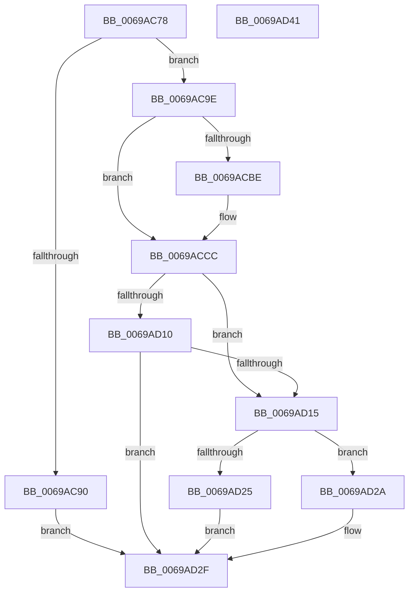

# MiZeroPageCalibrateLastDpcProcessorDone

- RVA: `0x0069AC78`–`0x0069AD42` (길이 `202` bytes)
- VA: `0x000000014069AC78`
- 실행 섹션: `.text`
- PDB 이름 있음: `예`; PDB Function 태그: `아니요`
- unwind 정보 RVA: `0x0005FD94`
- 디코드: `52`개 명령, `202/202` bytes 표시
- 미해석 바이트: `0` (있으면 어셈블리에 `.byte`로 보존)

> 이 문서는 커널 이미지의 기계어와 PDB 기호를 분석해 생성했습니다. 4번과 5번은 함수 원형과 자료형을 바이너리 사용 방식에서 추정한 C 해석이며 원본 소스 복구 결과는 아닙니다.

## 1. Dependencies

- 직접 호출 지점: **2**; 고유 호출 대상: **2**
- 직접 호출자로 확인된 함수: **1**
- RIP 상대 이미지 참조: **0**

### Outgoing calls
- `0x0069ACAE` → [KeQueryPerformanceCounter](../37/KeQueryPerformanceCounter_function_0037E7E0.md) (function, `0x0037E7E0`)
- `0x0069AD07` → [MiZeroInflectionPointReached](MiZeroInflectionPointReached_function_0069A4E8.md) (function, `0x0069A4E8`)

### Direct callers
- [MiZeroPageCalibrateDpc](MiZeroPageCalibrateDpc_function_0069AA90.md) at `0x0069ABB3`

### Static image references
- 디코드된 RIP-relative 메모리 참조가 없습니다.

## 2. Other-region calls and transfers

- 다른 실행 섹션으로 향하는 call: **0**
- 별도 외부 분기/꼬리 이동을 확인하지 못했습니다.

## 3. Assembly (complete function range)

```asm
0069AC78  48 89 5C 24 10                  mov qword ptr [rsp + 0x10], rbx
0069AC7D  48 89 74 24 18                  mov qword ptr [rsp + 0x18], rsi
0069AC82  57                              push rdi
0069AC83  48 83 EC 20                     sub rsp, 0x20
0069AC87  80 79 18 00                     cmp byte ptr [rcx + 0x18], 0
0069AC8B  48 8B D9                        mov rbx, rcx
0069AC8E  75 0E                           jne 0x14069ac9e
0069AC90  BF 01 00 00 00                  mov edi, 1
0069AC95  40 88 79 18                     mov byte ptr [rcx + 0x18], dil
0069AC99  E9 91 00 00 00                  jmp 0x14069ad2f
0069AC9E  F0 83 0C 24 00                  lock or dword ptr [rsp], 0
0069ACA3  48 83 64 24 30 00               and qword ptr [rsp + 0x30], 0
0069ACA9  48 8D 4C 24 30                  lea rcx, [rsp + 0x30]
0069ACAE  E8 2D 3B CE FF                  call 0x14037e7e0
0069ACB3  48 81 7C 24 30 80 96 98 00      cmp qword ptr [rsp + 0x30], 0x989680
0069ACBC  74 0E                           je 0x14069accc
0069ACBE  48 69 C0 80 96 98 00            imul rax, rax, 0x989680
0069ACC5  48 99                           cqo
0069ACC7  48 F7 7C 24 30                  idiv qword ptr [rsp + 0x30]
0069ACCC  48 8B 4B 10                     mov rcx, qword ptr [rbx + 0x10]
0069ACD0  BF 01 00 00 00                  mov edi, 1
0069ACD5  8B B3 C0 00 00 00               mov esi, dword ptr [rbx + 0xc0]
0069ACDB  48 3B C1                        cmp rax, rcx
0069ACDE  48 8B 53 50                     mov rdx, qword ptr [rbx + 0x50]
0069ACE2  4C 8B C1                        mov r8, rcx
0069ACE5  4C 0F 43 C0                     cmovae r8, rax
0069ACE9  48 63 43 08                     movsxd rax, dword ptr [rbx + 8]
0069ACED  4C 2B C1                        sub r8, rcx
0069ACF0  4C 0F 44 C7                     cmove r8, rdi
0069ACF4  48 8D 0C 70                     lea rcx, [rax + rsi*2]
0069ACF8  03 F7                           add esi, edi
0069ACFA  4C 89 04 CA                     mov qword ptr [rdx + rcx*8], r8
0069ACFE  48 8B CB                        mov rcx, rbx
0069AD01  89 B3 C0 00 00 00               mov dword ptr [rbx + 0xc0], esi
0069AD07  E8 DC F7 FF FF                  call 0x14069a4e8
0069AD0C  85 C0                           test eax, eax
0069AD0E  75 05                           jne 0x14069ad15
0069AD10  3B 73 20                        cmp esi, dword ptr [rbx + 0x20]
0069AD13  75 1A                           jne 0x14069ad2f
0069AD15  C7 83 C0 00 00 00 00 00 00 00   mov dword ptr [rbx + 0xc0], 0
0069AD1F  83 7B 08 00                     cmp dword ptr [rbx + 8], 0
0069AD23  75 05                           jne 0x14069ad2a
0069AD25  89 7B 08                        mov dword ptr [rbx + 8], edi
0069AD28  EB 05                           jmp 0x14069ad2f
0069AD2A  BF 02 00 00 00                  mov edi, 2
0069AD2F  48 8B 5C 24 38                  mov rbx, qword ptr [rsp + 0x38]
0069AD34  8B C7                           mov eax, edi
0069AD36  48 8B 74 24 40                  mov rsi, qword ptr [rsp + 0x40]
0069AD3B  48 83 C4 20                     add rsp, 0x20
0069AD3F  5F                              pop rdi
0069AD40  C3                              ret
0069AD41  CC                              int3
```

## 4. C-style interpretation (structured pseudocode)

```c
__int64 __fastcall MiZeroPageCalibrateLastDpcProcessorDone(__int64 a1)
{
    __int64 result;
    __int64 v_rsi;
    __int64 v_rsp;
    unsigned int v_stack_m28;
    unsigned __int64 v_stack_p10;
    unsigned __int64 v_stack_p18;
    unsigned __int64 v_stack_p8;

    v_stack_p10 = v_rbx;
    v_stack_p18 = v_rsi;
    v_rsp = (v_rsp) - (32);
    if ((*(unsigned __int8 *)(a1 + 24)) != 0) goto loc_0069AC9E;
    *(unsigned __int8 *)(a1 + 24) = 1;
    goto loc_0069AD2F;
loc_0069AC9E:
    result = KeQueryPerformanceCounter(v_stack_p8, a2, a3, a4);
    if (v_stack_p8 != 0x989680ULL) {
        result = (result) * (result);
    }
    a3 = *(unsigned __int64 *)(a1 + 16);
    if (result >= (*(unsigned __int64 *)(a1 + 16))) { a3 = result; }
    a3 = (a3) - (*(unsigned __int64 *)(a1 + 16));
    if (condition_is_equal) { a3 = 1; }
    v_rsi = (unsigned int)(((unsigned int)(*(unsigned int *)(a1 + 192))) + (1));
    *(unsigned __int64 *)(*(unsigned __int64 *)(a1 + 80) + (int)(*(unsigned int *)(a1 + 8)) + (unsigned int)(*(unsigned int *)(a1 + 192)) * 2 * 8) = a3;
    *(unsigned int *)(a1 + 192) = (unsigned int)(v_rsi);
    result = MiZeroInflectionPointReached(a1, *(unsigned __int64 *)(a1 + 80), a3, a4);
    if ((unsigned int)(result) != 0) goto loc_0069AD15;
    if (((unsigned int)(v_rsi)) != (*(unsigned int *)(a1 + 32))) goto loc_0069AD2F;
loc_0069AD15:
    *(unsigned int *)(a1 + 192) = 0;
    if ((*(unsigned int *)(a1 + 8)) != 0) goto loc_0069AD2A;
    *(unsigned int *)(a1 + 8) = 1;
    goto loc_0069AD2F;
loc_0069AD2A:
loc_0069AD2F:
    v_rsp = (v_rsp) + (32);
    return 2;
}
```

## 5. (Beta) C Style

```c
int64_t MiZeroPageCalibrateLastDpcProcessorDone(void *Arg1)
{
    uint8_t *arg1 = (uint8_t *)Arg1;

    int64_t result;
    int64_t local_rsi;
    int64_t local_rsp;
    uint32_t v_stack_m28;
    uint64_t v_stack_p10;
    uint64_t v_stack_p18;
    uint64_t v_stack_p8;

    v_stack_p10 = local_rbx;
    v_stack_p18 = local_rsi;
    local_rsp = (local_rsp) - (32);
    if ((*(uint8_t *)(arg1 + 0x18)) != 0) goto loc_0069AC9E;
    *(uint8_t *)(arg1 + 0x18) = 1;
    goto loc_0069AD2F;
loc_0069AC9E:
    result = KeQueryPerformanceCounter(v_stack_p8, a2, a3, a4);
    if (v_stack_p8 != 0x989680ULL) {
        result = (result) * (result);
    }
    a3 = *(uint64_t *)(arg1 + 0x10);
    if (result >= (*(uint64_t *)(arg1 + 0x10))) { a3 = result; }
    a3 = (a3) - (*(uint64_t *)(arg1 + 0x10));
    if (condition_is_equal) { a3 = 1; }
    local_rsi = (uint32_t)(((uint32_t)(*(uint32_t *)(arg1 + 0xC0))) + (1));
    *(uint64_t *)(*(uint64_t *)(arg1 + 0x50) + (int32_t)(*(uint32_t *)(arg1 + 0x8)) + (uint32_t)(*(uint32_t *)(arg1 + 0xC0)) * 2 * 8) = a3;
    *(uint32_t *)(arg1 + 0xC0) = (uint32_t)(local_rsi);
    result = MiZeroInflectionPointReached(Arg1, *(uint64_t *)(arg1 + 0x50), a3, a4);
    if ((uint32_t)(result) != 0) goto loc_0069AD15;
    if (((uint32_t)(local_rsi)) != (*(uint32_t *)(arg1 + 0x20))) goto loc_0069AD2F;
loc_0069AD15:
    *(uint32_t *)(arg1 + 0xC0) = 0;
    if ((*(uint32_t *)(arg1 + 0x8)) != 0) goto loc_0069AD2A;
    *(uint32_t *)(arg1 + 0x8) = 1;
    goto loc_0069AD2F;
loc_0069AD2A:
loc_0069AD2F:
    local_rsp = (local_rsp) + (32);
    return 2;
}
```

### 관측된 메모리 오프셋

구조체 형식이 확인되지 않은 접근은 인자 기준의 오프셋으로만 기록했습니다.

| 기준 인자 | 오프셋 표현 | 폭 (bit) | 접근 |
|---|---:|---:|---|
| `Arg1` | `+ 0x8` | `32` | `R` |
| `Arg1` | `+ 0x8` | `32` | `W` |
| `Arg1` | `+ 0x10` | `64` | `R` |
| `Arg1` | `+ 0x18` | `8` | `R` |
| `Arg1` | `+ 0x18` | `8` | `W` |
| `Arg1` | `+ 0x20` | `32` | `R` |
| `Arg1` | `+ 0x50` | `64` | `R` |
| `Arg1` | `+ 0xC0` | `32` | `R` |
| `Arg1` | `+ 0xC0` | `32` | `W` |

## 6. Execution-region graph

[열기: 2D/3D 그래프와 함수 탐색 컨트롤 패널](../../../control-panel.html?section=text&rva=0x0069AC78&view=graph)

- 2D 그래프는 위에서 아래로 흐르고, 3D 그래프는 빈 공간을 드래그해 회전합니다. Shift+드래그는 이동, 휠은 확대·축소, 함수 노드 선택은 대상 보고서 이동입니다.

### Static fallback


