# MiZeroPageCalibrate

- RVA: `0x0069A69C`–`0x0069AA80` (길이 `996` bytes)
- VA: `0x000000014069A69C`
- 실행 섹션: `.text`
- PDB 이름 있음: `예`; PDB Function 태그: `아니요`
- unwind 정보 RVA: `0x000D96F8`
- 디코드: `259`개 명령, `996/996` bytes 표시
- 미해석 바이트: `0` (있으면 어셈블리에 `.byte`로 보존)

> 이 문서는 커널 이미지의 기계어와 PDB 기호를 분석해 생성했습니다. 4번과 5번은 함수 원형과 자료형을 바이너리 사용 방식에서 추정한 C 해석이며 원본 소스 복구 결과는 아닙니다.

## 1. Dependencies

- 직접 호출 지점: **16**; 고유 호출 대상: **14**
- 직접 호출자로 확인된 함수: **1**
- RIP 상대 이미지 참조: **4**

### Outgoing calls
- `0x0069A6E4` → [memset](../6C/memset_function_006C6C40.md) (function, `0x006C6C40`)
- `0x0069A76F` → [MiIsCalibrationWorthwhile](../4A/MiIsCalibrationWorthwhile_function_004A0770.md) (function, `0x004A0770`)
- `0x0069A7A7` → [RtlRaiseStatus](../2F/RtlRaiseStatus_function_002F6A50.md) (function, `0x002F6A50`)
- `0x0069A7C2` → [MiAllocateAcceleratorDescriptor](MiAllocateAcceleratorDescriptor_function_00697124.md) (function, `0x00697124`)
- `0x0069A7E3` → [ExpInterlockedPushEntrySList](../6B/ExpInterlockedPushEntrySList_function_006BA5B0.md) (function, `0x006BA5B0`)
- `0x0069A835` → [MiIsCalibrationWorthwhile](../4A/MiIsCalibrationWorthwhile_function_004A0770.md) (function, `0x004A0770`)
- `0x0069A870` → [ExAllocatePoolMm](../35/ExAllocatePoolMm_function_0035B690.md) (function, `0x0035B690`)
- `0x0069A8BA` → [MiAllocateZeroCalibrationBuffer](MiAllocateZeroCalibrationBuffer_function_00699844.md) (function, `0x00699844`)
- `0x0069A8F1` → [memset](../6C/memset_function_006C6C40.md) (function, `0x006C6C40`)
- `0x0069A950` → [KeGenericCallDpcEx](../2C/KeGenericCallDpcEx_function_002C99F4.md) (function, `0x002C99F4`)
- `0x0069A9B4` → [ExFreePoolWithTag](../../poolcode/B8/ExFreePoolWithTag_function_00B82870.md) (function, `0x00B82870`)
- `0x0069A9E2` → [MiMergeCalibrationResults](MiMergeCalibrationResults_function_0069A104.md) (function, `0x0069A104`)
- `0x0069A9F0` → [MiFreeZeroCalibrationBuffer](MiFreeZeroCalibrationBuffer_function_00699E44.md) (function, `0x00699E44`)
- `0x0069AA2D` → [MiDeleteAcceleratorDescriptor](../2C/MiDeleteAcceleratorDescriptor_function_002CA560.md) (function, `0x002CA560`)
- `0x0069AA39` → [ExpInterlockedPopEntrySList](../6B/ExpInterlockedPopEntrySList_function_006BA570.md) (function, `0x006BA570`)
- `0x0069AA59` → [_security_check_cookie](../6A/_security_check_cookie_function_006AC640.md) (function, `0x006AC640`)

### Direct callers
- [MiInitializeZeroEngines](../../page/81/MiInitializeZeroEngines_function_008106F4.md) at `0x0081080C`

### Static image references
- `0x0069A6C4` → RVA `0x00E0A740` (`.data`; read)
- `0x0069A720` → RVA `0x00E2DBF8` (`.data`; read)
- `0x0069A7FE` → RVA `0x00E0ECF0` (`.data`; read)
- `0x0069A939` → RVA `0x0069AA90` (`MiZeroPageCalibrateDpc`; read)

## 2. Other-region calls and transfers

- 다른 실행 섹션으로 향하는 call: **1**
  - `0x0069A9B4` → [ExFreePoolWithTag](../../poolcode/B8/ExFreePoolWithTag_function_00B82870.md) (`.text` → `POOLCODE`)
- 별도 외부 분기/꼬리 이동을 확인하지 못했습니다.

## 3. Assembly (complete function range)

```asm
0069A69C  48 89 5C 24 10                  mov qword ptr [rsp + 0x10], rbx
0069A6A1  48 89 74 24 18                  mov qword ptr [rsp + 0x18], rsi
0069A6A6  48 89 7C 24 20                  mov qword ptr [rsp + 0x20], rdi
0069A6AB  55                              push rbp
0069A6AC  41 54                           push r12
0069A6AE  41 55                           push r13
0069A6B0  41 56                           push r14
0069A6B2  41 57                           push r15
0069A6B4  48 81 EC 00 02 00 00            sub rsp, 0x200
0069A6BB  48 8D 6C 24 70                  lea rbp, [rsp + 0x70]
0069A6C0  48 83 E5 C0                     and rbp, 0xffffffffffffffc0
0069A6C4  48 8B 05 75 00 77 00            mov rax, qword ptr [rip + 0x770075]
0069A6CB  48 33 C4                        xor rax, rsp
0069A6CE  48 89 85 80 01 00 00            mov qword ptr [rbp + 0x180], rax
0069A6D5  48 8B F1                        mov rsi, rcx
0069A6D8  33 D2                           xor edx, edx
0069A6DA  48 8D 4D 40                     lea rcx, [rbp + 0x40]
0069A6DE  41 B8 40 01 00 00               mov r8d, 0x140
0069A6E4  E8 57 C5 02 00                  call 0x1406c6c40
0069A6E9  BA 01 00 00 00                  mov edx, 1
0069A6EE  45 33 C0                        xor r8d, r8d
0069A6F1  44 8B FA                        mov r15d, edx
0069A6F4  44 8B EA                        mov r13d, edx
0069A6F7  44 39 86 A8 00 00 00            cmp dword ptr [rsi + 0xa8], r8d
0069A6FE  0F 84 49 03 00 00               je 0x14069aa4d
0069A704  48 8B 9E B0 00 00 00            mov rbx, qword ptr [rsi + 0xb0]
0069A70B  41 8B F8                        mov edi, r8d
0069A70E  4C 63 26                        movsxd r12, dword ptr [rsi]
0069A711  48 8B 43 30                     mov rax, qword ptr [rbx + 0x30]
0069A715  8B 5B 38                        mov ebx, dword ptr [rbx + 0x38]
0069A718  4F 8D 34 64                     lea r14, [r12 + r12*2]
0069A71C  48 89 45 28                     mov qword ptr [rbp + 0x28], rax
0069A720  48 8B 05 D1 34 79 00            mov rax, qword ptr [rip + 0x7934d1]
0069A727  89 9D 4C 01 00 00               mov dword ptr [rbp + 0x14c], ebx
0069A72D  48 8D 0C 5B                     lea rcx, [rbx + rbx*2]
0069A731  48 C1 E1 07                     shl rcx, 7
0069A735  44 38 46 24                     cmp byte ptr [rsi + 0x24], r8b
0069A739  48 8B 8C 01 78 01 00 00         mov rcx, qword ptr [rcx + rax + 0x178]
0069A741  0F B6 45 59                     movzx eax, byte ptr [rbp + 0x59]
0069A745  0F 45 C2                        cmovne eax, edx
0069A748  48 89 4D 10                     mov qword ptr [rbp + 0x10], rcx
0069A74C  8B 96 AC 00 00 00               mov edx, dword ptr [rsi + 0xac]
0069A752  88 45 59                        mov byte ptr [rbp + 0x59], al
0069A755  89 55 00                        mov dword ptr [rbp], edx
0069A758  48 63 C7                        movsxd rax, edi
0069A75B  45 33 C9                        xor r9d, r9d
0069A75E  49 03 C6                        add rax, r14
0069A761  44 8B C3                        mov r8d, ebx
0069A764  48 6B C0 38                     imul rax, rax, 0x38
0069A768  48 83 C0 48                     add rax, 0x48
0069A76C  48 03 C8                        add rcx, rax
0069A76F  E8 FC 5F E0 FF                  call 0x1404a0770
0069A774  85 C0                           test eax, eax
0069A776  75 14                           jne 0x14069a78c
0069A778  8B 55 00                        mov edx, dword ptr [rbp]
0069A77B  FF C7                           inc edi
0069A77D  48 8B 4D 10                     mov rcx, qword ptr [rbp + 0x10]
0069A781  83 FF 03                        cmp edi, 3
0069A784  7C D2                           jl 0x14069a758
0069A786  0F 84 BC 02 00 00               je 0x14069aa48
0069A78C  33 FF                           xor edi, edi
0069A78E  45 85 E4                        test r12d, r12d
0069A791  75 5E                           jne 0x14069a7f1
0069A793  48 8D 85 70 01 00 00            lea rax, [rbp + 0x170]
0069A79A  48 89 7D 08                     mov qword ptr [rbp + 8], rdi
0069A79E  A8 0F                           test al, 0xf
0069A7A0  74 0B                           je 0x14069a7ad
0069A7A2  B9 02 00 00 80                  mov ecx, 0x80000002
0069A7A7  E8 A4 C2 C5 FF                  call 0x1402f6a50
0069A7AC  CC                              int3
0069A7AD  0F 57 C0                        xorps xmm0, xmm0
0069A7B0  4C 8D 4D 08                     lea r9, [rbp + 8]
0069A7B4  45 33 C0                        xor r8d, r8d
0069A7B7  0F 29 85 70 01 00 00            movaps xmmword ptr [rbp + 0x170], xmm0
0069A7BE  8B D3                           mov edx, ebx
0069A7C0  33 C9                           xor ecx, ecx
0069A7C2  E8 5D C9 FF FF                  call 0x140697124
0069A7C7  4C 8B 75 08                     mov r14, qword ptr [rbp + 8]
0069A7CB  44 8B F8                        mov r15d, eax
0069A7CE  4D 85 F6                        test r14, r14
0069A7D1  74 1E                           je 0x14069a7f1
0069A7D3  49 8B 3E                        mov rdi, qword ptr [r14]
0069A7D6  48 8D 8D 70 01 00 00            lea rcx, [rbp + 0x170]
0069A7DD  49 8B D6                        mov rdx, r14
0069A7E0  4C 8B F7                        mov r14, rdi
0069A7E3  E8 C8 FD 01 00                  call 0x1406ba5b0
0069A7E8  48 85 FF                        test rdi, rdi
0069A7EB  75 E6                           jne 0x14069a7d3
0069A7ED  48 89 7D 08                     mov qword ptr [rbp + 8], rdi
0069A7F1  48 8B C7                        mov rax, rdi
0069A7F4  48 89 75 40                     mov qword ptr [rbp + 0x40], rsi
0069A7F8  8B 75 00                        mov esi, dword ptr [rbp]
0069A7FB  44 8B F7                        mov r14d, edi
0069A7FE  48 8D 3D EB 44 77 00            lea rdi, [rip + 0x7744eb]
0069A805  48 89 45 20                     mov qword ptr [rbp + 0x20], rax
0069A809  48 89 7D 18                     mov qword ptr [rbp + 0x18], rdi
0069A80D  49 63 CC                        movsxd rcx, r12d
0069A810  45 33 C9                        xor r9d, r9d
0069A813  44 8B C3                        mov r8d, ebx
0069A816  8B D6                           mov edx, esi
0069A818  48 8D 04 48                     lea rax, [rax + rcx*2]
0069A81C  48 03 C8                        add rcx, rax
0069A81F  48 6B C1 38                     imul rax, rcx, 0x38
0069A823  48 8B 4D 10                     mov rcx, qword ptr [rbp + 0x10]
0069A827  48 83 C1 48                     add rcx, 0x48
0069A82B  48 03 C1                        add rax, rcx
0069A82E  48 8B C8                        mov rcx, rax
0069A831  48 89 45 30                     mov qword ptr [rbp + 0x30], rax
0069A835  E8 36 5F E0 FF                  call 0x1404a0770
0069A83A  33 C9                           xor ecx, ecx
0069A83C  85 C0                           test eax, eax
0069A83E  0F 84 BA 01 00 00               je 0x14069a9fe
0069A844  48 89 8D 50 01 00 00            mov qword ptr [rbp + 0x150], rcx
0069A84B  48 89 8D 90 00 00 00            mov qword ptr [rbp + 0x90], rcx
0069A852  45 85 FF                        test r15d, r15d
0069A855  74 32                           je 0x14069a889
0069A857  44 8B 65 00                     mov r12d, dword ptr [rbp]
0069A85B  44 8B CB                        mov r9d, ebx
0069A85E  41 8B D4                        mov edx, r12d
0069A861  B9 40 00 00 00                  mov ecx, 0x40
0069A866  48 C1 E2 04                     shl rdx, 4
0069A86A  41 B8 4D 69 5A 65               mov r8d, 0x655a694d
0069A870  E8 1B 0E CC FF                  call 0x14035b690
0069A875  48 8B D0                        mov rdx, rax
0069A878  48 F7 D8                        neg rax
0069A87B  48 89 95 90 00 00 00            mov qword ptr [rbp + 0x90], rdx
0069A882  1B C9                           sbb ecx, ecx
0069A884  44 23 F9                        and r15d, ecx
0069A887  EB 04                           jmp 0x14069a88d
0069A889  44 8B 65 00                     mov r12d, dword ptr [rbp]
0069A88D  48 8B 37                        mov rsi, qword ptr [rdi]
0069A890  45 85 FF                        test r15d, r15d
0069A893  0F 84 CC 00 00 00               je 0x14069a965
0069A899  48 8B 55 28                     mov rdx, qword ptr [rbp + 0x28]
0069A89D  48 8D 4D 40                     lea rcx, [rbp + 0x40]
0069A8A1  45 8B CC                        mov r9d, r12d
0069A8A4  44 8B C3                        mov r8d, ebx
0069A8A7  4C 0F AF CE                     imul r9, rsi
0069A8AB  41 8B FC                        mov edi, r12d
0069A8AE  4C 89 8D 58 01 00 00            mov qword ptr [rbp + 0x158], r9
0069A8B5  44 89 74 24 20                  mov dword ptr [rsp + 0x20], r14d
0069A8BA  E8 85 EF FF FF                  call 0x140699844
0069A8BF  33 C0                           xor eax, eax
0069A8C1  48 39 85 50 01 00 00            cmp qword ptr [rbp + 0x150], rax
0069A8C8  0F 84 97 00 00 00               je 0x14069a965
0069A8CE  48 8B 8D 90 00 00 00            mov rcx, qword ptr [rbp + 0x90]
0069A8D5  33 D2                           xor edx, edx
0069A8D7  48 89 75 68                     mov qword ptr [rbp + 0x68], rsi
0069A8DB  33 F6                           xor esi, esi
0069A8DD  48 C1 E7 04                     shl rdi, 4
0069A8E1  4C 8B C7                        mov r8, rdi
0069A8E4  89 75 48                        mov dword ptr [rbp + 0x48], esi
0069A8E7  89 85 00 01 00 00               mov dword ptr [rbp + 0x100], eax
0069A8ED  44 89 65 60                     mov dword ptr [rbp + 0x60], r12d
0069A8F1  E8 4A C3 02 00                  call 0x1406c6c40
0069A8F6  8B C6                           mov eax, esi
0069A8F8  48 8D 95 80 00 00 00            lea rdx, [rbp + 0x80]
0069A8FF  8D 7E 01                        lea edi, [rsi + 1]
0069A902  40 88 74 05 66                  mov byte ptr [rbp + rax + 0x66], sil
0069A907  48 8B CA                        mov rcx, rdx
0069A90A  41 B8 02 00 00 00               mov r8d, 2
0069A910  89 31                           mov dword ptr [rcx], esi
0069A912  48 8D 49 08                     lea rcx, [rcx + 8]
0069A916  4C 2B C7                        sub r8, rdi
0069A919  75 F5                           jne 0x14069a910
0069A91B  48 03 C7                        add rax, rdi
0069A91E  48 83 C2 04                     add rdx, 4
0069A922  48 83 F8 02                     cmp rax, 2
0069A926  7C DA                           jl 0x14069a902
0069A928  83 8D C0 00 00 00 FF            or dword ptr [rbp + 0xc0], 0xffffffff
0069A92F  48 8D 55 40                     lea rdx, [rbp + 0x40]
0069A933  89 B5 48 01 00 00               mov dword ptr [rbp + 0x148], esi
0069A939  48 8D 0D 50 01 00 00            lea rcx, [rip + 0x150]
0069A940  40 88 75 58                     mov byte ptr [rbp + 0x58], sil
0069A944  89 B5 44 01 00 00               mov dword ptr [rbp + 0x144], esi
0069A94A  89 B5 40 01 00 00               mov dword ptr [rbp + 0x140], esi
0069A950  E8 9F F0 C2 FF                  call 0x1402c99f4
0069A955  8B 85 44 01 00 00               mov eax, dword ptr [rbp + 0x144]
0069A95B  85 C0                           test eax, eax
0069A95D  75 C9                           jne 0x14069a928
0069A95F  40 88 7D 65                     mov byte ptr [rbp + 0x65], dil
0069A963  EB 61                           jmp 0x14069a9c6
0069A965  BF 01 00 00 00                  mov edi, 1
0069A96A  48 8D 95 80 00 00 00            lea rdx, [rbp + 0x80]
0069A971  33 F6                           xor esi, esi
0069A973  89 7D 60                        mov dword ptr [rbp + 0x60], edi
0069A976  66 89 7D 64                     mov word ptr [rbp + 0x64], di
0069A97A  8B C6                           mov eax, esi
0069A97C  48 89 7D 68                     mov qword ptr [rbp + 0x68], rdi
0069A980  40 88 74 05 66                  mov byte ptr [rbp + rax + 0x66], sil
0069A985  48 8B CA                        mov rcx, rdx
0069A988  41 B8 02 00 00 00               mov r8d, 2
0069A98E  89 39                           mov dword ptr [rcx], edi
0069A990  48 8D 49 08                     lea rcx, [rcx + 8]
0069A994  4C 2B C7                        sub r8, rdi
0069A997  75 F5                           jne 0x14069a98e
0069A999  48 03 C7                        add rax, rdi
0069A99C  48 83 C2 04                     add rdx, 4
0069A9A0  48 83 F8 02                     cmp rax, 2
0069A9A4  7C DA                           jl 0x14069a980
0069A9A6  48 8B 8D 90 00 00 00            mov rcx, qword ptr [rbp + 0x90]
0069A9AD  48 85 C9                        test rcx, rcx
0069A9B0  74 0E                           je 0x14069a9c0
0069A9B2  33 D2                           xor edx, edx
0069A9B4  E8 B7 7E 4E 00                  call 0x140b82870
0069A9B9  48 89 B5 90 00 00 00            mov qword ptr [rbp + 0x90], rsi
0069A9C0  44 8B FE                        mov r15d, esi
0069A9C3  44 8B EE                        mov r13d, esi
0069A9C6  48 8B 45 40                     mov rax, qword ptr [rbp + 0x40]
0069A9CA  4C 8D 4D 60                     lea r9, [rbp + 0x60]
0069A9CE  4C 8B 45 30                     mov r8, qword ptr [rbp + 0x30]
0069A9D2  48 8D 4D 40                     lea rcx, [rbp + 0x40]
0069A9D6  48 8B 55 10                     mov rdx, qword ptr [rbp + 0x10]
0069A9DA  44 89 74 24 20                  mov dword ptr [rsp + 0x20], r14d
0069A9DF  44 8B 20                        mov r12d, dword ptr [rax]
0069A9E2  E8 1D F7 FF FF                  call 0x14069a104
0069A9E7  45 85 FF                        test r15d, r15d
0069A9EA  74 09                           je 0x14069a9f5
0069A9EC  48 8D 4D 40                     lea rcx, [rbp + 0x40]
0069A9F0  E8 4F F4 FF FF                  call 0x140699e44
0069A9F5  8B 75 00                        mov esi, dword ptr [rbp]
0069A9F8  33 C9                           xor ecx, ecx
0069A9FA  48 8B 7D 18                     mov rdi, qword ptr [rbp + 0x18]
0069A9FE  48 8B 45 20                     mov rax, qword ptr [rbp + 0x20]
0069AA02  48 83 C7 08                     add rdi, 8
0069AA06  48 FF C0                        inc rax
0069AA09  48 89 7D 18                     mov qword ptr [rbp + 0x18], rdi
0069AA0D  41 FF C6                        inc r14d
0069AA10  48 89 45 20                     mov qword ptr [rbp + 0x20], rax
0069AA14  41 83 FE 03                     cmp r14d, 3
0069AA18  0F 8C EF FD FF FF               jl 0x14069a80d
0069AA1E  66 39 8D 70 01 00 00            cmp word ptr [rbp + 0x170], cx
0069AA25  74 1C                           je 0x14069aa43
0069AA27  EB 09                           jmp 0x14069aa32
0069AA29  48 8D 48 20                     lea rcx, [rax + 0x20]
0069AA2D  E8 2E FB C2 FF                  call 0x1402ca560
0069AA32  48 8D 8D 70 01 00 00            lea rcx, [rbp + 0x170]
0069AA39  E8 32 FB 01 00                  call 0x1406ba570
0069AA3E  48 85 C0                        test rax, rax
0069AA41  75 E6                           jne 0x14069aa29
0069AA43  41 8B C5                        mov eax, r13d
0069AA46  EB 07                           jmp 0x14069aa4f
0069AA48  BA 01 00 00 00                  mov edx, 1
0069AA4D  8B C2                           mov eax, edx
0069AA4F  48 8B 8D 80 01 00 00            mov rcx, qword ptr [rbp + 0x180]
0069AA56  48 33 CC                        xor rcx, rsp
0069AA59  E8 E2 1B 01 00                  call 0x1406ac640
0069AA5E  4C 8D 9C 24 00 02 00 00         lea r11, [rsp + 0x200]
0069AA66  49 8B 5B 38                     mov rbx, qword ptr [r11 + 0x38]
0069AA6A  49 8B 73 40                     mov rsi, qword ptr [r11 + 0x40]
0069AA6E  49 8B 7B 48                     mov rdi, qword ptr [r11 + 0x48]
0069AA72  49 8B E3                        mov rsp, r11
0069AA75  41 5F                           pop r15
0069AA77  41 5E                           pop r14
0069AA79  41 5D                           pop r13
0069AA7B  41 5C                           pop r12
0069AA7D  5D                              pop rbp
0069AA7E  C3                              ret
0069AA7F  CC                              int3
```

## 4. C-style interpretation (structured pseudocode)

```c
__int64 __fastcall MiZeroPageCalibrate(__int64 a1, int a2, __int64 a3, int a4)
{
    __int64 result;
    __int64 v_r14;
    __int64 v_r15;
    __int64 v_rbp;
    __int64 v_rdi;
    __int64 v_rsi;
    __int64 v_rsp;
    unsigned __int64 v_stack_m128;
    unsigned __int64 v_stack_m138;
    unsigned __int64 v_stack_m150;
    unsigned __int8 v_stack_m153;
    unsigned __int16 v_stack_m154;
    unsigned int v_stack_m158;
    unsigned __int8 v_stack_m15F;
    unsigned __int8 v_stack_m160;
    unsigned int v_stack_m170;
    unsigned __int64 v_stack_m178;
    unsigned __int64 v_stack_m188;
    unsigned __int64 v_stack_m190;
    unsigned __int64 v_stack_m198;
    unsigned __int64 v_stack_m1A0;
    unsigned __int64 v_stack_m1A8;
    unsigned __int64 v_stack_m1B0;
    unsigned __int64 v_stack_m1B8;
    unsigned int v_stack_m208;
    unsigned __int64 v_stack_m28;
    unsigned __int64 v_stack_m38;
    unsigned __int64 v_stack_m48;
    unsigned __int64 v_stack_m60;
    unsigned __int64 v_stack_m68;
    unsigned int v_stack_m6C;
    unsigned int v_stack_m70;
    unsigned int v_stack_m74;
    unsigned int v_stack_m78;
    unsigned int v_stack_mB8;
    unsigned int v_stack_mF8;
    unsigned __int64 v_stack_p10;
    unsigned __int64 v_stack_p18;
    unsigned __int64 v_stack_p20;

    v_stack_p10 = v_rbx;
    v_stack_p18 = v_rsi;
    v_stack_p20 = v_rdi;
    v_rsp = (v_rsp) - (512);
    v_rbp = (v_stack_m1B8) & (-64);
    result = (*(unsigned __int64 *)(v_rip + 7798901)) ^ (v_rsp);
    v_stack_m38 = result;
    a2 = 0;
    result = memset(v_stack_m178, a2, 320, a4);
    a3 = 0;
    if ((*(unsigned int *)(a1 + 168)) == 0) goto loc_0069AA4D;
    v_stack_m190 = *(unsigned __int64 *)(*(unsigned __int64 *)(a1 + 176) + 48);
    v_stack_m6C = (unsigned int)((unsigned int)(*(unsigned int *)(*(unsigned __int64 *)(a1 + 176) + 56)));
    a1 = ((unsigned int)(*(unsigned int *)(*(unsigned __int64 *)(a1 + 176) + 56)) + (unsigned int)(*(unsigned int *)(*(unsigned __int64 *)(a1 + 176) + 56)) * 2) << (7);
    result = v_stack_m15F;
    if ((*(unsigned __int8 *)(a1 + 36)) != 0) { result = 1; }
    v_stack_m1A8 = *(unsigned __int64 *)(a1 + *(unsigned __int64 *)(v_rip + 7943377) * 1 + 376);
    v_stack_m15F = (unsigned __int8)(result);
    v_stack_m1B8 = (unsigned int)((unsigned int)(*(unsigned int *)(a1 + 172)));
loc_0069A758:
    a4 = 0;
    result = ((int)(0)) + ((int)(*(unsigned int *)(a1)) + (int)(*(unsigned int *)(a1)) * 2);
    result = (result) * (result);
    result = (result) + (72);
    a1 = (*(unsigned __int64 *)(a1 + *(unsigned __int64 *)(v_rip + 7943377) * 1 + 376)) + (result);
    result = MiIsCalibrationWorthwhile(a1, (unsigned int)(*(unsigned int *)(a1 + 172)), (unsigned int)((unsigned int)((unsigned int)(*(unsigned int *)(*(unsigned __int64 *)(a1 + 176) + 56)))), a4);
    if ((unsigned int)(result) != 0) goto loc_0069A78C;
    v_rdi = (unsigned int)((0) + 1);
    if (((unsigned int)(v_rdi)) < 3) goto loc_0069A758;
    if (((unsigned int)(v_rdi)) == 3) goto loc_0069AA48;
loc_0069A78C:
    v_rdi = 0;
    if ((unsigned int)((int)(*(unsigned int *)(a1))) != 0) goto loc_0069A7F1;
    v_stack_m1B0 = 0;
    result = v_stack_m48;
    if ((((unsigned __int8)(v_stack_m48)) & (15)) != 0) {
        a1 = 0x80000002ULL;
        result = RtlRaiseStatus(a1, (unsigned int)(v_stack_m1B8), (unsigned int)((unsigned int)((unsigned int)(*(unsigned int *)(*(unsigned __int64 *)(a1 + 176) + 56)))), a4);
    }
    a3 = 0;
    v_stack_m48 = v_xmm0;
    a1 = 0;
    result = MiAllocateAcceleratorDescriptor(a1, (unsigned int)((unsigned int)((unsigned int)(*(unsigned int *)(*(unsigned __int64 *)(a1 + 176) + 56)))), a3, v_stack_m1B0);
    if (v_stack_m1B0 == 0) goto loc_0069A7F1;
loc_0069A7D3:
    result = ExpInterlockedPushEntrySList(v_stack_m48, v_stack_m1B0, a3, v_stack_m1B0);
    if (*(unsigned __int64 *)(v_stack_m1B0) != 0) goto loc_0069A7D3;
    v_stack_m1B0 = *(unsigned __int64 *)(v_stack_m1B0);
loc_0069A7F1:
    v_stack_m178 = 0;
    v_stack_m198 = *(unsigned __int64 *)(v_stack_m1B0);
    v_stack_m1A0 = v_rip + 7816427;
loc_0069A80D:
    a4 = 0;
    a1 = ((int)((unsigned int)((int)(*(unsigned int *)(a1))))) + (*(unsigned __int64 *)(v_stack_m1B0) + (int)((unsigned int)((int)(*(unsigned int *)(a1)))) * 2);
    result = (*(unsigned __int64 *)(v_stack_m1B0) + (int)((unsigned int)((int)(*(unsigned int *)(a1)))) * 2) * (a1);
    a1 = (v_stack_m1A8) + (72);
    result = (result) + (a1);
    v_stack_m188 = result;
    result = MiIsCalibrationWorthwhile(result, (unsigned int)((unsigned int)((unsigned int)(v_stack_m1B8))), (unsigned int)((unsigned int)((unsigned int)(*(unsigned int *)(*(unsigned __int64 *)(a1 + 176) + 56)))), a4);
    a1 = 0;
    if ((unsigned int)(result) == 0) goto loc_0069A9FE;
    v_stack_m68 = 0;
    v_stack_m128 = 0;
    if ((unsigned int)((unsigned int)((unsigned int)(result))) == 0) goto loc_0069A889;
    a2 = ((unsigned int)((unsigned int)((unsigned int)(v_stack_m1B8)))) << (4);
    result = ExAllocatePoolMm(64, a2, (unsigned int)(0x655A694DULL), (unsigned int)((unsigned int)((unsigned int)(*(unsigned int *)(*(unsigned __int64 *)(a1 + 176) + 56)))));
    result = -(result);
    v_stack_m128 = result;
    v_r15 = (unsigned int)(((unsigned int)((unsigned int)(result))) & (64));
    goto loc_0069A88D;
loc_0069A889:
loc_0069A88D:
    if ((unsigned int)(v_r15) == 0) goto loc_0069A965;
    a4 = ((unsigned int)((unsigned int)((unsigned int)(v_stack_m1B8)))) * (*(unsigned __int64 *)(v_rip + 7816427));
    v_stack_m60 = a4;
    v_stack_m208 = (unsigned int)((unsigned int)((unsigned int)(*(unsigned __int64 *)(v_stack_m1B0))));
    result = MiAllocateZeroCalibrationBuffer(v_stack_m178, v_stack_m190, (unsigned int)((unsigned int)((unsigned int)(*(unsigned int *)(*(unsigned __int64 *)(a1 + 176) + 56)))), a4);
    result = 0;
    if (v_stack_m68 == 0) goto loc_0069A965;
    a2 = 0;
    v_stack_m150 = *(unsigned __int64 *)(v_rip + 7816427);
    v_rsi = 0;
    v_rdi = ((unsigned int)((unsigned int)((unsigned int)(v_stack_m1B8)))) << (4);
    v_stack_m170 = 0;
    v_stack_mB8 = 0;
    v_stack_m158 = (unsigned int)((unsigned int)(v_stack_m1B8));
    result = memset(v_stack_m128, a2, v_rdi, a4);
loc_0069A902:
    *(unsigned __int8 *)(v_rbp + 0 * 1 + 102) = 0;
loc_0069A910:
    *(unsigned int *)(v_stack_m138) = 0;
    a3 = (2) - (v_rsi + 1);
    if (condition_is_not_equal) goto loc_0069A910;
    result = (0) + (v_rsi + 1);
    a2 = (v_stack_m138) + (4);
    if (result < 2) goto loc_0069A902;
loc_0069A928:
    v_stack_m70 = 0;
    v_stack_m160 = 0;
    v_stack_m74 = 0;
    v_stack_m78 = 0;
    result = KeGenericCallDpcEx(v_rip + 336, v_stack_m178, a3, a4);
    if ((unsigned int)((unsigned int)(v_stack_m74)) != 0) goto loc_0069A928;
    v_stack_m153 = (unsigned __int8)(v_rsi + 1);
    goto loc_0069A9C6;
loc_0069A965:
    v_rsi = 0;
    v_stack_m158 = 1;
    v_stack_m154 = 1;
    v_stack_m150 = 1;
loc_0069A980:
    *(unsigned __int8 *)(v_rbp + 0 * 1 + 102) = 0;
loc_0069A98E:
    *(unsigned int *)(v_stack_m138) = 1;
    a3 = (2) - (1);
    if (condition_is_not_equal) goto loc_0069A98E;
    result = (0) + (1);
    a2 = (v_stack_m138) + (4);
    if (result < 2) goto loc_0069A980;
    if (v_stack_m128 != 0) {
        a2 = 0;
        result = ExFreePoolWithTag(v_stack_m128, a2, a3, a4);
        v_stack_m128 = 0;
    }
loc_0069A9C6:
    v_stack_m208 = (unsigned int)((unsigned int)((unsigned int)(*(unsigned __int64 *)(v_stack_m1B0))));
    result = MiMergeCalibrationResults(v_stack_m178, v_stack_m1A8, v_stack_m188, v_stack_m158);
    if (0 != 0) {
        a1 = v_stack_m178;
        result = MiFreeZeroCalibrationBuffer(a1, v_stack_m1A8, v_stack_m188, v_stack_m158);
    }
    a1 = 0;
loc_0069A9FE:
    v_rdi = (v_stack_m1A0) + (8);
    result = (v_stack_m198) + 1;
    v_stack_m1A0 = v_rdi;
    v_r14 = (unsigned int)(((unsigned int)((unsigned int)(*(unsigned __int64 *)(v_stack_m1B0)))) + 1);
    v_stack_m198 = result;
    if (((unsigned int)(v_r14)) < 3) goto loc_0069A80D;
    if (v_stack_m48 == 0) goto loc_0069AA43;
    goto loc_0069AA32;
loc_0069AA29:
    result = MiDeleteAcceleratorDescriptor(result + 32, v_stack_m1A8, v_stack_m188, v_stack_m158);
loc_0069AA32:
    result = ExpInterlockedPopEntrySList(v_stack_m48, v_stack_m1A8, v_stack_m188, v_stack_m158);
    if (result != 0) goto loc_0069AA29;
loc_0069AA43:
    goto loc_0069AA4F;
loc_0069AA48:
loc_0069AA4D:
loc_0069AA4F:
    a1 = (v_stack_m38) ^ (v_rsp);
    result = _security_check_cookie(a1, 1, v_stack_m188, v_stack_m158);
    return result;
}
```

## 5. (Beta) C Style

```c
int64_t MiZeroPageCalibrate(void *Arg1, int32_t Arg2, int64_t Arg3, int32_t Arg4)
{
    uint8_t *arg1 = (uint8_t *)Arg1;

    int64_t result;
    int64_t local_r14;
    int64_t local_r15;
    int64_t local_rbp;
    int64_t local_rdi;
    int64_t local_rsi;
    int64_t local_rsp;
    uint64_t v_stack_m128;
    uint64_t v_stack_m138;
    uint64_t v_stack_m150;
    uint8_t v_stack_m153;
    uint16_t v_stack_m154;
    uint32_t v_stack_m158;
    uint8_t v_stack_m15F;
    uint8_t v_stack_m160;
    uint32_t v_stack_m170;
    uint64_t v_stack_m178;
    uint64_t v_stack_m188;
    uint64_t v_stack_m190;
    uint64_t v_stack_m198;
    uint64_t v_stack_m1A0;
    uint64_t v_stack_m1A8;
    uint64_t v_stack_m1B0;
    uint64_t v_stack_m1B8;
    uint32_t v_stack_m208;
    uint64_t v_stack_m28;
    uint64_t v_stack_m38;
    uint64_t v_stack_m48;
    uint64_t v_stack_m60;
    uint64_t v_stack_m68;
    uint32_t v_stack_m6C;
    uint32_t v_stack_m70;
    uint32_t v_stack_m74;
    uint32_t v_stack_m78;
    uint32_t v_stack_mB8;
    uint32_t v_stack_mF8;
    uint64_t v_stack_p10;
    uint64_t v_stack_p18;
    uint64_t v_stack_p20;

    v_stack_p10 = local_rbx;
    v_stack_p18 = local_rsi;
    v_stack_p20 = local_rdi;
    local_rsp = (local_rsp) - (512);
    local_rbp = (v_stack_m1B8) & (-64);
    result = (*(uint64_t *)(v_rip + 0x770075)) ^ (local_rsp);
    v_stack_m38 = result;
    Arg2 = 0;
    result = memset(v_stack_m178, Arg2, 320, Arg4);
    Arg3 = 0;
    if ((*(uint32_t *)(arg1 + 0xA8)) == 0) goto loc_0069AA4D;
    v_stack_m190 = *(uint64_t *)(*(uint64_t *)(arg1 + 0xB0) + 0x30);
    v_stack_m6C = (uint32_t)((uint32_t)(*(uint32_t *)(*(uint64_t *)(arg1 + 0xB0) + 0x38)));
    Arg1 = ((uint32_t)(*(uint32_t *)(*(uint64_t *)(arg1 + 0xB0) + 0x38)) + (uint32_t)(*(uint32_t *)(*(uint64_t *)(arg1 + 0xB0) + 0x38)) * 2) << (7);
    result = v_stack_m15F;
    if ((*(uint8_t *)(arg1 + 0x24)) != 0) { result = 1; }
    v_stack_m1A8 = *(uint64_t *)(arg1 + *(uint64_t *)(v_rip + 0x7934D1) * 1 + 0x178);
    v_stack_m15F = (uint8_t)(result);
    v_stack_m1B8 = (uint32_t)((uint32_t)(*(uint32_t *)(arg1 + 0xAC)));
loc_0069A758:
    Arg4 = 0;
    result = ((int32_t)(0)) + ((int32_t)(*(uint32_t *)(arg1)) + (int32_t)(*(uint32_t *)(arg1)) * 2);
    result = (result) * (result);
    result = (result) + (72);
    Arg1 = (*(uint64_t *)(arg1 + *(uint64_t *)(v_rip + 0x7934D1) * 1 + 0x178)) + (result);
    result = MiIsCalibrationWorthwhile(Arg1, (uint32_t)(*(uint32_t *)(arg1 + 0xAC)), (uint32_t)((uint32_t)((uint32_t)(*(uint32_t *)(*(uint64_t *)(arg1 + 0xB0) + 0x38)))), Arg4);
    if ((uint32_t)(result) != 0) goto loc_0069A78C;
    local_rdi = (uint32_t)((0) + 1);
    if (((uint32_t)(local_rdi)) < 3) goto loc_0069A758;
    if (((uint32_t)(local_rdi)) == 3) goto loc_0069AA48;
loc_0069A78C:
    local_rdi = 0;
    if ((uint32_t)((int32_t)(*(uint32_t *)(arg1))) != 0) goto loc_0069A7F1;
    v_stack_m1B0 = 0;
    result = v_stack_m48;
    if ((((uint8_t)(v_stack_m48)) & (15)) != 0) {
        Arg1 = 0x80000002ULL;
        result = RtlRaiseStatus(Arg1, (uint32_t)(v_stack_m1B8), (uint32_t)((uint32_t)((uint32_t)(*(uint32_t *)(*(uint64_t *)(arg1 + 0xB0) + 0x38)))), Arg4);
    }
    Arg3 = 0;
    v_stack_m48 = v_xmm0;
    Arg1 = 0;
    result = MiAllocateAcceleratorDescriptor(Arg1, (uint32_t)((uint32_t)((uint32_t)(*(uint32_t *)(*(uint64_t *)(arg1 + 0xB0) + 0x38)))), Arg3, v_stack_m1B0);
    if (v_stack_m1B0 == 0) goto loc_0069A7F1;
loc_0069A7D3:
    result = ExpInterlockedPushEntrySList(v_stack_m48, v_stack_m1B0, Arg3, v_stack_m1B0);
    if (*(uint64_t *)(v_stack_m1B0) != 0) goto loc_0069A7D3;
    v_stack_m1B0 = *(uint64_t *)(v_stack_m1B0);
loc_0069A7F1:
    v_stack_m178 = 0;
    v_stack_m198 = *(uint64_t *)(v_stack_m1B0);
    v_stack_m1A0 = v_rip + 7816427;
loc_0069A80D:
    Arg4 = 0;
    Arg1 = ((int32_t)((uint32_t)((int32_t)(*(uint32_t *)(arg1))))) + (*(uint64_t *)(v_stack_m1B0) + (int32_t)((uint32_t)((int32_t)(*(uint32_t *)(arg1)))) * 2);
    result = (*(uint64_t *)(v_stack_m1B0) + (int32_t)((uint32_t)((int32_t)(*(uint32_t *)(arg1)))) * 2) * (Arg1);
    Arg1 = (v_stack_m1A8) + (72);
    result = (result) + (Arg1);
    v_stack_m188 = result;
    result = MiIsCalibrationWorthwhile(result, (uint32_t)((uint32_t)((uint32_t)(v_stack_m1B8))), (uint32_t)((uint32_t)((uint32_t)(*(uint32_t *)(*(uint64_t *)(arg1 + 0xB0) + 0x38)))), Arg4);
    Arg1 = 0;
    if ((uint32_t)(result) == 0) goto loc_0069A9FE;
    v_stack_m68 = 0;
    v_stack_m128 = 0;
    if ((uint32_t)((uint32_t)((uint32_t)(result))) == 0) goto loc_0069A889;
    Arg2 = ((uint32_t)((uint32_t)((uint32_t)(v_stack_m1B8)))) << (4);
    result = ExAllocatePoolMm(64, Arg2, (uint32_t)(0x655A694DULL), (uint32_t)((uint32_t)((uint32_t)(*(uint32_t *)(*(uint64_t *)(arg1 + 0xB0) + 0x38)))));
    result = -(result);
    v_stack_m128 = result;
    local_r15 = (uint32_t)(((uint32_t)((uint32_t)(result))) & (64));
    goto loc_0069A88D;
loc_0069A889:
loc_0069A88D:
    if ((uint32_t)(local_r15) == 0) goto loc_0069A965;
    Arg4 = ((uint32_t)((uint32_t)((uint32_t)(v_stack_m1B8)))) * (*(uint64_t *)(v_rip + 0x7744EB));
    v_stack_m60 = Arg4;
    v_stack_m208 = (uint32_t)((uint32_t)((uint32_t)(*(uint64_t *)(v_stack_m1B0))));
    result = MiAllocateZeroCalibrationBuffer(v_stack_m178, v_stack_m190, (uint32_t)((uint32_t)((uint32_t)(*(uint32_t *)(*(uint64_t *)(arg1 + 0xB0) + 0x38)))), Arg4);
    result = 0;
    if (v_stack_m68 == 0) goto loc_0069A965;
    Arg2 = 0;
    v_stack_m150 = *(uint64_t *)(v_rip + 0x7744EB);
    local_rsi = 0;
    local_rdi = ((uint32_t)((uint32_t)((uint32_t)(v_stack_m1B8)))) << (4);
    v_stack_m170 = 0;
    v_stack_mB8 = 0;
    v_stack_m158 = (uint32_t)((uint32_t)(v_stack_m1B8));
    result = memset(v_stack_m128, Arg2, local_rdi, Arg4);
loc_0069A902:
    *(uint8_t *)(local_rbp + 0x0 * 1 + 0x66) = 0;
loc_0069A910:
    *(uint32_t *)(v_stack_m138) = 0;
    Arg3 = (2) - (local_rsi + 1);
    if (condition_is_not_equal) goto loc_0069A910;
    result = (0) + (local_rsi + 1);
    Arg2 = (v_stack_m138) + (4);
    if (result < 2) goto loc_0069A902;
loc_0069A928:
    v_stack_m70 = 0;
    v_stack_m160 = 0;
    v_stack_m74 = 0;
    v_stack_m78 = 0;
    result = KeGenericCallDpcEx(v_rip + 336, v_stack_m178, Arg3, Arg4);
    if ((uint32_t)((uint32_t)(v_stack_m74)) != 0) goto loc_0069A928;
    v_stack_m153 = (uint8_t)(local_rsi + 1);
    goto loc_0069A9C6;
loc_0069A965:
    local_rsi = 0;
    v_stack_m158 = 1;
    v_stack_m154 = 1;
    v_stack_m150 = 1;
loc_0069A980:
    *(uint8_t *)(local_rbp + 0x0 * 1 + 0x66) = 0;
loc_0069A98E:
    *(uint32_t *)(v_stack_m138) = 1;
    Arg3 = (2) - (1);
    if (condition_is_not_equal) goto loc_0069A98E;
    result = (0) + (1);
    Arg2 = (v_stack_m138) + (4);
    if (result < 2) goto loc_0069A980;
    if (v_stack_m128 != 0) {
        Arg2 = 0;
        result = ExFreePoolWithTag(v_stack_m128, Arg2, Arg3, Arg4);
        v_stack_m128 = 0;
    }
loc_0069A9C6:
    v_stack_m208 = (uint32_t)((uint32_t)((uint32_t)(*(uint64_t *)(v_stack_m1B0))));
    result = MiMergeCalibrationResults(v_stack_m178, v_stack_m1A8, v_stack_m188, v_stack_m158);
    if (0 != 0) {
        Arg1 = v_stack_m178;
        result = MiFreeZeroCalibrationBuffer(Arg1, v_stack_m1A8, v_stack_m188, v_stack_m158);
    }
    Arg1 = 0;
loc_0069A9FE:
    local_rdi = (v_stack_m1A0) + (8);
    result = (v_stack_m198) + 1;
    v_stack_m1A0 = local_rdi;
    local_r14 = (uint32_t)(((uint32_t)((uint32_t)(*(uint64_t *)(v_stack_m1B0)))) + 1);
    v_stack_m198 = result;
    if (((uint32_t)(local_r14)) < 3) goto loc_0069A80D;
    if (v_stack_m48 == 0) goto loc_0069AA43;
    goto loc_0069AA32;
loc_0069AA29:
    result = MiDeleteAcceleratorDescriptor(result + 32, v_stack_m1A8, v_stack_m188, v_stack_m158);
loc_0069AA32:
    result = ExpInterlockedPopEntrySList(v_stack_m48, v_stack_m1A8, v_stack_m188, v_stack_m158);
    if (result != 0) goto loc_0069AA29;
loc_0069AA43:
    goto loc_0069AA4F;
loc_0069AA48:
loc_0069AA4D:
loc_0069AA4F:
    Arg1 = (v_stack_m38) ^ (local_rsp);
    result = _security_check_cookie(Arg1, 1, v_stack_m188, v_stack_m158);
    return result;
}
```

### 관측된 메모리 오프셋

구조체 형식이 확인되지 않은 접근은 인자 기준의 오프셋으로만 기록했습니다.

| 기준 인자 | 오프셋 표현 | 폭 (bit) | 접근 |
|---|---:|---:|---|
| `Arg1` | `+ 0x0` | `32` | `R` |
| `Arg1` | `+ 0x24` | `8` | `R` |
| `Arg1` | `+ 0xA8` | `32` | `R` |
| `Arg1` | `+ 0xAC` | `32` | `R` |
| `Arg1` | `+ 0xB0` | `64` | `R` |

## 6. Execution-region graph

[열기: 2D/3D 그래프와 함수 탐색 컨트롤 패널](../../../control-panel.html?section=text&rva=0x0069A69C&view=graph)

- 2D 그래프는 위에서 아래로 흐르고, 3D 그래프는 빈 공간을 드래그해 회전합니다. Shift+드래그는 이동, 휠은 확대·축소, 함수 노드 선택은 대상 보고서 이동입니다.

### Static fallback

```mermaid
flowchart TD
  bb_0069A69C[BB_0069A69C]
  bb_0069A704[BB_0069A704]
  bb_0069A758[BB_0069A758]
  bb_0069A778[BB_0069A778]
  bb_0069A786[BB_0069A786]
  bb_0069A78C[BB_0069A78C]
  bb_0069A793[BB_0069A793]
  bb_0069A7A2[BB_0069A7A2]
  bb_0069A7AD[BB_0069A7AD]
  bb_0069A7D3[BB_0069A7D3]
  bb_0069A7ED[BB_0069A7ED]
  bb_0069A7F1[BB_0069A7F1]
  bb_0069A80D[BB_0069A80D]
  bb_0069A844[BB_0069A844]
  bb_0069A857[BB_0069A857]
  bb_0069A889[BB_0069A889]
  bb_0069A88D[BB_0069A88D]
  bb_0069A899[BB_0069A899]
  bb_0069A8CE[BB_0069A8CE]
  bb_0069A902[BB_0069A902]
  bb_0069A910[BB_0069A910]
  bb_0069A91B[BB_0069A91B]
  bb_0069A928[BB_0069A928]
  bb_0069A95F[BB_0069A95F]
  bb_0069A965[BB_0069A965]
  bb_0069A980[BB_0069A980]
  bb_0069A98E[BB_0069A98E]
  bb_0069A999[BB_0069A999]
  bb_0069A9A6[BB_0069A9A6]
  bb_0069A9B2[BB_0069A9B2]
  bb_0069A9C0[BB_0069A9C0]
  bb_0069A9C6[BB_0069A9C6]
  bb_0069A9EC[BB_0069A9EC]
  bb_0069A9F5[BB_0069A9F5]
  bb_0069A9FE[BB_0069A9FE]
  bb_0069AA1E[BB_0069AA1E]
  bb_0069AA27[BB_0069AA27]
  bb_0069AA29[BB_0069AA29]
  bb_0069AA32[BB_0069AA32]
  bb_0069AA43[BB_0069AA43]
  bb_0069AA48[BB_0069AA48]
  bb_0069AA4D[BB_0069AA4D]
  bb_0069AA4F[BB_0069AA4F]
  bb_0069AA7F[BB_0069AA7F]
  bb_0069A69C -->|branch| bb_0069AA4D
  bb_0069A69C -->|fallthrough| bb_0069A704
  bb_0069A704 -->|flow| bb_0069A758
  bb_0069A758 -->|branch| bb_0069A78C
  bb_0069A758 -->|fallthrough| bb_0069A778
  bb_0069A778 -->|branch| bb_0069A758
  bb_0069A778 -->|fallthrough| bb_0069A786
  bb_0069A786 -->|branch| bb_0069AA48
  bb_0069A786 -->|fallthrough| bb_0069A78C
  bb_0069A78C -->|branch| bb_0069A7F1
  bb_0069A78C -->|fallthrough| bb_0069A793
  bb_0069A793 -->|branch| bb_0069A7AD
  bb_0069A793 -->|fallthrough| bb_0069A7A2
  bb_0069A7A2 -->|flow| bb_0069A7AD
  bb_0069A7AD -->|branch| bb_0069A7F1
  bb_0069A7AD -->|fallthrough| bb_0069A7D3
  bb_0069A7D3 -->|branch| bb_0069A7D3
  bb_0069A7D3 -->|fallthrough| bb_0069A7ED
  bb_0069A7ED -->|flow| bb_0069A7F1
  bb_0069A7F1 -->|flow| bb_0069A80D
  bb_0069A80D -->|branch| bb_0069A9FE
  bb_0069A80D -->|fallthrough| bb_0069A844
  bb_0069A844 -->|branch| bb_0069A889
  bb_0069A844 -->|fallthrough| bb_0069A857
  bb_0069A857 -->|branch| bb_0069A88D
  bb_0069A889 -->|flow| bb_0069A88D
  bb_0069A88D -->|branch| bb_0069A965
  bb_0069A88D -->|fallthrough| bb_0069A899
  bb_0069A899 -->|branch| bb_0069A965
  bb_0069A899 -->|fallthrough| bb_0069A8CE
  bb_0069A8CE -->|flow| bb_0069A902
  bb_0069A902 -->|flow| bb_0069A910
  bb_0069A910 -->|branch| bb_0069A910
  bb_0069A910 -->|fallthrough| bb_0069A91B
  bb_0069A91B -->|branch| bb_0069A902
  bb_0069A91B -->|fallthrough| bb_0069A928
  bb_0069A928 -->|branch| bb_0069A928
  bb_0069A928 -->|fallthrough| bb_0069A95F
  bb_0069A95F -->|branch| bb_0069A9C6
  bb_0069A965 -->|flow| bb_0069A980
  bb_0069A980 -->|flow| bb_0069A98E
  bb_0069A98E -->|branch| bb_0069A98E
  bb_0069A98E -->|fallthrough| bb_0069A999
  bb_0069A999 -->|branch| bb_0069A980
  bb_0069A999 -->|fallthrough| bb_0069A9A6
  bb_0069A9A6 -->|branch| bb_0069A9C0
  bb_0069A9A6 -->|fallthrough| bb_0069A9B2
  bb_0069A9B2 -->|flow| bb_0069A9C0
  bb_0069A9C0 -->|flow| bb_0069A9C6
  bb_0069A9C6 -->|branch| bb_0069A9F5
  bb_0069A9C6 -->|fallthrough| bb_0069A9EC
  bb_0069A9EC -->|flow| bb_0069A9F5
  bb_0069A9F5 -->|flow| bb_0069A9FE
  bb_0069A9FE -->|branch| bb_0069A80D
  bb_0069A9FE -->|fallthrough| bb_0069AA1E
  bb_0069AA1E -->|branch| bb_0069AA43
  bb_0069AA1E -->|fallthrough| bb_0069AA27
  bb_0069AA27 -->|branch| bb_0069AA32
  bb_0069AA29 -->|flow| bb_0069AA32
  bb_0069AA32 -->|branch| bb_0069AA29
  bb_0069AA32 -->|fallthrough| bb_0069AA43
  bb_0069AA43 -->|branch| bb_0069AA4F
  bb_0069AA48 -->|flow| bb_0069AA4D
  bb_0069AA4D -->|flow| bb_0069AA4F
```


