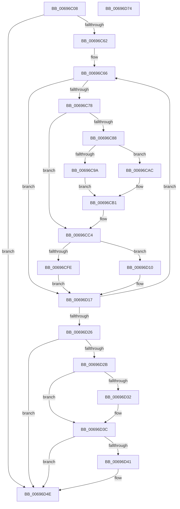

# MiZeroPageMakeHot

- RVA: `0x00696C08`–`0x00696D75` (길이 `365` bytes)
- VA: `0x0000000140696C08`
- 실행 섹션: `.text`
- PDB 이름 있음: `예`; PDB Function 태그: `아니요`
- unwind 정보 RVA: `0x000D9440`
- 디코드: `96`개 명령, `365/365` bytes 표시
- 미해석 바이트: `0` (있으면 어셈블리에 `.byte`로 보존)

> 이 문서는 커널 이미지의 기계어와 PDB 기호를 분석해 생성했습니다. 4번과 5번은 함수 원형과 자료형을 바이너리 사용 방식에서 추정한 C 해석이며 원본 소스 복구 결과는 아닙니다.

## 1. Dependencies

- 직접 호출 지점: **7**; 고유 호출 대상: **6**
- 직접 호출자로 확인된 함수: **1**
- RIP 상대 이미지 참조: **3**

### Outgoing calls
- `0x00696CA3` → [MiSetZeroPageThreadPriority](../31/MiSetZeroPageThreadPriority_function_0031E620.md) (function, `0x0031E620`)
- `0x00696CBF` → [MiInitializePageHeatList](../44/MiInitializePageHeatList_function_00446000.md) (function, `0x00446000`)
- `0x00696CF4` → [MiGetPfnPageSizeIndexUnsynchronized](../46/MiGetPfnPageSizeIndexUnsynchronized_function_0046C008.md) (function, `0x0046C008`)
- `0x00696D09` → [MiAddPageToHeatList](../44/MiAddPageToHeatList_function_0044603C.md) (function, `0x0044603C`)
- `0x00696D37` → [MiIssuePageHeatList](../44/MiIssuePageHeatList_function_0044615C.md) (function, `0x0044615C`)
- `0x00696D49` → [MiSetZeroPageThreadPriority](../31/MiSetZeroPageThreadPriority_function_0031E620.md) (function, `0x0031E620`)
- `0x00696D56` → [_security_check_cookie](../6A/_security_check_cookie_function_006AC640.md) (function, `0x006AC640`)

### Direct callers
- [MiBackgroundZeroLocalPages](../31/MiBackgroundZeroLocalPages_function_0031EF30.md) at `0x0031F733`

### Static image references
- `0x00696C1E` → RVA `0x00E0A740` (`.data`; read)
- `0x00696C78` → RVA `0x00EF50C4` (`.data`; read)
- `0x00696D10` → RVA `0x00EF50D4` (`.data`; read/write)

## 2. Other-region calls and transfers

- 다른 실행 섹션으로 향하는 call: **0**
- 별도 외부 분기/꼬리 이동을 확인하지 못했습니다.

## 3. Assembly (complete function range)

```asm
00696C08  48 89 5C 24 10                  mov qword ptr [rsp + 0x10], rbx
00696C0D  48 89 6C 24 18                  mov qword ptr [rsp + 0x18], rbp
00696C12  56                              push rsi
00696C13  57                              push rdi
00696C14  41 55                           push r13
00696C16  41 56                           push r14
00696C18  41 57                           push r15
00696C1A  48 83 EC 50                     sub rsp, 0x50
00696C1E  48 8B 05 1B 3B 77 00            mov rax, qword ptr [rip + 0x773b1b]
00696C25  48 33 C4                        xor rax, rsp
00696C28  48 89 44 24 40                  mov qword ptr [rsp + 0x40], rax
00696C2D  83 64 24 24 00                  and dword ptr [rsp + 0x24], 0
00696C32  33 C0                           xor eax, eax
00696C34  83 64 24 20 00                  and dword ptr [rsp + 0x20], 0
00696C39  33 F6                           xor esi, esi
00696C3B  44 8B B9 40 01 00 00            mov r15d, dword ptr [rcx + 0x140]
00696C42  33 FF                           xor edi, edi
00696C44  33 ED                           xor ebp, ebp
00696C46  48 89 44 24 38                  mov qword ptr [rsp + 0x38], rax
00696C4B  0F 57 C0                        xorps xmm0, xmm0
00696C4E  48 8B D9                        mov rbx, rcx
00696C51  0F 11 44 24 28                  movups xmmword ptr [rsp + 0x28], xmm0
00696C56  39 81 18 01 00 00               cmp dword ptr [rcx + 0x118], eax
00696C5C  0F 86 EC 00 00 00               jbe 0x140696d4e
00696C62  44 8D 68 01                     lea r13d, [rax + 1]
00696C66  4C 8B 74 EB 18                  mov r14, qword ptr [rbx + rbp*8 + 0x18]
00696C6B  41 8A C6                        mov al, r14b
00696C6E  24 0C                           and al, 0xc
00696C70  3C 0C                           cmp al, 0xc
00696C72  0F 85 9F 00 00 00               jne 0x140696d17
00696C78  48 8D 0D 45 E4 85 00            lea rcx, [rip + 0x85e445]
00696C7F  46 01 2C B9                     add dword ptr [rcx + r15*4], r13d
00696C83  48 85 F6                        test rsi, rsi
00696C86  75 3C                           jne 0x140696cc4
00696C88  65 48 8B 34 25 88 01 00 00      mov rsi, qword ptr gs:[0x188]
00696C91  80 BE C3 00 00 00 00            cmp byte ptr [rsi + 0xc3], 0
00696C98  75 12                           jne 0x140696cac
00696C9A  45 33 C0                        xor r8d, r8d
00696C9D  41 8B D5                        mov edx, r13d
00696CA0  48 8B CB                        mov rcx, rbx
00696CA3  E8 78 79 C8 FF                  call 0x14031e620
00696CA8  8B F8                           mov edi, eax
00696CAA  EB 05                           jmp 0x140696cb1
00696CAC  BF 21 00 00 00                  mov edi, 0x21
00696CB1  45 8B CD                        mov r9d, r13d
00696CB4  48 8D 4C 24 28                  lea rcx, [rsp + 0x28]
00696CB9  45 8B C5                        mov r8d, r13d
00696CBC  41 8B D5                        mov edx, r13d
00696CBF  E8 3C F3 DA FF                  call 0x140446000
00696CC4  49 C1 EE 0C                     shr r14, 0xc
00696CC8  48 B8 FF FF FF FF 3F 00 00 00   movabs rax, 0x3fffffffff
00696CD2  4C 23 F0                        and r14, rax
00696CD5  4B 8D 0C 76                     lea rcx, [r14 + r14*2]
00696CD9  48 C1 E1 04                     shl rcx, 4
00696CDD  48 B8 00 00 00 00 00 DE FF FF   movabs rax, 0xffffde0000000000
00696CE7  48 03 C8                        add rcx, rax
00696CEA  4C 8D 44 24 20                  lea r8, [rsp + 0x20]
00696CEF  48 8D 54 24 24                  lea rdx, [rsp + 0x24]
00696CF4  E8 0F 53 DD FF                  call 0x14046c008
00696CF9  44 3B F8                        cmp r15d, eax
00696CFC  75 12                           jne 0x140696d10
00696CFE  45 8B C7                        mov r8d, r15d
00696D01  48 8D 4C 24 28                  lea rcx, [rsp + 0x28]
00696D06  49 8B D6                        mov rdx, r14
00696D09  E8 2E F3 DA FF                  call 0x14044603c
00696D0E  EB 07                           jmp 0x140696d17
00696D10  44 01 2D BD E3 85 00            add dword ptr [rip + 0x85e3bd], r13d
00696D17  41 03 ED                        add ebp, r13d
00696D1A  3B AB 18 01 00 00               cmp ebp, dword ptr [rbx + 0x118]
00696D20  0F 82 40 FF FF FF               jb 0x140696c66
00696D26  48 85 F6                        test rsi, rsi
00696D29  74 23                           je 0x140696d4e
00696D2B  83 7C 24 2C 00                  cmp dword ptr [rsp + 0x2c], 0
00696D30  74 0A                           je 0x140696d3c
00696D32  48 8D 4C 24 28                  lea rcx, [rsp + 0x28]
00696D37  E8 20 F4 DA FF                  call 0x14044615c
00696D3C  83 FF 21                        cmp edi, 0x21
00696D3F  74 0D                           je 0x140696d4e
00696D41  45 33 C0                        xor r8d, r8d
00696D44  8B D7                           mov edx, edi
00696D46  48 8B CB                        mov rcx, rbx
00696D49  E8 D2 78 C8 FF                  call 0x14031e620
00696D4E  48 8B 4C 24 40                  mov rcx, qword ptr [rsp + 0x40]
00696D53  48 33 CC                        xor rcx, rsp
00696D56  E8 E5 58 01 00                  call 0x1406ac640
00696D5B  4C 8D 5C 24 50                  lea r11, [rsp + 0x50]
00696D60  49 8B 5B 38                     mov rbx, qword ptr [r11 + 0x38]
00696D64  49 8B 6B 40                     mov rbp, qword ptr [r11 + 0x40]
00696D68  49 8B E3                        mov rsp, r11
00696D6B  41 5F                           pop r15
00696D6D  41 5E                           pop r14
00696D6F  41 5D                           pop r13
00696D71  5F                              pop rdi
00696D72  5E                              pop rsi
00696D73  C3                              ret
00696D74  CC                              int3
```

## 4. C-style interpretation (structured pseudocode)

```c
__int64 __fastcall MiZeroPageMakeHot(__int64 a1, __int64 a2, int a3)
{
    __int64 result;
    __int64 v_r14;
    __int64 v_rbp;
    __int64 v_rdi;
    __int64 v_rsi;
    __int64 v_rsp;
    unsigned __int64 v_stack_m28;
    unsigned __int64 v_stack_m38;
    unsigned __int64 v_stack_m40;
    unsigned int v_stack_m4C;
    unsigned __int64 v_stack_m50;
    unsigned int v_stack_m54;
    unsigned int v_stack_m58;
    unsigned __int64 v_stack_p10;
    unsigned __int64 v_stack_p18;

    v_stack_p10 = v_rbx;
    v_stack_p18 = v_rbp;
    v_rsp = (v_rsp) - (80);
    result = (*(unsigned __int64 *)(v_rip + 7813915)) ^ (v_rsp);
    v_stack_m38 = result;
    result = 0;
    v_rsi = 0;
    v_rdi = 0;
    v_rbp = 0;
    v_stack_m40 = 0;
    v_stack_m50 = v_xmm0;
    if ((*(unsigned int *)(a1 + 280)) <= 0) goto loc_00696D4E;
loc_00696C66:
    result = (unsigned __int8)(((unsigned __int8)(*(unsigned __int64 *)(a1 + v_rbp * 8 + 24))) & (12));
    if (((unsigned __int8)(result)) != 12) goto loc_00696D17;
    if (0 != 0) goto loc_00696CC4;
    if ((*(unsigned __int8 *)(*(unsigned __int64 *)(gs_base + (0 + 392)) + 195)) != 0) goto loc_00696CAC;
    a3 = 0;
    result = MiSetZeroPageThreadPriority(a1, (unsigned int)((unsigned int)(result + 1)), a3, a4);
    goto loc_00696CB1;
loc_00696CAC:
loc_00696CB1:
    result = MiInitializePageHeatList(v_stack_m50, (unsigned int)((unsigned int)(result + 1)), (unsigned int)((unsigned int)(result + 1)), (unsigned int)((unsigned int)(result + 1)));
loc_00696CC4:
    v_r14 = (*(unsigned __int64 *)(a1 + v_rbp * 8 + 24)) >> (12);
    v_r14 = (v_r14) & (result);
    a1 = (v_r14 + v_r14 * 2) << (4);
    a1 = (a1) + (result);
    result = MiGetPfnPageSizeIndexUnsynchronized(a1, v_stack_m54, v_stack_m58, (unsigned int)((unsigned int)(result + 1)));
    if (((unsigned int)((unsigned int)(*(unsigned int *)(a1 + 320)))) != ((unsigned int)(result))) goto loc_00696D10;
    result = MiAddPageToHeatList(v_stack_m50, v_r14, (unsigned int)((unsigned int)((unsigned int)(*(unsigned int *)(a1 + 320)))), (unsigned int)((unsigned int)(result + 1)));
    goto loc_00696D17;
loc_00696D10:
loc_00696D17:
    v_rbp = (unsigned int)((v_rbp) + ((unsigned int)(result + 1)));
    if (((unsigned int)(v_rbp)) < (*(unsigned int *)(a1 + 280))) goto loc_00696C66;
    if (*(unsigned __int64 *)(gs_base + (0 + 392)) == 0) goto loc_00696D4E;
    if (v_stack_m4C != 0) {
        a1 = v_stack_m50;
        result = MiIssuePageHeatList(a1, v_r14, (unsigned int)((unsigned int)((unsigned int)(*(unsigned int *)(a1 + 320)))), (unsigned int)((unsigned int)(result + 1)));
    }
    if (33 != 33) {
        a3 = 0;
        a2 = 33;
        a1 = a1;
        result = MiSetZeroPageThreadPriority(a1, a2, a3, (unsigned int)((unsigned int)(result + 1)));
    }
    a1 = (v_stack_m38) ^ (v_rsp);
    result = _security_check_cookie(a1, a2, a3, (unsigned int)((unsigned int)(result + 1)));
    return result;
}
```

## 5. (Beta) C Style

```c
int64_t MiZeroPageMakeHot(void *Arg1, int64_t Arg2, int32_t Arg3)
{
    uint8_t *arg1 = (uint8_t *)Arg1;

    int64_t result;
    int64_t local_r14;
    int64_t local_rbp;
    int64_t local_rdi;
    int64_t local_rsi;
    int64_t local_rsp;
    uint64_t v_stack_m28;
    uint64_t v_stack_m38;
    uint64_t v_stack_m40;
    uint32_t v_stack_m4C;
    uint64_t v_stack_m50;
    uint32_t v_stack_m54;
    uint32_t v_stack_m58;
    uint64_t v_stack_p10;
    uint64_t v_stack_p18;

    v_stack_p10 = local_rbx;
    v_stack_p18 = local_rbp;
    local_rsp = (local_rsp) - (80);
    result = (*(uint64_t *)(v_rip + 0x773B1B)) ^ (local_rsp);
    v_stack_m38 = result;
    result = 0;
    local_rsi = 0;
    local_rdi = 0;
    local_rbp = 0;
    v_stack_m40 = 0;
    v_stack_m50 = v_xmm0;
    if ((*(uint32_t *)(arg1 + 0x118)) <= 0) goto loc_00696D4E;
loc_00696C66:
    result = (uint8_t)(((uint8_t)(*(uint64_t *)(arg1 + local_rbp * 8 + 0x18))) & (12));
    if (((uint8_t)(result)) != 12) goto loc_00696D17;
    if (0 != 0) goto loc_00696CC4;
    if ((*(uint8_t *)(*(uint64_t *)(gs_base + (0 + 0x188)) + 0xC3)) != 0) goto loc_00696CAC;
    Arg3 = 0;
    result = MiSetZeroPageThreadPriority(Arg1, (uint32_t)((uint32_t)(result + 1)), Arg3, a4);
    goto loc_00696CB1;
loc_00696CAC:
loc_00696CB1:
    result = MiInitializePageHeatList(v_stack_m50, (uint32_t)((uint32_t)(result + 1)), (uint32_t)((uint32_t)(result + 1)), (uint32_t)((uint32_t)(result + 1)));
loc_00696CC4:
    local_r14 = (*(uint64_t *)(arg1 + local_rbp * 8 + 0x18)) >> (12);
    local_r14 = (local_r14) & (result);
    Arg1 = (local_r14 + local_r14 * 2) << (4);
    Arg1 = (Arg1) + (result);
    result = MiGetPfnPageSizeIndexUnsynchronized(Arg1, v_stack_m54, v_stack_m58, (uint32_t)((uint32_t)(result + 1)));
    if (((uint32_t)((uint32_t)(*(uint32_t *)(arg1 + 0x140)))) != ((uint32_t)(result))) goto loc_00696D10;
    result = MiAddPageToHeatList(v_stack_m50, local_r14, (uint32_t)((uint32_t)((uint32_t)(*(uint32_t *)(arg1 + 0x140)))), (uint32_t)((uint32_t)(result + 1)));
    goto loc_00696D17;
loc_00696D10:
loc_00696D17:
    local_rbp = (uint32_t)((local_rbp) + ((uint32_t)(result + 1)));
    if (((uint32_t)(local_rbp)) < (*(uint32_t *)(arg1 + 0x118))) goto loc_00696C66;
    if (*(uint64_t *)(gs_base + (0 + 0x188)) == 0) goto loc_00696D4E;
    if (v_stack_m4C != 0) {
        Arg1 = v_stack_m50;
        result = MiIssuePageHeatList(Arg1, local_r14, (uint32_t)((uint32_t)((uint32_t)(*(uint32_t *)(arg1 + 0x140)))), (uint32_t)((uint32_t)(result + 1)));
    }
    if (33 != 33) {
        Arg3 = 0;
        Arg2 = 33;
        Arg1 = Arg1;
        result = MiSetZeroPageThreadPriority(Arg1, Arg2, Arg3, (uint32_t)((uint32_t)(result + 1)));
    }
    Arg1 = (v_stack_m38) ^ (local_rsp);
    result = _security_check_cookie(Arg1, Arg2, Arg3, (uint32_t)((uint32_t)(result + 1)));
    return result;
}
```

### 관측된 메모리 오프셋

구조체 형식이 확인되지 않은 접근은 인자 기준의 오프셋으로만 기록했습니다.

| 기준 인자 | 오프셋 표현 | 폭 (bit) | 접근 |
|---|---:|---:|---|
| `Arg1` | `+ 0x18 + rbp*8` | `64` | `R` |
| `Arg1` | `+ 0x118` | `32` | `R` |
| `Arg1` | `+ 0x140` | `32` | `R` |

## 6. Execution-region graph

[열기: 2D/3D 그래프와 함수 탐색 컨트롤 패널](../../../control-panel.html?section=text&rva=0x00696C08&view=graph)

- 2D 그래프는 위에서 아래로 흐르고, 3D 그래프는 빈 공간을 드래그해 회전합니다. Shift+드래그는 이동, 휠은 확대·축소, 함수 노드 선택은 대상 보고서 이동입니다.

### Static fallback


