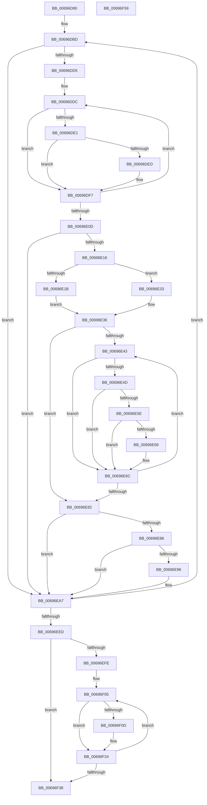

# MiZeroPageThread

- RVA: `0x00696D80`–`0x00696F5A` (길이 `474` bytes)
- VA: `0x0000000140696D80`
- 실행 섹션: `.text`
- PDB 이름 있음: `예`; PDB Function 태그: `아니요`
- unwind 정보 RVA: `0x000D94E0`
- 디코드: `122`개 명령, `474/474` bytes 표시
- 미해석 바이트: `0` (있으면 어셈블리에 `.byte`로 보존)

> 이 문서는 커널 이미지의 기계어와 PDB 기호를 분석해 생성했습니다. 4번과 5번은 함수 원형과 자료형을 바이너리 사용 방식에서 추정한 C 해석이며 원본 소스 복구 결과는 아닙니다.

## 1. Dependencies

- 직접 호출 지점: **5**; 고유 호출 대상: **5**
- 직접 호출자로 확인된 함수: **0**
- RIP 상대 이미지 참조: **1**

### Outgoing calls
- `0x00696E55` → [MiCreatePerNodeZeroingConductor](../../page/81/MiCreatePerNodeZeroingConductor_function_00810480.md) (function, `0x00810480`)
- `0x00696EA2` → [KeSetEvent](../33/KeSetEvent_function_0033F310.md) (function, `0x0033F310`)
- `0x00696EE0` → [KeWaitForMultipleObjects](../20/KeWaitForMultipleObjects_function_0020D110.md) (function, `0x0020D110`)
- `0x00696F15` → [ZwWaitForSingleObject](../6A/ZwWaitForSingleObject_function_006AD150.md) (function, `0x006AD150`)
- `0x00696F1F` → [ObCloseHandle](../../page/8A/ObCloseHandle_function_008A1870.md) (function, `0x008A1870`)

### Direct callers
- 이 함수 시작 RVA로 연결되는 직접 call은 확인되지 않았습니다. 간접 호출은 완전히 역산할 수 없습니다.

### Static image references
- `0x00696DBD` → RVA `0x00FC5000` (`ALMOSTRO`; read)

## 2. Other-region calls and transfers

- 다른 실행 섹션으로 향하는 call: **2**
  - `0x00696E55` → [MiCreatePerNodeZeroingConductor](../../page/81/MiCreatePerNodeZeroingConductor_function_00810480.md) (`.text` → `PAGE`)
  - `0x00696F1F` → [ObCloseHandle](../../page/8A/ObCloseHandle_function_008A1870.md) (`.text` → `PAGE`)
- 별도 외부 분기/꼬리 이동을 확인하지 못했습니다.

## 3. Assembly (complete function range)

```asm
00696D80  48 89 5C 24 08                  mov qword ptr [rsp + 8], rbx
00696D85  48 89 6C 24 10                  mov qword ptr [rsp + 0x10], rbp
00696D8A  48 89 74 24 18                  mov qword ptr [rsp + 0x18], rsi
00696D8F  57                              push rdi
00696D90  41 54                           push r12
00696D92  41 55                           push r13
00696D94  41 56                           push r14
00696D96  41 57                           push r15
00696D98  48 81 EC B0 00 00 00            sub rsp, 0xb0
00696D9F  48 8B F9                        mov rdi, rcx
00696DA2  C7 81 54 42 00 00 01 00 00 00   mov dword ptr [rcx + 0x4254], 1
00696DAC  41 BE 01 00 00 00               mov r14d, 1
00696DB2  4C 8D 79 58                     lea r15, [rcx + 0x58]
00696DB6  4C 8D 61 70                     lea r12, [rcx + 0x70]
00696DBA  45 33 ED                        xor r13d, r13d
00696DBD  66 44 3B 2D 3B E2 92 00         cmp r13w, word ptr [rip + 0x92e23b]
00696DC5  45 8B CD                        mov r9d, r13d
00696DC8  48 8B 57 10                     mov rdx, qword ptr [rdi + 0x10]
00696DCC  41 8B C5                        mov eax, r13d
00696DCF  0F 83 D2 00 00 00               jae 0x140696ea7
00696DD5  48 81 C2 B8 3B 00 00            add rdx, 0x3bb8
00696DDC  4C 39 2A                        cmp qword ptr [rdx], r13
00696DDF  75 16                           jne 0x140696df7
00696DE1  48 8B 8A C8 FE FF FF            mov rcx, qword ptr [rdx - 0x138]
00696DE8  48 85 C9                        test rcx, rcx
00696DEB  74 0A                           je 0x140696df7
00696DED  48 C7 02 01 00 00 00            mov qword ptr [rdx], 1
00696DF4  41 FF C1                        inc r9d
00696DF7  44 0F B7 05 01 E2 92 00         movzx r8d, word ptr [rip + 0x92e201]
00696DFF  48 81 C2 80 DF 00 00            add rdx, 0xdf80
00696E06  FF C0                           inc eax
00696E08  41 3B C0                        cmp eax, r8d
00696E0B  72 CF                           jb 0x140696ddc
00696E0D  45 85 C9                        test r9d, r9d
00696E10  0F 84 91 00 00 00               je 0x140696ea7
00696E16  45 85 F6                        test r14d, r14d
00696E19  74 18                           je 0x140696e33
00696E1B  42 8D 04 4D 01 00 00 00         lea eax, [r9*2 + 1]
00696E23  BE 01 00 00 00                  mov esi, 1
00696E28  41 03 C1                        add eax, r9d
00696E2B  89 87 34 42 00 00               mov dword ptr [rdi + 0x4234], eax
00696E31  EB 03                           jmp 0x140696e36
00696E33  41 8B F5                        mov esi, r13d
00696E36  48 8B 6F 10                     mov rbp, qword ptr [rdi + 0x10]
00696E3A  41 8B DD                        mov ebx, r13d
00696E3D  66 45 3B E8                     cmp r13w, r8w
00696E41  73 3F                           jae 0x140696e82
00696E43  48 83 BD B8 3B 00 00 01         cmp qword ptr [rbp + 0x3bb8], 1
00696E4B  75 1F                           jne 0x140696e6c
00696E4D  45 8B C6                        mov r8d, r14d
00696E50  8B D3                           mov edx, ebx
00696E52  48 8B CF                        mov rcx, rdi
00696E55  E8 26 96 17 00                  call 0x140810480
00696E5A  85 C0                           test eax, eax
00696E5C  79 0E                           jns 0x140696e6c
00696E5E  4C 89 AD B8 3B 00 00            mov qword ptr [rbp + 0x3bb8], r13
00696E65  85 F6                           test esi, esi
00696E67  74 03                           je 0x140696e6c
00696E69  83 C6 03                        add esi, 3
00696E6C  44 0F B7 05 8C E1 92 00         movzx r8d, word ptr [rip + 0x92e18c]
00696E74  FF C3                           inc ebx
00696E76  48 81 C5 80 DF 00 00            add rbp, 0xdf80
00696E7D  41 3B D8                        cmp ebx, r8d
00696E80  72 C1                           jb 0x140696e43
00696E82  85 F6                           test esi, esi
00696E84  74 21                           je 0x140696ea7
00696E86  8B C6                           mov eax, esi
00696E88  F7 D8                           neg eax
00696E8A  F0 0F C1 87 34 42 00 00         lock xadd dword ptr [rdi + 0x4234], eax
00696E92  3B C6                           cmp eax, esi
00696E94  75 11                           jne 0x140696ea7
00696E96  48 8D 8F 38 42 00 00            lea rcx, [rdi + 0x4238]
00696E9D  45 33 C0                        xor r8d, r8d
00696EA0  33 D2                           xor edx, edx
00696EA2  E8 69 84 CA FF                  call 0x14033f310
00696EA7  41 B9 08 00 00 00               mov r9d, 8
00696EAD  4C 89 7C 24 40                  mov qword ptr [rsp + 0x40], r15
00696EB2  48 8D 44 24 50                  lea rax, [rsp + 0x50]
00696EB7  4C 89 64 24 48                  mov qword ptr [rsp + 0x48], r12
00696EBC  48 89 44 24 38                  mov qword ptr [rsp + 0x38], rax
00696EC1  48 8D 54 24 40                  lea rdx, [rsp + 0x40]
00696EC6  4C 89 6C 24 30                  mov qword ptr [rsp + 0x30], r13
00696ECB  45 8B F5                        mov r14d, r13d
00696ECE  45 8D 41 F9                     lea r8d, [r9 - 7]
00696ED2  44 88 6C 24 28                  mov byte ptr [rsp + 0x28], r13b
00696ED7  41 8D 49 FA                     lea ecx, [r9 - 6]
00696EDB  44 88 6C 24 20                  mov byte ptr [rsp + 0x20], r13b
00696EE0  E8 2B 62 B7 FF                  call 0x14020d110
00696EE5  85 C0                           test eax, eax
00696EE7  0F 85 D0 FE FF FF               jne 0x140696dbd
00696EED  66 44 3B 2D 0B E1 92 00         cmp r13w, word ptr [rip + 0x92e10b]
00696EF5  41 8B DD                        mov ebx, r13d
00696EF8  48 8B 7F 10                     mov rdi, qword ptr [rdi + 0x10]
00696EFC  73 3A                           jae 0x140696f38
00696EFE  48 81 C7 B8 3B 00 00            add rdi, 0x3bb8
00696F05  48 8B 37                        mov rsi, qword ptr [rdi]
00696F08  48 85 F6                        test rsi, rsi
00696F0B  74 17                           je 0x140696f24
00696F0D  45 33 C0                        xor r8d, r8d
00696F10  33 D2                           xor edx, edx
00696F12  48 8B CE                        mov rcx, rsi
00696F15  E8 36 62 01 00                  call 0x1406ad150
00696F1A  33 D2                           xor edx, edx
00696F1C  48 8B CE                        mov rcx, rsi
00696F1F  E8 4C A9 20 00                  call 0x1408a1870
00696F24  0F B7 05 D5 E0 92 00            movzx eax, word ptr [rip + 0x92e0d5]
00696F2B  48 81 C7 80 DF 00 00            add rdi, 0xdf80
00696F32  FF C3                           inc ebx
00696F34  3B D8                           cmp ebx, eax
00696F36  72 CD                           jb 0x140696f05
00696F38  4C 8D 9C 24 B0 00 00 00         lea r11, [rsp + 0xb0]
00696F40  49 8B 5B 30                     mov rbx, qword ptr [r11 + 0x30]
00696F44  49 8B 6B 38                     mov rbp, qword ptr [r11 + 0x38]
00696F48  49 8B 73 40                     mov rsi, qword ptr [r11 + 0x40]
00696F4C  49 8B E3                        mov rsp, r11
00696F4F  41 5F                           pop r15
00696F51  41 5E                           pop r14
00696F53  41 5D                           pop r13
00696F55  41 5C                           pop r12
00696F57  5F                              pop rdi
00696F58  C3                              ret
00696F59  CC                              int3
```

## 4. C-style interpretation (structured pseudocode)

```c
__int64 __fastcall MiZeroPageThread(__int64 a1)
{
    __int64 result;
    __int64 v_r13;
    __int64 v_rbp;
    __int64 v_rbx;
    __int64 v_rdi;
    __int64 v_rsi;
    __int64 v_rsp;
    unsigned __int64 v_stack_m28;
    unsigned __int64 v_stack_m88;
    unsigned __int64 v_stack_m90;
    unsigned __int64 v_stack_m98;
    unsigned __int64 v_stack_mA0;
    unsigned __int64 v_stack_mA8;
    unsigned __int8 v_stack_mB0;
    unsigned __int8 v_stack_mB8;
    unsigned __int64 v_stack_p10;
    unsigned __int64 v_stack_p18;
    unsigned __int64 v_stack_p8;

    v_stack_p8 = v_rbx;
    v_stack_p10 = v_rbp;
    v_stack_p18 = v_rsi;
    v_rsp = (v_rsp) - (176);
    *(unsigned int *)(a1 + 16980) = 1;
    v_r13 = 0;
loc_00696DBD:
    if (0 >= (*(unsigned __int16 *)(v_rip + 9626171))) goto loc_00696EA7;
    a2 = (*(unsigned __int64 *)(a1 + 16)) + (0x3BB8ULL);
loc_00696DDC:
    if ((*(unsigned __int64 *)(a2)) != 0) goto loc_00696DF7;
    if (*(unsigned __int64 *)(a2 - 312) != 0) {
        *(unsigned __int64 *)(a2) = 1;
        a4 = (unsigned int)((0) + 1);
    }
    a2 = (a2) + (0xDF80ULL);
    result = (unsigned int)((0) + 1);
    if (((unsigned int)(result)) < ((unsigned int)(*(unsigned __int16 *)(v_rip + 9626113)))) goto loc_00696DDC;
    if ((unsigned int)(a4) == 0) goto loc_00696EA7;
    if (1 == 0) goto loc_00696E33;
    result = (unsigned int)((a4 * 2 + 1) + ((unsigned int)(a4)));
    *(unsigned int *)(a1 + 16948) = (unsigned int)(result);
    goto loc_00696E36;
loc_00696E33:
loc_00696E36:
    if (0 >= ((unsigned __int16)(*(unsigned __int16 *)(v_rip + 9626113)))) goto loc_00696E82;
loc_00696E43:
    if ((*(unsigned __int64 *)(*(unsigned __int64 *)(a1 + 16) + 15288)) != 1) goto loc_00696E6C;
    result = MiCreatePerNodeZeroingConductor(a1, 0, 1, a4);
    if (!sign_flag) goto loc_00696E6C;
    *(unsigned __int64 *)(*(unsigned __int64 *)(a1 + 16) + 15288) = 0;
    v_rsi = 0;
    if (0 != 0) {
        v_rsi = (unsigned int)((0) + (3));
    }
    v_rbx = (unsigned int)((0) + 1);
    v_rbp = (*(unsigned __int64 *)(a1 + 16)) + (0xDF80ULL);
    if (((unsigned int)(v_rbx)) < ((unsigned int)(*(unsigned __int16 *)(v_rip + 9625996)))) goto loc_00696E43;
loc_00696E82:
    if ((unsigned int)(v_rsi) == 0) goto loc_00696EA7;
    result = (unsigned int)(-((unsigned int)((unsigned int)(v_rsi))));
    if (((unsigned int)(result)) == ((unsigned int)(v_rsi))) {
        a1 = a1 + 16952;
        a3 = 0;
        a2 = 0;
        result = KeSetEvent(a1, a2, a3, a4);
    }
    v_stack_m98 = a1 + 88;
    v_stack_m90 = a1 + 112;
    v_stack_mA0 = v_stack_m88;
    v_stack_mA8 = 0;
    v_stack_mB0 = 0;
    v_stack_mB8 = 0;
    result = KeWaitForMultipleObjects(8 - 6, v_stack_m98, 8 - 7, 8);
    if ((unsigned int)(result) != 0) goto loc_00696DBD;
    if (0 >= (*(unsigned __int16 *)(v_rip + 9625867))) goto loc_00696F38;
    v_rdi = (*(unsigned __int64 *)(a1 + 16)) + (0x3BB8ULL);
loc_00696F05:
    if (*(unsigned __int64 *)(v_rdi) != 0) {
        a3 = 0;
        a2 = 0;
        a1 = *(unsigned __int64 *)(v_rdi);
        result = ZwWaitForSingleObject(a1, a2, a3, 8);
        a2 = 0;
        a1 = *(unsigned __int64 *)(v_rdi);
        result = ObCloseHandle(a1, a2, a3, 8);
    }
    v_rdi = (v_rdi) + (0xDF80ULL);
    v_rbx = (unsigned int)((0) + 1);
    if (((unsigned int)(v_rbx)) < ((unsigned int)(*(unsigned __int16 *)(v_rip + 9625813)))) goto loc_00696F05;
loc_00696F38:
    return *(unsigned __int16 *)(v_rip + 9625813);
}
```

## 5. (Beta) C Style

```c
int64_t MiZeroPageThread(void *Arg1)
{
    uint8_t *arg1 = (uint8_t *)Arg1;

    int64_t result;
    int64_t local_r13;
    int64_t local_rbp;
    int64_t local_rbx;
    int64_t local_rdi;
    int64_t local_rsi;
    int64_t local_rsp;
    uint64_t v_stack_m28;
    uint64_t v_stack_m88;
    uint64_t v_stack_m90;
    uint64_t v_stack_m98;
    uint64_t v_stack_mA0;
    uint64_t v_stack_mA8;
    uint8_t v_stack_mB0;
    uint8_t v_stack_mB8;
    uint64_t v_stack_p10;
    uint64_t v_stack_p18;
    uint64_t v_stack_p8;

    v_stack_p8 = local_rbx;
    v_stack_p10 = local_rbp;
    v_stack_p18 = local_rsi;
    local_rsp = (local_rsp) - (176);
    *(uint32_t *)(arg1 + 0x4254) = 1;
    local_r13 = 0;
loc_00696DBD:
    if (0 >= (*(uint16_t *)(v_rip + 0x92E23B))) goto loc_00696EA7;
    a2 = (*(uint64_t *)(arg1 + 0x10)) + (0x3BB8ULL);
loc_00696DDC:
    if ((*(uint64_t *)(a2)) != 0) goto loc_00696DF7;
    if (*(uint64_t *)(a2 - 0x138) != 0) {
        *(uint64_t *)(a2) = 1;
        a4 = (uint32_t)((0) + 1);
    }
    a2 = (a2) + (0xDF80ULL);
    result = (uint32_t)((0) + 1);
    if (((uint32_t)(result)) < ((uint32_t)(*(uint16_t *)(v_rip + 0x92E201)))) goto loc_00696DDC;
    if ((uint32_t)(a4) == 0) goto loc_00696EA7;
    if (1 == 0) goto loc_00696E33;
    result = (uint32_t)((a4 * 2 + 1) + ((uint32_t)(a4)));
    *(uint32_t *)(arg1 + 0x4234) = (uint32_t)(result);
    goto loc_00696E36;
loc_00696E33:
loc_00696E36:
    if (0 >= ((uint16_t)(*(uint16_t *)(v_rip + 0x92E201)))) goto loc_00696E82;
loc_00696E43:
    if ((*(uint64_t *)(*(uint64_t *)(arg1 + 0x10) + 0x3BB8)) != 1) goto loc_00696E6C;
    result = MiCreatePerNodeZeroingConductor(Arg1, 0, 1, a4);
    if (!sign_flag) goto loc_00696E6C;
    *(uint64_t *)(*(uint64_t *)(arg1 + 0x10) + 0x3BB8) = 0;
    local_rsi = 0;
    if (0 != 0) {
        local_rsi = (uint32_t)((0) + (3));
    }
    local_rbx = (uint32_t)((0) + 1);
    local_rbp = (*(uint64_t *)(arg1 + 0x10)) + (0xDF80ULL);
    if (((uint32_t)(local_rbx)) < ((uint32_t)(*(uint16_t *)(v_rip + 0x92E18C)))) goto loc_00696E43;
loc_00696E82:
    if ((uint32_t)(local_rsi) == 0) goto loc_00696EA7;
    result = (uint32_t)(-((uint32_t)((uint32_t)(local_rsi))));
    if (((uint32_t)(result)) == ((uint32_t)(local_rsi))) {
        Arg1 = Arg1 + 16952;
        a3 = 0;
        a2 = 0;
        result = KeSetEvent(Arg1, a2, a3, a4);
    }
    v_stack_m98 = Arg1 + 88;
    v_stack_m90 = Arg1 + 112;
    v_stack_mA0 = v_stack_m88;
    v_stack_mA8 = 0;
    v_stack_mB0 = 0;
    v_stack_mB8 = 0;
    result = KeWaitForMultipleObjects(8 - 6, v_stack_m98, 8 - 7, 8);
    if ((uint32_t)(result) != 0) goto loc_00696DBD;
    if (0 >= (*(uint16_t *)(v_rip + 0x92E10B))) goto loc_00696F38;
    local_rdi = (*(uint64_t *)(arg1 + 0x10)) + (0x3BB8ULL);
loc_00696F05:
    if (*(uint64_t *)(local_rdi) != 0) {
        a3 = 0;
        a2 = 0;
        Arg1 = *(uint64_t *)(local_rdi);
        result = ZwWaitForSingleObject(Arg1, a2, a3, 8);
        a2 = 0;
        Arg1 = *(uint64_t *)(local_rdi);
        result = ObCloseHandle(Arg1, a2, a3, 8);
    }
    local_rdi = (local_rdi) + (0xDF80ULL);
    local_rbx = (uint32_t)((0) + 1);
    if (((uint32_t)(local_rbx)) < ((uint32_t)(*(uint16_t *)(v_rip + 0x92E0D5)))) goto loc_00696F05;
loc_00696F38:
    return *(uint16_t *)(v_rip + 0x92E0D5);
}
```

### 관측된 메모리 오프셋

구조체 형식이 확인되지 않은 접근은 인자 기준의 오프셋으로만 기록했습니다.

| 기준 인자 | 오프셋 표현 | 폭 (bit) | 접근 |
|---|---:|---:|---|
| `Arg1` | `+ 0x10` | `64` | `R` |
| `Arg1` | `+ 0x58` | `64` | `R` |
| `Arg1` | `+ 0x70` | `64` | `R` |
| `Arg1` | `+ 0x4234` | `32` | `R/W` |
| `Arg1` | `+ 0x4234` | `32` | `W` |
| `Arg1` | `+ 0x4238` | `64` | `R` |
| `Arg1` | `+ 0x4254` | `32` | `W` |

## 6. Execution-region graph

[열기: 2D/3D 그래프와 함수 탐색 컨트롤 패널](../../../control-panel.html?section=text&rva=0x00696D80&view=graph)

- 2D 그래프는 위에서 아래로 흐르고, 3D 그래프는 빈 공간을 드래그해 회전합니다. Shift+드래그는 이동, 휠은 확대·축소, 함수 노드 선택은 대상 보고서 이동입니다.

### Static fallback


