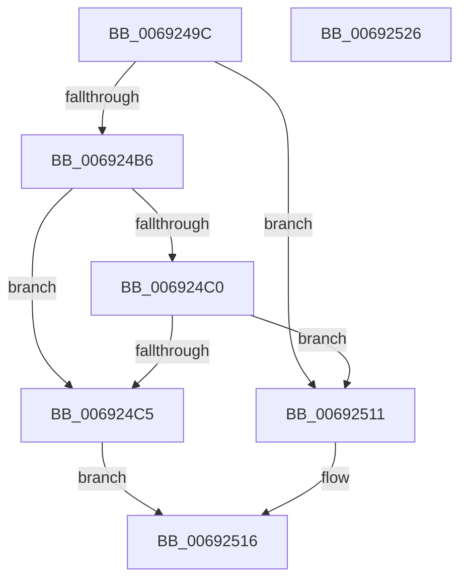

# MmManagePartitionSetMemoryThresholds

- RVA: `0x0069249C`–`0x00692527` (길이 `139` bytes)
- VA: `0x000000014069249C`
- 실행 섹션: `.text`
- PDB 이름 있음: `예`; PDB Function 태그: `아니요`
- unwind 정보 RVA: `0x00060BC4`
- 디코드: `38`개 명령, `139/139` bytes 표시
- 미해석 바이트: `0` (있으면 어셈블리에 `.byte`로 보존)

> 이 문서는 커널 이미지의 기계어와 PDB 기호를 분석해 생성했습니다. 4번과 5번은 함수 원형과 자료형을 바이너리 사용 방식에서 추정한 C 해석이며 원본 소스 복구 결과는 아닙니다.

## 1. Dependencies

- 직접 호출 지점: **3**; 고유 호출 대상: **3**
- 직접 호출자로 확인된 함수: **1**
- RIP 상대 이미지 참조: **0**

### Outgoing calls
- `0x006924CF` → [ExAcquireSpinLockExclusive](../24/ExAcquireSpinLockExclusive_function_00248690.md) (function, `0x00248690`)
- `0x006924F3` → [MiReleaseSpinLockExclusive](../24/MiReleaseSpinLockExclusive_function_002482C0.md) (function, `0x002482C0`)
- `0x00692508` → [KeSetEvent](../33/KeSetEvent_function_0033F310.md) (function, `0x0033F310`)

### Direct callers
- [sub_00B2095C](../../page/B2/Unknown_function_00B2095C.md) at `0x00B209D8`

### Static image references
- 디코드된 RIP-relative 메모리 참조가 없습니다.

## 2. Other-region calls and transfers

- 다른 실행 섹션으로 향하는 call: **0**
- 별도 외부 분기/꼬리 이동을 확인하지 못했습니다.

## 3. Assembly (complete function range)

```asm
0069249C  48 89 5C 24 08                  mov qword ptr [rsp + 8], rbx
006924A1  48 89 74 24 10                  mov qword ptr [rsp + 0x10], rsi
006924A6  57                              push rdi
006924A7  48 83 EC 20                     sub rsp, 0x20
006924AB  83 3A 00                        cmp dword ptr [rdx], 0
006924AE  48 8B FA                        mov rdi, rdx
006924B1  48 8B 31                        mov rsi, qword ptr [rcx]
006924B4  75 5B                           jne 0x140692511
006924B6  48 8B 42 10                     mov rax, qword ptr [rdx + 0x10]
006924BA  48 3B 42 08                     cmp rax, qword ptr [rdx + 8]
006924BE  73 05                           jae 0x1406924c5
006924C0  48 85 C0                        test rax, rax
006924C3  75 4C                           jne 0x140692511
006924C5  48 8D 9E C8 00 00 00            lea rbx, [rsi + 0xc8]
006924CC  48 8B CB                        mov rcx, rbx
006924CF  E8 BC 61 BB FF                  call 0x140248690
006924D4  48 8B 57 08                     mov rdx, qword ptr [rdi + 8]
006924D8  48 8B CB                        mov rcx, rbx
006924DB  48 89 96 F0 40 00 00            mov qword ptr [rsi + 0x40f0], rdx
006924E2  48 8B 57 10                     mov rdx, qword ptr [rdi + 0x10]
006924E6  48 89 96 F8 40 00 00            mov qword ptr [rsi + 0x40f8], rdx
006924ED  8A D0                           mov dl, al
006924EF  C6 46 0C 01                     mov byte ptr [rsi + 0xc], 1
006924F3  E8 C8 5D BB FF                  call 0x1402482c0
006924F8  48 8B 8E C0 44 00 00            mov rcx, qword ptr [rsi + 0x44c0]
006924FF  45 33 C0                        xor r8d, r8d
00692502  48 83 C1 60                     add rcx, 0x60
00692506  33 D2                           xor edx, edx
00692508  E8 03 CE CA FF                  call 0x14033f310
0069250D  33 C0                           xor eax, eax
0069250F  EB 05                           jmp 0x140692516
00692511  B8 0D 00 00 C0                  mov eax, 0xc000000d
00692516  48 8B 5C 24 30                  mov rbx, qword ptr [rsp + 0x30]
0069251B  48 8B 74 24 38                  mov rsi, qword ptr [rsp + 0x38]
00692520  48 83 C4 20                     add rsp, 0x20
00692524  5F                              pop rdi
00692525  C3                              ret
00692526  CC                              int3
```

## 4. C-style interpretation (structured pseudocode)

```c
__int64 __fastcall MmManagePartitionSetMemoryThresholds(__int64 a1, __int64 a2, int a3)
{
    __int64 result;
    __int64 v_rsp;
    unsigned __int64 v_stack_p10;
    unsigned __int64 v_stack_p8;

    v_stack_p8 = v_rbx;
    v_stack_p10 = v_rsi;
    v_rsp = (v_rsp) - (32);
    if ((*(unsigned int *)(a2)) != 0) goto loc_00692511;
    if ((*(unsigned __int64 *)(a2 + 16)) >= (*(unsigned __int64 *)(a2 + 8))) goto loc_006924C5;
    if (*(unsigned __int64 *)(a2 + 16) != 0) goto loc_00692511;
loc_006924C5:
    result = ExAcquireSpinLockExclusive(*(unsigned __int64 *)(a1) + 200, a2, a3, a4);
    *(unsigned __int64 *)(*(unsigned __int64 *)(a1) + 16624) = *(unsigned __int64 *)(a2 + 8);
    *(unsigned __int64 *)(*(unsigned __int64 *)(a1) + 16632) = *(unsigned __int64 *)(a2 + 16);
    *(unsigned __int8 *)(*(unsigned __int64 *)(a1) + 12) = 1;
    result = MiReleaseSpinLockExclusive(*(unsigned __int64 *)(a1) + 200, (unsigned __int8)(result), a3, a4);
    a3 = 0;
    a1 = (*(unsigned __int64 *)(*(unsigned __int64 *)(a1) + 17600)) + (96);
    a2 = 0;
    result = KeSetEvent(a1, a2, a3, a4);
    result = 0;
    goto loc_00692516;
loc_00692511:
loc_00692516:
    v_rsp = (v_rsp) + (32);
    return (unsigned int)(0xC000000DULL);
}
```

## 5. (Beta) C Style

```c
int64_t MmManagePartitionSetMemoryThresholds(void *Arg1, void *Arg2, int32_t Arg3)
{
    uint8_t *arg1 = (uint8_t *)Arg1;
    uint8_t *arg2 = (uint8_t *)Arg2;

    int64_t result;
    int64_t local_rsp;
    uint64_t v_stack_p10;
    uint64_t v_stack_p8;

    v_stack_p8 = local_rbx;
    v_stack_p10 = local_rsi;
    local_rsp = (local_rsp) - (32);
    if ((*(uint32_t *)(arg2)) != 0) goto loc_00692511;
    if ((*(uint64_t *)(arg2 + 0x10)) >= (*(uint64_t *)(arg2 + 0x8))) goto loc_006924C5;
    if (*(uint64_t *)(arg2 + 0x10) != 0) goto loc_00692511;
loc_006924C5:
    result = ExAcquireSpinLockExclusive(*(uint64_t *)(arg1) + 200, Arg2, Arg3, a4);
    *(uint64_t *)(*(uint64_t *)(arg1) + 0x40F0) = *(uint64_t *)(arg2 + 0x8);
    *(uint64_t *)(*(uint64_t *)(arg1) + 0x40F8) = *(uint64_t *)(arg2 + 0x10);
    *(uint8_t *)(*(uint64_t *)(arg1) + 0xC) = 1;
    result = MiReleaseSpinLockExclusive(*(uint64_t *)(arg1) + 200, (uint8_t)(result), Arg3, a4);
    Arg3 = 0;
    Arg1 = (*(uint64_t *)(*(uint64_t *)(arg1) + 0x44C0)) + (96);
    Arg2 = 0;
    result = KeSetEvent(Arg1, Arg2, Arg3, a4);
    result = 0;
    goto loc_00692516;
loc_00692511:
loc_00692516:
    local_rsp = (local_rsp) + (32);
    return (uint32_t)(0xC000000DULL);
}
```

### 관측된 메모리 오프셋

구조체 형식이 확인되지 않은 접근은 인자 기준의 오프셋으로만 기록했습니다.

| 기준 인자 | 오프셋 표현 | 폭 (bit) | 접근 |
|---|---:|---:|---|
| `Arg1` | `+ 0x0` | `64` | `R` |
| `Arg2` | `+ 0x0` | `32` | `R` |
| `Arg2` | `+ 0x8` | `64` | `R` |
| `Arg2` | `+ 0x10` | `64` | `R` |

## 6. Execution-region graph

[열기: 2D/3D 그래프와 함수 탐색 컨트롤 패널](../../../control-panel.html?section=text&rva=0x0069249C&view=graph)

- 2D 그래프는 위에서 아래로 흐르고, 3D 그래프는 빈 공간을 드래그해 회전합니다. Shift+드래그는 이동, 휠은 확대·축소, 함수 노드 선택은 대상 보고서 이동입니다.

### Static fallback


