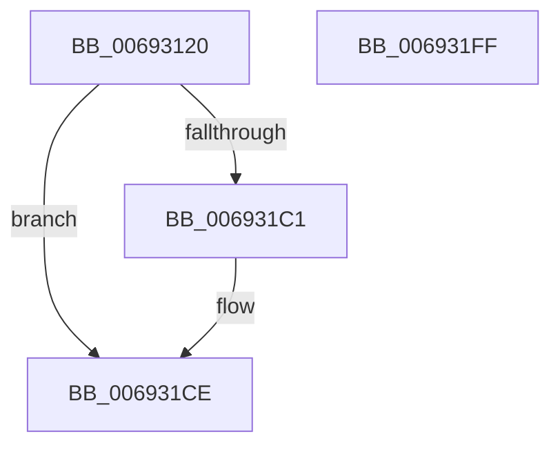

# MmStoreIsVirtualAddressPoisoned

- RVA: `0x00693120`–`0x00693200` (길이 `224` bytes)
- VA: `0x0000000140693120`
- 실행 섹션: `.text`
- PDB 이름 있음: `예`; PDB Function 태그: `아니요`
- unwind 정보 RVA: `0x00060300`
- 디코드: `60`개 명령, `224/224` bytes 표시
- 미해석 바이트: `0` (있으면 어셈블리에 `.byte`로 보존)

> 이 문서는 커널 이미지의 기계어와 PDB 기호를 분석해 생성했습니다. 4번과 5번은 함수 원형과 자료형을 바이너리 사용 방식에서 추정한 C 해석이며 원본 소스 복구 결과는 아닙니다.

## 1. Dependencies

- 직접 호출 지점: **6**; 고유 호출 대상: **6**
- 직접 호출자로 확인된 함수: **2**
- RIP 상대 이미지 참조: **0**

### Outgoing calls
- `0x00693152` → [MiStoreGetVadForAddress](../47/MiStoreGetVadForAddress_function_00474CB0.md) (function, `0x00474CB0`)
- `0x0069317E` → [MiLockWorkingSetShared](../27/MiLockWorkingSetShared_function_0027CBF0.md) (function, `0x0027CBF0`)
- `0x0069319B` → [MiMakeSystemAddressValid](../27/MiMakeSystemAddressValid_function_0027FF70.md) (function, `0x0027FF70`)
- `0x006931B6` → [IS_PTE_NOT_DEMAND_ZERO](../22/IS_PTE_NOT_DEMAND_ZERO_function_0022F4D0.md) (function, `0x0022F4D0`)
- `0x006931D4` → [MiUnlockPageTable](../21/MiUnlockPageTable_function_00216EC0.md) (function, `0x00216EC0`)
- `0x006931DF` → [MiUnlockWorkingSetShared](../27/MiUnlockWorkingSetShared_function_0027D690.md) (function, `0x0027D690`)

### Direct callers
- [MmStoreProbeAndLockPages](../23/MmStoreProbeAndLockPages_function_0023E570.md) at `0x0023E873`
- [ST_STORE&lt;SM_TRAITS&gt;::StRegionAccessExceptionFilter](../60/ST_STORE_SM_TRAITS_StRegionAccessExceptionFilter_function_0060E798.md) at `0x0060E838`

### Static image references
- 디코드된 RIP-relative 메모리 참조가 없습니다.

## 2. Other-region calls and transfers

- 다른 실행 섹션으로 향하는 call: **0**
- 별도 외부 분기/꼬리 이동을 확인하지 못했습니다.

## 3. Assembly (complete function range)

```asm
00693120  48 89 5C 24 08                  mov qword ptr [rsp + 8], rbx
00693125  48 89 6C 24 10                  mov qword ptr [rsp + 0x10], rbp
0069312A  48 89 74 24 18                  mov qword ptr [rsp + 0x18], rsi
0069312F  57                              push rdi
00693130  41 56                           push r14
00693132  41 57                           push r15
00693134  48 83 EC 20                     sub rsp, 0x20
00693138  65 48 8B 04 25 88 01 00 00      mov rax, qword ptr gs:[0x188]
00693141  48 8B F9                        mov rdi, rcx
00693144  48 8B B0 B8 00 00 00            mov rsi, qword ptr [rax + 0xb8]
0069314B  48 81 C6 00 04 00 00            add rsi, 0x400
00693152  E8 59 1B DE FF                  call 0x140474cb0
00693157  48 C1 EF 09                     shr rdi, 9
0069315B  49 BF F8 FF FF FF 7F 00 00 00   movabs r15, 0x7ffffffff8
00693165  49 23 FF                        and rdi, r15
00693168  49 BE 00 00 00 00 80 F6 FF FF   movabs r14, 0xfffff68000000000
00693172  48 8B D8                        mov rbx, rax
00693175  49 8B CE                        mov rcx, r14
00693178  48 03 F9                        add rdi, rcx
0069317B  48 8B CE                        mov rcx, rsi
0069317E  E8 6D 9A BE FF                  call 0x14027cbf0
00693183  8B 53 30                        mov edx, dword ptr [rbx + 0x30]
00693186  41 B9 02 00 00 00               mov r9d, 2
0069318C  C1 EA 0C                        shr edx, 0xc
0069318F  44 8A C0                        mov r8b, al
00693192  83 E2 7F                        and edx, 0x7f
00693195  48 8B CF                        mov rcx, rdi
00693198  40 8A E8                        mov bpl, al
0069319B  E8 D0 CD BE FF                  call 0x14027ff70
006931A0  4C 8B C7                        mov r8, rdi
006931A3  49 C1 E8 09                     shr r8, 9
006931A7  4D 23 C7                        and r8, r15
006931AA  49 8B C6                        mov rax, r14
006931AD  48 8B 17                        mov rdx, qword ptr [rdi]
006931B0  4C 03 C0                        add r8, rax
006931B3  48 8B CA                        mov rcx, rdx
006931B6  E8 15 C3 B9 FF                  call 0x14022f4d0
006931BB  33 DB                           xor ebx, ebx
006931BD  85 C0                           test eax, eax
006931BF  75 0D                           jne 0x1406931ce
006931C1  48 C1 EA 05                     shr rdx, 5
006931C5  80 E2 1F                        and dl, 0x1f
006931C8  80 FA 18                        cmp dl, 0x18
006931CB  0F 94 C3                        sete bl
006931CE  49 8B D0                        mov rdx, r8
006931D1  48 8B CE                        mov rcx, rsi
006931D4  E8 E7 3C B8 FF                  call 0x140216ec0
006931D9  40 8A D5                        mov dl, bpl
006931DC  48 8B CE                        mov rcx, rsi
006931DF  E8 AC A4 BE FF                  call 0x14027d690
006931E4  48 8B 6C 24 48                  mov rbp, qword ptr [rsp + 0x48]
006931E9  8B C3                           mov eax, ebx
006931EB  48 8B 5C 24 40                  mov rbx, qword ptr [rsp + 0x40]
006931F0  48 8B 74 24 50                  mov rsi, qword ptr [rsp + 0x50]
006931F5  48 83 C4 20                     add rsp, 0x20
006931F9  41 5F                           pop r15
006931FB  41 5E                           pop r14
006931FD  5F                              pop rdi
006931FE  C3                              ret
006931FF  CC                              int3
```

## 4. C-style interpretation (structured pseudocode)

```c
__int64 __fastcall MmStoreIsVirtualAddressPoisoned(__int64 a1)
{
    __int64 result;
    __int64 v_rbx;
    __int64 v_rdi;
    __int64 v_rsi;
    __int64 v_rsp;
    unsigned __int64 v_stack_p10;
    unsigned __int64 v_stack_p18;
    unsigned __int64 v_stack_p8;

    v_stack_p8 = v_rbx;
    v_stack_p10 = v_rbp;
    v_stack_p18 = v_rsi;
    v_rsp = (v_rsp) - (32);
    v_rsi = (*(unsigned __int64 *)(*(unsigned __int64 *)(gs_base + (0 + 392)) + 184)) + (0x400ULL);
    result = MiStoreGetVadForAddress(a1, a2, a3, a4);
    v_rdi = (a1) >> (9);
    v_rdi = (v_rdi) & (v_r15);
    v_rdi = (v_rdi) + (v_r14);
    result = MiLockWorkingSetShared(v_rsi, a2, a3, a4);
    a2 = (unsigned int)(((unsigned int)(*(unsigned int *)(result + 48))) >> (12));
    a2 = (unsigned int)((a2) & (127));
    result = MiMakeSystemAddressValid(v_rdi, a2, (unsigned __int8)(result), 2);
    a3 = (v_rdi) >> (9);
    a3 = (a3) & (v_r15);
    a3 = (a3) + (v_r14);
    result = IS_PTE_NOT_DEMAND_ZERO(*(unsigned __int64 *)(v_rdi), *(unsigned __int64 *)(v_rdi), a3, 2);
    v_rbx = 0;
    if ((unsigned int)(result) == 0) {
        a2 = (*(unsigned __int64 *)(v_rdi)) >> (5);
        a2 = (unsigned __int8)((a2) & (31));
        v_rbx = (((unsigned __int8)(a2)) == 24) ? 1 : 0;
    }
    result = MiUnlockPageTable(v_rsi, a3, a3, 2);
    result = MiUnlockWorkingSetShared(v_rsi, (unsigned __int8)((unsigned __int8)(result)), a3, 2);
    v_rsp = (v_rsp) + (32);
    return (unsigned int)((unsigned int)(v_rbx));
}
```

## 5. (Beta) C Style

```c
int64_t MmStoreIsVirtualAddressPoisoned(int64_t Arg1)
{
    int64_t result;
    int64_t local_rbx;
    int64_t local_rdi;
    int64_t local_rsi;
    int64_t local_rsp;
    uint64_t v_stack_p10;
    uint64_t v_stack_p18;
    uint64_t v_stack_p8;

    v_stack_p8 = local_rbx;
    v_stack_p10 = local_rbp;
    v_stack_p18 = local_rsi;
    local_rsp = (local_rsp) - (32);
    local_rsi = (*(uint64_t *)(*(uint64_t *)(gs_base + (0 + 0x188)) + 0xB8)) + (0x400ULL);
    result = MiStoreGetVadForAddress(Arg1, a2, a3, a4);
    local_rdi = (Arg1) >> (9);
    local_rdi = (local_rdi) & (local_r15);
    local_rdi = (local_rdi) + (local_r14);
    result = MiLockWorkingSetShared(local_rsi, a2, a3, a4);
    a2 = (uint32_t)(((uint32_t)(*(uint32_t *)(result + 0x30))) >> (12));
    a2 = (uint32_t)((a2) & (127));
    result = MiMakeSystemAddressValid(local_rdi, a2, (uint8_t)(result), 2);
    a3 = (local_rdi) >> (9);
    a3 = (a3) & (local_r15);
    a3 = (a3) + (local_r14);
    result = IS_PTE_NOT_DEMAND_ZERO(*(uint64_t *)(local_rdi), *(uint64_t *)(local_rdi), a3, 2);
    local_rbx = 0;
    if ((uint32_t)(result) == 0) {
        a2 = (*(uint64_t *)(local_rdi)) >> (5);
        a2 = (uint8_t)((a2) & (31));
        local_rbx = (((uint8_t)(a2)) == 24) ? 1 : 0;
    }
    result = MiUnlockPageTable(local_rsi, a3, a3, 2);
    result = MiUnlockWorkingSetShared(local_rsi, (uint8_t)((uint8_t)(result)), a3, 2);
    local_rsp = (local_rsp) + (32);
    return (uint32_t)((uint32_t)(local_rbx));
}
```

## 6. Execution-region graph

[열기: 2D/3D 그래프와 함수 탐색 컨트롤 패널](../../../control-panel.html?section=text&rva=0x00693120&view=graph)

- 2D 그래프는 위에서 아래로 흐르고, 3D 그래프는 빈 공간을 드래그해 회전합니다. Shift+드래그는 이동, 휠은 확대·축소, 함수 노드 선택은 대상 보고서 이동입니다.

### Static fallback


