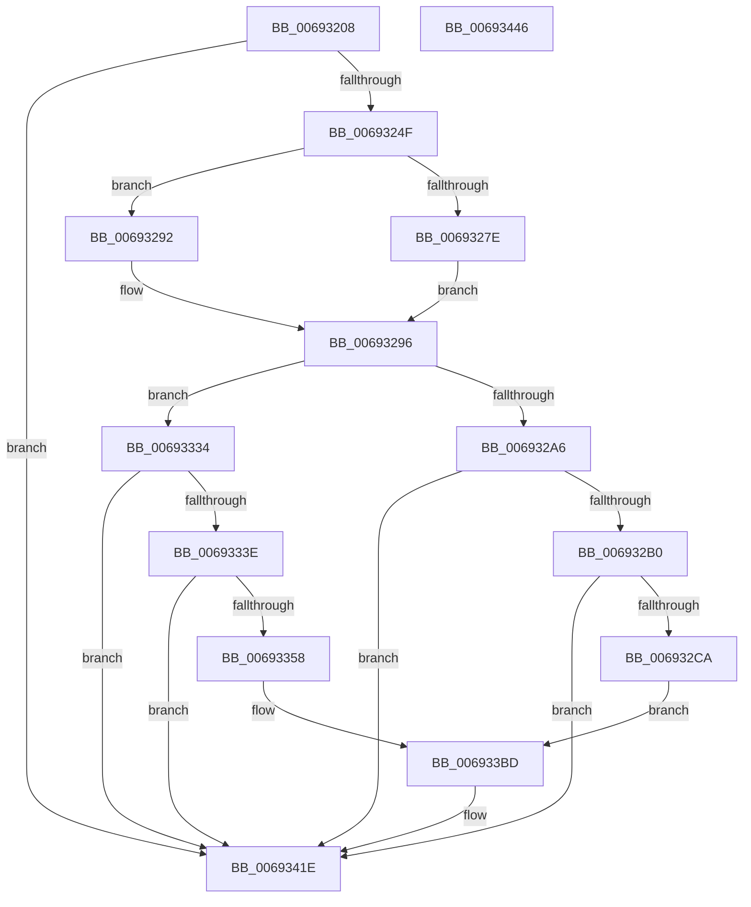

# MmStoreLogDecompressionFailure

- RVA: `0x00693208`–`0x00693447` (길이 `575` bytes)
- VA: `0x0000000140693208`
- 실행 섹션: `.text`
- PDB 이름 있음: `예`; PDB Function 태그: `아니요`
- unwind 정보 RVA: `0x000D9210`
- 디코드: `125`개 명령, `575/575` bytes 표시
- 미해석 바이트: `0` (있으면 어셈블리에 `.byte`로 보존)

> 이 문서는 커널 이미지의 기계어와 PDB 기호를 분석해 생성했습니다. 4번과 5번은 함수 원형과 자료형을 바이너리 사용 방식에서 추정한 C 해석이며 원본 소스 복구 결과는 아닙니다.

## 1. Dependencies

- 직접 호출 지점: **6**; 고유 호출 대상: **4**
- 직접 호출자로 확인된 함수: **1**
- RIP 상대 이미지 참조: **4**

### Outgoing calls
- `0x0069324F` → [MmGetPhysicalAddress](../23/MmGetPhysicalAddress_function_0023A500.md) (function, `0x0023A500`)
- `0x00693284` → [MmGetPhysicalAddress](../23/MmGetPhysicalAddress_function_0023A500.md) (function, `0x0023A500`)
- `0x006932BD` → [tlgKeywordOn](../42/tlgKeywordOn_function_0042EAA0.md) (function, `0x0042EAA0`)
- `0x0069334B` → [tlgKeywordOn](../42/tlgKeywordOn_function_0042EAA0.md) (function, `0x0042EAA0`)
- `0x00693419` → [tlgWriteEx_EtwWriteEx](../4A/tlgWriteEx_EtwWriteEx_function_004AA348.md) (function, `0x004AA348`)
- `0x00693425` → [_security_check_cookie](../6A/_security_check_cookie_function_006AC640.md) (function, `0x006AC640`)

### Direct callers
- [ST_STORE&lt;SM_TRAITS&gt;::StDmHandleDecompressionFailure](../60/ST_STORE_SM_TRAITS_StDmHandleDecompressionFailure_function_0060DA74.md) at `0x0060DD3E`

### Static image references
- `0x00693226` → RVA `0x00E0A740` (`.data`; read)
- `0x00693239` → RVA `0x00E37618` (`.data`; read)
- `0x006932D8` → RVA `0x00059DEF` (`.rdata`; read)
- `0x00693366` → RVA `0x00059D58` (`.rdata`; read)

## 2. Other-region calls and transfers

- 다른 실행 섹션으로 향하는 call: **0**
- 별도 외부 분기/꼬리 이동을 확인하지 못했습니다.

## 3. Assembly (complete function range)

```asm
00693208  48 89 5C 24 18                  mov qword ptr [rsp + 0x18], rbx
0069320D  48 89 74 24 20                  mov qword ptr [rsp + 0x20], rsi
00693212  55                              push rbp
00693213  57                              push rdi
00693214  41 54                           push r12
00693216  41 56                           push r14
00693218  41 57                           push r15
0069321A  48 8D 6C 24 F0                  lea rbp, [rsp - 0x10]
0069321F  48 81 EC 10 01 00 00            sub rsp, 0x110
00693226  48 8B 05 13 75 77 00            mov rax, qword ptr [rip + 0x777513]
0069322D  48 33 C4                        xor rax, rsp
00693230  48 89 45 00                     mov qword ptr [rbp], rax
00693234  45 33 E4                        xor r12d, r12d
00693237  8B FA                           mov edi, edx
00693239  4C 39 25 D8 43 7A 00            cmp qword ptr [rip + 0x7a43d8], r12
00693240  45 8B F9                        mov r15d, r9d
00693243  45 8B F0                        mov r14d, r8d
00693246  48 8B D9                        mov rbx, rcx
00693249  0F 84 CF 01 00 00               je 0x14069341e
0069324F  E8 AC 72 BA FF                  call 0x14023a500
00693254  48 8B D3                        mov rdx, rbx
00693257  48 8D 8F FF 0F 00 00            lea rcx, [rdi + 0xfff]
0069325E  81 E2 FF 0F 00 00               and edx, 0xfff
00693264  48 8B F0                        mov rsi, rax
00693267  48 03 D1                        add rdx, rcx
0069326A  48 C1 EE 0C                     shr rsi, 0xc
0069326E  48 81 E2 00 F0 FF FF            and rdx, 0xfffffffffffff000
00693275  48 81 FA 00 10 00 00            cmp rdx, 0x1000
0069327C  74 14                           je 0x140693292
0069327E  8D 4F FF                        lea ecx, [rdi - 1]
00693281  48 03 CB                        add rcx, rbx
00693284  E8 77 72 BA FF                  call 0x14023a500
00693289  4C 8B C0                        mov r8, rax
0069328C  49 C1 E8 0C                     shr r8, 0xc
00693290  EB 04                           jmp 0x140693296
00693292  49 83 C8 FF                     or r8, 0xffffffffffffffff
00693296  4C 8B 15 7B 43 7A 00            mov r10, qword ptr [rip + 0x7a437b]
0069329D  45 85 F6                        test r14d, r14d
006932A0  0F 84 8E 00 00 00               je 0x140693334
006932A6  41 83 3A 05                     cmp dword ptr [r10], 5
006932AA  0F 86 6E 01 00 00               jbe 0x14069341e
006932B0  48 BA 02 00 00 00 00 40 00 00   movabs rdx, 0x400000000002
006932BA  49 8B CA                        mov rcx, r10
006932BD  E8 DE B7 D9 FF                  call 0x14042eaa0
006932C2  84 C0                           test al, al
006932C4  0F 84 54 01 00 00               je 0x14069341e
006932CA  48 8D 44 24 50                  lea rax, [rsp + 0x50]
006932CF  48 89 5C 24 50                  mov qword ptr [rsp + 0x50], rbx
006932D4  48 89 45 90                     mov qword ptr [rbp - 0x70], rax
006932D8  48 8D 15 10 6B 9C FF            lea rdx, [rip - 0x6394f0]
006932DF  48 8D 44 24 40                  lea rax, [rsp + 0x40]
006932E4  89 7C 24 40                     mov dword ptr [rsp + 0x40], edi
006932E8  48 89 45 A0                     mov qword ptr [rbp - 0x60], rax
006932EC  48 8D 44 24 44                  lea rax, [rsp + 0x44]
006932F1  48 89 45 B0                     mov qword ptr [rbp - 0x50], rax
006932F5  8B 45 60                        mov eax, dword ptr [rbp + 0x60]
006932F8  89 44 24 48                     mov dword ptr [rsp + 0x48], eax
006932FC  48 8D 44 24 48                  lea rax, [rsp + 0x48]
00693301  48 89 45 C0                     mov qword ptr [rbp - 0x40], rax
00693305  48 8D 44 24 58                  lea rax, [rsp + 0x58]
0069330A  48 89 45 D0                     mov qword ptr [rbp - 0x30], rax
0069330E  48 8D 44 24 60                  lea rax, [rsp + 0x60]
00693313  48 89 45 E0                     mov qword ptr [rbp - 0x20], rax
00693317  48 8D 44 24 68                  lea rax, [rsp + 0x68]
0069331C  48 89 74 24 58                  mov qword ptr [rsp + 0x58], rsi
00693321  4C 89 44 24 60                  mov qword ptr [rsp + 0x60], r8
00693326  48 C7 44 24 68 00 00 00 01      mov qword ptr [rsp + 0x68], 0x1000000
0069332F  E9 89 00 00 00                  jmp 0x1406933bd
00693334  41 83 3A 05                     cmp dword ptr [r10], 5
00693338  0F 86 E0 00 00 00               jbe 0x14069341e
0069333E  48 BA 02 00 00 00 00 40 00 00   movabs rdx, 0x400000000002
00693348  49 8B CA                        mov rcx, r10
0069334B  E8 50 B7 D9 FF                  call 0x14042eaa0
00693350  84 C0                           test al, al
00693352  0F 84 C6 00 00 00               je 0x14069341e
00693358  48 8D 44 24 68                  lea rax, [rsp + 0x68]
0069335D  48 89 5C 24 68                  mov qword ptr [rsp + 0x68], rbx
00693362  48 89 45 90                     mov qword ptr [rbp - 0x70], rax
00693366  48 8D 15 EB 69 9C FF            lea rdx, [rip - 0x639615]
0069336D  48 8D 44 24 48                  lea rax, [rsp + 0x48]
00693372  89 7C 24 48                     mov dword ptr [rsp + 0x48], edi
00693376  48 89 45 A0                     mov qword ptr [rbp - 0x60], rax
0069337A  48 8D 44 24 44                  lea rax, [rsp + 0x44]
0069337F  48 89 45 B0                     mov qword ptr [rbp - 0x50], rax
00693383  8B 45 60                        mov eax, dword ptr [rbp + 0x60]
00693386  89 44 24 40                     mov dword ptr [rsp + 0x40], eax
0069338A  48 8D 44 24 40                  lea rax, [rsp + 0x40]
0069338F  48 89 45 C0                     mov qword ptr [rbp - 0x40], rax
00693393  48 8D 44 24 60                  lea rax, [rsp + 0x60]
00693398  48 89 45 D0                     mov qword ptr [rbp - 0x30], rax
0069339C  48 8D 44 24 58                  lea rax, [rsp + 0x58]
006933A1  48 89 45 E0                     mov qword ptr [rbp - 0x20], rax
006933A5  48 8D 44 24 50                  lea rax, [rsp + 0x50]
006933AA  48 89 74 24 60                  mov qword ptr [rsp + 0x60], rsi
006933AF  4C 89 44 24 58                  mov qword ptr [rsp + 0x58], r8
006933B4  48 C7 44 24 50 00 00 00 01      mov qword ptr [rsp + 0x50], 0x1000000
006933BD  48 89 45 F0                     mov qword ptr [rbp - 0x10], rax
006933C1  41 B9 01 00 00 00               mov r9d, 1
006933C7  48 8D 44 24 70                  lea rax, [rsp + 0x70]
006933CC  48 C7 45 98 08 00 00 00         mov qword ptr [rbp - 0x68], 8
006933D4  48 89 44 24 38                  mov qword ptr [rsp + 0x38], rax
006933D9  49 8B CA                        mov rcx, r10
006933DC  C7 44 24 30 09 00 00 00         mov dword ptr [rsp + 0x30], 9
006933E4  48 C7 45 A8 04 00 00 00         mov qword ptr [rbp - 0x58], 4
006933EC  44 89 7C 24 44                  mov dword ptr [rsp + 0x44], r15d
006933F1  48 C7 45 B8 04 00 00 00         mov qword ptr [rbp - 0x48], 4
006933F9  48 C7 45 C8 04 00 00 00         mov qword ptr [rbp - 0x38], 4
00693401  48 C7 45 D8 08 00 00 00         mov qword ptr [rbp - 0x28], 8
00693409  48 C7 45 E8 08 00 00 00         mov qword ptr [rbp - 0x18], 8
00693411  48 C7 45 F8 08 00 00 00         mov qword ptr [rbp - 8], 8
00693419  E8 2A 6F E1 FF                  call 0x1404aa348
0069341E  48 8B 4D 00                     mov rcx, qword ptr [rbp]
00693422  48 33 CC                        xor rcx, rsp
00693425  E8 16 92 01 00                  call 0x1406ac640
0069342A  4C 8D 9C 24 10 01 00 00         lea r11, [rsp + 0x110]
00693432  49 8B 5B 40                     mov rbx, qword ptr [r11 + 0x40]
00693436  49 8B 73 48                     mov rsi, qword ptr [r11 + 0x48]
0069343A  49 8B E3                        mov rsp, r11
0069343D  41 5F                           pop r15
0069343F  41 5E                           pop r14
00693441  41 5C                           pop r12
00693443  5F                              pop rdi
00693444  5D                              pop rbp
00693445  C3                              ret
00693446  CC                              int3
```

## 4. C-style interpretation (structured pseudocode)

```c
__int64 __fastcall MmStoreLogDecompressionFailure(__int64 a1, int a2, int a3, int a4, unsigned int a5)
{
    __int64 result;
    __int64 v_r12;
    __int64 v_rsi;
    __int64 v_rsp;
    unsigned __int64 v_stack_m100;
    unsigned int v_stack_m108;
    unsigned __int64 v_stack_m28;
    unsigned __int64 v_stack_m38;
    unsigned __int64 v_stack_m40;
    unsigned __int64 v_stack_m48;
    unsigned __int64 v_stack_m50;
    unsigned __int64 v_stack_m58;
    unsigned __int64 v_stack_m60;
    unsigned __int64 v_stack_m68;
    unsigned __int64 v_stack_m70;
    unsigned __int64 v_stack_m78;
    unsigned __int64 v_stack_m80;
    unsigned __int64 v_stack_m88;
    unsigned __int64 v_stack_m90;
    unsigned __int64 v_stack_m98;
    unsigned __int64 v_stack_mA0;
    unsigned __int64 v_stack_mA8;
    unsigned __int64 v_stack_mC8;
    unsigned __int64 v_stack_mD0;
    unsigned __int64 v_stack_mD8;
    unsigned __int64 v_stack_mE0;
    unsigned __int64 v_stack_mE8;
    unsigned int v_stack_mF0;
    unsigned __int64 v_stack_mF4;
    unsigned __int64 v_stack_mF8;
    unsigned __int64 v_stack_p18;
    unsigned __int64 v_stack_p20;

    v_stack_p18 = v_rbx;
    v_stack_p20 = v_rsi;
    v_rsp = (v_rsp) - (272);
    result = (*(unsigned __int64 *)(v_rip + 7828755)) ^ (v_rsp);
    v_stack_m38 = result;
    v_r12 = 0;
    if ((*(unsigned __int64 *)(v_rip + 8012760)) == 0) goto loc_0069341E;
    result = MmGetPhysicalAddress(a1, a2, a3, a4);
    a2 = (unsigned int)((a1) & (0xFFFULL));
    a2 = (a2) + ((unsigned int)(a2) + 4095);
    v_rsi = (result) >> (12);
    a2 = (a2) & (0xFFFFFFFFFFFFF000ULL);
    if (a2 == 0x1000ULL) goto loc_00693292;
    a1 = ((unsigned int)(a2) - 1) + (a1);
    result = MmGetPhysicalAddress(a1, a2, a3, a4);
    a3 = (result) >> (12);
    goto loc_00693296;
loc_00693292:
    a3 = (a3) | (-1);
loc_00693296:
    if ((unsigned int)((unsigned int)(a3)) == 0) goto loc_00693334;
    if ((*(unsigned int *)(*(unsigned __int64 *)(v_rip + 8012667))) <= 5) goto loc_0069341E;
    result = tlgKeywordOn(*(unsigned __int64 *)(v_rip + 8012667), a2, a3, a4);
    if ((unsigned __int8)(result) == 0) goto loc_0069341E;
    v_stack_mE8 = a1;
    v_stack_mA8 = v_stack_mE8;
    v_stack_mF8 = (unsigned int)((unsigned int)(a2));
    v_stack_m98 = v_stack_mF8;
    v_stack_m88 = v_stack_mF4;
    v_stack_mF0 = (unsigned int)((unsigned int)(a5));
    v_stack_m78 = v_stack_mF0;
    v_stack_m68 = v_stack_mE0;
    v_stack_m58 = v_stack_mD8;
    v_stack_mE0 = v_rsi;
    v_stack_mD8 = a3;
    v_stack_mD0 = 0x1000000ULL;
    goto loc_006933BD;
loc_00693334:
    if ((*(unsigned int *)(*(unsigned __int64 *)(v_rip + 8012667))) <= 5) goto loc_0069341E;
    result = tlgKeywordOn(*(unsigned __int64 *)(v_rip + 8012667), v_rip - 6526192, a3, a4);
    if ((unsigned __int8)(result) == 0) goto loc_0069341E;
    v_stack_mD0 = a1;
    v_stack_mA8 = v_stack_mD0;
    v_stack_mF0 = (unsigned int)((unsigned int)(a2));
    v_stack_m98 = v_stack_mF0;
    v_stack_m88 = v_stack_mF4;
    v_stack_mF8 = (unsigned int)((unsigned int)(a5));
    v_stack_m78 = v_stack_mF8;
    v_stack_m68 = v_stack_mD8;
    v_stack_m58 = v_stack_mE0;
    v_stack_mD8 = v_rsi;
    v_stack_mE0 = a3;
    v_stack_mE8 = 0x1000000ULL;
loc_006933BD:
    v_stack_m48 = v_stack_mE8;
    v_stack_mA0 = 8;
    v_stack_m100 = v_stack_mC8;
    v_stack_m108 = 9;
    v_stack_m90 = 4;
    v_stack_mF4 = (unsigned int)((unsigned int)(a4));
    v_stack_m80 = 4;
    v_stack_m70 = 4;
    v_stack_m60 = 8;
    v_stack_m50 = 8;
    v_stack_m40 = 8;
    result = tlgWriteEx_EtwWriteEx(*(unsigned __int64 *)(v_rip + 8012667), v_rip - 6526485, a3, 1);
loc_0069341E:
    a1 = (v_stack_m38) ^ (v_rsp);
    result = _security_check_cookie(a1, v_rip - 6526485, a3, 1);
    return result;
}
```

## 5. (Beta) C Style

```c
int64_t MmStoreLogDecompressionFailure(int64_t Arg1, void *Arg2, int32_t Arg3, int32_t Arg4, uint32_t Arg5)
{
    uint8_t *arg2 = (uint8_t *)Arg2;

    int64_t result;
    int64_t local_r12;
    int64_t local_rsi;
    int64_t local_rsp;
    uint64_t v_stack_m100;
    uint32_t v_stack_m108;
    uint64_t v_stack_m28;
    uint64_t v_stack_m38;
    uint64_t v_stack_m40;
    uint64_t v_stack_m48;
    uint64_t v_stack_m50;
    uint64_t v_stack_m58;
    uint64_t v_stack_m60;
    uint64_t v_stack_m68;
    uint64_t v_stack_m70;
    uint64_t v_stack_m78;
    uint64_t v_stack_m80;
    uint64_t v_stack_m88;
    uint64_t v_stack_m90;
    uint64_t v_stack_m98;
    uint64_t v_stack_mA0;
    uint64_t v_stack_mA8;
    uint64_t v_stack_mC8;
    uint64_t v_stack_mD0;
    uint64_t v_stack_mD8;
    uint64_t v_stack_mE0;
    uint64_t v_stack_mE8;
    uint32_t v_stack_mF0;
    uint64_t v_stack_mF4;
    uint64_t v_stack_mF8;
    uint64_t v_stack_p18;
    uint64_t v_stack_p20;

    v_stack_p18 = local_rbx;
    v_stack_p20 = local_rsi;
    local_rsp = (local_rsp) - (272);
    result = (*(uint64_t *)(v_rip + 0x777513)) ^ (local_rsp);
    v_stack_m38 = result;
    local_r12 = 0;
    if ((*(uint64_t *)(v_rip + 0x7A43D8)) == 0) goto loc_0069341E;
    result = MmGetPhysicalAddress(Arg1, Arg2, Arg3, Arg4);
    Arg2 = (uint32_t)((Arg1) & (0xFFFULL));
    Arg2 = (Arg2) + ((uint32_t)(Arg2) + 4095);
    local_rsi = (result) >> (12);
    Arg2 = (Arg2) & (0xFFFFFFFFFFFFF000ULL);
    if (Arg2 == 0x1000ULL) goto loc_00693292;
    Arg1 = ((uint32_t)(Arg2) - 1) + (Arg1);
    result = MmGetPhysicalAddress(Arg1, Arg2, Arg3, Arg4);
    Arg3 = (result) >> (12);
    goto loc_00693296;
loc_00693292:
    Arg3 = (Arg3) | (-1);
loc_00693296:
    if ((uint32_t)((uint32_t)(Arg3)) == 0) goto loc_00693334;
    if ((*(uint32_t *)(*(uint64_t *)(v_rip + 0x7A437B))) <= 5) goto loc_0069341E;
    result = tlgKeywordOn(*(uint64_t *)(v_rip + 0x7A437B), Arg2, Arg3, Arg4);
    if ((uint8_t)(result) == 0) goto loc_0069341E;
    v_stack_mE8 = Arg1;
    v_stack_mA8 = v_stack_mE8;
    v_stack_mF8 = (uint32_t)((uint32_t)(Arg2));
    v_stack_m98 = v_stack_mF8;
    v_stack_m88 = v_stack_mF4;
    v_stack_mF0 = (uint32_t)((uint32_t)(Arg5));
    v_stack_m78 = v_stack_mF0;
    v_stack_m68 = v_stack_mE0;
    v_stack_m58 = v_stack_mD8;
    v_stack_mE0 = local_rsi;
    v_stack_mD8 = Arg3;
    v_stack_mD0 = 0x1000000ULL;
    goto loc_006933BD;
loc_00693334:
    if ((*(uint32_t *)(*(uint64_t *)(v_rip + 0x7A437B))) <= 5) goto loc_0069341E;
    result = tlgKeywordOn(*(uint64_t *)(v_rip + 0x7A437B), v_rip - 6526192, Arg3, Arg4);
    if ((uint8_t)(result) == 0) goto loc_0069341E;
    v_stack_mD0 = Arg1;
    v_stack_mA8 = v_stack_mD0;
    v_stack_mF0 = (uint32_t)((uint32_t)(Arg2));
    v_stack_m98 = v_stack_mF0;
    v_stack_m88 = v_stack_mF4;
    v_stack_mF8 = (uint32_t)((uint32_t)(Arg5));
    v_stack_m78 = v_stack_mF8;
    v_stack_m68 = v_stack_mD8;
    v_stack_m58 = v_stack_mE0;
    v_stack_mD8 = local_rsi;
    v_stack_mE0 = Arg3;
    v_stack_mE8 = 0x1000000ULL;
loc_006933BD:
    v_stack_m48 = v_stack_mE8;
    v_stack_mA0 = 8;
    v_stack_m100 = v_stack_mC8;
    v_stack_m108 = 9;
    v_stack_m90 = 4;
    v_stack_mF4 = (uint32_t)((uint32_t)(Arg4));
    v_stack_m80 = 4;
    v_stack_m70 = 4;
    v_stack_m60 = 8;
    v_stack_m50 = 8;
    v_stack_m40 = 8;
    result = tlgWriteEx_EtwWriteEx(*(uint64_t *)(v_rip + 0x7A437B), v_rip - 6526485, Arg3, 1);
loc_0069341E:
    Arg1 = (v_stack_m38) ^ (local_rsp);
    result = _security_check_cookie(Arg1, v_rip - 6526485, Arg3, 1);
    return result;
}
```

### 관측된 메모리 오프셋

구조체 형식이 확인되지 않은 접근은 인자 기준의 오프셋으로만 기록했습니다.

| 기준 인자 | 오프셋 표현 | 폭 (bit) | 접근 |
|---|---:|---:|---|
| `Arg2` | `- 0x1` | `32` | `R` |
| `Arg2` | `+ 0xFFF` | `64` | `R` |

## 6. Execution-region graph

[열기: 2D/3D 그래프와 함수 탐색 컨트롤 패널](../../../control-panel.html?section=text&rva=0x00693208&view=graph)

- 2D 그래프는 위에서 아래로 흐르고, 3D 그래프는 빈 공간을 드래그해 회전합니다. Shift+드래그는 이동, 휠은 확대·축소, 함수 노드 선택은 대상 보고서 이동입니다.

### Static fallback


