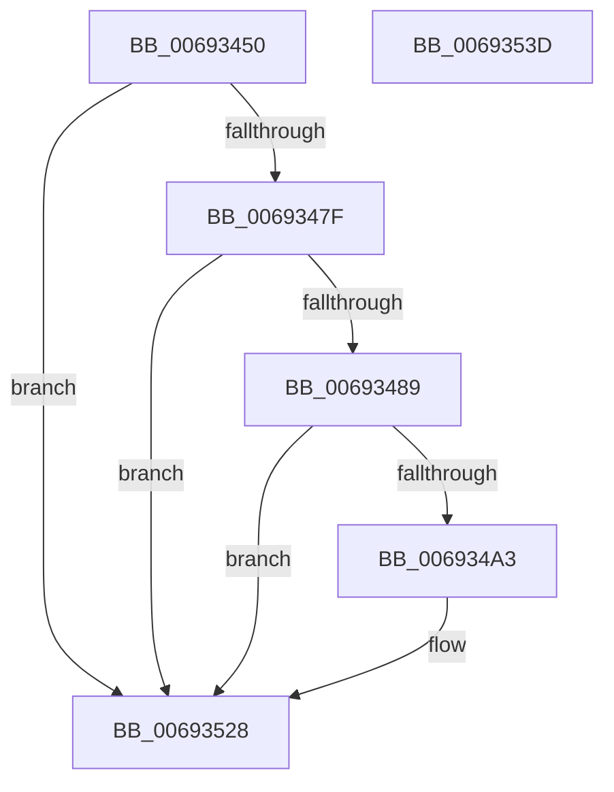

# MmStoreLogRegionInPageError

- RVA: `0x00693450`–`0x0069353E` (길이 `238` bytes)
- VA: `0x0000000140693450`
- 실행 섹션: `.text`
- PDB 이름 있음: `예`; PDB Function 태그: `아니요`
- unwind 정보 RVA: `0x000BAEE4`
- 디코드: `50`개 명령, `238/238` bytes 표시
- 미해석 바이트: `0` (있으면 어셈블리에 `.byte`로 보존)

> 이 문서는 커널 이미지의 기계어와 PDB 기호를 분석해 생성했습니다. 4번과 5번은 함수 원형과 자료형을 바이너리 사용 방식에서 추정한 C 해석이며 원본 소스 복구 결과는 아닙니다.

## 1. Dependencies

- 직접 호출 지점: **3**; 고유 호출 대상: **3**
- 직접 호출자로 확인된 함수: **1**
- RIP 상대 이미지 참조: **3**

### Outgoing calls
- `0x00693496` → [tlgKeywordOn](../42/tlgKeywordOn_function_0042EAA0.md) (function, `0x0042EAA0`)
- `0x00693523` → [tlgWriteEx_EtwWriteEx](../4A/tlgWriteEx_EtwWriteEx_function_004AA348.md) (function, `0x004AA348`)
- `0x0069352F` → [_security_check_cookie](../6A/_security_check_cookie_function_006AC640.md) (function, `0x006AC640`)

### Direct callers
- [ST_STORE&lt;SM_TRAITS&gt;::StRegionAccessExceptionFilter](../60/ST_STORE_SM_TRAITS_StRegionAccessExceptionFilter_function_0060E798.md) at `0x0060E801`

### Static image references
- `0x0069345E` → RVA `0x00E0A740` (`.data`; read)
- `0x0069346C` → RVA `0x00E37618` (`.data`; read)
- `0x006934A7` → RVA `0x00059F55` (`.rdata`; read)

## 2. Other-region calls and transfers

- 다른 실행 섹션으로 향하는 call: **0**
- 별도 외부 분기/꼬리 이동을 확인하지 못했습니다.

## 3. Assembly (complete function range)

```asm
00693450  40 55                           push rbp
00693452  48 8D 6C 24 A9                  lea rbp, [rsp - 0x57]
00693457  48 81 EC D0 00 00 00            sub rsp, 0xd0
0069345E  48 8B 05 DB 72 77 00            mov rax, qword ptr [rip + 0x7772db]
00693465  48 33 C4                        xor rax, rsp
00693468  48 89 45 47                     mov qword ptr [rbp + 0x47], rax
0069346C  4C 8B 05 A5 41 7A 00            mov r8, qword ptr [rip + 0x7a41a5]
00693473  4C 8B C9                        mov r9, rcx
00693476  4D 85 C0                        test r8, r8
00693479  0F 84 A9 00 00 00               je 0x140693528
0069347F  41 83 38 05                     cmp dword ptr [r8], 5
00693483  0F 86 9F 00 00 00               jbe 0x140693528
00693489  48 BA 02 00 00 00 00 40 00 00   movabs rdx, 0x400000000002
00693493  49 8B C8                        mov rcx, r8
00693496  E8 05 B6 D9 FF                  call 0x14042eaa0
0069349B  84 C0                           test al, al
0069349D  0F 84 85 00 00 00               je 0x140693528
006934A3  41 8B 41 30                     mov eax, dword ptr [r9 + 0x30]
006934A7  48 8D 15 A7 6A 9C FF            lea rdx, [rip - 0x639559]
006934AE  89 45 C7                        mov dword ptr [rbp - 0x39], eax
006934B1  49 8B C8                        mov rcx, r8
006934B4  48 8D 45 C7                     lea rax, [rbp - 0x39]
006934B8  48 C7 45 0F 04 00 00 00         mov qword ptr [rbp + 0xf], 4
006934C0  48 89 45 07                     mov qword ptr [rbp + 7], rax
006934C4  49 8B 41 20                     mov rax, qword ptr [r9 + 0x20]
006934C8  48 89 45 CF                     mov qword ptr [rbp - 0x31], rax
006934CC  48 8D 45 CF                     lea rax, [rbp - 0x31]
006934D0  48 89 45 17                     mov qword ptr [rbp + 0x17], rax
006934D4  49 8B 41 28                     mov rax, qword ptr [r9 + 0x28]
006934D8  41 B9 01 00 00 00               mov r9d, 1
006934DE  48 89 45 D7                     mov qword ptr [rbp - 0x29], rax
006934E2  48 8D 45 D7                     lea rax, [rbp - 0x29]
006934E6  48 89 45 27                     mov qword ptr [rbp + 0x27], rax
006934EA  48 8D 45 DF                     lea rax, [rbp - 0x21]
006934EE  48 89 45 37                     mov qword ptr [rbp + 0x37], rax
006934F2  48 8D 45 E7                     lea rax, [rbp - 0x19]
006934F6  48 89 44 24 38                  mov qword ptr [rsp + 0x38], rax
006934FB  C7 44 24 30 06 00 00 00         mov dword ptr [rsp + 0x30], 6
00693503  48 C7 45 1F 08 00 00 00         mov qword ptr [rbp + 0x1f], 8
0069350B  48 C7 45 2F 08 00 00 00         mov qword ptr [rbp + 0x2f], 8
00693513  48 C7 45 DF 00 00 00 01         mov qword ptr [rbp - 0x21], 0x1000000
0069351B  48 C7 45 3F 08 00 00 00         mov qword ptr [rbp + 0x3f], 8
00693523  E8 20 6E E1 FF                  call 0x1404aa348
00693528  48 8B 4D 47                     mov rcx, qword ptr [rbp + 0x47]
0069352C  48 33 CC                        xor rcx, rsp
0069352F  E8 0C 91 01 00                  call 0x1406ac640
00693534  48 81 C4 D0 00 00 00            add rsp, 0xd0
0069353B  5D                              pop rbp
0069353C  C3                              ret
0069353D  CC                              int3
```

## 4. C-style interpretation (structured pseudocode)

```c
__int64 __fastcall MmStoreLogRegionInPageError(__int64 a1)
{
    __int64 result;
    __int64 v_rsp;
    unsigned __int64 v_stack_m18;
    unsigned __int64 v_stack_m20;
    unsigned __int64 v_stack_m28;
    unsigned __int64 v_stack_m30;
    unsigned __int64 v_stack_m38;
    unsigned __int64 v_stack_m40;
    unsigned __int64 v_stack_m48;
    unsigned __int64 v_stack_m50;
    unsigned __int64 v_stack_m58;
    unsigned __int64 v_stack_m5F;
    unsigned __int64 v_stack_m78;
    unsigned __int64 v_stack_m80;
    unsigned __int64 v_stack_m88;
    unsigned __int64 v_stack_m90;
    unsigned int v_stack_m98;
    unsigned __int64 v_stack_mA0;
    unsigned int v_stack_mA8;

    v_rsp = (v_rsp) - (208);
    result = (*(unsigned __int64 *)(v_rip + 7828187)) ^ (v_rsp);
    v_stack_m18 = result;
    if (*(unsigned __int64 *)(v_rip + 8012197) == 0) goto loc_00693528;
    if ((*(unsigned int *)(*(unsigned __int64 *)(v_rip + 8012197))) <= 5) goto loc_00693528;
    result = tlgKeywordOn(*(unsigned __int64 *)(v_rip + 8012197), a2, *(unsigned __int64 *)(v_rip + 8012197), a1);
    if ((unsigned __int8)(result) != 0) {
        result = *(unsigned int *)(a1 + 48);
        a2 = v_rip - 6526297;
        v_stack_m98 = (unsigned int)(result);
        a1 = *(unsigned __int64 *)(v_rip + 8012197);
        result = v_stack_m98;
        v_stack_m50 = 4;
        v_stack_m58 = result;
        result = *(unsigned __int64 *)(a1 + 32);
        v_stack_m90 = result;
        result = v_stack_m90;
        v_stack_m48 = result;
        result = *(unsigned __int64 *)(a1 + 40);
        a4 = 1;
        v_stack_m88 = result;
        result = v_stack_m88;
        v_stack_m38 = result;
        result = v_stack_m80;
        v_stack_m28 = result;
        result = v_stack_m78;
        v_stack_mA0 = result;
        v_stack_mA8 = 6;
        v_stack_m40 = 8;
        v_stack_m30 = 8;
        v_stack_m80 = 0x1000000ULL;
        v_stack_m20 = 8;
        result = tlgWriteEx_EtwWriteEx(a1, a2, *(unsigned __int64 *)(v_rip + 8012197), a4);
    }
    a1 = (v_stack_m18) ^ (v_rsp);
    result = _security_check_cookie(a1, a2, *(unsigned __int64 *)(v_rip + 8012197), a4);
    v_rsp = (v_rsp) + (208);
    return result;
}
```

## 5. (Beta) C Style

```c
int64_t MmStoreLogRegionInPageError(int64_t Arg1)
{
    int64_t result;
    int64_t local_rsp;
    uint64_t v_stack_m18;
    uint64_t v_stack_m20;
    uint64_t v_stack_m28;
    uint64_t v_stack_m30;
    uint64_t v_stack_m38;
    uint64_t v_stack_m40;
    uint64_t v_stack_m48;
    uint64_t v_stack_m50;
    uint64_t v_stack_m58;
    uint64_t v_stack_m5F;
    uint64_t v_stack_m78;
    uint64_t v_stack_m80;
    uint64_t v_stack_m88;
    uint64_t v_stack_m90;
    uint32_t v_stack_m98;
    uint64_t v_stack_mA0;
    uint32_t v_stack_mA8;

    local_rsp = (local_rsp) - (208);
    result = (*(uint64_t *)(v_rip + 0x7772DB)) ^ (local_rsp);
    v_stack_m18 = result;
    if (*(uint64_t *)(v_rip + 0x7A41A5) == 0) goto loc_00693528;
    if ((*(uint32_t *)(*(uint64_t *)(v_rip + 0x7A41A5))) <= 5) goto loc_00693528;
    result = tlgKeywordOn(*(uint64_t *)(v_rip + 0x7A41A5), a2, *(uint64_t *)(v_rip + 0x7A41A5), Arg1);
    if ((uint8_t)(result) != 0) {
        result = *(uint32_t *)(Arg1 + 0x30);
        a2 = v_rip - 6526297;
        v_stack_m98 = (uint32_t)(result);
        Arg1 = *(uint64_t *)(v_rip + 0x7A41A5);
        result = v_stack_m98;
        v_stack_m50 = 4;
        v_stack_m58 = result;
        result = *(uint64_t *)(Arg1 + 0x20);
        v_stack_m90 = result;
        result = v_stack_m90;
        v_stack_m48 = result;
        result = *(uint64_t *)(Arg1 + 0x28);
        a4 = 1;
        v_stack_m88 = result;
        result = v_stack_m88;
        v_stack_m38 = result;
        result = v_stack_m80;
        v_stack_m28 = result;
        result = v_stack_m78;
        v_stack_mA0 = result;
        v_stack_mA8 = 6;
        v_stack_m40 = 8;
        v_stack_m30 = 8;
        v_stack_m80 = 0x1000000ULL;
        v_stack_m20 = 8;
        result = tlgWriteEx_EtwWriteEx(Arg1, a2, *(uint64_t *)(v_rip + 0x7A41A5), a4);
    }
    Arg1 = (v_stack_m18) ^ (local_rsp);
    result = _security_check_cookie(Arg1, a2, *(uint64_t *)(v_rip + 0x7A41A5), a4);
    local_rsp = (local_rsp) + (208);
    return result;
}
```

## 6. Execution-region graph

[열기: 2D/3D 그래프와 함수 탐색 컨트롤 패널](../../../control-panel.html?section=text&rva=0x00693450&view=graph)

- 2D 그래프는 위에서 아래로 흐르고, 3D 그래프는 빈 공간을 드래그해 회전합니다. Shift+드래그는 이동, 휠은 확대·축소, 함수 노드 선택은 대상 보고서 이동입니다.

### Static fallback


