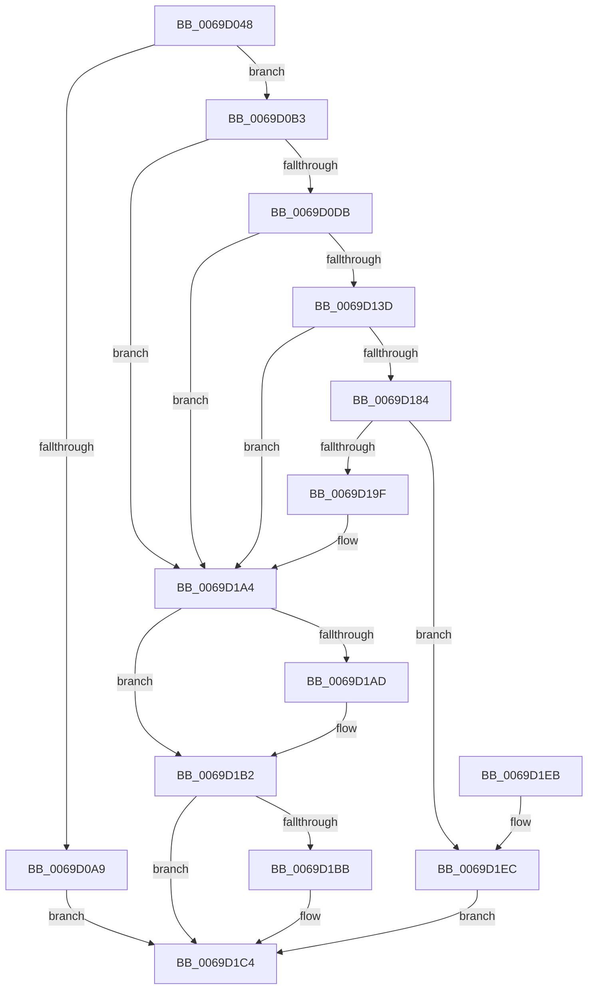

# RtlFileMapMapView

- RVA: `0x0069D048`–`0x0069D21E` (길이 `470` bytes)
- VA: `0x000000014069D048`
- 실행 섹션: `.text`
- PDB 이름 있음: `예`; PDB Function 태그: `아니요`
- unwind 정보 RVA: `0x000D9C68`
- 디코드: `117`개 명령, `470/470` bytes 표시
- 미해석 바이트: `0` (있으면 어셈블리에 `.byte`로 보존)

> 이 문서는 커널 이미지의 기계어와 PDB 기호를 분석해 생성했습니다. 4번과 5번은 함수 원형과 자료형을 바이너리 사용 방식에서 추정한 C 해석이며 원본 소스 복구 결과는 아닙니다.

## 1. Dependencies

- 직접 호출 지점: **7**; 고유 호출 대상: **7**
- 직접 호출자로 확인된 함수: **4**
- RIP 상대 이미지 참조: **1**

### Outgoing calls
- `0x0069D0CC` → [ZwQueryInformationFile](../6A/ZwQueryInformationFile_function_006AD2F0.md) (function, `0x006AD2F0`)
- `0x0069D132` → [ZwCreateSection](../6A/ZwCreateSection_function_006ADA10.md) (function, `0x006ADA10`)
- `0x0069D179` → [ZwMapViewOfSection](../6A/ZwMapViewOfSection_function_006AD5D0.md) (function, `0x006AD5D0`)
- `0x0069D192` → [MmSecureVirtualMemory](../../page/9F/MmSecureVirtualMemory_function_009F55F0.md) (function, `0x009F55F0`)
- `0x0069D1AD` → [ZwClose](../6A/ZwClose_function_006AD2B0.md) (function, `0x006AD2B0`)
- `0x0069D1BF` → [ZwUnmapViewOfSection](../6A/ZwUnmapViewOfSection_function_006AD610.md) (function, `0x006AD610`)
- `0x0069D1CD` → [_security_check_cookie](../6A/_security_check_cookie_function_006AC640.md) (function, `0x006AC640`)

### Direct callers
- [AslFileMappingEnsure](../../page/81/AslFileMappingEnsure_function_0081A5EC.md) at `0x0081A642`
- [AslFileMappingEnsureMappedAs](../../page/81/AslFileMappingEnsureMappedAs_function_0081A6BC.md) at `0x0081A700`
- [AslpFileGetChecksumAttributes](../../page/81/AslpFileGetChecksumAttributes_function_0081E130.md) at `0x0081E217`
- [AslpFileGetVersionBlock](../../page/81/AslpFileGetVersionBlock_function_0081FA50.md) at `0x0081FC66`

### Static image references
- `0x0069D063` → RVA `0x00E0A740` (`.data`; read)

## 2. Other-region calls and transfers

- 다른 실행 섹션으로 향하는 call: **1**
  - `0x0069D192` → [MmSecureVirtualMemory](../../page/9F/MmSecureVirtualMemory_function_009F55F0.md) (`.text` → `PAGE`)
- 별도 외부 분기/꼬리 이동을 확인하지 못했습니다.

## 3. Assembly (complete function range)

```asm
0069D048  48 8B C4                        mov rax, rsp
0069D04B  48 89 58 10                     mov qword ptr [rax + 0x10], rbx
0069D04F  48 89 70 18                     mov qword ptr [rax + 0x18], rsi
0069D053  48 89 78 20                     mov qword ptr [rax + 0x20], rdi
0069D057  55                              push rbp
0069D058  48 8D 68 A1                     lea rbp, [rax - 0x5f]
0069D05C  48 81 EC D0 00 00 00            sub rsp, 0xd0
0069D063  48 8B 05 D6 D6 76 00            mov rax, qword ptr [rip + 0x76d6d6]
0069D06A  48 33 C4                        xor rax, rsp
0069D06D  48 89 45 47                     mov qword ptr [rbp + 0x47], rax
0069D071  33 C0                           xor eax, eax
0069D073  0F 57 C0                        xorps xmm0, xmm0
0069D076  48 21 45 D7                     and qword ptr [rbp - 0x29], rax
0069D07A  0F 57 C9                        xorps xmm1, xmm1
0069D07D  48 21 45 DF                     and qword ptr [rbp - 0x21], rax
0069D081  40 8A F2                        mov sil, dl
0069D084  48 21 45 E7                     and qword ptr [rbp - 0x19], rax
0069D088  48 8B F9                        mov rdi, rcx
0069D08B  0F 11 45 EF                     movups xmmword ptr [rbp - 0x11], xmm0
0069D08F  48 89 45 3F                     mov qword ptr [rbp + 0x3f], rax
0069D093  0F 11 45 FF                     movups xmmword ptr [rbp - 1], xmm0
0069D097  0F 11 45 0F                     movups xmmword ptr [rbp + 0xf], xmm0
0069D09B  0F 11 45 1F                     movups xmmword ptr [rbp + 0x1f], xmm0
0069D09F  0F 11 4D 2F                     movups xmmword ptr [rbp + 0x2f], xmm1
0069D0A3  48 39 41 18                     cmp qword ptr [rcx + 0x18], rax
0069D0A7  74 0A                           je 0x14069d0b3
0069D0A9  BB 0E 01 00 C0                  mov ebx, 0xc000010e
0069D0AE  E9 11 01 00 00                  jmp 0x14069d1c4
0069D0B3  48 8B 09                        mov rcx, qword ptr [rcx]
0069D0B6  4C 8D 45 2F                     lea r8, [rbp + 0x2f]
0069D0BA  41 B9 18 00 00 00               mov r9d, 0x18
0069D0C0  C7 44 24 20 05 00 00 00         mov dword ptr [rsp + 0x20], 5
0069D0C8  48 8D 55 1F                     lea rdx, [rbp + 0x1f]
0069D0CC  E8 1F 02 01 00                  call 0x1406ad2f0
0069D0D1  8B D8                           mov ebx, eax
0069D0D3  85 C0                           test eax, eax
0069D0D5  0F 88 C9 00 00 00               js 0x14069d1a4
0069D0DB  48 83 65 F7 00                  and qword ptr [rbp - 9], 0
0069D0E0  4C 8D 45 EF                     lea r8, [rbp - 0x11]
0069D0E4  48 83 65 FF 00                  and qword ptr [rbp - 1], 0
0069D0E9  40 8A C6                        mov al, sil
0069D0EC  F6 D8                           neg al
0069D0EE  C7 45 EF 30 00 00 00            mov dword ptr [rbp - 0x11], 0x30
0069D0F5  48 8B 07                        mov rax, qword ptr [rdi]
0069D0F8  0F 57 C0                        xorps xmm0, xmm0
0069D0FB  1B C9                           sbb ecx, ecx
0069D0FD  48 89 44 24 30                  mov qword ptr [rsp + 0x30], rax
0069D102  81 E1 00 00 00 09               and ecx, 0x9000000
0069D108  C7 45 07 00 02 00 00            mov dword ptr [rbp + 7], 0x200
0069D10F  81 C1 00 00 00 08               add ecx, 0x8000000
0069D115  45 33 C9                        xor r9d, r9d
0069D118  89 4C 24 28                     mov dword ptr [rsp + 0x28], ecx
0069D11C  BA 05 00 0F 00                  mov edx, 0xf0005
0069D121  48 8D 4D D7                     lea rcx, [rbp - 0x29]
0069D125  C7 44 24 20 02 00 00 00         mov dword ptr [rsp + 0x20], 2
0069D12D  F3 0F 7F 45 0F                  movdqu xmmword ptr [rbp + 0xf], xmm0
0069D132  E8 D9 08 01 00                  call 0x1406ada10
0069D137  8B D8                           mov ebx, eax
0069D139  85 C0                           test eax, eax
0069D13B  78 67                           js 0x14069d1a4
0069D13D  48 8B 4D D7                     mov rcx, qword ptr [rbp - 0x29]
0069D141  48 8D 45 E7                     lea rax, [rbp - 0x19]
0069D145  C7 44 24 48 02 00 00 00         mov dword ptr [rsp + 0x48], 2
0069D14D  4C 8D 45 DF                     lea r8, [rbp - 0x21]
0069D151  C7 44 24 40 00 00 50 00         mov dword ptr [rsp + 0x40], 0x500000
0069D159  45 33 C9                        xor r9d, r9d
0069D15C  C7 44 24 38 02 00 00 00         mov dword ptr [rsp + 0x38], 2
0069D164  48 83 CA FF                     or rdx, 0xffffffffffffffff
0069D168  48 89 44 24 30                  mov qword ptr [rsp + 0x30], rax
0069D16D  48 83 64 24 28 00               and qword ptr [rsp + 0x28], 0
0069D173  48 83 64 24 20 00               and qword ptr [rsp + 0x20], 0
0069D179  E8 52 04 01 00                  call 0x1406ad5d0
0069D17E  8B D8                           mov ebx, eax
0069D180  85 C0                           test eax, eax
0069D182  78 20                           js 0x14069d1a4
0069D184  48 8B 55 E7                     mov rdx, qword ptr [rbp - 0x19]
0069D188  41 B8 02 00 00 00               mov r8d, 2
0069D18E  48 8B 4D DF                     mov rcx, qword ptr [rbp - 0x21]
0069D192  E8 59 84 35 00                  call 0x1409f55f0
0069D197  48 8B C8                        mov rcx, rax
0069D19A  48 85 C0                        test rax, rax
0069D19D  75 4D                           jne 0x14069d1ec
0069D19F  BB 01 00 00 C0                  mov ebx, 0xc0000001
0069D1A4  48 8B 4D D7                     mov rcx, qword ptr [rbp - 0x29]
0069D1A8  48 85 C9                        test rcx, rcx
0069D1AB  74 05                           je 0x14069d1b2
0069D1AD  E8 FE 00 01 00                  call 0x1406ad2b0
0069D1B2  48 8B 55 DF                     mov rdx, qword ptr [rbp - 0x21]
0069D1B6  48 85 D2                        test rdx, rdx
0069D1B9  74 09                           je 0x14069d1c4
0069D1BB  48 83 C9 FF                     or rcx, 0xffffffffffffffff
0069D1BF  E8 4C 04 01 00                  call 0x1406ad610
0069D1C4  8B C3                           mov eax, ebx
0069D1C6  48 8B 4D 47                     mov rcx, qword ptr [rbp + 0x47]
0069D1CA  48 33 CC                        xor rcx, rsp
0069D1CD  E8 6E F4 00 00                  call 0x1406ac640
0069D1D2  4C 8D 9C 24 D0 00 00 00         lea r11, [rsp + 0xd0]
0069D1DA  49 8B 5B 18                     mov rbx, qword ptr [r11 + 0x18]
0069D1DE  49 8B 73 20                     mov rsi, qword ptr [r11 + 0x20]
0069D1E2  49 8B 7B 28                     mov rdi, qword ptr [r11 + 0x28]
0069D1E6  49 8B E3                        mov rsp, r11
0069D1E9  5D                              pop rbp
0069D1EA  C3                              ret
0069D1EB  CC                              int3
0069D1EC  48 8B 45 D7                     mov rax, qword ptr [rbp - 0x29]
0069D1F0  33 DB                           xor ebx, ebx
0069D1F2  48 89 47 08                     mov qword ptr [rdi + 8], rax
0069D1F6  48 8B 45 DF                     mov rax, qword ptr [rbp - 0x21]
0069D1FA  48 89 47 18                     mov qword ptr [rdi + 0x18], rax
0069D1FE  48 8B 45 E7                     mov rax, qword ptr [rbp - 0x19]
0069D202  48 89 47 20                     mov qword ptr [rdi + 0x20], rax
0069D206  48 8B 45 37                     mov rax, qword ptr [rbp + 0x37]
0069D20A  48 89 47 10                     mov qword ptr [rdi + 0x10], rax
0069D20E  66 C7 47 31 01 01               mov word ptr [rdi + 0x31], 0x101
0069D214  40 88 77 33                     mov byte ptr [rdi + 0x33], sil
0069D218  48 89 4F 28                     mov qword ptr [rdi + 0x28], rcx
0069D21C  EB A6                           jmp 0x14069d1c4
```

## 4. C-style interpretation (structured pseudocode)

```c
__int64 __fastcall RtlFileMapMapView(__int64 a1, unsigned __int8 a2)
{
    __int64 result;
    __int64 v_rbx;
    __int64 v_rsp;
    unsigned __int64 v_stack_m8;
    unsigned int v_stack_m90;
    unsigned int v_stack_m98;
    unsigned int v_stack_mA0;
    unsigned __int64 v_stack_mA8;
    unsigned int v_stack_mB0;
    unsigned int v_stack_mB8;

    *(unsigned __int64 *)(v_rsp + 16) = v_rbx;
    *(unsigned __int64 *)(v_rsp + 24) = v_rsi;
    *(unsigned __int64 *)(v_rsp + 32) = v_rdi;
    v_rsp = (v_rsp) - (208);
    result = (*(unsigned __int64 *)(v_rip + 7788246)) ^ (v_rsp);
    *(unsigned __int64 *)(v_rsp - 95 + 71) = result;
    result = 0;
    *(unsigned __int64 *)(v_rsp - 95 - 17) = v_xmm0;
    *(unsigned __int64 *)(v_rsp - 95 + 63) = 0;
    *(unsigned __int64 *)(v_rsp - 95 - 1) = v_xmm0;
    *(unsigned __int64 *)(v_rsp - 95 + 15) = v_xmm0;
    *(unsigned __int64 *)(v_rsp - 95 + 31) = v_xmm0;
    *(unsigned __int64 *)(v_rsp - 95 + 47) = v_xmm1;
    if ((*(unsigned __int64 *)(a1 + 24)) == 0) goto loc_0069D0B3;
    goto loc_0069D1C4;
loc_0069D0B3:
    v_stack_mB8 = 5;
    result = ZwQueryInformationFile(*(unsigned __int64 *)(a1), v_rsp - 95 + 31, v_rsp - 95 + 47, 24);
    if (sign_flag) goto loc_0069D1A4;
    result = (unsigned __int8)(-(a2));
    *(unsigned int *)(v_rsp - 95 - 17) = 48;
    v_stack_mA8 = *(unsigned __int64 *)(a1);
    a1 = (unsigned int)((*(unsigned __int64 *)(a1)) & (0x9000000ULL));
    *(unsigned int *)(v_rsp - 95 + 7) = 512;
    a1 = (unsigned int)((a1) + (0x8000000ULL));
    a4 = 0;
    v_stack_mB0 = (unsigned int)(a1);
    v_stack_mB8 = 2;
    *(unsigned __int64 *)(v_rsp - 95 + 15) = v_xmm0;
    result = ZwCreateSection(v_rsp - 95 - 41, (unsigned int)(0xF0005ULL), v_rsp - 95 - 17, a4);
    if (sign_flag) goto loc_0069D1A4;
    v_stack_m90 = 2;
    v_stack_m98 = 0x500000ULL;
    a4 = 0;
    v_stack_mA0 = 2;
    a2 = ((unsigned int)(0xF0005ULL)) | (-1);
    v_stack_mA8 = v_rsp - 95 - 25;
    result = ZwMapViewOfSection(*(unsigned __int64 *)(v_rsp - 95 - 41), a2, v_rsp - 95 - 33, a4);
    if (sign_flag) goto loc_0069D1A4;
    result = MmSecureVirtualMemory(*(unsigned __int64 *)(v_rsp - 95 - 33), *(unsigned __int64 *)(v_rsp - 95 - 25), 2, a4);
    if (result != 0) goto loc_0069D1EC;
loc_0069D1A4:
    if (*(unsigned __int64 *)(v_rsp - 95 - 41) != 0) {
        result = ZwClose(*(unsigned __int64 *)(v_rsp - 95 - 41), *(unsigned __int64 *)(v_rsp - 95 - 25), 2, a4);
    }
    if (*(unsigned __int64 *)(v_rsp - 95 - 33) != 0) {
        a1 = (*(unsigned __int64 *)(v_rsp - 95 - 41)) | (-1);
        result = ZwUnmapViewOfSection(a1, *(unsigned __int64 *)(v_rsp - 95 - 33), 2, a4);
    }
    a1 = (*(unsigned __int64 *)(v_rsp - 95 + 71)) ^ (v_rsp);
    result = _security_check_cookie(a1, *(unsigned __int64 *)(v_rsp - 95 - 33), 2, a4);
    return result;
loc_0069D1EC:
    v_rbx = 0;
    *(unsigned __int64 *)(*(unsigned __int64 *)(v_stack_m8 + 40) + 8) = *(unsigned __int64 *)(v_rsp - 95 - 41);
    *(unsigned __int64 *)(*(unsigned __int64 *)(v_stack_m8 + 40) + 24) = *(unsigned __int64 *)(v_rsp - 95 - 33);
    *(unsigned __int64 *)(*(unsigned __int64 *)(v_stack_m8 + 40) + 32) = *(unsigned __int64 *)(v_rsp - 95 - 25);
    *(unsigned __int64 *)(*(unsigned __int64 *)(v_stack_m8 + 40) + 16) = *(unsigned __int64 *)(v_rsp - 95 + 55);
    *(unsigned __int16 *)(*(unsigned __int64 *)(v_stack_m8 + 40) + 49) = 257;
    *(unsigned __int8 *)(*(unsigned __int64 *)(v_stack_m8 + 40) + 51) = (unsigned __int8)(*(unsigned __int64 *)(v_stack_m8 + 32));
    *(unsigned __int64 *)(*(unsigned __int64 *)(v_stack_m8 + 40) + 40) = a1;
    goto loc_0069D1C4;
}
```

## 5. (Beta) C Style

```c
int64_t RtlFileMapMapView(void *Arg1, uint8_t Arg2)
{
    uint8_t *arg1 = (uint8_t *)Arg1;

    int64_t result;
    int64_t local_rbx;
    int64_t local_rsp;
    uint64_t v_stack_m8;
    uint32_t v_stack_m90;
    uint32_t v_stack_m98;
    uint32_t v_stack_mA0;
    uint64_t v_stack_mA8;
    uint32_t v_stack_mB0;
    uint32_t v_stack_mB8;

    *(uint64_t *)(local_rsp + 0x10) = local_rbx;
    *(uint64_t *)(local_rsp + 0x18) = local_rsi;
    *(uint64_t *)(local_rsp + 0x20) = local_rdi;
    local_rsp = (local_rsp) - (208);
    result = (*(uint64_t *)(v_rip + 0x76D6D6)) ^ (local_rsp);
    *(uint64_t *)(local_rsp - 0x5F + 0x47) = result;
    result = 0;
    *(uint64_t *)(local_rsp - 0x5F - 0x11) = v_xmm0;
    *(uint64_t *)(local_rsp - 0x5F + 0x3F) = 0;
    *(uint64_t *)(local_rsp - 0x5F - 0x1) = v_xmm0;
    *(uint64_t *)(local_rsp - 0x5F + 0xF) = v_xmm0;
    *(uint64_t *)(local_rsp - 0x5F + 0x1F) = v_xmm0;
    *(uint64_t *)(local_rsp - 0x5F + 0x2F) = v_xmm1;
    if ((*(uint64_t *)(arg1 + 0x18)) == 0) goto loc_0069D0B3;
    goto loc_0069D1C4;
loc_0069D0B3:
    v_stack_mB8 = 5;
    result = ZwQueryInformationFile(*(uint64_t *)(arg1), local_rsp - 95 + 31, local_rsp - 95 + 47, 24);
    if (sign_flag) goto loc_0069D1A4;
    result = (uint8_t)(-(Arg2));
    *(uint32_t *)(local_rsp - 0x5F - 0x11) = 48;
    v_stack_mA8 = *(uint64_t *)(arg1);
    Arg1 = (uint32_t)((*(uint64_t *)(arg1)) & (0x9000000ULL));
    *(uint32_t *)(local_rsp - 0x5F + 0x7) = 512;
    Arg1 = (uint32_t)((Arg1) + (0x8000000ULL));
    a4 = 0;
    v_stack_mB0 = (uint32_t)(Arg1);
    v_stack_mB8 = 2;
    *(uint64_t *)(local_rsp - 0x5F + 0xF) = v_xmm0;
    result = ZwCreateSection(local_rsp - 95 - 41, (uint32_t)(0xF0005ULL), local_rsp - 95 - 17, a4);
    if (sign_flag) goto loc_0069D1A4;
    v_stack_m90 = 2;
    v_stack_m98 = 0x500000ULL;
    a4 = 0;
    v_stack_mA0 = 2;
    Arg2 = ((uint32_t)(0xF0005ULL)) | (-1);
    v_stack_mA8 = local_rsp - 95 - 25;
    result = ZwMapViewOfSection(*(uint64_t *)(local_rsp - 0x5F - 0x29), Arg2, local_rsp - 95 - 33, a4);
    if (sign_flag) goto loc_0069D1A4;
    result = MmSecureVirtualMemory(*(uint64_t *)(local_rsp - 0x5F - 0x21), *(uint64_t *)(local_rsp - 0x5F - 0x19), 2, a4);
    if (result != 0) goto loc_0069D1EC;
loc_0069D1A4:
    if (*(uint64_t *)(local_rsp - 0x5F - 0x29) != 0) {
        result = ZwClose(*(uint64_t *)(local_rsp - 0x5F - 0x29), *(uint64_t *)(local_rsp - 0x5F - 0x19), 2, a4);
    }
    if (*(uint64_t *)(local_rsp - 0x5F - 0x21) != 0) {
        Arg1 = (*(uint64_t *)(local_rsp - 0x5F - 0x29)) | (-1);
        result = ZwUnmapViewOfSection(Arg1, *(uint64_t *)(local_rsp - 0x5F - 0x21), 2, a4);
    }
    Arg1 = (*(uint64_t *)(local_rsp - 0x5F + 0x47)) ^ (local_rsp);
    result = _security_check_cookie(Arg1, *(uint64_t *)(local_rsp - 0x5F - 0x21), 2, a4);
    return result;
loc_0069D1EC:
    local_rbx = 0;
    *(uint64_t *)(*(uint64_t *)(v_stack_m8 + 0x28) + 0x8) = *(uint64_t *)(local_rsp - 0x5F - 0x29);
    *(uint64_t *)(*(uint64_t *)(v_stack_m8 + 0x28) + 0x18) = *(uint64_t *)(local_rsp - 0x5F - 0x21);
    *(uint64_t *)(*(uint64_t *)(v_stack_m8 + 0x28) + 0x20) = *(uint64_t *)(local_rsp - 0x5F - 0x19);
    *(uint64_t *)(*(uint64_t *)(v_stack_m8 + 0x28) + 0x10) = *(uint64_t *)(local_rsp - 0x5F + 0x37);
    *(uint16_t *)(*(uint64_t *)(v_stack_m8 + 0x28) + 0x31) = 257;
    *(uint8_t *)(*(uint64_t *)(v_stack_m8 + 0x28) + 0x33) = (uint8_t)(*(uint64_t *)(v_stack_m8 + 0x20));
    *(void **)(*(uint64_t *)(v_stack_m8 + 0x28) + 0x28) = Arg1;
    goto loc_0069D1C4;
}
```

### 관측된 메모리 오프셋

구조체 형식이 확인되지 않은 접근은 인자 기준의 오프셋으로만 기록했습니다.

| 기준 인자 | 오프셋 표현 | 폭 (bit) | 접근 |
|---|---:|---:|---|
| `Arg1` | `+ 0x0` | `64` | `R` |
| `Arg1` | `+ 0x8` | `64` | `W` |
| `Arg1` | `+ 0x10` | `64` | `W` |
| `Arg1` | `+ 0x18` | `64` | `R` |
| `Arg1` | `+ 0x18` | `64` | `W` |
| `Arg1` | `+ 0x20` | `64` | `W` |
| `Arg1` | `+ 0x28` | `64` | `W` |
| `Arg1` | `+ 0x31` | `16` | `W` |
| `Arg1` | `+ 0x33` | `8` | `W` |

## 6. Execution-region graph

[열기: 2D/3D 그래프와 함수 탐색 컨트롤 패널](../../../control-panel.html?section=text&rva=0x0069D048&view=graph)

- 2D 그래프는 위에서 아래로 흐르고, 3D 그래프는 빈 공간을 드래그해 회전합니다. Shift+드래그는 이동, 휠은 확대·축소, 함수 노드 선택은 대상 보고서 이동입니다.

### Static fallback


