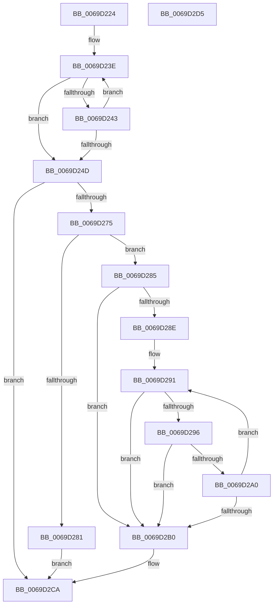

# RtlStringCbCatNW

- RVA: `0x0069D224`–`0x0069D2D6` (길이 `178` bytes)
- VA: `0x000000014069D224`
- 실행 섹션: `.text`
- PDB 이름 있음: `예`; PDB Function 태그: `아니요`
- unwind 정보 RVA: `0x000950EC`
- 디코드: `57`개 명령, `178/178` bytes 표시
- 미해석 바이트: `0` (있으면 어셈블리에 `.byte`로 보존)

> 이 문서는 커널 이미지의 기계어와 PDB 기호를 분석해 생성했습니다. 4번과 5번은 함수 원형과 자료형을 바이너리 사용 방식에서 추정한 C 해석이며 원본 소스 복구 결과는 아닙니다.

## 1. Dependencies

- 직접 호출 지점: **0**; 고유 호출 대상: **0**
- 직접 호출자로 확인된 함수: **1**
- RIP 상대 이미지 참조: **0**

### Outgoing calls
- 직접 디코드된 call 명령이 없습니다.

### Direct callers
- [AslPathWildcardFindNext](../../page/81/AslPathWildcardFindNext_function_0081BB2C.md) at `0x0081C1C0`
- [AslPathWildcardFindNext](../../page/81/AslPathWildcardFindNext_function_0081BB2C.md) at `0x0081C1E5`

### Static image references
- 디코드된 RIP-relative 메모리 참조가 없습니다.

## 2. Other-region calls and transfers

- 다른 실행 섹션으로 향하는 call: **0**
- 별도 외부 분기/꼬리 이동을 확인하지 못했습니다.

## 3. Assembly (complete function range)

```asm
0069D224  48 89 5C 24 08                  mov qword ptr [rsp + 8], rbx
0069D229  48 89 7C 24 10                  mov qword ptr [rsp + 0x10], rdi
0069D22E  BA 04 01 00 00                  mov edx, 0x104
0069D233  48 8B D9                        mov rbx, rcx
0069D236  44 8B D2                        mov r10d, edx
0069D239  48 8B C1                        mov rax, rcx
0069D23C  33 FF                           xor edi, edi
0069D23E  66 39 38                        cmp word ptr [rax], di
0069D241  74 0A                           je 0x14069d24d
0069D243  48 83 C0 02                     add rax, 2
0069D247  49 83 EA 01                     sub r10, 1
0069D24B  75 F1                           jne 0x14069d23e
0069D24D  48 8B CA                        mov rcx, rdx
0069D250  49 8B C2                        mov rax, r10
0069D253  49 2B CA                        sub rcx, r10
0069D256  48 F7 D8                        neg rax
0069D259  49 8B C2                        mov rax, r10
0069D25C  4D 1B DB                        sbb r11, r11
0069D25F  4C 23 D9                        and r11, rcx
0069D262  B9 0D 00 00 C0                  mov ecx, 0xc000000d
0069D267  48 F7 D8                        neg rax
0069D26A  1B C0                           sbb eax, eax
0069D26C  F7 D0                           not eax
0069D26E  23 C1                           and eax, ecx
0069D270  4D 85 D2                        test r10, r10
0069D273  74 55                           je 0x14069d2ca
0069D275  49 D1 E9                        shr r9, 1
0069D278  49 81 F9 FE FF FF 7F            cmp r9, 0x7ffffffe
0069D27F  76 04                           jbe 0x14069d285
0069D281  8B C1                           mov eax, ecx
0069D283  EB 45                           jmp 0x14069d2ca
0069D285  4A 8D 0C 5B                     lea rcx, [rbx + r11*2]
0069D289  49 2B D3                        sub rdx, r11
0069D28C  74 22                           je 0x14069d2b0
0069D28E  4C 2B C1                        sub r8, rcx
0069D291  4D 85 C9                        test r9, r9
0069D294  74 1A                           je 0x14069d2b0
0069D296  41 0F B7 04 08                  movzx eax, word ptr [r8 + rcx]
0069D29B  66 85 C0                        test ax, ax
0069D29E  74 10                           je 0x14069d2b0
0069D2A0  66 89 01                        mov word ptr [rcx], ax
0069D2A3  49 FF C9                        dec r9
0069D2A6  48 83 C1 02                     add rcx, 2
0069D2AA  48 83 EA 01                     sub rdx, 1
0069D2AE  75 E1                           jne 0x14069d291
0069D2B0  48 85 D2                        test rdx, rdx
0069D2B3  48 8D 41 FE                     lea rax, [rcx - 2]
0069D2B7  48 0F 45 C1                     cmovne rax, rcx
0069D2BB  48 F7 DA                        neg rdx
0069D2BE  66 89 38                        mov word ptr [rax], di
0069D2C1  1B C0                           sbb eax, eax
0069D2C3  F7 D0                           not eax
0069D2C5  25 05 00 00 80                  and eax, 0x80000005
0069D2CA  48 8B 5C 24 08                  mov rbx, qword ptr [rsp + 8]
0069D2CF  48 8B 7C 24 10                  mov rdi, qword ptr [rsp + 0x10]
0069D2D4  C3                              ret
0069D2D5  CC                              int3
```

## 4. C-style interpretation (structured pseudocode)

```c
__int64 __fastcall RtlStringCbCatNW(__int64 a1, __int64 a2, __int64 a3, __int64 a4)
{
    __int64 result;
    __int64 v_r10;
    __int64 v_r11;
    __int64 v_rdi;
    unsigned __int64 v_stack_p10;
    unsigned __int64 v_stack_p8;

    v_stack_p8 = v_rbx;
    v_stack_p10 = v_rdi;
    v_rdi = 0;
loc_0069D23E:
    if ((*(unsigned __int16 *)(a1)) == 0) goto loc_0069D24D;
    result = (a1) + (2);
    v_r10 = (260) - (1);
    if (condition_is_not_equal) goto loc_0069D23E;
loc_0069D24D:
    a1 = (260) - (v_r10);
    result = -(v_r10);
    v_r11 = (v_r11) & (a1);
    result = -(v_r10);
    result = (unsigned int)(~(result));
    result = (unsigned int)((result) & ((unsigned int)((unsigned int)(0xC000000DULL))));
    if (v_r10 == 0) goto loc_0069D2CA;
    a4 = (a4) >> (1);
    if (a4 <= 0x7FFFFFFEULL) goto loc_0069D285;
    goto loc_0069D2CA;
loc_0069D285:
    a2 = (260) - (v_r11);
    if (condition_is_equal) goto loc_0069D2B0;
    a3 = (a3) - (a1 + v_r11 * 2);
loc_0069D291:
    if (a4 == 0) goto loc_0069D2B0;
    if ((unsigned __int16)(*(unsigned __int16 *)(a3 + a1 + v_r11 * 2 * 1)) == 0) goto loc_0069D2B0;
    *(unsigned __int16 *)(a1 + v_r11 * 2) = (unsigned __int16)(*(unsigned __int16 *)(a3 + a1 + v_r11 * 2 * 1));
    a4 = (a4) - 1;
    a1 = (a1 + v_r11 * 2) + (2);
    a2 = (a2) - (1);
    if (condition_is_not_equal) goto loc_0069D291;
loc_0069D2B0:
    result = a1 - 2;
    if (a2 != 0) { result = a1; }
    a2 = -(a2);
    *(unsigned __int16 *)(result) = 0;
    result = (unsigned int)(~(result));
    result = (unsigned int)((result) & (0x80000005ULL));
loc_0069D2CA:
    return result;
}
```

## 5. (Beta) C Style

```c
int64_t RtlStringCbCatNW(void *Arg1, int64_t Arg2, void *Arg3, int64_t Arg4)
{
    uint8_t *arg1 = (uint8_t *)Arg1;
    uint8_t *arg3 = (uint8_t *)Arg3;

    int64_t result;
    int64_t local_r10;
    int64_t local_r11;
    int64_t local_rdi;
    uint64_t v_stack_p10;
    uint64_t v_stack_p8;

    v_stack_p8 = local_rbx;
    v_stack_p10 = local_rdi;
    local_rdi = 0;
loc_0069D23E:
    if ((*(uint16_t *)(arg1)) == 0) goto loc_0069D24D;
    result = (Arg1) + (2);
    local_r10 = (260) - (1);
    if (condition_is_not_equal) goto loc_0069D23E;
loc_0069D24D:
    Arg1 = (260) - (local_r10);
    result = -(local_r10);
    local_r11 = (local_r11) & (Arg1);
    result = -(local_r10);
    result = (uint32_t)(~(result));
    result = (uint32_t)((result) & ((uint32_t)((uint32_t)(0xC000000DULL))));
    if (local_r10 == 0) goto loc_0069D2CA;
    Arg4 = (Arg4) >> (1);
    if (Arg4 <= 0x7FFFFFFEULL) goto loc_0069D285;
    goto loc_0069D2CA;
loc_0069D285:
    Arg2 = (260) - (local_r11);
    if (condition_is_equal) goto loc_0069D2B0;
    Arg3 = (Arg3) - (Arg1 + local_r11 * 2);
loc_0069D291:
    if (Arg4 == 0) goto loc_0069D2B0;
    if ((uint16_t)(*(uint16_t *)(arg3 + arg1 + local_r11 * 2 * 1)) == 0) goto loc_0069D2B0;
    *(uint16_t *)(arg1 + local_r11 * 2) = (uint16_t)(*(uint16_t *)(arg3 + arg1 + local_r11 * 2 * 1));
    Arg4 = (Arg4) - 1;
    Arg1 = (Arg1 + local_r11 * 2) + (2);
    Arg2 = (Arg2) - (1);
    if (condition_is_not_equal) goto loc_0069D291;
loc_0069D2B0:
    result = Arg1 - 2;
    if (Arg2 != 0) { result = Arg1; }
    Arg2 = -(Arg2);
    *(uint16_t *)(result) = 0;
    result = (uint32_t)(~(result));
    result = (uint32_t)((result) & (0x80000005ULL));
loc_0069D2CA:
    return result;
}
```

### 관측된 메모리 오프셋

구조체 형식이 확인되지 않은 접근은 인자 기준의 오프셋으로만 기록했습니다.

| 기준 인자 | 오프셋 표현 | 폭 (bit) | 접근 |
|---|---:|---:|---|
| `Arg1` | `- 0x2` | `64` | `R` |
| `Arg1` | `+ 0x0` | `16` | `R` |
| `Arg1` | `+ 0x0` | `16` | `W` |
| `Arg1` | `+ 0x0 + r11*2` | `64` | `R` |
| `Arg3` | `+ 0x0 + rcx*1` | `16` | `R` |

## 6. Execution-region graph

[열기: 2D/3D 그래프와 함수 탐색 컨트롤 패널](../../../control-panel.html?section=text&rva=0x0069D224&view=graph)

- 2D 그래프는 위에서 아래로 흐르고, 3D 그래프는 빈 공간을 드래그해 회전합니다. Shift+드래그는 이동, 휠은 확대·축소, 함수 노드 선택은 대상 보고서 이동입니다.

### Static fallback


