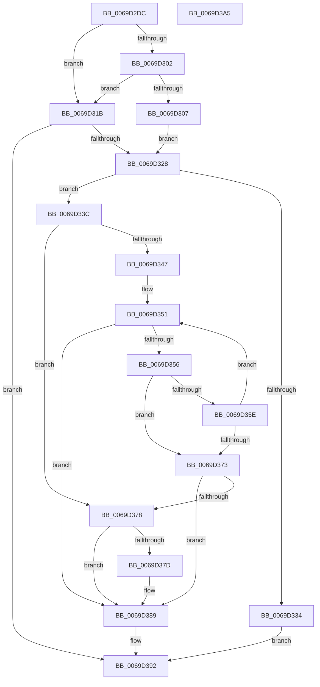

# RtlUnicodeStringCbCatStringN

- RVA: `0x0069D2DC`–`0x0069D3A6` (길이 `202` bytes)
- VA: `0x000000014069D2DC`
- 실행 섹션: `.text`
- PDB 이름 있음: `예`; PDB Function 태그: `아니요`
- unwind 정보 RVA: `0x00060BC4`
- 디코드: `65`개 명령, `202/202` bytes 표시
- 미해석 바이트: `0` (있으면 어셈블리에 `.byte`로 보존)

> 이 문서는 커널 이미지의 기계어와 PDB 기호를 분석해 생성했습니다. 4번과 5번은 함수 원형과 자료형을 바이너리 사용 방식에서 추정한 C 해석이며 원본 소스 복구 결과는 아닙니다.

## 1. Dependencies

- 직접 호출 지점: **1**; 고유 호출 대상: **1**
- 직접 호출자로 확인된 함수: **1**
- RIP 상대 이미지 참조: **0**

### Outgoing calls
- `0x0069D2F4` → [RtlUnicodeStringValidateWorker](../4A/RtlUnicodeStringValidateWorker_function_004A6530.md) (function, `0x004A6530`)

### Direct callers
- [AslpPathWildcardAllocMatchNode](../../page/81/AslpPathWildcardAllocMatchNode_function_0081C620.md) at `0x0081C795`

### Static image references
- 디코드된 RIP-relative 메모리 참조가 없습니다.

## 2. Other-region calls and transfers

- 다른 실행 섹션으로 향하는 call: **0**
- 별도 외부 분기/꼬리 이동을 확인하지 못했습니다.

## 3. Assembly (complete function range)

```asm
0069D2DC  48 89 5C 24 08                  mov qword ptr [rsp + 8], rbx
0069D2E1  48 89 74 24 10                  mov qword ptr [rsp + 0x10], rsi
0069D2E6  57                              push rdi
0069D2E7  48 83 EC 20                     sub rsp, 0x20
0069D2EB  4D 8B D8                        mov r11, r8
0069D2EE  48 8B FA                        mov rdi, rdx
0069D2F1  48 8B D9                        mov rbx, rcx
0069D2F4  E8 37 92 E0 FF                  call 0x1404a6530
0069D2F9  33 F6                           xor esi, esi
0069D2FB  44 8B D0                        mov r10d, eax
0069D2FE  85 C0                           test eax, eax
0069D300  78 19                           js 0x14069d31b
0069D302  48 85 C9                        test rcx, rcx
0069D305  74 14                           je 0x14069d31b
0069D307  44 0F B7 41 02                  movzx r8d, word ptr [rcx + 2]
0069D30C  4C 8B 49 08                     mov r9, qword ptr [rcx + 8]
0069D310  0F B7 09                        movzx ecx, word ptr [rcx]
0069D313  49 D1 E8                        shr r8, 1
0069D316  48 D1 E9                        shr rcx, 1
0069D319  EB 0D                           jmp 0x14069d328
0069D31B  4C 8B CE                        mov r9, rsi
0069D31E  4C 8B C6                        mov r8, rsi
0069D321  48 8B CE                        mov rcx, rsi
0069D324  85 C0                           test eax, eax
0069D326  78 6A                           js 0x14069d392
0069D328  49 D1 EB                        shr r11, 1
0069D32B  49 81 FB FF 7F 00 00            cmp r11, 0x7fff
0069D332  76 08                           jbe 0x14069d33c
0069D334  41 BA 0D 00 00 C0               mov r10d, 0xc000000d
0069D33A  EB 56                           jmp 0x14069d392
0069D33C  44 8B D6                        mov r10d, esi
0069D33F  48 8B D6                        mov rdx, rsi
0069D342  4C 2B C1                        sub r8, rcx
0069D345  74 31                           je 0x14069d378
0069D347  48 8D 04 09                     lea rax, [rcx + rcx]
0069D34B  48 2B C7                        sub rax, rdi
0069D34E  4C 03 C8                        add r9, rax
0069D351  4D 85 DB                        test r11, r11
0069D354  74 33                           je 0x14069d389
0069D356  0F B7 07                        movzx eax, word ptr [rdi]
0069D359  66 85 C0                        test ax, ax
0069D35C  74 15                           je 0x14069d373
0069D35E  66 41 89 04 39                  mov word ptr [r9 + rdi], ax
0069D363  49 FF CB                        dec r11
0069D366  48 83 C7 02                     add rdi, 2
0069D36A  48 FF C2                        inc rdx
0069D36D  49 83 E8 01                     sub r8, 1
0069D371  75 DE                           jne 0x14069d351
0069D373  4D 85 C0                        test r8, r8
0069D376  75 11                           jne 0x14069d389
0069D378  4D 85 DB                        test r11, r11
0069D37B  74 0C                           je 0x14069d389
0069D37D  66 39 37                        cmp word ptr [rdi], si
0069D380  B8 05 00 00 80                  mov eax, 0x80000005
0069D385  44 0F 45 D0                     cmovne r10d, eax
0069D389  66 03 CA                        add cx, dx
0069D38C  66 03 C9                        add cx, cx
0069D38F  66 89 0B                        mov word ptr [rbx], cx
0069D392  48 8B 5C 24 30                  mov rbx, qword ptr [rsp + 0x30]
0069D397  41 8B C2                        mov eax, r10d
0069D39A  48 8B 74 24 38                  mov rsi, qword ptr [rsp + 0x38]
0069D39F  48 83 C4 20                     add rsp, 0x20
0069D3A3  5F                              pop rdi
0069D3A4  C3                              ret
0069D3A5  CC                              int3
```

## 4. C-style interpretation (structured pseudocode)

```c
__int64 __fastcall RtlUnicodeStringCbCatStringN(__int64 a1, __int64 a2, __int64 a3)
{
    __int64 result;
    __int64 v_r10;
    __int64 v_r11;
    __int64 v_rdi;
    __int64 v_rsi;
    __int64 v_rsp;
    unsigned __int64 v_stack_p10;
    unsigned __int64 v_stack_p8;

    v_stack_p8 = v_rbx;
    v_stack_p10 = v_rsi;
    v_rsp = (v_rsp) - (32);
    result = RtlUnicodeStringValidateWorker(a1, a2, a3, a4);
    v_rsi = 0;
    if (sign_flag) goto loc_0069D31B;
    if (a1 == 0) goto loc_0069D31B;
    a3 = (*(unsigned __int16 *)(a1 + 2)) >> (1);
    a1 = (*(unsigned __int16 *)(a1)) >> (1);
    goto loc_0069D328;
loc_0069D31B:
    if (sign_flag) goto loc_0069D392;
loc_0069D328:
    v_r11 = (a3) >> (1);
    if (v_r11 <= 0x7FFFULL) goto loc_0069D33C;
    goto loc_0069D392;
loc_0069D33C:
    a3 = (0) - (0);
    if (condition_is_equal) goto loc_0069D378;
    result = (0 + 0 * 1) - (a2);
    a4 = (0) + (result);
loc_0069D351:
    if (v_r11 == 0) goto loc_0069D389;
    if ((unsigned __int16)(*(unsigned __int16 *)(a2)) == 0) goto loc_0069D373;
    *(unsigned __int16 *)(a4 + a2 * 1) = (unsigned __int16)(*(unsigned __int16 *)(a2));
    v_r11 = (v_r11) - 1;
    v_rdi = (a2) + (2);
    a2 = (0) + 1;
    a3 = (a3) - (1);
    if (condition_is_not_equal) goto loc_0069D351;
loc_0069D373:
    if (a3 != 0) goto loc_0069D389;
loc_0069D378:
    result = *(unsigned __int16 *)(a2);
    v_r10 = 0;
    if (v_r11 != 0) {
        result = 0x80000005ULL;
        v_r10 = 0;
        if ((*(unsigned __int16 *)(v_rdi)) != 0) { v_r10 = (unsigned int)(result); }
    }
    a1 = (unsigned __int16)((0) + ((unsigned __int16)(a2)));
    a1 = (unsigned __int16)((a1) + ((unsigned __int16)(a1)));
    *(unsigned __int16 *)(a1) = (unsigned __int16)(a1);
loc_0069D392:
    v_rsp = (v_rsp) + (32);
    return (unsigned int)((unsigned int)(v_r10));
}
```

## 5. (Beta) C Style

```c
int64_t RtlUnicodeStringCbCatStringN(void *Arg1, void *Arg2, int64_t Arg3)
{
    uint8_t *arg1 = (uint8_t *)Arg1;
    uint8_t *arg2 = (uint8_t *)Arg2;

    int64_t result;
    int64_t local_r10;
    int64_t local_r11;
    int64_t local_rdi;
    int64_t local_rsi;
    int64_t local_rsp;
    uint64_t v_stack_p10;
    uint64_t v_stack_p8;

    v_stack_p8 = local_rbx;
    v_stack_p10 = local_rsi;
    local_rsp = (local_rsp) - (32);
    result = RtlUnicodeStringValidateWorker(Arg1, Arg2, Arg3, a4);
    local_rsi = 0;
    if (sign_flag) goto loc_0069D31B;
    if (Arg1 == NULL) goto loc_0069D31B;
    Arg3 = (*(uint16_t *)(arg1 + 0x2)) >> (1);
    Arg1 = (*(uint16_t *)(arg1)) >> (1);
    goto loc_0069D328;
loc_0069D31B:
    if (sign_flag) goto loc_0069D392;
loc_0069D328:
    local_r11 = (Arg3) >> (1);
    if (local_r11 <= 0x7FFFULL) goto loc_0069D33C;
    goto loc_0069D392;
loc_0069D33C:
    Arg3 = (0) - (0);
    if (condition_is_equal) goto loc_0069D378;
    result = (0 + 0 * 1) - (Arg2);
    a4 = (0) + (result);
loc_0069D351:
    if (local_r11 == 0) goto loc_0069D389;
    if ((uint16_t)(*(uint16_t *)(arg2)) == 0) goto loc_0069D373;
    *(uint16_t *)(a4 + arg2 * 1) = (uint16_t)(*(uint16_t *)(arg2));
    local_r11 = (local_r11) - 1;
    local_rdi = (Arg2) + (2);
    Arg2 = (0) + 1;
    Arg3 = (Arg3) - (1);
    if (condition_is_not_equal) goto loc_0069D351;
loc_0069D373:
    if (Arg3 != 0) goto loc_0069D389;
loc_0069D378:
    result = *(uint16_t *)(arg2);
    local_r10 = 0;
    if (local_r11 != 0) {
        result = 0x80000005ULL;
        local_r10 = 0;
        if ((*(uint16_t *)(local_rdi)) != 0) { local_r10 = (uint32_t)(result); }
    }
    Arg1 = (uint16_t)((0) + ((uint16_t)(Arg2)));
    Arg1 = (uint16_t)((Arg1) + ((uint16_t)(Arg1)));
    *(uint16_t *)(arg1) = (uint16_t)(Arg1);
loc_0069D392:
    local_rsp = (local_rsp) + (32);
    return (uint32_t)((uint32_t)(local_r10));
}
```

### 관측된 메모리 오프셋

구조체 형식이 확인되지 않은 접근은 인자 기준의 오프셋으로만 기록했습니다.

| 기준 인자 | 오프셋 표현 | 폭 (bit) | 접근 |
|---|---:|---:|---|
| `Arg1` | `+ 0x0` | `16` | `W` |
| `Arg2` | `+ 0x0` | `16` | `R` |

## 6. Execution-region graph

[열기: 2D/3D 그래프와 함수 탐색 컨트롤 패널](../../../control-panel.html?section=text&rva=0x0069D2DC&view=graph)

- 2D 그래프는 위에서 아래로 흐르고, 3D 그래프는 빈 공간을 드래그해 회전합니다. Shift+드래그는 이동, 휠은 확대·축소, 함수 노드 선택은 대상 보고서 이동입니다.

### Static fallback


