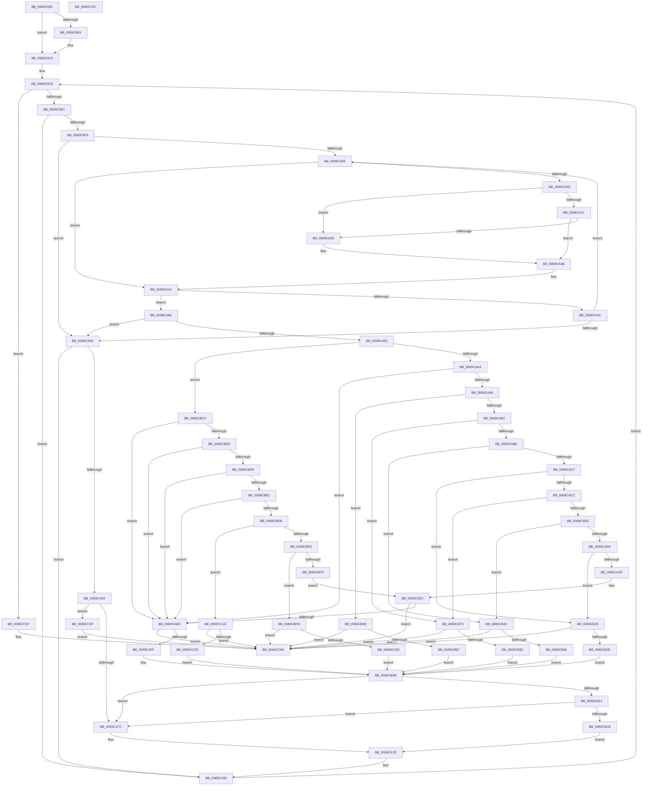

# SdbpCheckApplicationTypeAttributes

- RVA: `0x0069C93C`–`0x0069CC88` (길이 `844` bytes)
- VA: `0x000000014069C93C`
- 실행 섹션: `.text`
- PDB 이름 있음: `예`; PDB Function 태그: `아니요`
- unwind 정보 RVA: `0x0005D79C`
- 디코드: `218`개 명령, `844/844` bytes 표시
- 미해석 바이트: `0` (있으면 어셈블리에 `.byte`로 보존)

> 이 문서는 커널 이미지의 기계어와 PDB 기호를 분석해 생성했습니다. 4번과 5번은 함수 원형과 자료형을 바이너리 사용 방식에서 추정한 C 해석이며 원본 소스 복구 결과는 아닙니다.

## 1. Dependencies

- 직접 호출 지점: **19**; 고유 호출 대상: **15**
- 직접 호출자로 확인된 함수: **2**
- RIP 상대 이미지 참조: **5**

### Outgoing calls
- `0x0069C9AB` → [wil_details_FeatureReporting_ReportUsageToService](../53/wil_details_FeatureReporting_ReportUsageToService_function_0053E6E4.md) (function, `0x0053E6E4`)
- `0x0069C9BE` → [wil_details_FeatureStateCache_TryEnableDeviceUsageFastPath](../53/wil_details_FeatureStateCache_TryEnableDeviceUsageFastPath_function_0053E774.md) (function, `0x0053E774`)
- `0x0069C9E2` → [SdbFindFirstTag](../../page/95/SdbFindFirstTag_function_0095E34C.md) (function, `0x0095E34C`)
- `0x0069CA1E` → [ULongLongMult](../44/ULongLongMult_function_00448380.md) (function, `0x00448380`)
- `0x0069CA69` → [SdbGetTagFromTagID](../../page/95/SdbGetTagFromTagID_function_0095E3C0.md) (function, `0x0095E3C0`)
- `0x0069CAF1` → [SdbGetStringTagPtr](../../page/95/SdbGetStringTagPtr_function_0095DDA8.md) (function, `0x0095DDA8`)
- `0x0069CB06` → [AslStringPatternMatchW](../../page/95/AslStringPatternMatchW_function_0095D4A4.md) (function, `0x0095D4A4`)
- `0x0069CB2F` → [SdbReadQWORDTag](../../page/81/SdbReadQWORDTag_function_0081706C.md) (function, `0x0081706C`)
- `0x0069CB45` → [SdbpCheckUptoVersion](../../page/81/SdbpCheckUptoVersion_function_008190D0.md) (function, `0x008190D0`)
- `0x0069CB56` → [SdbReadQWORDTag](../../page/81/SdbReadQWORDTag_function_0081706C.md) (function, `0x0081706C`)
- `0x0069CB6C` → [SdbpCheckFromVersion](../../page/81/SdbpCheckFromVersion_function_00818F14.md) (function, `0x00818F14`)
- `0x0069CB7D` → [SdbReadQWORDTag](../../page/81/SdbReadQWORDTag_function_0081706C.md) (function, `0x0081706C`)
- `0x0069CB93` → [SdbpCheckVersion](../../page/81/SdbpCheckVersion_function_00819118.md) (function, `0x00819118`)
- `0x0069CBA7` → [SdbReadDWORDTag](../../page/95/SdbReadDWORDTag_function_0095D408.md) (function, `0x0095D408`)
- `0x0069CC03` → [SdbGetStringTagPtr](../../page/95/SdbGetStringTagPtr_function_0095DDA8.md) (function, `0x0095DDA8`)
- `0x0069CC14` → [SdbpCheckFromStringVersion](../../page/81/SdbpCheckFromStringVersion_function_00818D84.md) (function, `0x00818D84`)
- `0x0069CC24` → [SdbGetStringTagPtr](../../page/95/SdbGetStringTagPtr_function_0095DDA8.md) (function, `0x0095DDA8`)
- `0x0069CC35` → [SdbpCheckUptoStringVersion](../../page/81/SdbpCheckUptoStringVersion_function_00818F5C.md) (function, `0x00818F5C`)
- `0x0069CC58` → [AslLogCallPrintf](../../page/95/AslLogCallPrintf_function_0095E4EC.md) (function, `0x0095E4EC`)

### Direct callers
- [SdbpCheckBackupApplicationAttributes](../../page/81/SdbpCheckBackupApplicationAttributes_function_00813C90.md) at `0x00813D0F`
- [SdbpCheckPackageAttributes](../../page/81/SdbpCheckPackageAttributes_function_00815380.md) at `0x00815432`

### Static image references
- `0x0069C96D` → RVA `0x00FC4E40` (`.data`; read)
- `0x0069C991` → RVA `0x000E05A8` (`.rdata`; read)
- `0x0069C9C6` → RVA `0x00E0ED10` (`.data`; read)
- `0x0069CC3F` → RVA `0x0003CC30` (`.rdata`; read)
- `0x0069CC4C` → RVA `0x0003CC08` (`.rdata`; read)

## 2. Other-region calls and transfers

- 다른 실행 섹션으로 향하는 call: **16**
  - `0x0069C9E2` → [SdbFindFirstTag](../../page/95/SdbFindFirstTag_function_0095E34C.md) (`.text` → `PAGE`)
  - `0x0069CA69` → [SdbGetTagFromTagID](../../page/95/SdbGetTagFromTagID_function_0095E3C0.md) (`.text` → `PAGE`)
  - `0x0069CAF1` → [SdbGetStringTagPtr](../../page/95/SdbGetStringTagPtr_function_0095DDA8.md) (`.text` → `PAGE`)
  - `0x0069CB06` → [AslStringPatternMatchW](../../page/95/AslStringPatternMatchW_function_0095D4A4.md) (`.text` → `PAGE`)
  - `0x0069CB2F` → [SdbReadQWORDTag](../../page/81/SdbReadQWORDTag_function_0081706C.md) (`.text` → `PAGE`)
  - `0x0069CB45` → [SdbpCheckUptoVersion](../../page/81/SdbpCheckUptoVersion_function_008190D0.md) (`.text` → `PAGE`)
  - `0x0069CB56` → [SdbReadQWORDTag](../../page/81/SdbReadQWORDTag_function_0081706C.md) (`.text` → `PAGE`)
  - `0x0069CB6C` → [SdbpCheckFromVersion](../../page/81/SdbpCheckFromVersion_function_00818F14.md) (`.text` → `PAGE`)
  - `0x0069CB7D` → [SdbReadQWORDTag](../../page/81/SdbReadQWORDTag_function_0081706C.md) (`.text` → `PAGE`)
  - `0x0069CB93` → [SdbpCheckVersion](../../page/81/SdbpCheckVersion_function_00819118.md) (`.text` → `PAGE`)
  - `0x0069CBA7` → [SdbReadDWORDTag](../../page/95/SdbReadDWORDTag_function_0095D408.md) (`.text` → `PAGE`)
  - `0x0069CC03` → [SdbGetStringTagPtr](../../page/95/SdbGetStringTagPtr_function_0095DDA8.md) (`.text` → `PAGE`)
  - `0x0069CC14` → [SdbpCheckFromStringVersion](../../page/81/SdbpCheckFromStringVersion_function_00818D84.md) (`.text` → `PAGE`)
  - `0x0069CC24` → [SdbGetStringTagPtr](../../page/95/SdbGetStringTagPtr_function_0095DDA8.md) (`.text` → `PAGE`)
  - `0x0069CC35` → [SdbpCheckUptoStringVersion](../../page/81/SdbpCheckUptoStringVersion_function_00818F5C.md) (`.text` → `PAGE`)
  - `0x0069CC58` → [AslLogCallPrintf](../../page/95/AslLogCallPrintf_function_0095E4EC.md) (`.text` → `PAGE`)
- 별도 외부 분기/꼬리 이동을 확인하지 못했습니다.

## 3. Assembly (complete function range)

```asm
0069C93C  48 89 5C 24 10                  mov qword ptr [rsp + 0x10], rbx
0069C941  48 89 6C 24 18                  mov qword ptr [rsp + 0x18], rbp
0069C946  48 89 74 24 20                  mov qword ptr [rsp + 0x20], rsi
0069C94B  57                              push rdi
0069C94C  41 54                           push r12
0069C94E  41 55                           push r13
0069C950  41 56                           push r14
0069C952  41 57                           push r15
0069C954  48 83 EC 20                     sub rsp, 0x20
0069C958  33 DB                           xor ebx, ebx
0069C95A  4D 8B F9                        mov r15, r9
0069C95D  89 19                           mov dword ptr [rcx], ebx
0069C95F  45 8B E8                        mov r13d, r8d
0069C962  4C 8B F2                        mov r14, rdx
0069C965  4C 8B E1                        mov r12, rcx
0069C968  BD 01 00 00 00                  mov ebp, 1
0069C96D  44 8B 15 CC 84 92 00            mov r10d, dword ptr [rip + 0x9284cc]
0069C974  48 89 5C 24 50                  mov qword ptr [rsp + 0x50], rbx
0069C979  44 89 54 24 50                  mov dword ptr [rsp + 0x50], r10d
0069C97E  41 F6 C2 10                     test r10b, 0x10
0069C982  75 3F                           jne 0x14069c9c3
0069C984  48 8B 44 24 50                  mov rax, qword ptr [rsp + 0x50]
0069C989  8D 7D 02                        lea edi, [rbp + 2]
0069C98C  48 89 44 24 50                  mov qword ptr [rsp + 0x50], rax
0069C991  48 8D 0D 10 3C A4 FF            lea rcx, [rip - 0x5bc3f0]
0069C998  44 0B D5                        or r10d, ebp
0069C99B  44 8B CD                        mov r9d, ebp
0069C99E  44 89 54 24 50                  mov dword ptr [rsp + 0x50], r10d
0069C9A3  44 8B C7                        mov r8d, edi
0069C9A6  48 8B 54 24 50                  mov rdx, qword ptr [rsp + 0x50]
0069C9AB  E8 34 1D EA FF                  call 0x14053e6e4
0069C9B0  48 8B 4C 24 50                  mov rcx, qword ptr [rsp + 0x50]
0069C9B5  4C 8D 05 EC 3B A4 FF            lea r8, [rip - 0x5bc414]
0069C9BC  8B D7                           mov edx, edi
0069C9BE  E8 B1 1D EA FF                  call 0x14053e774
0069C9C3  48 8B F3                        mov rsi, rbx
0069C9C6  48 8D 0D 43 23 77 00            lea rcx, [rip + 0x772343]
0069C9CD  48 83 FE 40                     cmp rsi, 0x40
0069C9D1  0F 83 88 02 00 00               jae 0x14069cc5f
0069C9D7  44 0F B7 04 0E                  movzx r8d, word ptr [rsi + rcx]
0069C9DC  41 8B D5                        mov edx, r13d
0069C9DF  49 8B CE                        mov rcx, r14
0069C9E2  E8 65 19 2C 00                  call 0x14095e34c
0069C9E7  48 8D 0D 22 23 77 00            lea rcx, [rip + 0x772322]
0069C9EE  44 8B D0                        mov r10d, eax
0069C9F1  85 C0                           test eax, eax
0069C9F3  0F 84 8C 00 00 00               je 0x14069ca85
0069C9F9  49 8B 47 10                     mov rax, qword ptr [r15 + 0x10]
0069C9FD  4C 8B CB                        mov r9, rbx
0069CA00  48 85 C0                        test rax, rax
0069CA03  74 53                           je 0x14069ca58
0069CA05  48 8B FB                        mov rdi, rbx
0069CA08  4C 3B C8                        cmp r9, rax
0069CA0B  73 35                           jae 0x14069ca42
0069CA0D  49 8B 4F 08                     mov rcx, qword ptr [r15 + 8]
0069CA11  4C 8D 44 24 50                  lea r8, [rsp + 0x50]
0069CA16  49 8B D1                        mov rdx, r9
0069CA19  48 89 5C 24 50                  mov qword ptr [rsp + 0x50], rbx
0069CA1E  E8 5D B9 DA FF                  call 0x140448380
0069CA23  85 C0                           test eax, eax
0069CA25  78 11                           js 0x14069ca38
0069CA27  49 8B 4F 28                     mov rcx, qword ptr [r15 + 0x28]
0069CA2B  48 8B 7C 24 50                  mov rdi, qword ptr [rsp + 0x50]
0069CA30  48 03 F9                        add rdi, rcx
0069CA33  48 3B F9                        cmp rdi, rcx
0069CA36  73 03                           jae 0x14069ca3b
0069CA38  48 8B FB                        mov rdi, rbx
0069CA3B  48 8D 0D CE 22 77 00            lea rcx, [rip + 0x7722ce]
0069CA42  0F B7 44 0E 02                  movzx eax, word ptr [rsi + rcx + 2]
0069CA47  66 39 07                        cmp word ptr [rdi], ax
0069CA4A  74 42                           je 0x14069ca8e
0069CA4C  49 8B 47 10                     mov rax, qword ptr [r15 + 0x10]
0069CA50  49 FF C1                        inc r9
0069CA53  4C 3B C8                        cmp r9, rax
0069CA56  72 AD                           jb 0x14069ca05
0069CA58  B8 01 60 00 00                  mov eax, 0x6001
0069CA5D  66 39 04 0E                     cmp word ptr [rsi + rcx], ax
0069CA61  74 22                           je 0x14069ca85
0069CA63  41 8B D5                        mov edx, r13d
0069CA66  49 8B CE                        mov rcx, r14
0069CA69  E8 52 19 2C 00                  call 0x14095e3c0
0069CA6E  B9 60 70 00 00                  mov ecx, 0x7060
0069CA73  66 3B C1                        cmp ax, cx
0069CA76  0F 85 C3 01 00 00               jne 0x14069cc3f
0069CA7C  8B EB                           mov ebp, ebx
0069CA7E  48 8D 0D 8B 22 77 00            lea rcx, [rip + 0x77228b]
0069CA85  48 83 C6 04                     add rsi, 4
0069CA89  E9 3F FF FF FF                  jmp 0x14069c9cd
0069CA8E  48 85 FF                        test rdi, rdi
0069CA91  74 C5                           je 0x14069ca58
0069CA93  0F B7 0C 0E                     movzx ecx, word ptr [rsi + rcx]
0069CA97  B8 11 60 00 00                  mov eax, 0x6011
0069CA9C  3B C8                           cmp ecx, eax
0069CA9E  0F 87 20 01 00 00               ja 0x14069cbc4
0069CAA4  74 45                           je 0x14069caeb
0069CAA6  81 E9 45 40 00 00               sub ecx, 0x4045
0069CAAC  0F 84 EB 00 00 00               je 0x14069cb9d
0069CAB2  81 E9 CF 0F 00 00               sub ecx, 0xfcf
0069CAB8  0F 84 B5 00 00 00               je 0x14069cb73
0069CABE  83 E9 01                        sub ecx, 1
0069CAC1  0F 84 85 00 00 00               je 0x14069cb4c
0069CAC7  83 E9 01                        sub ecx, 1
0069CACA  74 59                           je 0x14069cb25
0069CACC  83 E9 01                        sub ecx, 1
0069CACF  0F 84 9E 00 00 00               je 0x14069cb73
0069CAD5  83 E9 01                        sub ecx, 1
0069CAD8  74 72                           je 0x14069cb4c
0069CADA  83 E9 01                        sub ecx, 1
0069CADD  74 46                           je 0x14069cb25
0069CADF  81 F9 E8 0F 00 00               cmp ecx, 0xfe8
0069CAE5  0F 85 7D 01 00 00               jne 0x14069cc68
0069CAEB  41 8B D2                        mov edx, r10d
0069CAEE  49 8B CE                        mov rcx, r14
0069CAF1  E8 B2 12 2C 00                  call 0x14095dda8
0069CAF6  48 85 C0                        test rax, rax
0069CAF9  0F 84 69 01 00 00               je 0x14069cc68
0069CAFF  48 8B 57 08                     mov rdx, qword ptr [rdi + 8]
0069CB03  48 8B C8                        mov rcx, rax
0069CB06  E8 99 09 2C 00                  call 0x14095d4a4
0069CB0B  85 ED                           test ebp, ebp
0069CB0D  0F 84 69 FF FF FF               je 0x14069ca7c
0069CB13  85 C0                           test eax, eax
0069CB15  0F 84 61 FF FF FF               je 0x14069ca7c
0069CB1B  BD 01 00 00 00                  mov ebp, 1
0069CB20  E9 59 FF FF FF                  jmp 0x14069ca7e
0069CB25  49 83 C8 FF                     or r8, 0xffffffffffffffff
0069CB29  41 8B D2                        mov edx, r10d
0069CB2C  49 8B CE                        mov rcx, r14
0069CB2F  E8 38 A5 17 00                  call 0x14081706c
0069CB34  48 83 F8 FF                     cmp rax, -1
0069CB38  0F 84 2A 01 00 00               je 0x14069cc68
0069CB3E  48 8B 57 08                     mov rdx, qword ptr [rdi + 8]
0069CB42  48 8B C8                        mov rcx, rax
0069CB45  E8 86 C5 17 00                  call 0x1408190d0
0069CB4A  EB BF                           jmp 0x14069cb0b
0069CB4C  49 83 C8 FF                     or r8, 0xffffffffffffffff
0069CB50  41 8B D2                        mov edx, r10d
0069CB53  49 8B CE                        mov rcx, r14
0069CB56  E8 11 A5 17 00                  call 0x14081706c
0069CB5B  48 83 F8 FF                     cmp rax, -1
0069CB5F  0F 84 03 01 00 00               je 0x14069cc68
0069CB65  48 8B 57 08                     mov rdx, qword ptr [rdi + 8]
0069CB69  48 8B C8                        mov rcx, rax
0069CB6C  E8 A3 C3 17 00                  call 0x140818f14
0069CB71  EB 98                           jmp 0x14069cb0b
0069CB73  49 83 C8 FF                     or r8, 0xffffffffffffffff
0069CB77  41 8B D2                        mov edx, r10d
0069CB7A  49 8B CE                        mov rcx, r14
0069CB7D  E8 EA A4 17 00                  call 0x14081706c
0069CB82  48 83 F8 FF                     cmp rax, -1
0069CB86  0F 84 DC 00 00 00               je 0x14069cc68
0069CB8C  48 8B 57 08                     mov rdx, qword ptr [rdi + 8]
0069CB90  48 8B C8                        mov rcx, rax
0069CB93  E8 80 C5 17 00                  call 0x140819118
0069CB98  E9 6E FF FF FF                  jmp 0x14069cb0b
0069CB9D  41 83 C8 FF                     or r8d, 0xffffffff
0069CBA1  41 8B D2                        mov edx, r10d
0069CBA4  49 8B CE                        mov rcx, r14
0069CBA7  E8 5C 08 2C 00                  call 0x14095d408
0069CBAC  8B C8                           mov ecx, eax
0069CBAE  83 F8 FF                        cmp eax, -1
0069CBB1  0F 84 B1 00 00 00               je 0x14069cc68
0069CBB7  3B 4F 08                        cmp ecx, dword ptr [rdi + 8]
0069CBBA  8B C3                           mov eax, ebx
0069CBBC  0F 94 C0                        sete al
0069CBBF  E9 47 FF FF FF                  jmp 0x14069cb0b
0069CBC4  81 E9 29 60 00 00               sub ecx, 0x6029
0069CBCA  0F 84 1B FF FF FF               je 0x14069caeb
0069CBD0  83 E9 01                        sub ecx, 1
0069CBD3  0F 84 12 FF FF FF               je 0x14069caeb
0069CBD9  83 E9 01                        sub ecx, 1
0069CBDC  0F 84 09 FF FF FF               je 0x14069caeb
0069CBE2  83 E9 17                        sub ecx, 0x17
0069CBE5  0F 84 00 FF FF FF               je 0x14069caeb
0069CBEB  83 E9 02                        sub ecx, 2
0069CBEE  74 2E                           je 0x14069cc1e
0069CBF0  83 E9 02                        sub ecx, 2
0069CBF3  74 08                           je 0x14069cbfd
0069CBF5  83 F9 02                        cmp ecx, 2
0069CBF8  E9 E8 FE FF FF                  jmp 0x14069cae5
0069CBFD  41 8B D2                        mov edx, r10d
0069CC00  49 8B CE                        mov rcx, r14
0069CC03  E8 A0 11 2C 00                  call 0x14095dda8
0069CC08  48 85 C0                        test rax, rax
0069CC0B  74 5B                           je 0x14069cc68
0069CC0D  48 8B 57 08                     mov rdx, qword ptr [rdi + 8]
0069CC11  48 8B C8                        mov rcx, rax
0069CC14  E8 6B C1 17 00                  call 0x140818d84
0069CC19  E9 ED FE FF FF                  jmp 0x14069cb0b
0069CC1E  41 8B D2                        mov edx, r10d
0069CC21  49 8B CE                        mov rcx, r14
0069CC24  E8 7F 11 2C 00                  call 0x14095dda8
0069CC29  48 85 C0                        test rax, rax
0069CC2C  74 3A                           je 0x14069cc68
0069CC2E  48 8B 57 08                     mov rdx, qword ptr [rdi + 8]
0069CC32  48 8B C8                        mov rcx, rax
0069CC35  E8 22 C3 17 00                  call 0x140818f5c
0069CC3A  E9 CC FE FF FF                  jmp 0x14069cb0b
0069CC3F  4C 8D 0D EA FF 99 FF            lea r9, [rip - 0x660016]
0069CC46  41 B8 35 14 00 00               mov r8d, 0x1435
0069CC4C  48 8D 15 B5 FF 99 FF            lea rdx, [rip - 0x66004b]
0069CC53  B9 01 00 00 00                  mov ecx, 1
0069CC58  E8 8F 18 2C 00                  call 0x14095e4ec
0069CC5D  EB 09                           jmp 0x14069cc68
0069CC5F  41 89 2C 24                     mov dword ptr [r12], ebp
0069CC63  BB 01 00 00 00                  mov ebx, 1
0069CC68  48 8B 6C 24 60                  mov rbp, qword ptr [rsp + 0x60]
0069CC6D  8B C3                           mov eax, ebx
0069CC6F  48 8B 5C 24 58                  mov rbx, qword ptr [rsp + 0x58]
0069CC74  48 8B 74 24 68                  mov rsi, qword ptr [rsp + 0x68]
0069CC79  48 83 C4 20                     add rsp, 0x20
0069CC7D  41 5F                           pop r15
0069CC7F  41 5E                           pop r14
0069CC81  41 5D                           pop r13
0069CC83  41 5C                           pop r12
0069CC85  5F                              pop rdi
0069CC86  C3                              ret
0069CC87  CC                              int3
```

## 4. C-style interpretation (structured pseudocode)

```c
__int64 __fastcall SdbpCheckApplicationTypeAttributes(__int64 a1, __int64 a2, int a3, __int64 a4)
{
    __int64 result;
    __int64 v_r10;
    __int64 v_rbx;
    __int64 v_rdi;
    __int64 v_rsi;
    __int64 v_rsp;
    unsigned __int64 v_stack_p10;
    unsigned __int64 v_stack_p18;
    unsigned __int64 v_stack_p20;
    unsigned __int64 v_stack_p8;

    v_stack_p10 = v_rbx;
    v_stack_p18 = v_rbp;
    v_stack_p20 = v_rsi;
    v_rsp = (v_rsp) - (32);
    v_rbx = 0;
    *(unsigned int *)(a1) = 0;
    v_stack_p8 = 0;
    v_stack_p8 = (unsigned int)((unsigned int)(*(unsigned int *)(v_rip + 9602252)));
    v_r10 = (unsigned int)(*(unsigned int *)(v_rip + 9602252));
    if ((((unsigned __int8)((unsigned int)(*(unsigned int *)(v_rip + 9602252)))) & (16)) == 0) {
        result = v_stack_p8;
        v_rdi = 1 + 2;
        v_stack_p8 = result;
        a1 = v_rip - 6013936;
        v_r10 = (unsigned int)(((unsigned int)(*(unsigned int *)(v_rip + 9602252))) | (1));
        a4 = 1;
        v_stack_p8 = (unsigned int)(v_r10);
        a3 = (unsigned int)(v_rdi);
        a2 = v_stack_p8;
        result = wil_details_FeatureReporting_ReportUsageToService(a1, a2, a3, a4);
        a1 = v_stack_p8;
        a3 = v_rip - 6013972;
        a2 = (unsigned int)(v_rdi);
        result = wil_details_FeatureStateCache_TryEnableDeviceUsageFastPath(a1, a2, a3, a4);
    }
loc_0069C9CD:
    if (0 >= 64) goto loc_0069CC5F;
    result = SdbFindFirstTag(a2, (unsigned int)((unsigned int)((unsigned int)(a3))), *(unsigned __int16 *)(0 + v_rip + 7807811 * 1), a4);
    if ((unsigned int)(result) == 0) goto loc_0069CA85;
    if (*(unsigned __int64 *)(a4 + 16) == 0) goto loc_0069CA58;
loc_0069CA05:
    if (0 >= (*(unsigned __int64 *)(a4 + 16))) goto loc_0069CA42;
    v_stack_p8 = 0;
    result = ULongLongMult(*(unsigned __int64 *)(a4 + 8), 0, v_stack_p8, 0);
    if (sign_flag) goto loc_0069CA38;
    v_rdi = (v_stack_p8) + (*(unsigned __int64 *)(a4 + 40));
    if (v_rdi < (*(unsigned __int64 *)(a4 + 40))) {
        v_rdi = 0;
    }
loc_0069CA42:
    if ((*(unsigned __int16 *)(v_rdi)) == ((unsigned __int16)(*(unsigned __int16 *)(0 + v_rip + 7807694 * 1 + 2)))) goto loc_0069CA8E;
    a4 = (0) + 1;
    if (a4 < (*(unsigned __int64 *)(a4 + 16))) goto loc_0069CA05;
loc_0069CA58:
    if ((*(unsigned __int16 *)(0 + v_rip + 7807694 * 1)) == ((unsigned __int16)((unsigned int)(0x6001ULL)))) goto loc_0069CA85;
    result = SdbGetTagFromTagID(a2, (unsigned int)((unsigned int)((unsigned int)(a3))), v_stack_p8, a4);
    if (((unsigned __int16)(result)) != ((unsigned __int16)((unsigned int)(0x7060ULL)))) goto loc_0069CC3F;
loc_0069CA7C:
loc_0069CA7E:
loc_0069CA85:
    v_rsi = (0) + (4);
    goto loc_0069C9CD;
loc_0069CA8E:
    if (v_rdi == 0) goto loc_0069CA58;
    if (((unsigned int)(*(unsigned __int16 *)(v_rsi + v_rip + 7807627 * 1))) > ((unsigned int)((unsigned int)(0x6011ULL)))) goto loc_0069CBC4;
    if (((unsigned int)(*(unsigned __int16 *)(v_rsi + v_rip + 7807627 * 1))) == ((unsigned int)((unsigned int)(0x6011ULL)))) goto loc_0069CAEB;
    a1 = (unsigned int)((*(unsigned __int16 *)(v_rsi + v_rip + 7807627 * 1)) - (0x4045ULL));
    if (condition_is_equal) goto loc_0069CB9D;
    a1 = (unsigned int)((a1) - (0xFCFULL));
    if (condition_is_equal) goto loc_0069CB73;
    a1 = (unsigned int)((a1) - (1));
    if (condition_is_equal) goto loc_0069CB4C;
    a1 = (unsigned int)((a1) - (1));
    if (condition_is_equal) goto loc_0069CB25;
    a1 = (unsigned int)((a1) - (1));
    if (condition_is_equal) goto loc_0069CB73;
    a1 = (unsigned int)((a1) - (1));
    if (condition_is_equal) goto loc_0069CB4C;
    a1 = (unsigned int)((a1) - (1));
    if (condition_is_equal) goto loc_0069CB25;
loc_0069CAE5:
    if (((unsigned int)(a1)) != 0xFE8ULL) goto loc_0069CC68;
loc_0069CAEB:
    result = SdbGetStringTagPtr(a2, (unsigned int)((unsigned int)((unsigned int)((unsigned int)(result)))), v_stack_p8, a4);
    if (result == 0) goto loc_0069CC68;
    result = AslStringPatternMatchW(result, *(unsigned __int64 *)(v_rdi + 8), v_stack_p8, a4);
loc_0069CB0B:
    if (0 == 0) goto loc_0069CA7C;
    if ((unsigned int)(result) == 0) goto loc_0069CA7C;
    goto loc_0069CA7E;
loc_0069CB25:
    a3 = (v_stack_p8) | (-1);
    result = SdbReadQWORDTag(a2, (unsigned int)((unsigned int)((unsigned int)((unsigned int)(result)))), a3, a4);
    if (result == -1) goto loc_0069CC68;
    result = SdbpCheckUptoVersion(result, *(unsigned __int64 *)(v_rdi + 8), a3, a4);
    goto loc_0069CB0B;
loc_0069CB4C:
    a3 = (a3) | (-1);
    result = SdbReadQWORDTag(a2, (unsigned int)((unsigned int)((unsigned int)((unsigned int)(result)))), a3, a4);
    if (result == -1) goto loc_0069CC68;
    result = SdbpCheckFromVersion(result, *(unsigned __int64 *)(v_rdi + 8), a3, a4);
    goto loc_0069CB0B;
loc_0069CB73:
    a3 = (a3) | (-1);
    result = SdbReadQWORDTag(a2, (unsigned int)((unsigned int)((unsigned int)((unsigned int)(result)))), a3, a4);
    if (result == -1) goto loc_0069CC68;
    result = SdbpCheckVersion(result, *(unsigned __int64 *)(v_rdi + 8), a3, a4);
    goto loc_0069CB0B;
loc_0069CB9D:
    a3 = (unsigned int)((a3) | (0xFFFFFFFFULL));
    result = SdbReadDWORDTag(a2, (unsigned int)((unsigned int)((unsigned int)((unsigned int)(result)))), a3, a4);
    if (((unsigned int)(result)) == -1) goto loc_0069CC68;
    result = (((unsigned int)((unsigned int)((unsigned int)(result)))) == (*(unsigned int *)(v_rdi + 8))) ? 1 : 0;
    goto loc_0069CB0B;
loc_0069CBC4:
    a1 = (unsigned int)(((unsigned int)((unsigned int)(result))) - (0x6029ULL));
    if (condition_is_equal) goto loc_0069CAEB;
    a1 = (unsigned int)((a1) - (1));
    if (condition_is_equal) goto loc_0069CAEB;
    a1 = (unsigned int)((a1) - (1));
    if (condition_is_equal) goto loc_0069CAEB;
    a1 = (unsigned int)((a1) - (23));
    if (condition_is_equal) goto loc_0069CAEB;
    a1 = (unsigned int)((a1) - (2));
    if (condition_is_equal) goto loc_0069CC1E;
    a1 = (unsigned int)((a1) - (2));
    if (condition_is_equal) goto loc_0069CBFD;
    goto loc_0069CAE5;
loc_0069CBFD:
    result = SdbGetStringTagPtr(a2, (unsigned int)((unsigned int)((unsigned int)((unsigned int)(result)))), a3, a4);
    if (result == 0) goto loc_0069CC68;
    result = SdbpCheckFromStringVersion(result, *(unsigned __int64 *)(v_rdi + 8), a3, a4);
    goto loc_0069CB0B;
loc_0069CC1E:
    result = SdbGetStringTagPtr(a2, (unsigned int)((unsigned int)((unsigned int)((unsigned int)(result)))), a3, a4);
    if (result == 0) goto loc_0069CC68;
    result = SdbpCheckUptoStringVersion(result, *(unsigned __int64 *)(v_rdi + 8), a3, a4);
    goto loc_0069CB0B;
loc_0069CC3F:
    result = AslLogCallPrintf(1, v_rip - 6684747, (unsigned int)(0x1435ULL), v_rip - 6684694);
    goto loc_0069CC68;
loc_0069CC5F:
    *(unsigned int *)(a1) = 1;
loc_0069CC68:
    v_rsp = (v_rsp) + (32);
    return 1;
}
```

## 5. (Beta) C Style

```c
int64_t SdbpCheckApplicationTypeAttributes(void *Arg1, int64_t Arg2, int32_t Arg3, void *Arg4)
{
    uint8_t *arg1 = (uint8_t *)Arg1;
    uint8_t *arg4 = (uint8_t *)Arg4;

    int64_t result;
    int64_t local_r10;
    int64_t local_rbx;
    int64_t local_rdi;
    int64_t local_rsi;
    int64_t local_rsp;
    uint64_t v_stack_p10;
    uint64_t v_stack_p18;
    uint64_t v_stack_p20;
    uint64_t v_stack_p8;

    v_stack_p10 = local_rbx;
    v_stack_p18 = local_rbp;
    v_stack_p20 = local_rsi;
    local_rsp = (local_rsp) - (32);
    local_rbx = 0;
    *(uint32_t *)(arg1) = 0;
    v_stack_p8 = 0;
    v_stack_p8 = (uint32_t)((uint32_t)(*(uint32_t *)(v_rip + 0x9284CC)));
    local_r10 = (uint32_t)(*(uint32_t *)(v_rip + 0x9284CC));
    if ((((uint8_t)((uint32_t)(*(uint32_t *)(v_rip + 0x9284CC)))) & (16)) == 0) {
        result = v_stack_p8;
        local_rdi = 1 + 2;
        v_stack_p8 = result;
        Arg1 = v_rip - 6013936;
        local_r10 = (uint32_t)(((uint32_t)(*(uint32_t *)(v_rip + 0x9284CC))) | (1));
        Arg4 = 1;
        v_stack_p8 = (uint32_t)(local_r10);
        Arg3 = (uint32_t)(local_rdi);
        Arg2 = v_stack_p8;
        result = wil_details_FeatureReporting_ReportUsageToService(Arg1, Arg2, Arg3, Arg4);
        Arg1 = v_stack_p8;
        Arg3 = v_rip - 6013972;
        Arg2 = (uint32_t)(local_rdi);
        result = wil_details_FeatureStateCache_TryEnableDeviceUsageFastPath(Arg1, Arg2, Arg3, Arg4);
    }
loc_0069C9CD:
    if (0 >= 64) goto loc_0069CC5F;
    result = SdbFindFirstTag(Arg2, (uint32_t)((uint32_t)((uint32_t)(Arg3))), *(uint16_t *)(0 + v_rip + 0x772343 * 1), Arg4);
    if ((uint32_t)(result) == 0) goto loc_0069CA85;
    if (*(uint64_t *)(arg4 + 0x10) == 0) goto loc_0069CA58;
loc_0069CA05:
    if (0 >= (*(uint64_t *)(arg4 + 0x10))) goto loc_0069CA42;
    v_stack_p8 = 0;
    result = ULongLongMult(*(uint64_t *)(arg4 + 0x8), 0, v_stack_p8, 0);
    if (sign_flag) goto loc_0069CA38;
    local_rdi = (v_stack_p8) + (*(uint64_t *)(arg4 + 0x28));
    if (local_rdi < (*(uint64_t *)(arg4 + 0x28))) {
        local_rdi = 0;
    }
loc_0069CA42:
    if ((*(uint16_t *)(local_rdi)) == ((uint16_t)(*(uint16_t *)(0 + v_rip + 0x7722CE * 1 + 0x2)))) goto loc_0069CA8E;
    Arg4 = (0) + 1;
    if (Arg4 < (*(uint64_t *)(arg4 + 0x10))) goto loc_0069CA05;
loc_0069CA58:
    if ((*(uint16_t *)(0 + v_rip + 0x7722CE * 1)) == ((uint16_t)((uint32_t)(0x6001ULL)))) goto loc_0069CA85;
    result = SdbGetTagFromTagID(Arg2, (uint32_t)((uint32_t)((uint32_t)(Arg3))), v_stack_p8, Arg4);
    if (((uint16_t)(result)) != ((uint16_t)((uint32_t)(0x7060ULL)))) goto loc_0069CC3F;
loc_0069CA7C:
loc_0069CA7E:
loc_0069CA85:
    local_rsi = (0) + (4);
    goto loc_0069C9CD;
loc_0069CA8E:
    if (local_rdi == 0) goto loc_0069CA58;
    if (((uint32_t)(*(uint16_t *)(local_rsi + v_rip + 0x77228B * 1))) > ((uint32_t)((uint32_t)(0x6011ULL)))) goto loc_0069CBC4;
    if (((uint32_t)(*(uint16_t *)(local_rsi + v_rip + 0x77228B * 1))) == ((uint32_t)((uint32_t)(0x6011ULL)))) goto loc_0069CAEB;
    Arg1 = (uint32_t)((*(uint16_t *)(local_rsi + v_rip + 0x77228B * 1)) - (0x4045ULL));
    if (condition_is_equal) goto loc_0069CB9D;
    Arg1 = (uint32_t)((Arg1) - (0xFCFULL));
    if (condition_is_equal) goto loc_0069CB73;
    Arg1 = (uint32_t)((Arg1) - (1));
    if (condition_is_equal) goto loc_0069CB4C;
    Arg1 = (uint32_t)((Arg1) - (1));
    if (condition_is_equal) goto loc_0069CB25;
    Arg1 = (uint32_t)((Arg1) - (1));
    if (condition_is_equal) goto loc_0069CB73;
    Arg1 = (uint32_t)((Arg1) - (1));
    if (condition_is_equal) goto loc_0069CB4C;
    Arg1 = (uint32_t)((Arg1) - (1));
    if (condition_is_equal) goto loc_0069CB25;
loc_0069CAE5:
    if (((uint32_t)(Arg1)) != 0xFE8ULL) goto loc_0069CC68;
loc_0069CAEB:
    result = SdbGetStringTagPtr(Arg2, (uint32_t)((uint32_t)((uint32_t)((uint32_t)(result)))), v_stack_p8, Arg4);
    if (result == 0) goto loc_0069CC68;
    result = AslStringPatternMatchW(result, *(uint64_t *)(local_rdi + 0x8), v_stack_p8, Arg4);
loc_0069CB0B:
    if (0 == 0) goto loc_0069CA7C;
    if ((uint32_t)(result) == 0) goto loc_0069CA7C;
    goto loc_0069CA7E;
loc_0069CB25:
    Arg3 = (v_stack_p8) | (-1);
    result = SdbReadQWORDTag(Arg2, (uint32_t)((uint32_t)((uint32_t)((uint32_t)(result)))), Arg3, Arg4);
    if (result == -1) goto loc_0069CC68;
    result = SdbpCheckUptoVersion(result, *(uint64_t *)(local_rdi + 0x8), Arg3, Arg4);
    goto loc_0069CB0B;
loc_0069CB4C:
    Arg3 = (Arg3) | (-1);
    result = SdbReadQWORDTag(Arg2, (uint32_t)((uint32_t)((uint32_t)((uint32_t)(result)))), Arg3, Arg4);
    if (result == -1) goto loc_0069CC68;
    result = SdbpCheckFromVersion(result, *(uint64_t *)(local_rdi + 0x8), Arg3, Arg4);
    goto loc_0069CB0B;
loc_0069CB73:
    Arg3 = (Arg3) | (-1);
    result = SdbReadQWORDTag(Arg2, (uint32_t)((uint32_t)((uint32_t)((uint32_t)(result)))), Arg3, Arg4);
    if (result == -1) goto loc_0069CC68;
    result = SdbpCheckVersion(result, *(uint64_t *)(local_rdi + 0x8), Arg3, Arg4);
    goto loc_0069CB0B;
loc_0069CB9D:
    Arg3 = (uint32_t)((Arg3) | (0xFFFFFFFFULL));
    result = SdbReadDWORDTag(Arg2, (uint32_t)((uint32_t)((uint32_t)((uint32_t)(result)))), Arg3, Arg4);
    if (((uint32_t)(result)) == -1) goto loc_0069CC68;
    result = (((uint32_t)((uint32_t)((uint32_t)(result)))) == (*(uint32_t *)(local_rdi + 0x8))) ? 1 : 0;
    goto loc_0069CB0B;
loc_0069CBC4:
    Arg1 = (uint32_t)(((uint32_t)((uint32_t)(result))) - (0x6029ULL));
    if (condition_is_equal) goto loc_0069CAEB;
    Arg1 = (uint32_t)((Arg1) - (1));
    if (condition_is_equal) goto loc_0069CAEB;
    Arg1 = (uint32_t)((Arg1) - (1));
    if (condition_is_equal) goto loc_0069CAEB;
    Arg1 = (uint32_t)((Arg1) - (23));
    if (condition_is_equal) goto loc_0069CAEB;
    Arg1 = (uint32_t)((Arg1) - (2));
    if (condition_is_equal) goto loc_0069CC1E;
    Arg1 = (uint32_t)((Arg1) - (2));
    if (condition_is_equal) goto loc_0069CBFD;
    goto loc_0069CAE5;
loc_0069CBFD:
    result = SdbGetStringTagPtr(Arg2, (uint32_t)((uint32_t)((uint32_t)((uint32_t)(result)))), Arg3, Arg4);
    if (result == 0) goto loc_0069CC68;
    result = SdbpCheckFromStringVersion(result, *(uint64_t *)(local_rdi + 0x8), Arg3, Arg4);
    goto loc_0069CB0B;
loc_0069CC1E:
    result = SdbGetStringTagPtr(Arg2, (uint32_t)((uint32_t)((uint32_t)((uint32_t)(result)))), Arg3, Arg4);
    if (result == 0) goto loc_0069CC68;
    result = SdbpCheckUptoStringVersion(result, *(uint64_t *)(local_rdi + 0x8), Arg3, Arg4);
    goto loc_0069CB0B;
loc_0069CC3F:
    result = AslLogCallPrintf(1, v_rip - 6684747, (uint32_t)(0x1435ULL), v_rip - 6684694);
    goto loc_0069CC68;
loc_0069CC5F:
    *(uint32_t *)(arg1) = 1;
loc_0069CC68:
    local_rsp = (local_rsp) + (32);
    return 1;
}
```

### 관측된 메모리 오프셋

구조체 형식이 확인되지 않은 접근은 인자 기준의 오프셋으로만 기록했습니다.

| 기준 인자 | 오프셋 표현 | 폭 (bit) | 접근 |
|---|---:|---:|---|
| `Arg1` | `+ 0x0` | `32` | `W` |
| `Arg4` | `+ 0x8` | `64` | `R` |
| `Arg4` | `+ 0x10` | `64` | `R` |
| `Arg4` | `+ 0x28` | `64` | `R` |

## 6. Execution-region graph

[열기: 2D/3D 그래프와 함수 탐색 컨트롤 패널](../../../control-panel.html?section=text&rva=0x0069C93C&view=graph)

- 2D 그래프는 위에서 아래로 흐르고, 3D 그래프는 빈 공간을 드래그해 회전합니다. Shift+드래그는 이동, 휠은 확대·축소, 함수 노드 선택은 대상 보고서 이동입니다.

### Static fallback


