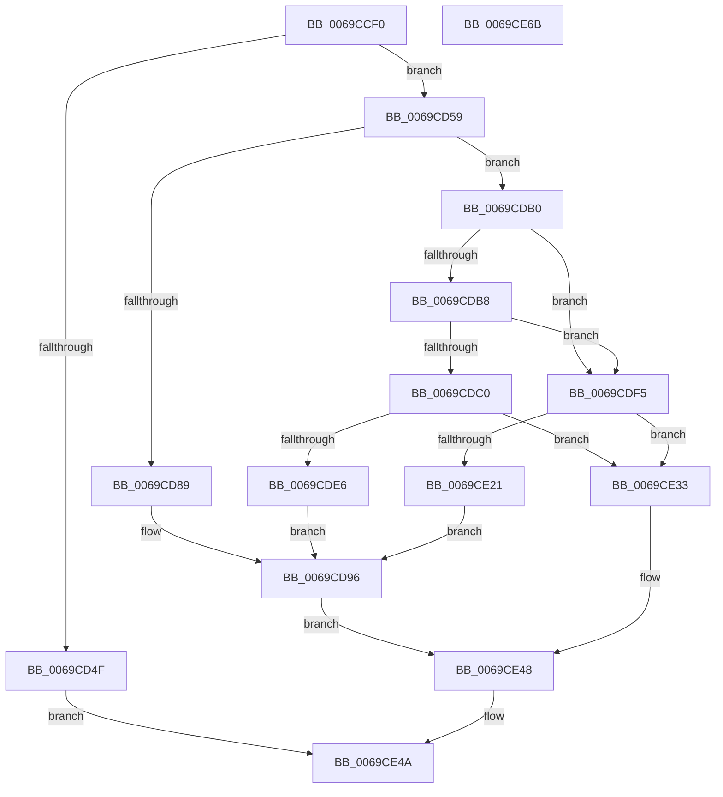

# SdbpGetPathAppPatchPreRS3

- RVA: `0x0069CCF0`–`0x0069CE6C` (길이 `380` bytes)
- VA: `0x000000014069CCF0`
- 실행 섹션: `.text`
- PDB 이름 있음: `예`; PDB Function 태그: `아니요`
- unwind 정보 RVA: `0x000D69C8`
- 디코드: `96`개 명령, `380/380` bytes 표시
- 미해석 바이트: `0` (있으면 어셈블리에 `.byte`로 보존)

> 이 문서는 커널 이미지의 기계어와 PDB 기호를 분석해 생성했습니다. 4번과 5번은 함수 원형과 자료형을 바이너리 사용 방식에서 추정한 C 해석이며 원본 소스 복구 결과는 아닙니다.

## 1. Dependencies

- 직접 호출 지점: **6**; 고유 호출 대상: **6**
- 직접 호출자로 확인된 함수: **0**
- RIP 상대 이미지 참조: **9**

### Outgoing calls
- `0x0069CD7E` → [SdbpGetProcessHostGuestArchitectures](../../page/81/SdbpGetProcessHostGuestArchitectures_function_00818350.md) (function, `0x00818350`)
- `0x0069CDA6` → [AslLogCallPrintf](../../page/95/AslLogCallPrintf_function_0095E4EC.md) (function, `0x0095E4EC`)
- `0x0069CDDB` → [RtlStringCchCopyW](../26/RtlStringCchCopyW_function_0026E9A4.md) (function, `0x0026E9A4`)
- `0x0069CE16` → [AslPathCombine](../../page/81/AslPathCombine_function_0081B100.md) (function, `0x0081B100`)
- `0x0069CE41` → [SdbpGetPathAppPatch](../../page/81/SdbpGetPathAppPatch_function_00817E30.md) (function, `0x00817E30`)
- `0x0069CE54` → [_security_check_cookie](../6A/_security_check_cookie_function_006AC640.md) (function, `0x006AC640`)

### Direct callers
- 이 함수 시작 RVA로 연결되는 직접 call은 확인되지 않았습니다. 간접 호출은 완전히 역산할 수 없습니다.

### Static image references
- `0x0069CD0A` → RVA `0x00E0A740` (`.data`; read)
- `0x0069CD1B` → RVA `0x0003DD80` (`.rdata`; read)
- `0x0069CD2B` → RVA `0x0003DD84` (`.rdata`; read)
- `0x0069CD3D` → RVA `0x0003DD70` (`.rdata`; read)
- `0x0069CD89` → RVA `0x0003DD88` (`.rdata`; read)
- `0x0069CD96` → RVA `0x0003DDC0` (`.rdata`; read)
- `0x0069CDC0` → RVA `0x00013F90` (`.rdata`; read)
- `0x0069CDE6` → RVA `0x0003DDE0` (`.rdata`; read)
- `0x0069CE21` → RVA `0x0003DD10` (`.rdata`; read)

## 2. Other-region calls and transfers

- 다른 실행 섹션으로 향하는 call: **4**
  - `0x0069CD7E` → [SdbpGetProcessHostGuestArchitectures](../../page/81/SdbpGetProcessHostGuestArchitectures_function_00818350.md) (`.text` → `PAGE`)
  - `0x0069CDA6` → [AslLogCallPrintf](../../page/95/AslLogCallPrintf_function_0095E4EC.md) (`.text` → `PAGE`)
  - `0x0069CE16` → [AslPathCombine](../../page/81/AslPathCombine_function_0081B100.md) (`.text` → `PAGE`)
  - `0x0069CE41` → [SdbpGetPathAppPatch](../../page/81/SdbpGetPathAppPatch_function_00817E30.md) (`.text` → `PAGE`)
- 별도 외부 분기/꼬리 이동을 확인하지 못했습니다.

## 3. Assembly (complete function range)

```asm
0069CCF0  40 55                           push rbp
0069CCF2  53                              push rbx
0069CCF3  56                              push rsi
0069CCF4  57                              push rdi
0069CCF5  41 54                           push r12
0069CCF7  41 56                           push r14
0069CCF9  41 57                           push r15
0069CCFB  48 8D AC 24 90 FE FF FF         lea rbp, [rsp - 0x170]
0069CD03  48 81 EC 70 02 00 00            sub rsp, 0x270
0069CD0A  48 8B 05 2F DA 76 00            mov rax, qword ptr [rip + 0x76da2f]
0069CD11  48 33 C4                        xor rax, rsp
0069CD14  48 89 85 60 01 00 00            mov qword ptr [rbp + 0x160], rax
0069CD1B  8B 05 5F 10 9A FF               mov eax, dword ptr [rip - 0x65efa1]
0069CD21  49 8B F1                        mov rsi, r9
0069CD24  89 44 24 48                     mov dword ptr [rsp + 0x48], eax
0069CD28  49 8B F8                        mov rdi, r8
0069CD2B  0F B7 05 52 10 9A FF            movzx eax, word ptr [rip - 0x65efae]
0069CD32  4C 8B F2                        mov r14, rdx
0069CD35  66 89 44 24 4C                  mov word ptr [rsp + 0x4c], ax
0069CD3A  4C 8B F9                        mov r15, rcx
0069CD3D  0F 10 05 2C 10 9A FF            movups xmm0, xmmword ptr [rip - 0x65efd4]
0069CD44  0F 11 44 24 38                  movups xmmword ptr [rsp + 0x38], xmm0
0069CD49  48 83 FA 0B                     cmp rdx, 0xb
0069CD4D  73 0A                           jae 0x14069cd59
0069CD4F  B8 23 00 00 C0                  mov eax, 0xc0000023
0069CD54  E9 F1 00 00 00                  jmp 0x14069ce4a
0069CD59  B8 FF FF 00 00                  mov eax, 0xffff
0069CD5E  48 8D 54 24 30                  lea rdx, [rsp + 0x30]
0069CD63  45 33 E4                        xor r12d, r12d
0069CD66  66 89 44 24 34                  mov word ptr [rsp + 0x34], ax
0069CD6B  4C 8B C6                        mov r8, rsi
0069CD6E  66 44 89 64 24 50               mov word ptr [rsp + 0x50], r12w
0069CD74  48 8D 4C 24 34                  lea rcx, [rsp + 0x34]
0069CD79  66 89 44 24 30                  mov word ptr [rsp + 0x30], ax
0069CD7E  E8 CD B5 17 00                  call 0x140818350
0069CD83  8B D8                           mov ebx, eax
0069CD85  85 C0                           test eax, eax
0069CD87  79 27                           jns 0x14069cdb0
0069CD89  4C 8D 0D F8 0F 9A FF            lea r9, [rip - 0x65f008]
0069CD90  41 B8 FA 03 00 00               mov r8d, 0x3fa
0069CD96  48 8D 15 23 10 9A FF            lea rdx, [rip - 0x65efdd]
0069CD9D  89 44 24 20                     mov dword ptr [rsp + 0x20], eax
0069CDA1  B9 01 00 00 00                  mov ecx, 1
0069CDA6  E8 41 17 2C 00                  call 0x14095e4ec
0069CDAB  E9 98 00 00 00                  jmp 0x14069ce48
0069CDB0  66 83 7C 24 30 09               cmp word ptr [rsp + 0x30], 9
0069CDB6  74 3D                           je 0x14069cdf5
0069CDB8  66 83 7C 24 30 0C               cmp word ptr [rsp + 0x30], 0xc
0069CDBE  74 35                           je 0x14069cdf5
0069CDC0  48 8D 05 C9 71 97 FF            lea rax, [rip - 0x688e37]
0069CDC7  48 85 FF                        test rdi, rdi
0069CDCA  BA 04 01 00 00                  mov edx, 0x104
0069CDCF  48 8D 4C 24 50                  lea rcx, [rsp + 0x50]
0069CDD4  48 0F 44 F8                     cmove rdi, rax
0069CDD8  4C 8B C7                        mov r8, rdi
0069CDDB  E8 C4 1B BD FF                  call 0x14026e9a4
0069CDE0  8B D8                           mov ebx, eax
0069CDE2  85 C0                           test eax, eax
0069CDE4  79 4D                           jns 0x14069ce33
0069CDE6  4C 8D 0D F3 0F 9A FF            lea r9, [rip - 0x65f00d]
0069CDED  41 B8 0C 04 00 00               mov r8d, 0x40c
0069CDF3  EB A1                           jmp 0x14069cd96
0069CDF5  48 8D 05 94 71 97 FF            lea rax, [rip - 0x688e6c]
0069CDFC  48 85 FF                        test rdi, rdi
0069CDFF  41 B9 04 01 00 00               mov r9d, 0x104
0069CE05  4C 8D 44 24 50                  lea r8, [rsp + 0x50]
0069CE0A  48 0F 44 F8                     cmove rdi, rax
0069CE0E  48 8D 4C 24 38                  lea rcx, [rsp + 0x38]
0069CE13  48 8B D7                        mov rdx, rdi
0069CE16  E8 E5 E2 17 00                  call 0x14081b100
0069CE1B  8B D8                           mov ebx, eax
0069CE1D  85 C0                           test eax, eax
0069CE1F  79 12                           jns 0x14069ce33
0069CE21  4C 8D 0D E8 0E 9A FF            lea r9, [rip - 0x65f118]
0069CE28  41 B8 06 04 00 00               mov r8d, 0x406
0069CE2E  E9 63 FF FF FF                  jmp 0x14069cd96
0069CE33  4C 8B CE                        mov r9, rsi
0069CE36  4C 8D 44 24 50                  lea r8, [rsp + 0x50]
0069CE3B  49 8B D6                        mov rdx, r14
0069CE3E  49 8B CF                        mov rcx, r15
0069CE41  E8 EA AF 17 00                  call 0x140817e30
0069CE46  8B D8                           mov ebx, eax
0069CE48  8B C3                           mov eax, ebx
0069CE4A  48 8B 8D 60 01 00 00            mov rcx, qword ptr [rbp + 0x160]
0069CE51  48 33 CC                        xor rcx, rsp
0069CE54  E8 E7 F7 00 00                  call 0x1406ac640
0069CE59  48 81 C4 70 02 00 00            add rsp, 0x270
0069CE60  41 5F                           pop r15
0069CE62  41 5E                           pop r14
0069CE64  41 5C                           pop r12
0069CE66  5F                              pop rdi
0069CE67  5E                              pop rsi
0069CE68  5B                              pop rbx
0069CE69  5D                              pop rbp
0069CE6A  C3                              ret
0069CE6B  CC                              int3
```

## 4. C-style interpretation (structured pseudocode)

```c
__int64 __fastcall SdbpGetPathAppPatchPreRS3(__int64 a1, __int64 a2, __int64 a3, __int64 a4)
{
    __int64 result;
    __int64 v_r12;
    __int64 v_rsp;
    unsigned __int64 v_stack_m1A8;
    unsigned __int16 v_stack_m258;
    unsigned __int16 v_stack_m25C;
    unsigned int v_stack_m260;
    unsigned __int64 v_stack_m270;
    unsigned __int16 v_stack_m274;
    unsigned __int64 v_stack_m278;
    unsigned int v_stack_m288;
    unsigned __int64 v_stack_m48;

    v_rsp = (v_rsp) - (624);
    result = (*(unsigned __int64 *)(v_rip + 7789103)) ^ (v_rsp);
    v_stack_m48 = result;
    v_stack_m260 = (unsigned int)((unsigned int)(*(unsigned int *)(v_rip - 6680481)));
    v_stack_m25C = (unsigned __int16)(*(unsigned __int16 *)(v_rip - 6680494));
    v_stack_m270 = v_xmm0;
    if (a2 >= 11) goto loc_0069CD59;
    goto loc_0069CE4A;
loc_0069CD59:
    v_r12 = 0;
    v_stack_m274 = (unsigned __int16)((unsigned int)(0xFFFFULL));
    v_stack_m258 = 0;
    v_stack_m278 = (unsigned __int16)((unsigned int)(0xFFFFULL));
    result = SdbpGetProcessHostGuestArchitectures(v_stack_m274, v_stack_m278, a4, a4);
    if (!sign_flag) goto loc_0069CDB0;
loc_0069CD96:
    v_stack_m288 = (unsigned int)(result);
    result = AslLogCallPrintf(1, v_rip - 6680541, (unsigned int)(0x3FAULL), v_rip - 6680584);
    goto loc_0069CE48;
loc_0069CDB0:
    if (v_stack_m278 == 9) goto loc_0069CDF5;
    if (v_stack_m278 == 12) goto loc_0069CDF5;
    if (a3 == 0) { a3 = v_rip - 6852151; }
    result = RtlStringCchCopyW(v_stack_m258, 260, a3, v_rip - 6680584);
    if (!sign_flag) goto loc_0069CE33;
    goto loc_0069CD96;
loc_0069CDF5:
    if (a3 == 0) { a3 = v_rip - 6852204; }
    result = AslPathCombine(v_stack_m270, a3, v_stack_m258, 260);
    if (!sign_flag) goto loc_0069CE33;
    goto loc_0069CD96;
loc_0069CE33:
    result = SdbpGetPathAppPatch(a1, a2, v_stack_m258, a4);
loc_0069CE48:
loc_0069CE4A:
    a1 = (v_stack_m48) ^ (v_rsp);
    result = _security_check_cookie(a1, a2, v_stack_m258, a4);
    v_rsp = (v_rsp) + (624);
    return result;
}
```

## 5. (Beta) C Style

```c
int64_t SdbpGetPathAppPatchPreRS3(int64_t Arg1, int64_t Arg2, int64_t Arg3, int64_t Arg4)
{
    int64_t result;
    int64_t local_r12;
    int64_t local_rsp;
    uint64_t v_stack_m1A8;
    uint16_t v_stack_m258;
    uint16_t v_stack_m25C;
    uint32_t v_stack_m260;
    uint64_t v_stack_m270;
    uint16_t v_stack_m274;
    uint64_t v_stack_m278;
    uint32_t v_stack_m288;
    uint64_t v_stack_m48;

    local_rsp = (local_rsp) - (624);
    result = (*(uint64_t *)(v_rip + 0x76DA2F)) ^ (local_rsp);
    v_stack_m48 = result;
    v_stack_m260 = (uint32_t)((uint32_t)(*(uint32_t *)(v_rip - 0x65EFA1)));
    v_stack_m25C = (uint16_t)(*(uint16_t *)(v_rip - 0x65EFAE));
    v_stack_m270 = v_xmm0;
    if (Arg2 >= 11) goto loc_0069CD59;
    goto loc_0069CE4A;
loc_0069CD59:
    local_r12 = 0;
    v_stack_m274 = (uint16_t)((uint32_t)(0xFFFFULL));
    v_stack_m258 = 0;
    v_stack_m278 = (uint16_t)((uint32_t)(0xFFFFULL));
    result = SdbpGetProcessHostGuestArchitectures(v_stack_m274, v_stack_m278, Arg4, Arg4);
    if (!sign_flag) goto loc_0069CDB0;
loc_0069CD96:
    v_stack_m288 = (uint32_t)(result);
    result = AslLogCallPrintf(1, v_rip - 6680541, (uint32_t)(0x3FAULL), v_rip - 6680584);
    goto loc_0069CE48;
loc_0069CDB0:
    if (v_stack_m278 == 9) goto loc_0069CDF5;
    if (v_stack_m278 == 12) goto loc_0069CDF5;
    if (Arg3 == 0) { Arg3 = v_rip - 6852151; }
    result = RtlStringCchCopyW(v_stack_m258, 260, Arg3, v_rip - 6680584);
    if (!sign_flag) goto loc_0069CE33;
    goto loc_0069CD96;
loc_0069CDF5:
    if (Arg3 == 0) { Arg3 = v_rip - 6852204; }
    result = AslPathCombine(v_stack_m270, Arg3, v_stack_m258, 260);
    if (!sign_flag) goto loc_0069CE33;
    goto loc_0069CD96;
loc_0069CE33:
    result = SdbpGetPathAppPatch(Arg1, Arg2, v_stack_m258, Arg4);
loc_0069CE48:
loc_0069CE4A:
    Arg1 = (v_stack_m48) ^ (local_rsp);
    result = _security_check_cookie(Arg1, Arg2, v_stack_m258, Arg4);
    local_rsp = (local_rsp) + (624);
    return result;
}
```

## 6. Execution-region graph

[열기: 2D/3D 그래프와 함수 탐색 컨트롤 패널](../../../control-panel.html?section=text&rva=0x0069CCF0&view=graph)

- 2D 그래프는 위에서 아래로 흐르고, 3D 그래프는 빈 공간을 드래그해 회전합니다. Shift+드래그는 이동, 휠은 확대·축소, 함수 노드 선택은 대상 보고서 이동입니다.

### Static fallback


