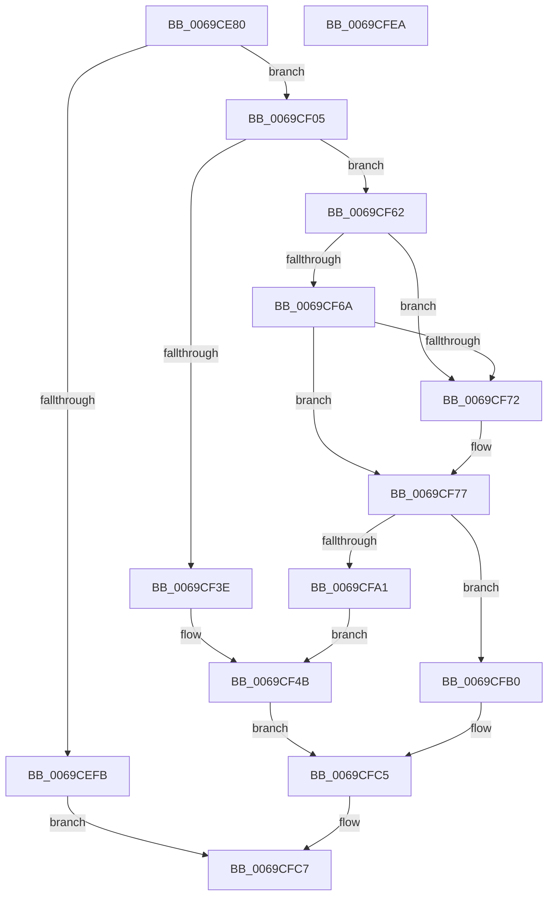

# SdbpGetPathCustomSdbPreRS3

- RVA: `0x0069CE80`–`0x0069CFEB` (길이 `363` bytes)
- VA: `0x000000014069CE80`
- 실행 섹션: `.text`
- PDB 이름 있음: `예`; PDB Function 태그: `아니요`
- unwind 정보 RVA: `0x000CD568`
- 디코드: `92`개 명령, `363/363` bytes 표시
- 미해석 바이트: `0` (있으면 어셈블리에 `.byte`로 보존)

> 이 문서는 커널 이미지의 기계어와 PDB 기호를 분석해 생성했습니다. 4번과 5번은 함수 원형과 자료형을 바이너리 사용 방식에서 추정한 C 해석이며 원본 소스 복구 결과는 아닙니다.

## 1. Dependencies

- 직접 호출 지점: **5**; 고유 호출 대상: **5**
- 직접 호출자로 확인된 함수: **0**
- RIP 상대 이미지 참조: **10**

### Outgoing calls
- `0x0069CF33` → [SdbpGetProcessHostGuestArchitectures](../../page/81/SdbpGetProcessHostGuestArchitectures_function_00818350.md) (function, `0x00818350`)
- `0x0069CF5B` → [AslLogCallPrintf](../../page/95/AslLogCallPrintf_function_0095E4EC.md) (function, `0x0095E4EC`)
- `0x0069CF96` → [AslPathCombine](../../page/81/AslPathCombine_function_0081B100.md) (function, `0x0081B100`)
- `0x0069CFBE` → [SdbpGetPathAppPatch](../../page/81/SdbpGetPathAppPatch_function_00817E30.md) (function, `0x00817E30`)
- `0x0069CFD1` → [_security_check_cookie](../6A/_security_check_cookie_function_006AC640.md) (function, `0x006AC640`)

### Direct callers
- 이 함수 시작 RVA로 연결되는 직접 call은 확인되지 않았습니다. 간접 호출은 완전히 역산할 수 없습니다.

### Static image references
- `0x0069CE9C` → RVA `0x00E0A740` (`.data`; read)
- `0x0069CEAD` → RVA `0x0003DA08` (`.rdata`; read)
- `0x0069CEB8` → RVA `0x0003DA10` (`.rdata`; read)
- `0x0069CED1` → RVA `0x0003DA14` (`.rdata`; read)
- `0x0069CEDD` → RVA `0x0003DA18` (`.rdata`; read)
- `0x0069CEE4` → RVA `0x0003DA28` (`.rdata`; read)
- `0x0069CF3E` → RVA `0x0003DD88` (`.rdata`; read)
- `0x0069CF4B` → RVA `0x0003DA38` (`.rdata`; read)
- `0x0069CF77` → RVA `0x00013F90` (`.rdata`; read)
- `0x0069CFA1` → RVA `0x0003DD10` (`.rdata`; read)

## 2. Other-region calls and transfers

- 다른 실행 섹션으로 향하는 call: **4**
  - `0x0069CF33` → [SdbpGetProcessHostGuestArchitectures](../../page/81/SdbpGetProcessHostGuestArchitectures_function_00818350.md) (`.text` → `PAGE`)
  - `0x0069CF5B` → [AslLogCallPrintf](../../page/95/AslLogCallPrintf_function_0095E4EC.md) (`.text` → `PAGE`)
  - `0x0069CF96` → [AslPathCombine](../../page/81/AslPathCombine_function_0081B100.md) (`.text` → `PAGE`)
  - `0x0069CFBE` → [SdbpGetPathAppPatch](../../page/81/SdbpGetPathAppPatch_function_00817E30.md) (`.text` → `PAGE`)
- 별도 외부 분기/꼬리 이동을 확인하지 못했습니다.

## 3. Assembly (complete function range)

```asm
0069CE80  40 55                           push rbp
0069CE82  53                              push rbx
0069CE83  56                              push rsi
0069CE84  57                              push rdi
0069CE85  41 54                           push r12
0069CE87  41 55                           push r13
0069CE89  41 56                           push r14
0069CE8B  41 57                           push r15
0069CE8D  48 8D AC 24 68 FE FF FF         lea rbp, [rsp - 0x198]
0069CE95  48 81 EC 98 02 00 00            sub rsp, 0x298
0069CE9C  48 8B 05 9D D8 76 00            mov rax, qword ptr [rip + 0x76d89d]
0069CEA3  48 33 C4                        xor rax, rsp
0069CEA6  48 89 85 80 01 00 00            mov qword ptr [rbp + 0x180], rax
0069CEAD  F2 0F 10 05 53 0B 9A FF         movsd xmm0, qword ptr [rip - 0x65f4ad]
0069CEB5  4D 8B F9                        mov r15, r9
0069CEB8  8B 05 52 0B 9A FF               mov eax, dword ptr [rip - 0x65f4ae]
0069CEBE  49 8B F8                        mov rdi, r8
0069CEC1  F2 0F 11 44 24 38               movsd qword ptr [rsp + 0x38], xmm0
0069CEC7  4C 8B E2                        mov r12, rdx
0069CECA  89 44 24 40                     mov dword ptr [rsp + 0x40], eax
0069CECE  4C 8B F1                        mov r14, rcx
0069CED1  0F B7 05 3C 0B 9A FF            movzx eax, word ptr [rip - 0x65f4c4]
0069CED8  66 89 44 24 44                  mov word ptr [rsp + 0x44], ax
0069CEDD  0F 10 05 34 0B 9A FF            movups xmm0, xmmword ptr [rip - 0x65f4cc]
0069CEE4  0F 10 0D 3D 0B 9A FF            movups xmm1, xmmword ptr [rip - 0x65f4c3]
0069CEEB  0F 11 44 24 48                  movups xmmword ptr [rsp + 0x48], xmm0
0069CEF0  0F 11 4C 24 58                  movups xmmword ptr [rsp + 0x58], xmm1
0069CEF5  48 83 FA 07                     cmp rdx, 7
0069CEF9  73 0A                           jae 0x14069cf05
0069CEFB  B8 23 00 00 C0                  mov eax, 0xc0000023
0069CF00  E9 C2 00 00 00                  jmp 0x14069cfc7
0069CF05  B8 FF FF 00 00                  mov eax, 0xffff
0069CF0A  48 8D 54 24 30                  lea rdx, [rsp + 0x30]
0069CF0F  45 33 ED                        xor r13d, r13d
0069CF12  66 89 44 24 34                  mov word ptr [rsp + 0x34], ax
0069CF17  66 44 89 29                     mov word ptr [rcx], r13w
0069CF1B  48 8D 74 24 38                  lea rsi, [rsp + 0x38]
0069CF20  48 8D 4C 24 34                  lea rcx, [rsp + 0x34]
0069CF25  66 44 89 6C 24 70               mov word ptr [rsp + 0x70], r13w
0069CF2B  4D 8B C7                        mov r8, r15
0069CF2E  66 89 44 24 30                  mov word ptr [rsp + 0x30], ax
0069CF33  E8 18 B4 17 00                  call 0x140818350
0069CF38  8B D8                           mov ebx, eax
0069CF3A  85 C0                           test eax, eax
0069CF3C  79 24                           jns 0x14069cf62
0069CF3E  4C 8D 0D 43 0E 9A FF            lea r9, [rip - 0x65f1bd]
0069CF45  41 B8 E3 04 00 00               mov r8d, 0x4e3
0069CF4B  48 8D 15 E6 0A 9A FF            lea rdx, [rip - 0x65f51a]
0069CF52  89 44 24 20                     mov dword ptr [rsp + 0x20], eax
0069CF56  B9 01 00 00 00                  mov ecx, 1
0069CF5B  E8 8C 15 2C 00                  call 0x14095e4ec
0069CF60  EB 63                           jmp 0x14069cfc5
0069CF62  66 83 7C 24 30 09               cmp word ptr [rsp + 0x30], 9
0069CF68  74 08                           je 0x14069cf72
0069CF6A  66 83 7C 24 30 0C               cmp word ptr [rsp + 0x30], 0xc
0069CF70  75 05                           jne 0x14069cf77
0069CF72  48 8D 74 24 48                  lea rsi, [rsp + 0x48]
0069CF77  48 8D 05 12 70 97 FF            lea rax, [rip - 0x688fee]
0069CF7E  48 85 FF                        test rdi, rdi
0069CF81  41 B9 04 01 00 00               mov r9d, 0x104
0069CF87  4C 8D 44 24 70                  lea r8, [rsp + 0x70]
0069CF8C  48 0F 44 F8                     cmove rdi, rax
0069CF90  48 8B CE                        mov rcx, rsi
0069CF93  48 8B D7                        mov rdx, rdi
0069CF96  E8 65 E1 17 00                  call 0x14081b100
0069CF9B  8B D8                           mov ebx, eax
0069CF9D  85 C0                           test eax, eax
0069CF9F  79 0F                           jns 0x14069cfb0
0069CFA1  4C 8D 0D 68 0D 9A FF            lea r9, [rip - 0x65f298]
0069CFA8  41 B8 F1 04 00 00               mov r8d, 0x4f1
0069CFAE  EB 9B                           jmp 0x14069cf4b
0069CFB0  4D 8B CF                        mov r9, r15
0069CFB3  4C 8D 44 24 70                  lea r8, [rsp + 0x70]
0069CFB8  49 8B D4                        mov rdx, r12
0069CFBB  49 8B CE                        mov rcx, r14
0069CFBE  E8 6D AE 17 00                  call 0x140817e30
0069CFC3  8B D8                           mov ebx, eax
0069CFC5  8B C3                           mov eax, ebx
0069CFC7  48 8B 8D 80 01 00 00            mov rcx, qword ptr [rbp + 0x180]
0069CFCE  48 33 CC                        xor rcx, rsp
0069CFD1  E8 6A F6 00 00                  call 0x1406ac640
0069CFD6  48 81 C4 98 02 00 00            add rsp, 0x298
0069CFDD  41 5F                           pop r15
0069CFDF  41 5E                           pop r14
0069CFE1  41 5D                           pop r13
0069CFE3  41 5C                           pop r12
0069CFE5  5F                              pop rdi
0069CFE6  5E                              pop rsi
0069CFE7  5B                              pop rbx
0069CFE8  5D                              pop rbp
0069CFE9  C3                              ret
0069CFEA  CC                              int3
```

## 4. C-style interpretation (structured pseudocode)

```c
__int64 __fastcall SdbpGetPathCustomSdbPreRS3(__int64 a1, __int64 a2, __int64 a3, __int64 a4)
{
    __int64 result;
    __int64 v_r13;
    __int64 v_rsi;
    __int64 v_rsp;
    unsigned __int64 v_stack_m1D8;
    unsigned __int16 v_stack_m268;
    unsigned __int64 v_stack_m280;
    unsigned __int64 v_stack_m290;
    unsigned __int16 v_stack_m294;
    unsigned int v_stack_m298;
    unsigned __int64 v_stack_m2A0;
    unsigned __int16 v_stack_m2A4;
    unsigned __int64 v_stack_m2A8;
    unsigned int v_stack_m2B8;
    unsigned __int64 v_stack_m58;

    v_rsp = (v_rsp) - (664);
    result = (*(unsigned __int64 *)(v_rip + 7788701)) ^ (v_rsp);
    v_stack_m58 = result;
    v_stack_m2A0 = v_xmm0;
    v_stack_m298 = (unsigned int)((unsigned int)(*(unsigned int *)(v_rip - 6681774)));
    v_stack_m294 = (unsigned __int16)(*(unsigned __int16 *)(v_rip - 6681796));
    v_stack_m290 = v_xmm0;
    v_stack_m280 = v_xmm1;
    if (a2 >= 7) goto loc_0069CF05;
    goto loc_0069CFC7;
loc_0069CF05:
    v_r13 = 0;
    v_stack_m2A4 = (unsigned __int16)((unsigned int)(0xFFFFULL));
    *(unsigned __int16 *)(a1) = 0;
    v_stack_m268 = 0;
    v_stack_m2A8 = (unsigned __int16)((unsigned int)(0xFFFFULL));
    result = SdbpGetProcessHostGuestArchitectures(v_stack_m2A4, v_stack_m2A8, a4, a4);
    if (!sign_flag) goto loc_0069CF62;
loc_0069CF4B:
    v_stack_m2B8 = (unsigned int)(result);
    result = AslLogCallPrintf(1, v_rip - 6681882, (unsigned int)(0x4E3ULL), v_rip - 6681021);
    goto loc_0069CFC5;
loc_0069CF62:
    if (v_stack_m2A8 == 9) goto loc_0069CF72;
    v_rsi = v_stack_m2A0;
    if (v_stack_m2A8 == 12) {
        v_rsi = v_stack_m290;
    }
    if (a3 == 0) { a3 = v_rip - 6852590; }
    result = AslPathCombine(v_rsi, a3, v_stack_m268, 260);
    if (!sign_flag) goto loc_0069CFB0;
    goto loc_0069CF4B;
loc_0069CFB0:
    result = SdbpGetPathAppPatch(a1, a2, v_stack_m268, a4);
loc_0069CFC5:
loc_0069CFC7:
    a1 = (v_stack_m58) ^ (v_rsp);
    result = _security_check_cookie(a1, a2, v_stack_m268, a4);
    v_rsp = (v_rsp) + (664);
    return result;
}
```

## 5. (Beta) C Style

```c
int64_t SdbpGetPathCustomSdbPreRS3(void *Arg1, int64_t Arg2, int64_t Arg3, int64_t Arg4)
{
    uint8_t *arg1 = (uint8_t *)Arg1;

    int64_t result;
    int64_t local_r13;
    int64_t local_rsi;
    int64_t local_rsp;
    uint64_t v_stack_m1D8;
    uint16_t v_stack_m268;
    uint64_t v_stack_m280;
    uint64_t v_stack_m290;
    uint16_t v_stack_m294;
    uint32_t v_stack_m298;
    uint64_t v_stack_m2A0;
    uint16_t v_stack_m2A4;
    uint64_t v_stack_m2A8;
    uint32_t v_stack_m2B8;
    uint64_t v_stack_m58;

    local_rsp = (local_rsp) - (664);
    result = (*(uint64_t *)(v_rip + 0x76D89D)) ^ (local_rsp);
    v_stack_m58 = result;
    v_stack_m2A0 = v_xmm0;
    v_stack_m298 = (uint32_t)((uint32_t)(*(uint32_t *)(v_rip - 0x65F4AE)));
    v_stack_m294 = (uint16_t)(*(uint16_t *)(v_rip - 0x65F4C4));
    v_stack_m290 = v_xmm0;
    v_stack_m280 = v_xmm1;
    if (Arg2 >= 7) goto loc_0069CF05;
    goto loc_0069CFC7;
loc_0069CF05:
    local_r13 = 0;
    v_stack_m2A4 = (uint16_t)((uint32_t)(0xFFFFULL));
    *(uint16_t *)(arg1) = 0;
    v_stack_m268 = 0;
    v_stack_m2A8 = (uint16_t)((uint32_t)(0xFFFFULL));
    result = SdbpGetProcessHostGuestArchitectures(v_stack_m2A4, v_stack_m2A8, Arg4, Arg4);
    if (!sign_flag) goto loc_0069CF62;
loc_0069CF4B:
    v_stack_m2B8 = (uint32_t)(result);
    result = AslLogCallPrintf(1, v_rip - 6681882, (uint32_t)(0x4E3ULL), v_rip - 6681021);
    goto loc_0069CFC5;
loc_0069CF62:
    if (v_stack_m2A8 == 9) goto loc_0069CF72;
    local_rsi = v_stack_m2A0;
    if (v_stack_m2A8 == 12) {
        local_rsi = v_stack_m290;
    }
    if (Arg3 == 0) { Arg3 = v_rip - 6852590; }
    result = AslPathCombine(local_rsi, Arg3, v_stack_m268, 260);
    if (!sign_flag) goto loc_0069CFB0;
    goto loc_0069CF4B;
loc_0069CFB0:
    result = SdbpGetPathAppPatch(Arg1, Arg2, v_stack_m268, Arg4);
loc_0069CFC5:
loc_0069CFC7:
    Arg1 = (v_stack_m58) ^ (local_rsp);
    result = _security_check_cookie(Arg1, Arg2, v_stack_m268, Arg4);
    local_rsp = (local_rsp) + (664);
    return result;
}
```

### 관측된 메모리 오프셋

구조체 형식이 확인되지 않은 접근은 인자 기준의 오프셋으로만 기록했습니다.

| 기준 인자 | 오프셋 표현 | 폭 (bit) | 접근 |
|---|---:|---:|---|
| `Arg1` | `+ 0x0` | `16` | `W` |

## 6. Execution-region graph

[열기: 2D/3D 그래프와 함수 탐색 컨트롤 패널](../../../control-panel.html?section=text&rva=0x0069CE80&view=graph)

- 2D 그래프는 위에서 아래로 흐르고, 3D 그래프는 빈 공간을 드래그해 회전합니다. Shift+드래그는 이동, 휠은 확대·축소, 함수 노드 선택은 대상 보고서 이동입니다.

### Static fallback


