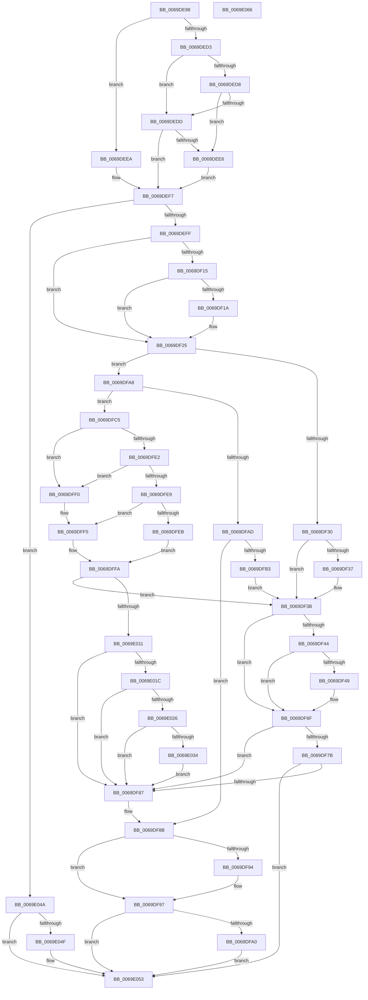

# StringCchPrintfExW

- RVA: `0x0069DE98`–`0x0069E067` (길이 `463` bytes)
- VA: `0x000000014069DE98`
- 실행 섹션: `.text`
- PDB 이름 있음: `예`; PDB Function 태그: `아니요`
- unwind 정보 RVA: `0x000DA1E8`
- 디코드: `140`개 명령, `463/463` bytes 표시
- 미해석 바이트: `0` (있으면 어셈블리에 `.byte`로 보존)

> 이 문서는 커널 이미지의 기계어와 PDB 기호를 분석해 생성했습니다. 4번과 5번은 함수 원형과 자료형을 바이너리 사용 방식에서 추정한 C 해석이며 원본 소스 복구 결과는 아닙니다.

## 1. Dependencies

- 직접 호출 지점: **3**; 고유 호출 대상: **3**
- 직접 호출자로 확인된 함수: **2**
- RIP 상대 이미지 참조: **1**

### Outgoing calls
- `0x0069DF62` → [RtlStringExHandleOtherFlagsW](../41/RtlStringExHandleOtherFlagsW_function_0041E3F0.md) (function, `0x0041E3F0`)
- `0x0069DFD7` → [vsnwprintf](../4F/vsnwprintf_function_004FEF30.md) (function, `0x004FEF30`)
- `0x0069E040` → [memset](../6C/memset_function_006C6C40.md) (function, `0x006C6C40`)

### Direct callers
- [AdtpBuildStagingReasonAuditStringInternal](AdtpBuildStagingReasonAuditStringInternal_function_0069DA44.md) at `0x0069DC75`
- [sub_006ECA3A](../6E/Unknown_function_006ECA3A.md) at `0x006ECBE4`

### Static image references
- `0x0069DF1A` → RVA `0x00013F90` (`.rdata`; read)

## 2. Other-region calls and transfers

- 다른 실행 섹션으로 향하는 call: **0**
- 별도 외부 분기/꼬리 이동을 확인하지 못했습니다.

## 3. Assembly (complete function range)

```asm
0069DE98  4C 89 4C 24 20                  mov qword ptr [rsp + 0x20], r9
0069DE9D  4C 89 44 24 18                  mov qword ptr [rsp + 0x18], r8
0069DEA2  55                              push rbp
0069DEA3  53                              push rbx
0069DEA4  56                              push rsi
0069DEA5  57                              push rdi
0069DEA6  41 54                           push r12
0069DEA8  41 55                           push r13
0069DEAA  41 56                           push r14
0069DEAC  41 57                           push r15
0069DEAE  48 8B EC                        mov rbp, rsp
0069DEB1  48 83 EC 48                     sub rsp, 0x48
0069DEB5  44 8B 65 68                     mov r12d, dword ptr [rbp + 0x68]
0069DEB9  4C 8B F1                        mov r14, rcx
0069DEBC  33 F6                           xor esi, esi
0069DEBE  41 8B CC                        mov ecx, r12d
0069DEC1  48 8B FA                        mov rdi, rdx
0069DEC4  8B DE                           mov ebx, esi
0069DEC6  BA 57 00 07 80                  mov edx, 0x80070057
0069DECB  81 E1 00 01 00 00               and ecx, 0x100
0069DED1  74 17                           je 0x14069deea
0069DED3  4D 85 F6                        test r14, r14
0069DED6  75 05                           jne 0x14069dedd
0069DED8  48 85 FF                        test rdi, rdi
0069DEDB  75 09                           jne 0x14069dee6
0069DEDD  48 81 FF FF FF FF 7F            cmp rdi, 0x7fffffff
0069DEE4  76 11                           jbe 0x14069def7
0069DEE6  8B DA                           mov ebx, edx
0069DEE8  EB 0D                           jmp 0x14069def7
0069DEEA  48 8D 47 FF                     lea rax, [rdi - 1]
0069DEEE  48 3D FE FF FF 7F               cmp rax, 0x7ffffffe
0069DEF4  0F 47 DA                        cmova ebx, edx
0069DEF7  85 DB                           test ebx, ebx
0069DEF9  0F 88 4B 01 00 00               js 0x14069e04a
0069DEFF  4C 8B 45 70                     mov r8, qword ptr [rbp + 0x70]
0069DF03  4D 8B EE                        mov r13, r14
0069DF06  4C 89 75 E8                     mov qword ptr [rbp - 0x18], r14
0069DF0A  4C 8B FF                        mov r15, rdi
0069DF0D  48 89 7D F0                     mov qword ptr [rbp - 0x10], rdi
0069DF11  85 C9                           test ecx, ecx
0069DF13  74 10                           je 0x14069df25
0069DF15  4D 85 C0                        test r8, r8
0069DF18  75 0B                           jne 0x14069df25
0069DF1A  4C 8D 05 6F 60 97 FF            lea r8, [rip - 0x689f91]
0069DF21  4C 89 45 70                     mov qword ptr [rbp + 0x70], r8
0069DF25  8B DE                           mov ebx, esi
0069DF27  41 F7 C4 00 E0 FF FF            test r12d, 0xffffe000
0069DF2E  74 78                           je 0x14069dfa8
0069DF30  8B DA                           mov ebx, edx
0069DF32  48 85 FF                        test rdi, rdi
0069DF35  74 04                           je 0x14069df3b
0069DF37  66 41 89 36                     mov word ptr [r14], si
0069DF3B  41 F7 C4 00 1C 00 00            test r12d, 0x1c00
0069DF42  74 2B                           je 0x14069df6f
0069DF44  48 85 FF                        test rdi, rdi
0069DF47  74 26                           je 0x14069df6f
0069DF49  48 8D 45 F0                     lea rax, [rbp - 0x10]
0069DF4D  44 89 64 24 28                  mov dword ptr [rsp + 0x28], r12d
0069DF52  48 8D 14 3F                     lea rdx, [rdi + rdi]
0069DF56  48 89 44 24 20                  mov qword ptr [rsp + 0x20], rax
0069DF5B  4C 8D 4D E8                     lea r9, [rbp - 0x18]
0069DF5F  49 8B CE                        mov rcx, r14
0069DF62  E8 89 04 D8 FF                  call 0x14041e3f0
0069DF67  4C 8B 6D E8                     mov r13, qword ptr [rbp - 0x18]
0069DF6B  4C 8B 7D F0                     mov r15, qword ptr [rbp - 0x10]
0069DF6F  B9 00 00 00 80                  mov ecx, 0x80000000
0069DF74  8D 04 0B                        lea eax, [rbx + rcx]
0069DF77  85 C1                           test ecx, eax
0069DF79  75 0C                           jne 0x14069df87
0069DF7B  81 FB 7A 00 07 80               cmp ebx, 0x8007007a
0069DF81  0F 85 CC 00 00 00               jne 0x14069e053
0069DF87  4C 8B 4D 60                     mov r9, qword ptr [rbp + 0x60]
0069DF8B  48 8B 45 58                     mov rax, qword ptr [rbp + 0x58]
0069DF8F  48 85 C0                        test rax, rax
0069DF92  74 03                           je 0x14069df97
0069DF94  4C 89 28                        mov qword ptr [rax], r13
0069DF97  4D 85 C9                        test r9, r9
0069DF9A  0F 84 B3 00 00 00               je 0x14069e053
0069DFA0  4D 89 39                        mov qword ptr [r9], r15
0069DFA3  E9 AB 00 00 00                  jmp 0x14069e053
0069DFA8  48 85 FF                        test rdi, rdi
0069DFAB  75 18                           jne 0x14069dfc5
0069DFAD  66 41 39 30                     cmp word ptr [r8], si
0069DFB1  74 D8                           je 0x14069df8b
0069DFB3  49 8B C6                        mov rax, r14
0069DFB6  48 F7 D8                        neg rax
0069DFB9  1B DB                           sbb ebx, ebx
0069DFBB  83 E3 23                        and ebx, 0x23
0069DFBE  03 DA                           add ebx, edx
0069DFC0  E9 76 FF FF FF                  jmp 0x14069df3b
0069DFC5  48 89 75 F0                     mov qword ptr [rbp - 0x10], rsi
0069DFC9  4C 8D 4D 78                     lea r9, [rbp + 0x78]
0069DFCD  48 8D 77 FF                     lea rsi, [rdi - 1]
0069DFD1  49 8B CE                        mov rcx, r14
0069DFD4  48 8B D6                        mov rdx, rsi
0069DFD7  E8 54 0F E6 FF                  call 0x1404fef30
0069DFDC  33 C9                           xor ecx, ecx
0069DFDE  85 C0                           test eax, eax
0069DFE0  78 0E                           js 0x14069dff0
0069DFE2  48 98                           cdqe
0069DFE4  48 3B C6                        cmp rax, rsi
0069DFE7  77 07                           ja 0x14069dff0
0069DFE9  74 0A                           je 0x14069dff5
0069DFEB  48 8B F0                        mov rsi, rax
0069DFEE  EB 0A                           jmp 0x14069dffa
0069DFF0  BB 7A 00 07 80                  mov ebx, 0x8007007a
0069DFF5  66 41 89 0C 76                  mov word ptr [r14 + rsi*2], cx
0069DFFA  4C 2B FE                        sub r15, rsi
0069DFFD  4D 8D 2C 76                     lea r13, [r14 + rsi*2]
0069E001  4C 89 6D E8                     mov qword ptr [rbp - 0x18], r13
0069E005  4C 89 7D F0                     mov qword ptr [rbp - 0x10], r15
0069E009  85 DB                           test ebx, ebx
0069E00B  0F 88 2A FF FF FF               js 0x14069df3b
0069E011  41 0F BA E4 09                  bt r12d, 9
0069E016  0F 83 6B FF FF FF               jae 0x14069df87
0069E01C  49 83 FF 01                     cmp r15, 1
0069E020  0F 86 61 FF FF FF               jbe 0x14069df87
0069E026  4F 8D 04 3F                     lea r8, [r15 + r15]
0069E02A  49 83 F8 02                     cmp r8, 2
0069E02E  0F 86 53 FF FF FF               jbe 0x14069df87
0069E034  49 83 C0 FE                     add r8, -2
0069E038  41 0F B6 D4                     movzx edx, r12b
0069E03C  49 8D 4D 02                     lea rcx, [r13 + 2]
0069E040  E8 FB 8B 02 00                  call 0x1406c6c40
0069E045  E9 3D FF FF FF                  jmp 0x14069df87
0069E04A  48 85 FF                        test rdi, rdi
0069E04D  74 04                           je 0x14069e053
0069E04F  66 41 89 36                     mov word ptr [r14], si
0069E053  8B C3                           mov eax, ebx
0069E055  48 83 C4 48                     add rsp, 0x48
0069E059  41 5F                           pop r15
0069E05B  41 5E                           pop r14
0069E05D  41 5D                           pop r13
0069E05F  41 5C                           pop r12
0069E061  5F                              pop rdi
0069E062  5E                              pop rsi
0069E063  5B                              pop rbx
0069E064  5D                              pop rbp
0069E065  C3                              ret
0069E066  CC                              int3
```

## 4. C-style interpretation (structured pseudocode)

```c
__int64 __fastcall StringCchPrintfExW(__int64 a1, __int64 a2, __int64 a3, __int64 a4, unsigned int a5, __int64 a6, __int64 a7)
{
    __int64 result;
    __int64 v_r13;
    __int64 v_r15;
    __int64 v_rbx;
    __int64 v_rsi;
    __int64 v_rsp;
    unsigned __int64 v_stack_m50;
    unsigned __int64 v_stack_m58;
    unsigned int v_stack_m60;
    unsigned __int64 v_stack_m68;
    unsigned __int64 v_stack_p18;
    unsigned __int64 v_stack_p20;
    unsigned __int64 v_stack_p30;

    v_stack_p20 = a4;
    v_stack_p18 = a3;
    v_rsp = (v_rsp) - (72);
    v_rsi = 0;
    a1 = (unsigned int)(((unsigned int)((unsigned int)((unsigned int)(a5)))) & (256));
    if (condition_is_equal) goto loc_0069DEEA;
    if (a1 != 0) goto loc_0069DEDD;
    if (a2 != 0) goto loc_0069DEE6;
loc_0069DEDD:
    if (a2 <= 0x7FFFFFFFULL) goto loc_0069DEF7;
loc_0069DEE6:
    goto loc_0069DEF7;
loc_0069DEEA:
    v_rbx = (unsigned int)((unsigned int)((unsigned int)(0x80070057ULL)));
    if ((a2 - 1) > 0x7FFFFFFEULL) { v_rbx = (unsigned int)((unsigned int)(0x80070057ULL)); }
loc_0069DEF7:
    if (sign_flag) goto loc_0069E04A;
    v_stack_m58 = a1;
    v_stack_m50 = a2;
    if ((unsigned int)(a1) == 0) goto loc_0069DF25;
    if (a6 == 0) {
        a3 = v_rip - 6856593;
        v_stack_p30 = a3;
    }
    if ((((unsigned int)((unsigned int)(a5))) & (0xFFFFE000ULL)) == 0) goto loc_0069DFA8;
    if (a2 != 0) {
        *(unsigned __int16 *)(a1) = 0;
    }
    if ((((unsigned int)((unsigned int)(a5))) & (0x1C00ULL)) == 0) goto loc_0069DF6F;
    result = a2 - 1;
    v_r13 = a1;
    v_r15 = a2;
    if (a2 != 0) {
        result = v_stack_m50;
        v_stack_m60 = (unsigned int)((unsigned int)(a5));
        a2 = a2 + a2 * 1;
        v_stack_m68 = result;
        a4 = v_stack_m58;
        a1 = a1;
        result = RtlStringExHandleOtherFlagsW(a1, a2, a3, a4);
        v_r13 = v_stack_m58;
        v_r15 = v_stack_m50;
    }
    if ((((unsigned int)((unsigned int)(0x80000000ULL))) & ((unsigned int)((unsigned int)((unsigned int)((unsigned int)(0x80070057ULL))) + (unsigned int)(0x80000000ULL) * 1))) != 0) goto loc_0069DF87;
    if (((unsigned int)((unsigned int)((unsigned int)((unsigned int)(0x80070057ULL))))) != 0x8007007AULL) goto loc_0069E053;
loc_0069DF87:
loc_0069DF8B:
    if (v_stack_p18 != 0) {
        *(unsigned __int64 *)(v_stack_p18) = v_r13;
    }
    if (v_stack_p20 == 0) goto loc_0069E053;
    *(unsigned __int64 *)(v_stack_p20) = v_r15;
    goto loc_0069E053;
loc_0069DFA8:
    if (a2 != 0) goto loc_0069DFC5;
    if ((*(unsigned __int16 *)(a3)) == 0) goto loc_0069DF8B;
    result = -(a1);
    v_rbx = (unsigned int)(((unsigned int)((unsigned int)((unsigned int)(0x80070057ULL)))) & (35));
    v_rbx = (unsigned int)((v_rbx) + ((unsigned int)(a2)));
    goto loc_0069DF3B;
loc_0069DFC5:
    v_stack_m50 = 0;
    result = vsnwprintf(a1, a2 - 1, a3, a7);
    a1 = 0;
    if (sign_flag) goto loc_0069DFF0;
    if (result > (a2 - 1)) goto loc_0069DFF0;
    if (result == (a2 - 1)) goto loc_0069DFF5;
    goto loc_0069DFFA;
loc_0069DFF0:
loc_0069DFF5:
    *(unsigned __int16 *)(a1 + result * 2) = 0;
loc_0069DFFA:
    v_r15 = (v_r15) - (result);
    v_stack_m58 = a1 + result * 2;
    v_stack_m50 = v_r15;
    if (sign_flag) goto loc_0069DF3B;
    if (condition_is_above_or_equal) goto loc_0069DF87;
    if (v_r15 <= 1) goto loc_0069DF87;
    if ((v_r15 + v_r15 * 1) <= 2) goto loc_0069DF87;
    a3 = (v_r15 + v_r15 * 1) + (-2);
    result = memset(a1 + result * 2 + 2, (unsigned __int8)((unsigned int)(a5)), a3, a7);
    goto loc_0069DF87;
loc_0069E04A:
    if (a2 != 0) {
        *(unsigned __int16 *)(a1) = (unsigned __int16)(result);
    }
    v_rsp = (v_rsp) + (72);
    return (unsigned int)((unsigned int)((unsigned int)(0x8007007AULL)));
}
```

## 5. (Beta) C Style

```c
int64_t StringCchPrintfExW(int64_t Arg1, void *Arg2, int64_t Arg3, int64_t Arg4, uint32_t Arg5, int64_t Arg6, int64_t Arg7)
{
    uint8_t *arg2 = (uint8_t *)Arg2;

    int64_t result;
    int64_t local_r13;
    int64_t local_r15;
    int64_t local_rbx;
    int64_t local_rsi;
    int64_t local_rsp;
    uint64_t v_stack_m50;
    uint64_t v_stack_m58;
    uint32_t v_stack_m60;
    uint64_t v_stack_m68;
    uint64_t v_stack_p18;
    uint64_t v_stack_p20;
    uint64_t v_stack_p30;

    v_stack_p20 = Arg4;
    v_stack_p18 = Arg3;
    local_rsp = (local_rsp) - (72);
    local_rsi = 0;
    Arg1 = (uint32_t)(((uint32_t)((uint32_t)((uint32_t)(Arg5)))) & (256));
    if (condition_is_equal) goto loc_0069DEEA;
    if (Arg1 != 0) goto loc_0069DEDD;
    if (Arg2 != NULL) goto loc_0069DEE6;
loc_0069DEDD:
    if (Arg2 <= 0x7FFFFFFFULL) goto loc_0069DEF7;
loc_0069DEE6:
    goto loc_0069DEF7;
loc_0069DEEA:
    local_rbx = (uint32_t)((uint32_t)((uint32_t)(0x80070057ULL)));
    if ((Arg2 - 1) > 0x7FFFFFFEULL) { local_rbx = (uint32_t)((uint32_t)(0x80070057ULL)); }
loc_0069DEF7:
    if (sign_flag) goto loc_0069E04A;
    v_stack_m58 = Arg1;
    v_stack_m50 = Arg2;
    if ((uint32_t)(Arg1) == 0) goto loc_0069DF25;
    if (Arg6 == 0) {
        Arg3 = v_rip - 6856593;
        v_stack_p30 = Arg3;
    }
    if ((((uint32_t)((uint32_t)(Arg5))) & (0xFFFFE000ULL)) == 0) goto loc_0069DFA8;
    if (Arg2 != NULL) {
        *(uint16_t *)(Arg1) = 0;
    }
    if ((((uint32_t)((uint32_t)(Arg5))) & (0x1C00ULL)) == 0) goto loc_0069DF6F;
    result = Arg2 - 1;
    local_r13 = Arg1;
    local_r15 = Arg2;
    if (Arg2 != NULL) {
        result = v_stack_m50;
        v_stack_m60 = (uint32_t)((uint32_t)(Arg5));
        Arg2 = Arg2 + Arg2 * 1;
        v_stack_m68 = result;
        Arg4 = v_stack_m58;
        Arg1 = Arg1;
        result = RtlStringExHandleOtherFlagsW(Arg1, Arg2, Arg3, Arg4);
        local_r13 = v_stack_m58;
        local_r15 = v_stack_m50;
    }
    if ((((uint32_t)((uint32_t)(0x80000000ULL))) & ((uint32_t)((uint32_t)((uint32_t)((uint32_t)(0x80070057ULL))) + (uint32_t)(0x80000000ULL) * 1))) != 0) goto loc_0069DF87;
    if (((uint32_t)((uint32_t)((uint32_t)((uint32_t)(0x80070057ULL))))) != 0x8007007AULL) goto loc_0069E053;
loc_0069DF87:
loc_0069DF8B:
    if (v_stack_p18 != 0) {
        *(uint64_t *)(v_stack_p18) = local_r13;
    }
    if (v_stack_p20 == 0) goto loc_0069E053;
    *(uint64_t *)(v_stack_p20) = local_r15;
    goto loc_0069E053;
loc_0069DFA8:
    if (Arg2 != NULL) goto loc_0069DFC5;
    if ((*(uint16_t *)(Arg3)) == 0) goto loc_0069DF8B;
    result = -(Arg1);
    local_rbx = (uint32_t)(((uint32_t)((uint32_t)((uint32_t)(0x80070057ULL)))) & (35));
    local_rbx = (uint32_t)((local_rbx) + ((uint32_t)(Arg2)));
    goto loc_0069DF3B;
loc_0069DFC5:
    v_stack_m50 = 0;
    result = vsnwprintf(Arg1, Arg2 - 1, Arg3, Arg7);
    Arg1 = 0;
    if (sign_flag) goto loc_0069DFF0;
    if (result > (Arg2 - 1)) goto loc_0069DFF0;
    if (result == (Arg2 - 1)) goto loc_0069DFF5;
    goto loc_0069DFFA;
loc_0069DFF0:
loc_0069DFF5:
    *(uint16_t *)(Arg1 + result * 2) = 0;
loc_0069DFFA:
    local_r15 = (local_r15) - (result);
    v_stack_m58 = Arg1 + result * 2;
    v_stack_m50 = local_r15;
    if (sign_flag) goto loc_0069DF3B;
    if (condition_is_above_or_equal) goto loc_0069DF87;
    if (local_r15 <= 1) goto loc_0069DF87;
    if ((local_r15 + local_r15 * 1) <= 2) goto loc_0069DF87;
    Arg3 = (local_r15 + local_r15 * 1) + (-2);
    result = memset(Arg1 + result * 2 + 2, (uint8_t)((uint32_t)(Arg5)), Arg3, Arg7);
    goto loc_0069DF87;
loc_0069E04A:
    if (Arg2 != NULL) {
        *(uint16_t *)(Arg1) = (uint16_t)(result);
    }
    local_rsp = (local_rsp) + (72);
    return (uint32_t)((uint32_t)((uint32_t)(0x8007007AULL)));
}
```

### 관측된 메모리 오프셋

구조체 형식이 확인되지 않은 접근은 인자 기준의 오프셋으로만 기록했습니다.

| 기준 인자 | 오프셋 표현 | 폭 (bit) | 접근 |
|---|---:|---:|---|
| `Arg2` | `- 0x1` | `64` | `R` |

## 6. Execution-region graph

[열기: 2D/3D 그래프와 함수 탐색 컨트롤 패널](../../../control-panel.html?section=text&rva=0x0069DE98&view=graph)

- 2D 그래프는 위에서 아래로 흐르고, 3D 그래프는 빈 공간을 드래그해 회전합니다. Shift+드래그는 이동, 휠은 확대·축소, 함수 노드 선택은 대상 보고서 이동입니다.

### Static fallback


