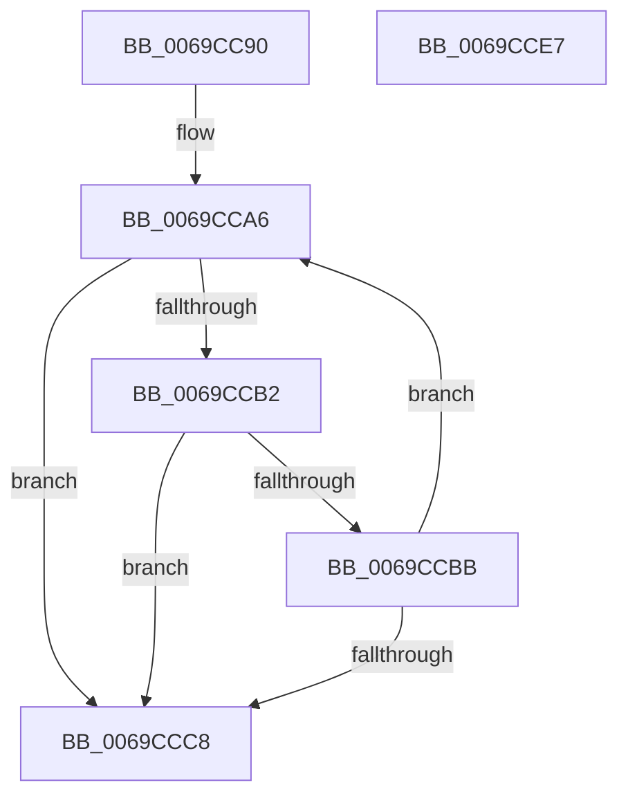

# StringCopyWorkerW

- RVA: `0x0069CC90`–`0x0069CCE8` (길이 `88` bytes)
- VA: `0x000000014069CC90`
- 실행 섹션: `.text`
- PDB 이름 있음: `예`; PDB Function 태그: `예`
- unwind 정보 RVA: `0x000DB714`
- 디코드: `26`개 명령, `88/88` bytes 표시
- 미해석 바이트: `0` (있으면 어셈블리에 `.byte`로 보존)

> 이 문서는 커널 이미지의 기계어와 PDB 기호를 분석해 생성했습니다. 4번과 5번은 함수 원형과 자료형을 바이너리 사용 방식에서 추정한 C 해석이며 원본 소스 복구 결과는 아닙니다.

## 1. Dependencies

- 직접 호출 지점: **0**; 고유 호출 대상: **0**
- 직접 호출자로 확인된 함수: **1**
- RIP 상대 이미지 참조: **1**

### Outgoing calls
- 직접 디코드된 call 명령이 없습니다.

### Direct callers
- [AdtpInitializeDriveLetters](../../page/82/AdtpInitializeDriveLetters_function_00823058.md) at `0x008230B2`

### Static image references
- `0x0069CC99` → RVA `0x00041AD0` (`.rdata`; read)

## 2. Other-region calls and transfers

- 다른 실행 섹션으로 향하는 call: **0**
- 별도 외부 분기/꼬리 이동을 확인하지 못했습니다.

## 3. Assembly (complete function range)

```asm
0069CC90  48 8B D1                        mov rdx, rcx
0069CC93  41 B8 1F 00 00 00               mov r8d, 0x1f
0069CC99  48 8D 0D 30 4E 9A FF            lea rcx, [rip - 0x65b1d0]
0069CCA0  48 2B CA                        sub rcx, rdx
0069CCA3  45 33 C9                        xor r9d, r9d
0069CCA6  49 8D 80 DF FF FF 7F            lea rax, [r8 + 0x7fffffdf]
0069CCAD  48 85 C0                        test rax, rax
0069CCB0  74 16                           je 0x14069ccc8
0069CCB2  0F B7 04 11                     movzx eax, word ptr [rcx + rdx]
0069CCB6  66 85 C0                        test ax, ax
0069CCB9  74 0D                           je 0x14069ccc8
0069CCBB  66 89 02                        mov word ptr [rdx], ax
0069CCBE  48 83 C2 02                     add rdx, 2
0069CCC2  49 83 E8 01                     sub r8, 1
0069CCC6  75 DE                           jne 0x14069cca6
0069CCC8  49 8B C0                        mov rax, r8
0069CCCB  48 8D 4A FE                     lea rcx, [rdx - 2]
0069CCCF  48 F7 D8                        neg rax
0069CCD2  1B C0                           sbb eax, eax
0069CCD4  F7 D0                           not eax
0069CCD6  25 7A 00 07 80                  and eax, 0x8007007a
0069CCDB  4D 85 C0                        test r8, r8
0069CCDE  48 0F 45 CA                     cmovne rcx, rdx
0069CCE2  66 44 89 09                     mov word ptr [rcx], r9w
0069CCE6  C3                              ret
0069CCE7  CC                              int3
```

## 4. C-style interpretation (structured pseudocode)

```c
__int64 __fastcall StringCopyWorkerW(__int64 a1, __int64 a2, __int64 a3, int a4)
{
    __int64 result;

    a1 = (v_rip - 6664656) - (a1);
    a4 = 0;
loc_0069CCA6:
    if (31 + 2147483615 == 0) goto loc_0069CCC8;
    if ((unsigned __int16)(*(unsigned __int16 *)(a1 + a1 * 1)) == 0) goto loc_0069CCC8;
    *(unsigned __int16 *)(a1) = (unsigned __int16)(*(unsigned __int16 *)(a1 + a1 * 1));
    a2 = (a1) + (2);
    a3 = (31) - (1);
    if (condition_is_not_equal) goto loc_0069CCA6;
loc_0069CCC8:
    result = -(a3);
    result = (unsigned int)(~(result));
    result = (unsigned int)((result) & (0x8007007AULL));
    a1 = a2 - 2;
    if (a3 != 0) { a1 = a2; }
    *(unsigned __int16 *)(a1) = 0;
    return result;
}
```

## 5. (Beta) C Style

```c
int64_t StringCopyWorkerW(void *Arg1, int64_t Arg2, int64_t Arg3, int32_t Arg4)
{
    uint8_t *arg1 = (uint8_t *)Arg1;

    int64_t result;

    Arg1 = (v_rip - 6664656) - (Arg1);
    Arg4 = 0;
loc_0069CCA6:
    if (31 + 2147483615 == 0) goto loc_0069CCC8;
    if ((uint16_t)(*(uint16_t *)(arg1 + arg1 * 1)) == 0) goto loc_0069CCC8;
    *(uint16_t *)(arg1) = (uint16_t)(*(uint16_t *)(arg1 + arg1 * 1));
    Arg2 = (Arg1) + (2);
    Arg3 = (31) - (1);
    if (condition_is_not_equal) goto loc_0069CCA6;
loc_0069CCC8:
    result = -(Arg3);
    result = (uint32_t)(~(result));
    result = (uint32_t)((result) & (0x8007007AULL));
    Arg1 = Arg2 - 2;
    if (Arg3 != 0) { Arg1 = Arg2; }
    *(uint16_t *)(arg1) = 0;
    return result;
}
```

### 관측된 메모리 오프셋

구조체 형식이 확인되지 않은 접근은 인자 기준의 오프셋으로만 기록했습니다.

| 기준 인자 | 오프셋 표현 | 폭 (bit) | 접근 |
|---|---:|---:|---|
| `Arg1` | `- 0x2` | `64` | `R` |
| `Arg1` | `+ 0x0` | `16` | `W` |

## 6. Execution-region graph

[열기: 2D/3D 그래프와 함수 탐색 컨트롤 패널](../../../control-panel.html?section=text&rva=0x0069CC90&view=graph)

- 2D 그래프는 위에서 아래로 흐르고, 3D 그래프는 빈 공간을 드래그해 회전합니다. Shift+드래그는 이동, 휠은 확대·축소, 함수 노드 선택은 대상 보고서 이동입니다.

### Static fallback


