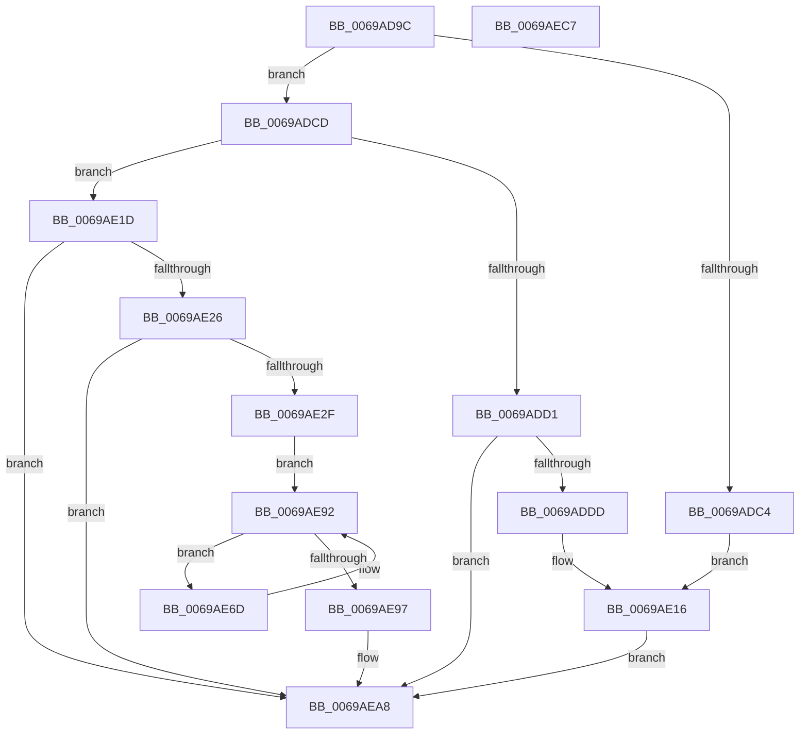

# UcInitialize

- RVA: `0x0069AD9C`–`0x0069AEC8` (길이 `300` bytes)
- VA: `0x000000014069AD9C`
- 실행 섹션: `.text`
- PDB 이름 있음: `예`; PDB Function 태그: `아니요`
- unwind 정보 RVA: `0x000CA810`
- 디코드: `68`개 명령, `300/300` bytes 표시
- 미해석 바이트: `0` (있으면 어셈블리에 `.byte`로 보존)

> 이 문서는 커널 이미지의 기계어와 PDB 기호를 분석해 생성했습니다. 4번과 5번은 함수 원형과 자료형을 바이너리 사용 방식에서 추정한 C 해석이며 원본 소스 복구 결과는 아닙니다.

## 1. Dependencies

- 직접 호출 지점: **5**; 고유 호출 대상: **5**
- 직접 호출자로 확인된 함수: **3**
- RIP 상대 이미지 참조: **16**

### Outgoing calls
- `0x0069AE3B` → [TraceLoggingRegisterEx_EtwRegister_EtwSetInformation](../../page/92/TraceLoggingRegisterEx_EtwRegister_EtwSetInformation_function_009208A0.md) (function, `0x009208A0`)
- `0x0069AE47` → [KeAcquireSpinLockRaiseToDpc](../20/KeAcquireSpinLockRaiseToDpc_function_00208470.md) (function, `0x00208470`)
- `0x0069AE8A` → [UcpLogUnexpectedCodePathEvent](UcpLogUnexpectedCodePathEvent_function_0069B388.md) (function, `0x0069B388`)
- `0x0069AEA3` → [KeReleaseSpinLock](../39/KeReleaseSpinLock_function_00392BA0.md) (function, `0x00392BA0`)
- `0x0069AEB2` → [_security_check_cookie](../6A/_security_check_cookie_function_006AC640.md) (function, `0x006AC640`)

### Direct callers
- [Phase1InitializationDiscard](../../init/C1/Phase1InitializationDiscard_function_00C1C728.md) at `0x00C1D2F6`
- [EtwpInitialize](../../init/C4/EtwpInitialize_function_00C4DBCC.md) at `0x00C4E166`
- [ExpInitSystemPhase1](../../init/C5/ExpInitSystemPhase1_function_00C51508.md) at `0x00C516C1`

### Static image references
- `0x0069ADAB` → RVA `0x00E0A740` (`.data`; read)
- `0x0069ADC4` → RVA `0x00EEFD10` (`.data`; write)
- `0x0069ADD1` → RVA `0x00EEFD13` (`.data`; read)
- `0x0069ADDD` → RVA `0x00EF0E48` (`.data`; read/write)
- `0x0069ADE5` → RVA `0x00EF0E30` (`.data`; read)
- `0x0069ADEC` → RVA `0x00EF0E50` (`.data`; read)
- `0x0069ADF3` → RVA `0x00EF0E38` (`.data`; write)
- `0x0069ADFA` → RVA `0x00EF0E30` (`.data`; write)
- `0x0069AE01` → RVA `0x00EF0E58` (`.data`; write)
- `0x0069AE08` → RVA `0x00EF0E50` (`.data`; write)
- `0x0069AE0F` → RVA `0x00EEFD13` (`.data`; write)
- `0x0069AE26` → RVA `0x00EEFD11` (`.data`; read)
- `0x0069AE32` → RVA `0x00E0A090` (`.data`; read)
- `0x0069AE40` → RVA `0x00EF0E48` (`.data`; read)
- `0x0069AE5D` → RVA `0x00EEFD12` (`.data`; write)
- `0x0069AE64` → RVA `0x00EEFD11` (`.data`; write)

## 2. Other-region calls and transfers

- 다른 실행 섹션으로 향하는 call: **1**
  - `0x0069AE3B` → [TraceLoggingRegisterEx_EtwRegister_EtwSetInformation](../../page/92/TraceLoggingRegisterEx_EtwRegister_EtwSetInformation_function_009208A0.md) (`.text` → `PAGE`)
- 별도 외부 분기/꼬리 이동을 확인하지 못했습니다.

## 3. Assembly (complete function range)

```asm
0069AD9C  48 89 5C 24 08                  mov qword ptr [rsp + 8], rbx
0069ADA1  48 89 74 24 10                  mov qword ptr [rsp + 0x10], rsi
0069ADA6  57                              push rdi
0069ADA7  48 83 EC 40                     sub rsp, 0x40
0069ADAB  48 8B 05 8E F9 76 00            mov rax, qword ptr [rip + 0x76f98e]
0069ADB2  48 33 C4                        xor rax, rsp
0069ADB5  48 89 44 24 30                  mov qword ptr [rsp + 0x30], rax
0069ADBA  BB 03 01 00 00                  mov ebx, 0x103
0069ADBF  83 F9 02                        cmp ecx, 2
0069ADC2  75 09                           jne 0x14069adcd
0069ADC4  C6 05 45 4F 85 00 01            mov byte ptr [rip + 0x854f45], 1
0069ADCB  EB 49                           jmp 0x14069ae16
0069ADCD  85 C9                           test ecx, ecx
0069ADCF  75 4C                           jne 0x14069ae1d
0069ADD1  38 0D 3C 4F 85 00               cmp byte ptr [rip + 0x854f3c], cl
0069ADD7  0F 85 CB 00 00 00               jne 0x14069aea8
0069ADDD  48 83 25 63 60 85 00 00         and qword ptr [rip + 0x856063], 0
0069ADE5  48 8D 1D 44 60 85 00            lea rbx, [rip + 0x856044]
0069ADEC  48 8D 05 5D 60 85 00            lea rax, [rip + 0x85605d]
0069ADF3  48 89 1D 3E 60 85 00            mov qword ptr [rip + 0x85603e], rbx
0069ADFA  48 89 1D 2F 60 85 00            mov qword ptr [rip + 0x85602f], rbx
0069AE01  48 89 05 50 60 85 00            mov qword ptr [rip + 0x856050], rax
0069AE08  48 89 05 41 60 85 00            mov qword ptr [rip + 0x856041], rax
0069AE0F  C6 05 FD 4E 85 00 01            mov byte ptr [rip + 0x854efd], 1
0069AE16  33 DB                           xor ebx, ebx
0069AE18  E9 8B 00 00 00                  jmp 0x14069aea8
0069AE1D  83 F9 01                        cmp ecx, 1
0069AE20  0F 85 82 00 00 00               jne 0x14069aea8
0069AE26  80 3D E4 4E 85 00 00            cmp byte ptr [rip + 0x854ee4], 0
0069AE2D  75 79                           jne 0x14069aea8
0069AE2F  45 33 C0                        xor r8d, r8d
0069AE32  48 8D 0D 57 F2 76 00            lea rcx, [rip + 0x76f257]
0069AE39  33 D2                           xor edx, edx
0069AE3B  E8 60 5A 28 00                  call 0x1409208a0
0069AE40  48 8D 0D 01 60 85 00            lea rcx, [rip + 0x856001]
0069AE47  E8 24 D6 B6 FF                  call 0x140208470
0069AE4C  48 8B 3D DD 5F 85 00            mov rdi, qword ptr [rip + 0x855fdd]
0069AE53  48 8D 1D D6 5F 85 00            lea rbx, [rip + 0x855fd6]
0069AE5A  40 8A F0                        mov sil, al
0069AE5D  C6 05 AE 4E 85 00 00            mov byte ptr [rip + 0x854eae], 0
0069AE64  C6 05 A6 4E 85 00 01            mov byte ptr [rip + 0x854ea6], 1
0069AE6B  EB 25                           jmp 0x14069ae92
0069AE6D  8B 47 18                        mov eax, dword ptr [rdi + 0x18]
0069AE70  48 8D 4C 24 20                  lea rcx, [rsp + 0x20]
0069AE75  8B 57 F0                        mov edx, dword ptr [rdi - 0x10]
0069AE78  89 44 24 20                     mov dword ptr [rsp + 0x20], eax
0069AE7C  8B 47 1C                        mov eax, dword ptr [rdi + 0x1c]
0069AE7F  89 44 24 24                     mov dword ptr [rsp + 0x24], eax
0069AE83  8B 47 20                        mov eax, dword ptr [rdi + 0x20]
0069AE86  89 44 24 28                     mov dword ptr [rsp + 0x28], eax
0069AE8A  E8 F9 04 00 00                  call 0x14069b388
0069AE8F  48 8B 3F                        mov rdi, qword ptr [rdi]
0069AE92  48 3B FB                        cmp rdi, rbx
0069AE95  75 D6                           jne 0x14069ae6d
0069AE97  33 DB                           xor ebx, ebx
0069AE99  48 8D 0D A8 5F 85 00            lea rcx, [rip + 0x855fa8]
0069AEA0  40 8A D6                        mov dl, sil
0069AEA3  E8 F8 7C CF FF                  call 0x140392ba0
0069AEA8  8B C3                           mov eax, ebx
0069AEAA  48 8B 4C 24 30                  mov rcx, qword ptr [rsp + 0x30]
0069AEAF  48 33 CC                        xor rcx, rsp
0069AEB2  E8 89 17 01 00                  call 0x1406ac640
0069AEB7  48 8B 5C 24 50                  mov rbx, qword ptr [rsp + 0x50]
0069AEBC  48 8B 74 24 58                  mov rsi, qword ptr [rsp + 0x58]
0069AEC1  48 83 C4 40                     add rsp, 0x40
0069AEC5  5F                              pop rdi
0069AEC6  C3                              ret
0069AEC7  CC                              int3
```

## 4. C-style interpretation (structured pseudocode)

```c
__int64 __fastcall UcInitialize(int a1, int a2, int a3)
{
    __int64 result;
    __int64 v_rbx;
    __int64 v_rsp;
    unsigned __int64 v_stack_m18;
    unsigned int v_stack_m20;
    unsigned int v_stack_m24;
    unsigned __int64 v_stack_m28;
    unsigned __int64 v_stack_p10;
    unsigned __int64 v_stack_p8;

    v_stack_p8 = v_rbx;
    v_stack_p10 = v_rsi;
    v_rsp = (v_rsp) - (64);
    result = (*(unsigned __int64 *)(v_rip + 7797134)) ^ (v_rsp);
    v_stack_m18 = result;
    if (a1 != 2) goto loc_0069ADCD;
    *(unsigned __int8 *)(v_rip + 8736581) = 1;
    goto loc_0069AE16;
loc_0069ADCD:
    if (a1 != 0) goto loc_0069AE1D;
    if ((*(unsigned __int8 *)(v_rip + 8736572)) != ((unsigned __int8)(a1))) goto loc_0069AEA8;
    *(unsigned __int64 *)(v_rip + 8740926) = v_rip + 8740932;
    *(unsigned __int64 *)(v_rip + 8740911) = v_rip + 8740932;
    *(unsigned __int64 *)(v_rip + 8740944) = v_rip + 8740957;
    *(unsigned __int64 *)(v_rip + 8740929) = v_rip + 8740957;
    *(unsigned __int8 *)(v_rip + 8736509) = 1;
loc_0069AE16:
    v_rbx = 0;
    goto loc_0069AEA8;
loc_0069AE1D:
    if (a1 != 1) goto loc_0069AEA8;
    if ((*(unsigned __int8 *)(v_rip + 8736484)) != 0) goto loc_0069AEA8;
    a3 = 0;
    a2 = 0;
    result = TraceLoggingRegisterEx_EtwRegister_EtwSetInformation(v_rip + 7795287, a2, a3, a4);
    result = KeAcquireSpinLockRaiseToDpc(v_rip + 8740865, a2, a3, a4);
    *(unsigned __int8 *)(v_rip + 8736430) = 0;
    *(unsigned __int8 *)(v_rip + 8736422) = 1;
    goto loc_0069AE92;
loc_0069AE6D:
    v_stack_m28 = (unsigned int)((unsigned int)(*(unsigned int *)(*(unsigned __int64 *)(v_rip + 8740829) + 24)));
    v_stack_m24 = (unsigned int)((unsigned int)(*(unsigned int *)(*(unsigned __int64 *)(v_rip + 8740829) + 28)));
    v_stack_m20 = (unsigned int)((unsigned int)(*(unsigned int *)(*(unsigned __int64 *)(v_rip + 8740829) + 32)));
    result = UcpLogUnexpectedCodePathEvent(v_stack_m28, (unsigned int)(*(unsigned int *)(*(unsigned __int64 *)(v_rip + 8740829) - 16)), a3, a4);
loc_0069AE92:
    if ((*(unsigned __int64 *)(*(unsigned __int64 *)(v_rip + 8740829))) != (v_rip + 8740822)) goto loc_0069AE6D;
    v_rbx = 0;
    result = KeReleaseSpinLock(v_rip + 8740776, (unsigned __int8)((unsigned __int8)(result)), a3, a4);
loc_0069AEA8:
    a1 = (v_stack_m18) ^ (v_rsp);
    result = _security_check_cookie(a1, (unsigned __int8)((unsigned __int8)(result)), a3, a4);
    v_rsp = (v_rsp) + (64);
    return result;
}
```

## 5. (Beta) C Style

```c
int64_t UcInitialize(int32_t Arg1, int32_t Arg2, int32_t Arg3)
{
    int64_t result;
    int64_t local_rbx;
    int64_t local_rsp;
    uint64_t v_stack_m18;
    uint32_t v_stack_m20;
    uint32_t v_stack_m24;
    uint64_t v_stack_m28;
    uint64_t v_stack_p10;
    uint64_t v_stack_p8;

    v_stack_p8 = local_rbx;
    v_stack_p10 = local_rsi;
    local_rsp = (local_rsp) - (64);
    result = (*(uint64_t *)(v_rip + 0x76F98E)) ^ (local_rsp);
    v_stack_m18 = result;
    if (Arg1 != 2) goto loc_0069ADCD;
    *(uint8_t *)(v_rip + 0x854F45) = 1;
    goto loc_0069AE16;
loc_0069ADCD:
    if (Arg1 != 0) goto loc_0069AE1D;
    if ((*(uint8_t *)(v_rip + 0x854F3C)) != ((uint8_t)(Arg1))) goto loc_0069AEA8;
    *(uint64_t *)(v_rip + 0x85603E) = v_rip + 8740932;
    *(uint64_t *)(v_rip + 0x85602F) = v_rip + 8740932;
    *(uint64_t *)(v_rip + 0x856050) = v_rip + 8740957;
    *(uint64_t *)(v_rip + 0x856041) = v_rip + 8740957;
    *(uint8_t *)(v_rip + 0x854EFD) = 1;
loc_0069AE16:
    local_rbx = 0;
    goto loc_0069AEA8;
loc_0069AE1D:
    if (Arg1 != 1) goto loc_0069AEA8;
    if ((*(uint8_t *)(v_rip + 0x854EE4)) != 0) goto loc_0069AEA8;
    Arg3 = 0;
    Arg2 = 0;
    result = TraceLoggingRegisterEx_EtwRegister_EtwSetInformation(v_rip + 7795287, Arg2, Arg3, a4);
    result = KeAcquireSpinLockRaiseToDpc(v_rip + 8740865, Arg2, Arg3, a4);
    *(uint8_t *)(v_rip + 0x854EAE) = 0;
    *(uint8_t *)(v_rip + 0x854EA6) = 1;
    goto loc_0069AE92;
loc_0069AE6D:
    v_stack_m28 = (uint32_t)((uint32_t)(*(uint32_t *)(*(uint64_t *)(v_rip + 0x855FDD) + 0x18)));
    v_stack_m24 = (uint32_t)((uint32_t)(*(uint32_t *)(*(uint64_t *)(v_rip + 0x855FDD) + 0x1C)));
    v_stack_m20 = (uint32_t)((uint32_t)(*(uint32_t *)(*(uint64_t *)(v_rip + 0x855FDD) + 0x20)));
    result = UcpLogUnexpectedCodePathEvent(v_stack_m28, (uint32_t)(*(uint32_t *)(*(uint64_t *)(v_rip + 0x855FDD) - 0x10)), Arg3, a4);
loc_0069AE92:
    if ((*(uint64_t *)(*(uint64_t *)(v_rip + 0x855FDD))) != (v_rip + 8740822)) goto loc_0069AE6D;
    local_rbx = 0;
    result = KeReleaseSpinLock(v_rip + 8740776, (uint8_t)((uint8_t)(result)), Arg3, a4);
loc_0069AEA8:
    Arg1 = (v_stack_m18) ^ (local_rsp);
    result = _security_check_cookie(Arg1, (uint8_t)((uint8_t)(result)), Arg3, a4);
    local_rsp = (local_rsp) + (64);
    return result;
}
```

## 6. Execution-region graph

[열기: 2D/3D 그래프와 함수 탐색 컨트롤 패널](../../../control-panel.html?section=text&rva=0x0069AD9C&view=graph)

- 2D 그래프는 위에서 아래로 흐르고, 3D 그래프는 빈 공간을 드래그해 회전합니다. Shift+드래그는 이동, 휠은 확대·축소, 함수 노드 선택은 대상 보고서 이동입니다.

### Static fallback


