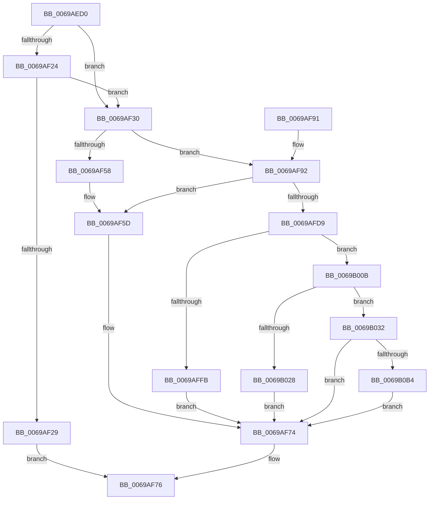

# UcOnUnexpectedCodePath

- RVA: `0x0069AED0`–`0x0069B0C8` (길이 `504` bytes)
- VA: `0x000000014069AED0`
- 실행 섹션: `.text`
- PDB 이름 있음: `예`; PDB Function 태그: `아니요`
- unwind 정보 RVA: `0x000D9778`
- 디코드: `121`개 명령, `504/504` bytes 표시
- 미해석 바이트: `0` (있으면 어셈블리에 `.byte`로 보존)

> 이 문서는 커널 이미지의 기계어와 PDB 기호를 분석해 생성했습니다. 4번과 5번은 함수 원형과 자료형을 바이너리 사용 방식에서 추정한 C 해석이며 원본 소스 복구 결과는 아닙니다.

## 1. Dependencies

- 직접 호출 지점: **9**; 고유 호출 대상: **8**
- 직접 호출자로 확인된 함수: **1**
- RIP 상대 이미지 참조: **8**

### Outgoing calls
- `0x0069AF37` → [KeAcquireSpinLockRaiseToDpc](../20/KeAcquireSpinLockRaiseToDpc_function_00208470.md) (function, `0x00208470`)
- `0x0069AF4B` → [UcpFindOrCreateTelemetryRecord](UcpFindOrCreateTelemetryRecord_function_0069B164.md) (function, `0x0069B164`)
- `0x0069AF6F` → [KeReleaseSpinLock](../39/KeReleaseSpinLock_function_00392BA0.md) (function, `0x00392BA0`)
- `0x0069AFEE` → [KeReleaseSpinLock](../39/KeReleaseSpinLock_function_00392BA0.md) (function, `0x00392BA0`)
- `0x0069B001` → [UcpLogEventGenerateDump](UcpLogEventGenerateDump_function_0069B2C0.md) (function, `0x0069B2C0`)
- `0x0069B01B` → [ExAllocatePool2](../../poolcode/B8/ExAllocatePool2_function_00B820F0.md) (function, `0x00B820F0`)
- `0x0069B082` → [RtlCaptureStackBackTrace](../2F/RtlCaptureStackBackTrace_function_002F9FF0.md) (function, `0x002F9FF0`)
- `0x0069B0A7` → [KeInsertQueueApc](../20/KeInsertQueueApc_function_00203F10.md) (function, `0x00203F10`)
- `0x0069B0B9` → [ExFreePoolWithTag](../../poolcode/B8/ExFreePoolWithTag_function_00B82870.md) (function, `0x00B82870`)

### Direct callers
- [RtlLogUnexpectedCodepath](../5E/RtlLogUnexpectedCodepath_function_005EDEB0.md) at `0x005EDEB4`

### Static image references
- `0x0069AF18` → RVA `0x00EEFD20` (`.data`; read)
- `0x0069AF30` → RVA `0x00EF0E48` (`.data`; read)
- `0x0069AF41` → RVA `0x00EEFD20` (`.data`; write)
- `0x0069AF5D` → RVA `0x00EEFD20` (`.data`; read/write)
- `0x0069AFA5` → RVA `0x00FC6AA0` (`ALMOSTRO`; read)
- `0x0069B046` → RVA `0x00A64D60` (`AlpcConnectionCleanupProcedure`; read)
- `0x0069B056` → RVA `0x009071C0` (`AlpcpFreeBuffer`; read)
- `0x0069B061` → RVA `0x00811B40` (`UcpApcNormalRoutine`; read)

## 2. Other-region calls and transfers

- 다른 실행 섹션으로 향하는 call: **2**
  - `0x0069B01B` → [ExAllocatePool2](../../poolcode/B8/ExAllocatePool2_function_00B820F0.md) (`.text` → `POOLCODE`)
  - `0x0069B0B9` → [ExFreePoolWithTag](../../poolcode/B8/ExFreePoolWithTag_function_00B82870.md) (`.text` → `POOLCODE`)
- 별도 외부 분기/꼬리 이동을 확인하지 못했습니다.

## 3. Assembly (complete function range)

```asm
0069AED0  48 8B C4                        mov rax, rsp
0069AED3  48 89 58 08                     mov qword ptr [rax + 8], rbx
0069AED7  48 89 68 10                     mov qword ptr [rax + 0x10], rbp
0069AEDB  48 89 70 18                     mov qword ptr [rax + 0x18], rsi
0069AEDF  48 89 78 20                     mov qword ptr [rax + 0x20], rdi
0069AEE3  41 56                           push r14
0069AEE5  48 83 EC 40                     sub rsp, 0x40
0069AEE9  33 DB                           xor ebx, ebx
0069AEEB  4C 8B F1                        mov r14, rcx
0069AEEE  21 58 EC                        and dword ptr [rax - 0x14], ebx
0069AEF1  48 8B 44 24 48                  mov rax, qword ptr [rsp + 0x48]
0069AEF6  65 48 8B 3C 25 88 01 00 00      mov rdi, qword ptr gs:[0x188]
0069AEFF  48 89 44 24 20                  mov qword ptr [rsp + 0x20], rax
0069AF04  8B 01                           mov eax, dword ptr [rcx]
0069AF06  89 44 24 28                     mov dword ptr [rsp + 0x28], eax
0069AF0A  8B 41 04                        mov eax, dword ptr [rcx + 4]
0069AF0D  89 44 24 2C                     mov dword ptr [rsp + 0x2c], eax
0069AF11  8B 41 08                        mov eax, dword ptr [rcx + 8]
0069AF14  89 44 24 30                     mov dword ptr [rsp + 0x30], eax
0069AF18  48 8B 05 01 4E 85 00            mov rax, qword ptr [rip + 0x854e01]
0069AF1F  48 85 C0                        test rax, rax
0069AF22  74 0C                           je 0x14069af30
0069AF24  48 3B F8                        cmp rdi, rax
0069AF27  75 07                           jne 0x14069af30
0069AF29  B8 0D 00 00 C0                  mov eax, 0xc000000d
0069AF2E  EB 46                           jmp 0x14069af76
0069AF30  48 8D 0D 11 5F 85 00            lea rcx, [rip + 0x855f11]
0069AF37  E8 34 D5 B6 FF                  call 0x140208470
0069AF3C  48 8D 4C 24 20                  lea rcx, [rsp + 0x20]
0069AF41  48 89 3D D8 4D 85 00            mov qword ptr [rip + 0x854dd8], rdi
0069AF48  40 8A E8                        mov bpl, al
0069AF4B  E8 14 02 00 00                  call 0x14069b164
0069AF50  48 8B F0                        mov rsi, rax
0069AF53  48 85 C0                        test rax, rax
0069AF56  75 3A                           jne 0x14069af92
0069AF58  BB 17 00 00 C0                  mov ebx, 0xc0000017
0069AF5D  48 83 25 BB 4D 85 00 00         and qword ptr [rip + 0x854dbb], 0
0069AF65  48 8D 0D DC 5E 85 00            lea rcx, [rip + 0x855edc]
0069AF6C  40 8A D5                        mov dl, bpl
0069AF6F  E8 2C 7C CF FF                  call 0x140392ba0
0069AF74  8B C3                           mov eax, ebx
0069AF76  48 8B 5C 24 50                  mov rbx, qword ptr [rsp + 0x50]
0069AF7B  48 8B 6C 24 58                  mov rbp, qword ptr [rsp + 0x58]
0069AF80  48 8B 74 24 60                  mov rsi, qword ptr [rsp + 0x60]
0069AF85  48 8B 7C 24 68                  mov rdi, qword ptr [rsp + 0x68]
0069AF8A  48 83 C4 40                     add rsp, 0x40
0069AF8E  41 5E                           pop r14
0069AF90  C3                              ret
0069AF91  CC                              int3
0069AF92  FF 40 10                        inc dword ptr [rax + 0x10]
0069AF95  FF 40 14                        inc dword ptr [rax + 0x14]
0069AF98  48 B8 20 03 00 00 80 F7 FF FF   movabs rax, 0xfffff78000000320
0069AFA2  48 8B 00                        mov rax, qword ptr [rax]
0069AFA5  8B 0D F5 BA 92 00               mov ecx, dword ptr [rip + 0x92baf5]
0069AFAB  48 0F AF C8                     imul rcx, rax
0069AFAF  48 B8 4B 59 86 38 D6 C5 6D 34   movabs rax, 0x346dc5d63886594b
0069AFB9  48 F7 E9                        imul rcx
0069AFBC  48 C1 FA 0B                     sar rdx, 0xb
0069AFC0  48 8B C2                        mov rax, rdx
0069AFC3  48 C1 E8 3F                     shr rax, 0x3f
0069AFC7  48 03 D0                        add rdx, rax
0069AFCA  48 8B C2                        mov rax, rdx
0069AFCD  48 2B 46 08                     sub rax, qword ptr [rsi + 8]
0069AFD1  48 3D 60 EA 00 00               cmp rax, 0xea60
0069AFD7  76 84                           jbe 0x14069af5d
0069AFD9  48 21 1D 40 4D 85 00            and qword ptr [rip + 0x854d40], rbx
0069AFE0  48 8D 0D 61 5E 85 00            lea rcx, [rip + 0x855e61]
0069AFE7  48 89 56 08                     mov qword ptr [rsi + 8], rdx
0069AFEB  40 8A D5                        mov dl, bpl
0069AFEE  E8 AD 7B CF FF                  call 0x140392ba0
0069AFF3  44 0F 20 C0                     mov rax, cr8
0069AFF7  84 C0                           test al, al
0069AFF9  75 10                           jne 0x14069b00b
0069AFFB  48 8B D6                        mov rdx, rsi
0069AFFE  49 8B CE                        mov rcx, r14
0069B001  E8 BA 02 00 00                  call 0x14069b2c0
0069B006  E9 69 FF FF FF                  jmp 0x14069af74
0069B00B  BA F0 00 00 00                  mov edx, 0xf0
0069B010  B9 40 00 00 00                  mov ecx, 0x40
0069B015  41 B8 55 63 61 70               mov r8d, 0x70616355
0069B01B  E8 D0 70 4E 00                  call 0x140b820f0
0069B020  48 8B F8                        mov rdi, rax
0069B023  48 85 C0                        test rax, rax
0069B026  75 0A                           jne 0x14069b032
0069B028  BB 17 00 00 C0                  mov ebx, 0xc0000017
0069B02D  E9 42 FF FF FF                  jmp 0x14069af74
0069B032  65 48 8B 04 25 88 01 00 00      mov rax, qword ptr gs:[0x188]
0069B03B  4C 8D 47 70                     lea r8, [rdi + 0x70]
0069B03F  48 89 47 08                     mov qword ptr [rdi + 8], rax
0069B043  45 33 C9                        xor r9d, r9d
0069B046  48 8D 05 13 9D 3C 00            lea rax, [rip + 0x3c9d13]
0069B04D  66 C7 07 12 00                  mov word ptr [rdi], 0x12
0069B052  48 89 47 20                     mov qword ptr [rdi + 0x20], rax
0069B056  48 8D 05 63 C1 26 00            lea rax, [rip + 0x26c163]
0069B05D  48 89 47 28                     mov qword ptr [rdi + 0x28], rax
0069B061  48 8D 05 D8 6A 17 00            lea rax, [rip + 0x176ad8]
0069B068  41 8D 51 10                     lea edx, [r9 + 0x10]
0069B06C  48 89 47 30                     mov qword ptr [rdi + 0x30], rax
0069B070  C6 47 02 58                     mov byte ptr [rdi + 2], 0x58
0069B074  8D 4A F1                        lea ecx, [rdx - 0xf]
0069B077  66 89 5F 50                     mov word ptr [rdi + 0x50], bx
0069B07B  48 89 7F 38                     mov qword ptr [rdi + 0x38], rdi
0069B07F  88 5F 52                        mov byte ptr [rdi + 0x52], bl
0069B082  E8 69 EF C5 FF                  call 0x1402f9ff0
0069B087  F2 41 0F 10 06                  movsd xmm0, qword ptr [r14]
0069B08C  45 33 C9                        xor r9d, r9d
0069B08F  F2 0F 11 47 58                  movsd qword ptr [rdi + 0x58], xmm0
0069B094  45 33 C0                        xor r8d, r8d
0069B097  41 8B 46 08                     mov eax, dword ptr [r14 + 8]
0069B09B  33 D2                           xor edx, edx
0069B09D  48 8B CF                        mov rcx, rdi
0069B0A0  89 47 60                        mov dword ptr [rdi + 0x60], eax
0069B0A3  48 89 77 68                     mov qword ptr [rdi + 0x68], rsi
0069B0A7  E8 64 8E B6 FF                  call 0x140203f10
0069B0AC  84 C0                           test al, al
0069B0AE  0F 85 C0 FE FF FF               jne 0x14069af74
0069B0B4  33 D2                           xor edx, edx
0069B0B6  48 8B CF                        mov rcx, rdi
0069B0B9  E8 B2 77 4E 00                  call 0x140b82870
0069B0BE  BB 01 00 00 C0                  mov ebx, 0xc0000001
0069B0C3  E9 AC FE FF FF                  jmp 0x14069af74
```

## 4. C-style interpretation (structured pseudocode)

```c
__int64 __fastcall UcOnUnexpectedCodePath(__int64 a1, __int64 a2, __int64 a3, int a4)
{
    __int64 result;
    __int64 v_rbx;
    __int64 v_rsp;
    unsigned int v_stack_m18;
    unsigned int v_stack_m1C;
    unsigned int v_stack_m20;
    unsigned __int64 v_stack_m28;
    unsigned __int64 v_stack_p0;
    unsigned __int64 v_stack_p10;
    unsigned __int64 v_stack_p18;
    unsigned __int64 v_stack_p20;
    unsigned __int64 v_stack_p8;

    *(unsigned __int64 *)(v_rsp + 8) = v_rbx;
    *(unsigned __int64 *)(v_rsp + 16) = v_rbp;
    *(unsigned __int64 *)(v_rsp + 24) = v_rsi;
    *(unsigned __int64 *)(v_rsp + 32) = v_rdi;
    v_rsp = (v_rsp) - (64);
    v_rbx = 0;
    v_stack_m28 = v_stack_p0;
    v_stack_m20 = (unsigned int)((unsigned int)(*(unsigned int *)(a1)));
    v_stack_m1C = (unsigned int)((unsigned int)(*(unsigned int *)(a1 + 4)));
    v_stack_m18 = (unsigned int)((unsigned int)(*(unsigned int *)(a1 + 8)));
    if (*(unsigned __int64 *)(v_rip + 8736257) == 0) goto loc_0069AF30;
    if ((*(unsigned __int64 *)(gs_base + (0 + 392))) != (*(unsigned __int64 *)(v_rip + 8736257))) goto loc_0069AF30;
    goto loc_0069AF76;
loc_0069AF30:
    result = KeAcquireSpinLockRaiseToDpc(v_rip + 8740625, a2, a3, a4);
    *(unsigned __int64 *)(v_rip + 8736216) = *(unsigned __int64 *)(gs_base + (0 + 392));
    result = UcpFindOrCreateTelemetryRecord(v_stack_m28, a2, a3, a4);
    if (result != 0) goto loc_0069AF92;
loc_0069AF5D:
    result = KeReleaseSpinLock(v_rip + 8740572, (unsigned __int8)((unsigned __int8)(result)), a3, a4);
loc_0069AF74:
loc_0069AF76:
    v_rsp = (v_rsp) + (64);
    return (unsigned int)((unsigned int)((unsigned int)(0xC0000017ULL)));
loc_0069AF92:
    a1 = ((unsigned int)(*(unsigned int *)(v_rip + 9616117))) * (*(unsigned __int64 *)((unsigned int)((unsigned int)((unsigned int)(0xC0000017ULL)))));
    a2 = ((unsigned __int8)((unsigned __int8)(result))) >> (11);
    result = (a2) >> (63);
    a2 = (a2) + (result);
    result = (a2) - (*(unsigned __int64 *)(v_stack_p18 + 8));
    if (result <= 0xEA60ULL) goto loc_0069AF5D;
    *(unsigned __int64 *)(v_stack_p18 + 8) = a2;
    result = KeReleaseSpinLock(v_rip + 8740449, (unsigned __int8)(v_stack_p10), a3, a4);
    if ((unsigned __int8)(v_cr8) != 0) goto loc_0069B00B;
    result = UcpLogEventGenerateDump(a1, v_stack_p18, a3, a4);
    goto loc_0069AF74;
loc_0069B00B:
    result = ExAllocatePool2(64, 240, (unsigned int)(0x70616355ULL), a4);
    if (result != 0) goto loc_0069B032;
    goto loc_0069AF74;
loc_0069B032:
    *(unsigned __int64 *)(result + 8) = *(unsigned __int64 *)(gs_base + (0 + 392));
    a4 = 0;
    *(unsigned __int16 *)(result) = 18;
    *(unsigned __int64 *)(result + 32) = v_rip + 3972371;
    *(unsigned __int64 *)(result + 40) = v_rip + 2539875;
    *(unsigned __int64 *)(result + 48) = v_rip + 1534680;
    *(unsigned __int8 *)(result + 2) = 88;
    *(unsigned __int16 *)(result + 80) = (unsigned __int16)((unsigned int)(0xC0000017ULL));
    *(unsigned __int64 *)(result + 56) = result;
    *(unsigned __int8 *)(result + 82) = (unsigned __int8)((unsigned int)(0xC0000017ULL));
    result = RtlCaptureStackBackTrace(a4 + 16 - 15, a4 + 16, result + 112, a4);
    a4 = 0;
    *(unsigned __int64 *)(result + 88) = v_xmm0;
    a3 = 0;
    a2 = 0;
    *(unsigned int *)(result + 96) = (unsigned int)((unsigned int)(*(unsigned int *)(a1 + 8)));
    *(unsigned __int64 *)(result + 104) = v_stack_p18;
    result = KeInsertQueueApc(result, a2, a3, a4);
    if ((unsigned __int8)(result) != 0) goto loc_0069AF74;
    a2 = 0;
    result = ExFreePoolWithTag(result, a2, a3, a4);
    goto loc_0069AF74;
}
```

## 5. (Beta) C Style

```c
int64_t UcOnUnexpectedCodePath(void *Arg1, int64_t Arg2, int64_t Arg3, int32_t Arg4)
{
    uint8_t *arg1 = (uint8_t *)Arg1;

    int64_t result;
    int64_t local_rbx;
    int64_t local_rsp;
    uint32_t v_stack_m18;
    uint32_t v_stack_m1C;
    uint32_t v_stack_m20;
    uint64_t v_stack_m28;
    uint64_t v_stack_p0;
    uint64_t v_stack_p10;
    uint64_t v_stack_p18;
    uint64_t v_stack_p20;
    uint64_t v_stack_p8;

    *(uint64_t *)(local_rsp + 0x8) = local_rbx;
    *(uint64_t *)(local_rsp + 0x10) = local_rbp;
    *(uint64_t *)(local_rsp + 0x18) = local_rsi;
    *(uint64_t *)(local_rsp + 0x20) = local_rdi;
    local_rsp = (local_rsp) - (64);
    local_rbx = 0;
    v_stack_m28 = v_stack_p0;
    v_stack_m20 = (uint32_t)((uint32_t)(*(uint32_t *)(arg1)));
    v_stack_m1C = (uint32_t)((uint32_t)(*(uint32_t *)(arg1 + 0x4)));
    v_stack_m18 = (uint32_t)((uint32_t)(*(uint32_t *)(arg1 + 0x8)));
    if (*(uint64_t *)(v_rip + 0x854E01) == 0) goto loc_0069AF30;
    if ((*(uint64_t *)(gs_base + (0 + 0x188))) != (*(uint64_t *)(v_rip + 0x854E01))) goto loc_0069AF30;
    goto loc_0069AF76;
loc_0069AF30:
    result = KeAcquireSpinLockRaiseToDpc(v_rip + 8740625, Arg2, Arg3, Arg4);
    *(uint64_t *)(v_rip + 0x854DD8) = *(uint64_t *)(gs_base + (0 + 0x188));
    result = UcpFindOrCreateTelemetryRecord(v_stack_m28, Arg2, Arg3, Arg4);
    if (result != 0) goto loc_0069AF92;
loc_0069AF5D:
    result = KeReleaseSpinLock(v_rip + 8740572, (uint8_t)((uint8_t)(result)), Arg3, Arg4);
loc_0069AF74:
loc_0069AF76:
    local_rsp = (local_rsp) + (64);
    return (uint32_t)((uint32_t)((uint32_t)(0xC0000017ULL)));
loc_0069AF92:
    Arg1 = ((uint32_t)(*(uint32_t *)(v_rip + 0x92BAF5))) * (*(uint64_t *)((uint32_t)((uint32_t)((uint32_t)(0xC0000017ULL)))));
    Arg2 = ((uint8_t)((uint8_t)(result))) >> (11);
    result = (Arg2) >> (63);
    Arg2 = (Arg2) + (result);
    result = (Arg2) - (*(uint64_t *)(v_stack_p18 + 0x8));
    if (result <= 0xEA60ULL) goto loc_0069AF5D;
    *(uint64_t *)(v_stack_p18 + 0x8) = Arg2;
    result = KeReleaseSpinLock(v_rip + 8740449, (uint8_t)(v_stack_p10), Arg3, Arg4);
    if ((uint8_t)(v_cr8) != 0) goto loc_0069B00B;
    result = UcpLogEventGenerateDump(Arg1, v_stack_p18, Arg3, Arg4);
    goto loc_0069AF74;
loc_0069B00B:
    result = ExAllocatePool2(64, 240, (uint32_t)(0x70616355ULL), Arg4);
    if (result != 0) goto loc_0069B032;
    goto loc_0069AF74;
loc_0069B032:
    *(uint64_t *)(result + 0x8) = *(uint64_t *)(gs_base + (0 + 0x188));
    Arg4 = 0;
    *(uint16_t *)(result) = 18;
    *(uint64_t *)(result + 0x20) = v_rip + 3972371;
    *(uint64_t *)(result + 0x28) = v_rip + 2539875;
    *(uint64_t *)(result + 0x30) = v_rip + 1534680;
    *(uint8_t *)(result + 0x2) = 88;
    *(uint16_t *)(result + 0x50) = (uint16_t)((uint32_t)(0xC0000017ULL));
    *(uint64_t *)(result + 0x38) = result;
    *(uint8_t *)(result + 0x52) = (uint8_t)((uint32_t)(0xC0000017ULL));
    result = RtlCaptureStackBackTrace(Arg4 + 16 - 15, Arg4 + 16, result + 112, Arg4);
    Arg4 = 0;
    *(uint64_t *)(result + 0x58) = v_xmm0;
    Arg3 = 0;
    Arg2 = 0;
    *(uint32_t *)(result + 0x60) = (uint32_t)((uint32_t)(*(uint32_t *)(arg1 + 0x8)));
    *(uint64_t *)(result + 0x68) = v_stack_p18;
    result = KeInsertQueueApc(result, Arg2, Arg3, Arg4);
    if ((uint8_t)(result) != 0) goto loc_0069AF74;
    Arg2 = 0;
    result = ExFreePoolWithTag(result, Arg2, Arg3, Arg4);
    goto loc_0069AF74;
}
```

### 관측된 메모리 오프셋

구조체 형식이 확인되지 않은 접근은 인자 기준의 오프셋으로만 기록했습니다.

| 기준 인자 | 오프셋 표현 | 폭 (bit) | 접근 |
|---|---:|---:|---|
| `Arg1` | `+ 0x0` | `32` | `R` |
| `Arg1` | `+ 0x0` | `64` | `R` |
| `Arg1` | `+ 0x4` | `32` | `R` |
| `Arg1` | `+ 0x8` | `32` | `R` |

## 6. Execution-region graph

[열기: 2D/3D 그래프와 함수 탐색 컨트롤 패널](../../../control-panel.html?section=text&rva=0x0069AED0&view=graph)

- 2D 그래프는 위에서 아래로 흐르고, 3D 그래프는 빈 공간을 드래그해 회전합니다. Shift+드래그는 이동, 휠은 확대·축소, 함수 노드 선택은 대상 보고서 이동입니다.

### Static fallback


