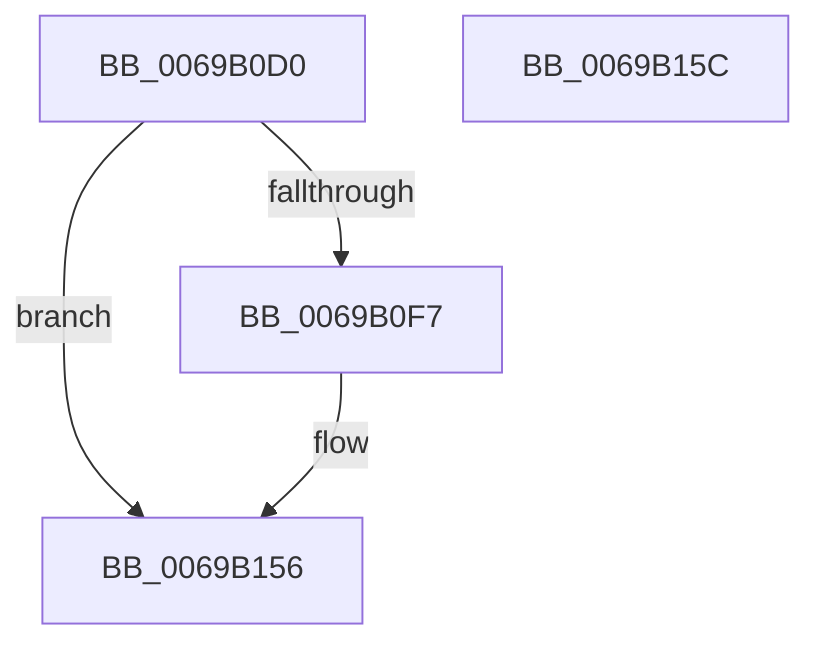

# UcpCreateTelemetryRecord

- RVA: `0x0069B0D0`–`0x0069B15D` (길이 `141` bytes)
- VA: `0x000000014069B0D0`
- 실행 섹션: `.text`
- PDB 이름 있음: `예`; PDB Function 태그: `아니요`
- unwind 정보 RVA: `0x0005CF00`
- 디코드: `37`개 명령, `141/141` bytes 표시
- 미해석 바이트: `0` (있으면 어셈블리에 `.byte`로 보존)

> 이 문서는 커널 이미지의 기계어와 PDB 기호를 분석해 생성했습니다. 4번과 5번은 함수 원형과 자료형을 바이너리 사용 방식에서 추정한 C 해석이며 원본 소스 복구 결과는 아닙니다.

## 1. Dependencies

- 직접 호출 지점: **1**; 고유 호출 대상: **1**
- 직접 호출자로 확인된 함수: **1**
- RIP 상대 이미지 참조: **1**

### Outgoing calls
- `0x0069B0E7` → [ExAllocatePool2](../../poolcode/B8/ExAllocatePool2_function_00B820F0.md) (function, `0x00B820F0`)

### Direct callers
- [UcpFindOrCreateTelemetryRecord](UcpFindOrCreateTelemetryRecord_function_0069B164.md) at `0x0069B26A`

### Static image references
- `0x0069B11E` → RVA `0x00EF0E44` (`.data`; read/write)

## 2. Other-region calls and transfers

- 다른 실행 섹션으로 향하는 call: **1**
  - `0x0069B0E7` → [ExAllocatePool2](../../poolcode/B8/ExAllocatePool2_function_00B820F0.md) (`.text` → `POOLCODE`)
- 별도 외부 분기/꼬리 이동을 확인하지 못했습니다.

## 3. Assembly (complete function range)

```asm
0069B0D0  40 53                           push rbx
0069B0D2  48 83 EC 20                     sub rsp, 0x20
0069B0D6  BA 48 00 00 00                  mov edx, 0x48
0069B0DB  48 8B D9                        mov rbx, rcx
0069B0DE  41 B8 55 63 65 72               mov r8d, 0x72656355
0069B0E4  8D 4A F8                        lea ecx, [rdx - 8]
0069B0E7  E8 04 70 4E 00                  call 0x140b820f0
0069B0EC  45 33 C9                        xor r9d, r9d
0069B0EF  4C 8B C0                        mov r8, rax
0069B0F2  48 85 C0                        test rax, rax
0069B0F5  74 5F                           je 0x14069b156
0069B0F7  48 B8 04 00 00 00 80 F7 FF FF   movabs rax, 0xfffff78000000004
0069B101  8B 08                           mov ecx, dword ptr [rax]
0069B103  48 B8 20 03 00 00 80 F7 FF FF   movabs rax, 0xfffff78000000320
0069B10D  48 C1 E1 20                     shl rcx, 0x20
0069B111  48 8B 00                        mov rax, qword ptr [rax]
0069B114  48 C1 E0 08                     shl rax, 8
0069B118  48 F7 E1                        mul rcx
0069B11B  48 8B 0B                        mov rcx, qword ptr [rbx]
0069B11E  FF 05 20 5D 85 00               inc dword ptr [rip + 0x855d20]
0069B124  49 89 08                        mov qword ptr [r8], rcx
0069B127  4D 89 48 10                     mov qword ptr [r8 + 0x10], r9
0069B12B  45 89 48 18                     mov dword ptr [r8 + 0x18], r9d
0069B12F  48 8D 82 9F 15 FF FF            lea rax, [rdx - 0xea61]
0069B136  49 89 40 08                     mov qword ptr [r8 + 8], rax
0069B13A  8B 43 08                        mov eax, dword ptr [rbx + 8]
0069B13D  41 89 40 38                     mov dword ptr [r8 + 0x38], eax
0069B141  8B 43 0C                        mov eax, dword ptr [rbx + 0xc]
0069B144  41 89 40 3C                     mov dword ptr [r8 + 0x3c], eax
0069B148  8B 43 10                        mov eax, dword ptr [rbx + 0x10]
0069B14B  41 89 40 40                     mov dword ptr [r8 + 0x40], eax
0069B14F  49 8B C0                        mov rax, r8
0069B152  49 89 48 30                     mov qword ptr [r8 + 0x30], rcx
0069B156  48 83 C4 20                     add rsp, 0x20
0069B15A  5B                              pop rbx
0069B15B  C3                              ret
0069B15C  CC                              int3
```

## 4. C-style interpretation (structured pseudocode)

```c
__int64 __fastcall UcpCreateTelemetryRecord(__int64 a1, __int64 a2, __int64 a3, int a4)
{
    __int64 result;
    __int64 v_rsp;

    v_rsp = (v_rsp) - (32);
    result = ExAllocatePool2(72 - 8, 72, (unsigned int)(0x72656355ULL), a4);
    a4 = 0;
    if (result != 0) {
        a1 = *(unsigned int *)(result);
        a1 = (a1) << (32);
        result = *(unsigned __int64 *)(result);
        result = (result) << (8);
        a1 = *(unsigned __int64 *)(a1);
        *(unsigned __int64 *)(result) = a1;
        *(unsigned __int64 *)(result + 16) = 0;
        *(unsigned int *)(result + 24) = 0;
        result = 72 - 60001;
        *(unsigned __int64 *)(result + 8) = result;
        result = *(unsigned int *)(a1 + 8);
        *(unsigned int *)(result + 56) = (unsigned int)(result);
        result = *(unsigned int *)(a1 + 12);
        *(unsigned int *)(result + 60) = (unsigned int)(result);
        result = *(unsigned int *)(a1 + 16);
        *(unsigned int *)(result + 64) = (unsigned int)(result);
        result = result;
        *(unsigned __int64 *)(result + 48) = a1;
    }
    v_rsp = (v_rsp) + (32);
    return result;
}
```

## 5. (Beta) C Style

```c
int64_t UcpCreateTelemetryRecord(void *Arg1, int64_t Arg2, int64_t Arg3, int32_t Arg4)
{
    uint8_t *arg1 = (uint8_t *)Arg1;

    int64_t result;
    int64_t local_rsp;

    local_rsp = (local_rsp) - (32);
    result = ExAllocatePool2(72 - 8, 72, (uint32_t)(0x72656355ULL), Arg4);
    Arg4 = 0;
    if (result != 0) {
        Arg1 = *(uint32_t *)(result);
        Arg1 = (Arg1) << (32);
        result = *(uint64_t *)(result);
        result = (result) << (8);
        Arg1 = *(uint64_t *)(arg1);
        *(void **)(result) = Arg1;
        *(uint64_t *)(result + 0x10) = 0;
        *(uint32_t *)(result + 0x18) = 0;
        result = 72 - 60001;
        *(uint64_t *)(result + 0x8) = result;
        result = *(uint32_t *)(arg1 + 0x8);
        *(uint32_t *)(result + 0x38) = (uint32_t)(result);
        result = *(uint32_t *)(arg1 + 0xC);
        *(uint32_t *)(result + 0x3C) = (uint32_t)(result);
        result = *(uint32_t *)(arg1 + 0x10);
        *(uint32_t *)(result + 0x40) = (uint32_t)(result);
        result = result;
        *(void **)(result + 0x30) = Arg1;
    }
    local_rsp = (local_rsp) + (32);
    return result;
}
```

### 관측된 메모리 오프셋

구조체 형식이 확인되지 않은 접근은 인자 기준의 오프셋으로만 기록했습니다.

| 기준 인자 | 오프셋 표현 | 폭 (bit) | 접근 |
|---|---:|---:|---|
| `Arg1` | `+ 0x0` | `64` | `R` |
| `Arg1` | `+ 0x8` | `32` | `R` |
| `Arg1` | `+ 0xC` | `32` | `R` |
| `Arg1` | `+ 0x10` | `32` | `R` |

## 6. Execution-region graph

[열기: 2D/3D 그래프와 함수 탐색 컨트롤 패널](../../../control-panel.html?section=text&rva=0x0069B0D0&view=graph)

- 2D 그래프는 위에서 아래로 흐르고, 3D 그래프는 빈 공간을 드래그해 회전합니다. Shift+드래그는 이동, 휠은 확대·축소, 함수 노드 선택은 대상 보고서 이동입니다.

### Static fallback


