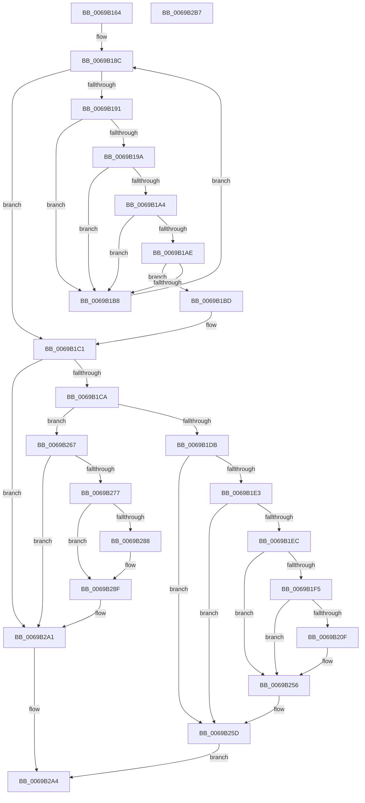

# UcpFindOrCreateTelemetryRecord

- RVA: `0x0069B164`–`0x0069B2B8` (길이 `340` bytes)
- VA: `0x000000014069B164`
- 실행 섹션: `.text`
- PDB 이름 있음: `예`; PDB Function 태그: `아니요`
- unwind 정보 RVA: `0x0009DFE8`
- 디코드: `82`개 명령, `340/340` bytes 표시
- 미해석 바이트: `0` (있으면 어셈블리에 `.byte`로 보존)

> 이 문서는 커널 이미지의 기계어와 PDB 기호를 분석해 생성했습니다. 4번과 5번은 함수 원형과 자료형을 바이너리 사용 방식에서 추정한 C 해석이며 원본 소스 복구 결과는 아닙니다.

## 1. Dependencies

- 직접 호출 지점: **4**; 고유 호출 대상: **4**
- 직접 호출자로 확인된 함수: **1**
- RIP 상대 이미지 참조: **10**

### Outgoing calls
- `0x0069B206` → [tlgKeywordOn](../42/tlgKeywordOn_function_0042EAA0.md) (function, `0x0042EAA0`)
- `0x0069B251` → [tlgWriteTransfer_EtwWriteTransfer](../42/tlgWriteTransfer_EtwWriteTransfer_function_004260E0.md) (function, `0x004260E0`)
- `0x0069B26A` → [UcpCreateTelemetryRecord](UcpCreateTelemetryRecord_function_0069B0D0.md) (function, `0x0069B0D0`)
- `0x0069B2AC` → [_security_check_cookie](../6A/_security_check_cookie_function_006AC640.md) (function, `0x006AC640`)

### Direct callers
- [UcOnUnexpectedCodePath](UcOnUnexpectedCodePath_function_0069AED0.md) at `0x0069AF4B`

### Static image references
- `0x0069B16A` → RVA `0x00E0A740` (`.data`; read)
- `0x0069B179` → RVA `0x00EF0E30` (`.data`; read)
- `0x0069B1CA` → RVA `0x00EF0E44` (`.data`; read)
- `0x0069B1DB` → RVA `0x00EEFD12` (`.data`; read)
- `0x0069B1E3` → RVA `0x00EEFD11` (`.data`; read)
- `0x0069B1EC` → RVA `0x00E0A090` (`.data`; read)
- `0x0069B21E` → RVA `0x0005A72C` (`.rdata`; read)
- `0x0069B256` → RVA `0x00EEFD12` (`.data`; write)
- `0x0069B25D` → RVA `0x00EF0E44` (`.data`; read/write)
- `0x0069B29A` → RVA `0x00EF0E30` (`.data`; write)

## 2. Other-region calls and transfers

- 다른 실행 섹션으로 향하는 call: **0**
- 별도 외부 분기/꼬리 이동을 확인하지 못했습니다.

## 3. Assembly (complete function range)

```asm
0069B164  40 53                           push rbx
0069B166  48 83 EC 70                     sub rsp, 0x70
0069B16A  48 8B 05 CF F5 76 00            mov rax, qword ptr [rip + 0x76f5cf]
0069B171  48 33 C4                        xor rax, rsp
0069B174  48 89 44 24 68                  mov qword ptr [rsp + 0x68], rax
0069B179  4C 8B 0D B0 5C 85 00            mov r9, qword ptr [rip + 0x855cb0]
0069B180  48 8D 1D A9 5C 85 00            lea rbx, [rip + 0x855ca9]
0069B187  4C 8B C1                        mov r8, rcx
0069B18A  33 C9                           xor ecx, ecx
0069B18C  4C 3B CB                        cmp r9, rbx
0069B18F  74 30                           je 0x14069b1c1
0069B191  49 8B 00                        mov rax, qword ptr [r8]
0069B194  49 39 41 E0                     cmp qword ptr [r9 - 0x20], rax
0069B198  75 1E                           jne 0x14069b1b8
0069B19A  41 8B 40 08                     mov eax, dword ptr [r8 + 8]
0069B19E  41 39 41 18                     cmp dword ptr [r9 + 0x18], eax
0069B1A2  75 14                           jne 0x14069b1b8
0069B1A4  41 8B 40 0C                     mov eax, dword ptr [r8 + 0xc]
0069B1A8  41 39 41 1C                     cmp dword ptr [r9 + 0x1c], eax
0069B1AC  75 0A                           jne 0x14069b1b8
0069B1AE  41 8B 40 10                     mov eax, dword ptr [r8 + 0x10]
0069B1B2  41 39 41 20                     cmp dword ptr [r9 + 0x20], eax
0069B1B6  74 05                           je 0x14069b1bd
0069B1B8  4D 8B 09                        mov r9, qword ptr [r9]
0069B1BB  EB CF                           jmp 0x14069b18c
0069B1BD  49 8D 49 E0                     lea rcx, [r9 - 0x20]
0069B1C1  48 85 C9                        test rcx, rcx
0069B1C4  0F 85 D7 00 00 00               jne 0x14069b2a1
0069B1CA  44 8B 0D 73 5C 85 00            mov r9d, dword ptr [rip + 0x855c73]
0069B1D1  41 83 F9 64                     cmp r9d, 0x64
0069B1D5  0F 82 8C 00 00 00               jb 0x14069b267
0069B1DB  38 0D 31 4B 85 00               cmp byte ptr [rip + 0x854b31], cl
0069B1E1  75 7A                           jne 0x14069b25d
0069B1E3  80 3D 27 4B 85 00 01            cmp byte ptr [rip + 0x854b27], 1
0069B1EA  75 71                           jne 0x14069b25d
0069B1EC  83 3D 9D EE 76 00 04            cmp dword ptr [rip + 0x76ee9d], 4
0069B1F3  76 61                           jbe 0x14069b256
0069B1F5  48 BA 00 00 00 00 00 40 00 00   movabs rdx, 0x400000000000
0069B1FF  48 8D 0D 8A EE 76 00            lea rcx, [rip + 0x76ee8a]
0069B206  E8 95 38 D9 FF                  call 0x14042eaa0
0069B20B  84 C0                           test al, al
0069B20D  74 47                           je 0x14069b256
0069B20F  83 64 24 64 00                  and dword ptr [rsp + 0x64], 0
0069B214  48 8D 44 24 30                  lea rax, [rsp + 0x30]
0069B219  48 89 44 24 58                  mov qword ptr [rsp + 0x58], rax
0069B21E  48 8D 15 07 F5 9B FF            lea rdx, [rip - 0x640af9]
0069B225  48 8D 44 24 38                  lea rax, [rsp + 0x38]
0069B22A  4C 89 4C 24 30                  mov qword ptr [rsp + 0x30], r9
0069B22F  48 89 44 24 28                  mov qword ptr [rsp + 0x28], rax
0069B234  48 8D 0D 55 EE 76 00            lea rcx, [rip + 0x76ee55]
0069B23B  45 33 C9                        xor r9d, r9d
0069B23E  C7 44 24 20 03 00 00 00         mov dword ptr [rsp + 0x20], 3
0069B246  45 33 C0                        xor r8d, r8d
0069B249  C7 44 24 60 08 00 00 00         mov dword ptr [rsp + 0x60], 8
0069B251  E8 8A AE D8 FF                  call 0x1404260e0
0069B256  C6 05 B5 4A 85 00 01            mov byte ptr [rip + 0x854ab5], 1
0069B25D  FF 05 E1 5B 85 00               inc dword ptr [rip + 0x855be1]
0069B263  33 C0                           xor eax, eax
0069B265  EB 3D                           jmp 0x14069b2a4
0069B267  49 8B C8                        mov rcx, r8
0069B26A  E8 61 FE FF FF                  call 0x14069b0d0
0069B26F  48 8B C8                        mov rcx, rax
0069B272  48 85 C0                        test rax, rax
0069B275  74 2A                           je 0x14069b2a1
0069B277  48 8B 15 B2 5B 85 00            mov rdx, qword ptr [rip + 0x855bb2]
0069B27E  48 83 C0 20                     add rax, 0x20
0069B282  48 39 5A 08                     cmp qword ptr [rdx + 8], rbx
0069B286  74 07                           je 0x14069b28f
0069B288  B9 03 00 00 00                  mov ecx, 3
0069B28D  CD 29                           int 0x29
0069B28F  48 89 10                        mov qword ptr [rax], rdx
0069B292  48 89 58 08                     mov qword ptr [rax + 8], rbx
0069B296  48 89 42 08                     mov qword ptr [rdx + 8], rax
0069B29A  48 89 05 8F 5B 85 00            mov qword ptr [rip + 0x855b8f], rax
0069B2A1  48 8B C1                        mov rax, rcx
0069B2A4  48 8B 4C 24 68                  mov rcx, qword ptr [rsp + 0x68]
0069B2A9  48 33 CC                        xor rcx, rsp
0069B2AC  E8 8F 13 01 00                  call 0x1406ac640
0069B2B1  48 83 C4 70                     add rsp, 0x70
0069B2B5  5B                              pop rbx
0069B2B6  C3                              ret
0069B2B7  CC                              int3
```

## 4. C-style interpretation (structured pseudocode)

```c
__int64 __fastcall UcpFindOrCreateTelemetryRecord(__int64 a1)
{
    __int64 result;
    __int64 v_rsp;
    unsigned __int64 v_stack_m10;
    unsigned int v_stack_m14;
    unsigned int v_stack_m18;
    unsigned __int64 v_stack_m20;
    unsigned __int64 v_stack_m40;
    unsigned __int64 v_stack_m48;
    unsigned __int64 v_stack_m50;
    unsigned int v_stack_m58;

    v_rsp = (v_rsp) - (112);
    result = (*(unsigned __int64 *)(v_rip + 7796175)) ^ (v_rsp);
    v_stack_m10 = result;
    a1 = 0;
loc_0069B18C:
    if ((*(unsigned __int64 *)(v_rip + 8740016)) == (v_rip + 8740009)) goto loc_0069B1C1;
    if ((*(unsigned __int64 *)(*(unsigned __int64 *)(v_rip + 8740016) - 32)) != (*(unsigned __int64 *)(a1))) goto loc_0069B1B8;
    if ((*(unsigned int *)(*(unsigned __int64 *)(v_rip + 8740016) + 24)) != ((unsigned int)((unsigned int)(*(unsigned int *)(a1 + 8))))) goto loc_0069B1B8;
    if ((*(unsigned int *)(*(unsigned __int64 *)(v_rip + 8740016) + 28)) != ((unsigned int)((unsigned int)(*(unsigned int *)(a1 + 12))))) goto loc_0069B1B8;
    if ((*(unsigned int *)(*(unsigned __int64 *)(v_rip + 8740016) + 32)) == ((unsigned int)((unsigned int)(*(unsigned int *)(a1 + 16))))) goto loc_0069B1BD;
loc_0069B1B8:
    goto loc_0069B18C;
loc_0069B1BD:
loc_0069B1C1:
    if (*(unsigned __int64 *)(*(unsigned __int64 *)(v_rip + 8740016)) - 32 != 0) goto loc_0069B2A1;
    if (((unsigned int)((unsigned int)(*(unsigned int *)(v_rip + 8739955)))) < 100) goto loc_0069B267;
    if ((*(unsigned __int8 *)(v_rip + 8735537)) != ((unsigned __int8)(*(unsigned __int64 *)(*(unsigned __int64 *)(v_rip + 8740016)) - 32))) goto loc_0069B25D;
    if ((*(unsigned __int8 *)(v_rip + 8735527)) != 1) goto loc_0069B25D;
    if ((*(unsigned int *)(v_rip + 7794333)) <= 4) goto loc_0069B256;
    result = tlgKeywordOn(v_rip + 7794314, a2, a1, (unsigned int)(*(unsigned int *)(v_rip + 8739955)));
    if ((unsigned __int8)(result) != 0) {
        result = v_stack_m48;
        v_stack_m20 = result;
        a2 = v_rip - 6556409;
        result = v_stack_m40;
        v_stack_m48 = (unsigned int)(*(unsigned int *)(v_rip + 8739955));
        v_stack_m50 = result;
        a1 = v_rip + 7794261;
        a4 = 0;
        v_stack_m58 = 3;
        a3 = 0;
        v_stack_m18 = 8;
        result = tlgWriteTransfer_EtwWriteTransfer(a1, a2, a3, a4);
    }
    *(unsigned __int8 *)(v_rip + 8735413) = 1;
loc_0069B25D:
    result = 0;
    goto loc_0069B2A4;
loc_0069B267:
    result = UcpCreateTelemetryRecord(0, a2, a3, a4);
    if (result == 0) goto loc_0069B2A1;
    result = (result) + (32);
    if ((*(unsigned __int64 *)(*(unsigned __int64 *)(v_rip + 8739762) + 8)) != (v_rip + 8740009)) {
        a1 = 3;
    }
    *(unsigned __int64 *)(result) = *(unsigned __int64 *)(v_rip + 8739762);
    *(unsigned __int64 *)(result + 8) = v_rip + 8740009;
    *(unsigned __int64 *)(*(unsigned __int64 *)(v_rip + 8739762) + 8) = result;
    *(unsigned __int64 *)(v_rip + 8739727) = result;
loc_0069B2A1:
loc_0069B2A4:
    a1 = (v_stack_m10) ^ (v_rsp);
    result = _security_check_cookie(a1, *(unsigned __int64 *)(v_rip + 8739762), a3, a4);
    v_rsp = (v_rsp) + (112);
    return result;
}
```

## 5. (Beta) C Style

```c
int64_t UcpFindOrCreateTelemetryRecord(void *Arg1)
{
    uint8_t *arg1 = (uint8_t *)Arg1;

    int64_t result;
    int64_t local_rsp;
    uint64_t v_stack_m10;
    uint32_t v_stack_m14;
    uint32_t v_stack_m18;
    uint64_t v_stack_m20;
    uint64_t v_stack_m40;
    uint64_t v_stack_m48;
    uint64_t v_stack_m50;
    uint32_t v_stack_m58;

    local_rsp = (local_rsp) - (112);
    result = (*(uint64_t *)(v_rip + 0x76F5CF)) ^ (local_rsp);
    v_stack_m10 = result;
    Arg1 = 0;
loc_0069B18C:
    if ((*(uint64_t *)(v_rip + 0x855CB0)) == (v_rip + 8740009)) goto loc_0069B1C1;
    if ((*(uint64_t *)(*(uint64_t *)(v_rip + 0x855CB0) - 0x20)) != (*(uint64_t *)(arg1))) goto loc_0069B1B8;
    if ((*(uint32_t *)(*(uint64_t *)(v_rip + 0x855CB0) + 0x18)) != ((uint32_t)((uint32_t)(*(uint32_t *)(arg1 + 0x8))))) goto loc_0069B1B8;
    if ((*(uint32_t *)(*(uint64_t *)(v_rip + 0x855CB0) + 0x1C)) != ((uint32_t)((uint32_t)(*(uint32_t *)(arg1 + 0xC))))) goto loc_0069B1B8;
    if ((*(uint32_t *)(*(uint64_t *)(v_rip + 0x855CB0) + 0x20)) == ((uint32_t)((uint32_t)(*(uint32_t *)(arg1 + 0x10))))) goto loc_0069B1BD;
loc_0069B1B8:
    goto loc_0069B18C;
loc_0069B1BD:
loc_0069B1C1:
    if (*(uint64_t *)(*(uint64_t *)(v_rip + 0x855CB0)) - 32 != 0) goto loc_0069B2A1;
    if (((uint32_t)((uint32_t)(*(uint32_t *)(v_rip + 0x855C73)))) < 100) goto loc_0069B267;
    if ((*(uint8_t *)(v_rip + 0x854B31)) != ((uint8_t)(*(uint64_t *)(*(uint64_t *)(v_rip + 0x855CB0)) - 32))) goto loc_0069B25D;
    if ((*(uint8_t *)(v_rip + 0x854B27)) != 1) goto loc_0069B25D;
    if ((*(uint32_t *)(v_rip + 0x76EE9D)) <= 4) goto loc_0069B256;
    result = tlgKeywordOn(v_rip + 7794314, a2, Arg1, (uint32_t)(*(uint32_t *)(v_rip + 0x855C73)));
    if ((uint8_t)(result) != 0) {
        result = v_stack_m48;
        v_stack_m20 = result;
        a2 = v_rip - 6556409;
        result = v_stack_m40;
        v_stack_m48 = (uint32_t)(*(uint32_t *)(v_rip + 0x855C73));
        v_stack_m50 = result;
        Arg1 = v_rip + 7794261;
        a4 = 0;
        v_stack_m58 = 3;
        a3 = 0;
        v_stack_m18 = 8;
        result = tlgWriteTransfer_EtwWriteTransfer(Arg1, a2, a3, a4);
    }
    *(uint8_t *)(v_rip + 0x854AB5) = 1;
loc_0069B25D:
    result = 0;
    goto loc_0069B2A4;
loc_0069B267:
    result = UcpCreateTelemetryRecord(0, a2, a3, a4);
    if (result == 0) goto loc_0069B2A1;
    result = (result) + (32);
    if ((*(uint64_t *)(*(uint64_t *)(v_rip + 0x855BB2) + 0x8)) != (v_rip + 8740009)) {
        Arg1 = 3;
    }
    *(uint64_t *)(result) = *(uint64_t *)(v_rip + 0x855BB2);
    *(uint64_t *)(result + 0x8) = v_rip + 8740009;
    *(uint64_t *)(*(uint64_t *)(v_rip + 0x855BB2) + 0x8) = result;
    *(uint64_t *)(v_rip + 0x855B8F) = result;
loc_0069B2A1:
loc_0069B2A4:
    Arg1 = (v_stack_m10) ^ (local_rsp);
    result = _security_check_cookie(Arg1, *(uint64_t *)(v_rip + 0x855BB2), a3, a4);
    local_rsp = (local_rsp) + (112);
    return result;
}
```

### 관측된 메모리 오프셋

구조체 형식이 확인되지 않은 접근은 인자 기준의 오프셋으로만 기록했습니다.

| 기준 인자 | 오프셋 표현 | 폭 (bit) | 접근 |
|---|---:|---:|---|
| `Arg1` | `+ 0x0` | `64` | `R` |
| `Arg1` | `+ 0x8` | `32` | `R` |
| `Arg1` | `+ 0xC` | `32` | `R` |
| `Arg1` | `+ 0x10` | `32` | `R` |

## 6. Execution-region graph

[열기: 2D/3D 그래프와 함수 탐색 컨트롤 패널](../../../control-panel.html?section=text&rva=0x0069B164&view=graph)

- 2D 그래프는 위에서 아래로 흐르고, 3D 그래프는 빈 공간을 드래그해 회전합니다. Shift+드래그는 이동, 휠은 확대·축소, 함수 노드 선택은 대상 보고서 이동입니다.

### Static fallback


