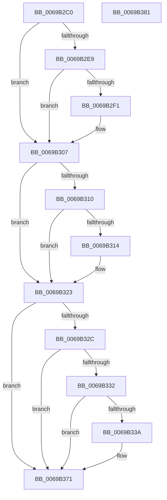

# UcpLogEventGenerateDump

- RVA: `0x0069B2C0`–`0x0069B382` (길이 `194` bytes)
- VA: `0x000000014069B2C0`
- 실행 섹션: `.text`
- PDB 이름 있음: `예`; PDB Function 태그: `아니요`
- unwind 정보 RVA: `0x0007F83C`
- 디코드: `52`개 명령, `194/194` bytes 표시
- 미해석 바이트: `0` (있으면 어셈블리에 `.byte`로 보존)

> 이 문서는 커널 이미지의 기계어와 PDB 기호를 분석해 생성했습니다. 4번과 5번은 함수 원형과 자료형을 바이너리 사용 방식에서 추정한 C 해석이며 원본 소스 복구 결과는 아닙니다.

## 1. Dependencies

- 직접 호출 지점: **3**; 고유 호출 대상: **3**
- 직접 호출자로 확인된 함수: **2**
- RIP 상대 이미지 참조: **4**

### Outgoing calls
- `0x0069B2F9` → [UcpRetrieveCurrentConfigSettings](UcpRetrieveCurrentConfigSettings_function_0069B484.md) (function, `0x0069B484`)
- `0x0069B31A` → [UcpLogUnexpectedCodePathEvent](UcpLogUnexpectedCodePathEvent_function_0069B388.md) (function, `0x0069B388`)
- `0x0069B36C` → [DbgkWerCaptureLiveKernelDump](../../page/AC/DbgkWerCaptureLiveKernelDump_function_00AC1E90.md) (function, `0x00AC1E90`)

### Direct callers
- [UcOnUnexpectedCodePath](UcOnUnexpectedCodePath_function_0069AED0.md) at `0x0069B001`
- [UcpApcNormalRoutine](../../page/81/UcpApcNormalRoutine_function_00811B40.md) at `0x00811B67`

### Static image references
- `0x0069B2E9` → RVA `0x00EEFD10` (`.data`; read)
- `0x0069B307` → RVA `0x00EEFD11` (`.data`; read)
- `0x0069B323` → RVA `0x00EEFD13` (`.data`; read)
- `0x0069B33F` → RVA `0x006D0A00` (` ?? ::FNODOBFM::`string'`; read)

## 2. Other-region calls and transfers

- 다른 실행 섹션으로 향하는 call: **1**
  - `0x0069B36C` → [DbgkWerCaptureLiveKernelDump](../../page/AC/DbgkWerCaptureLiveKernelDump_function_00AC1E90.md) (`.text` → `PAGE`)
- 별도 외부 분기/꼬리 이동을 확인하지 못했습니다.

## 3. Assembly (complete function range)

```asm
0069B2C0  4C 8B DC                        mov r11, rsp
0069B2C3  49 89 5B 08                     mov qword ptr [r11 + 8], rbx
0069B2C7  49 89 73 10                     mov qword ptr [r11 + 0x10], rsi
0069B2CB  57                              push rdi
0069B2CC  48 83 EC 50                     sub rsp, 0x50
0069B2D0  32 C0                           xor al, al
0069B2D2  40 32 FF                        xor dil, dil
0069B2D5  88 44 24 70                     mov byte ptr [rsp + 0x70], al
0069B2D9  48 8B F2                        mov rsi, rdx
0069B2DC  40 88 7C 24 78                  mov byte ptr [rsp + 0x78], dil
0069B2E1  48 8B D9                        mov rbx, rcx
0069B2E4  48 85 C9                        test rcx, rcx
0069B2E7  74 1E                           je 0x14069b307
0069B2E9  38 05 21 4A 85 00               cmp byte ptr [rip + 0x854a21], al
0069B2EF  74 16                           je 0x14069b307
0069B2F1  4D 8D 43 20                     lea r8, [r11 + 0x20]
0069B2F5  49 8D 53 18                     lea rdx, [r11 + 0x18]
0069B2F9  E8 86 01 00 00                  call 0x14069b484
0069B2FE  8A 44 24 70                     mov al, byte ptr [rsp + 0x70]
0069B302  40 8A 7C 24 78                  mov dil, byte ptr [rsp + 0x78]
0069B307  80 3D 03 4A 85 00 01            cmp byte ptr [rip + 0x854a03], 1
0069B30E  75 13                           jne 0x14069b323
0069B310  84 C0                           test al, al
0069B312  75 0F                           jne 0x14069b323
0069B314  8B 56 10                        mov edx, dword ptr [rsi + 0x10]
0069B317  48 8B CB                        mov rcx, rbx
0069B31A  E8 69 00 00 00                  call 0x14069b388
0069B31F  83 66 10 00                     and dword ptr [rsi + 0x10], 0
0069B323  80 3D E9 49 85 00 01            cmp byte ptr [rip + 0x8549e9], 1
0069B32A  75 45                           jne 0x14069b371
0069B32C  40 80 FF 01                     cmp dil, 1
0069B330  75 3F                           jne 0x14069b371
0069B332  44 0F 20 C0                     mov rax, cr8
0069B336  84 C0                           test al, al
0069B338  75 37                           jne 0x14069b371
0069B33A  83 64 24 40 00                  and dword ptr [rsp + 0x40], 0
0069B33F  48 8D 0D BA 56 03 00            lea rcx, [rip + 0x356ba]
0069B346  48 83 64 24 38 00               and qword ptr [rsp + 0x38], 0
0069B34C  BA 02 02 00 00                  mov edx, 0x202
0069B351  48 83 64 24 30 00               and qword ptr [rsp + 0x30], 0
0069B357  8B 43 08                        mov eax, dword ptr [rbx + 8]
0069B35A  48 83 64 24 28 00               and qword ptr [rsp + 0x28], 0
0069B360  44 8B 4B 04                     mov r9d, dword ptr [rbx + 4]
0069B364  44 8B 03                        mov r8d, dword ptr [rbx]
0069B367  48 89 44 24 20                  mov qword ptr [rsp + 0x20], rax
0069B36C  E8 1F 6B 42 00                  call 0x140ac1e90
0069B371  48 8B 5C 24 60                  mov rbx, qword ptr [rsp + 0x60]
0069B376  48 8B 74 24 68                  mov rsi, qword ptr [rsp + 0x68]
0069B37B  48 83 C4 50                     add rsp, 0x50
0069B37F  5F                              pop rdi
0069B380  C3                              ret
0069B381  CC                              int3
```

## 4. C-style interpretation (structured pseudocode)

```c
__int64 __fastcall UcpLogEventGenerateDump(__int64 a1, __int64 a2)
{
    __int64 result;
    __int64 v_rdi;
    __int64 v_rsp;
    unsigned int v_stack_m18;
    unsigned __int64 v_stack_m20;
    unsigned __int64 v_stack_m28;
    unsigned __int64 v_stack_m30;
    unsigned __int64 v_stack_m38;
    unsigned __int64 v_stack_p10;
    unsigned __int8 v_stack_p18;
    unsigned __int8 v_stack_p20;
    unsigned __int64 v_stack_p8;

    *(unsigned __int64 *)(v_rsp + 8) = v_rbx;
    *(unsigned __int64 *)(v_rsp + 16) = v_rsi;
    v_rsp = (v_rsp) - (80);
    result = 0;
    v_rdi = 0;
    v_stack_p18 = 0;
    v_stack_p20 = 0;
    if (a1 == 0) goto loc_0069B307;
    if ((*(unsigned __int8 *)(v_rip + 8735265)) != 0) {
        a3 = v_rsp + 32;
        a2 = v_rsp + 24;
        result = UcpRetrieveCurrentConfigSettings(a1, a2, a3, a4);
        result = v_stack_p18;
        v_rdi = v_stack_p20;
    }
    if ((*(unsigned __int8 *)(v_rip + 8735235)) != 1) goto loc_0069B323;
    if ((unsigned __int8)(result) == 0) {
        a2 = *(unsigned int *)(a2 + 16);
        a1 = a1;
        result = UcpLogUnexpectedCodePathEvent(a1, a2, a3, a4);
    }
    if ((*(unsigned __int8 *)(v_rip + 8735209)) != 1) goto loc_0069B371;
    if (((unsigned __int8)(v_rdi)) != 1) goto loc_0069B371;
    result = v_cr8;
    if ((unsigned __int8)(v_cr8) == 0) {
        a1 = v_rip + 218810;
        a2 = 514;
        result = *(unsigned int *)(a1 + 8);
        a4 = *(unsigned int *)(a1 + 4);
        a3 = *(unsigned int *)(a1);
        v_stack_m38 = result;
        result = DbgkWerCaptureLiveKernelDump(a1, a2, a3, a4);
    }
    v_rsp = (v_rsp) + (80);
    return result;
}
```

## 5. (Beta) C Style

```c
int64_t UcpLogEventGenerateDump(void *Arg1, void *Arg2)
{
    uint8_t *arg1 = (uint8_t *)Arg1;
    uint8_t *arg2 = (uint8_t *)Arg2;

    int64_t result;
    int64_t local_rdi;
    int64_t local_rsp;
    uint32_t v_stack_m18;
    uint64_t v_stack_m20;
    uint64_t v_stack_m28;
    uint64_t v_stack_m30;
    uint64_t v_stack_m38;
    uint64_t v_stack_p10;
    uint8_t v_stack_p18;
    uint8_t v_stack_p20;
    uint64_t v_stack_p8;

    *(uint64_t *)(local_rsp + 0x8) = local_rbx;
    *(uint64_t *)(local_rsp + 0x10) = local_rsi;
    local_rsp = (local_rsp) - (80);
    result = 0;
    local_rdi = 0;
    v_stack_p18 = 0;
    v_stack_p20 = 0;
    if (Arg1 == NULL) goto loc_0069B307;
    if ((*(uint8_t *)(v_rip + 0x854A21)) != 0) {
        a3 = local_rsp + 32;
        Arg2 = local_rsp + 24;
        result = UcpRetrieveCurrentConfigSettings(Arg1, Arg2, a3, a4);
        result = v_stack_p18;
        local_rdi = v_stack_p20;
    }
    if ((*(uint8_t *)(v_rip + 0x854A03)) != 1) goto loc_0069B323;
    if ((uint8_t)(result) == 0) {
        Arg2 = *(uint32_t *)(arg2 + 0x10);
        Arg1 = Arg1;
        result = UcpLogUnexpectedCodePathEvent(Arg1, Arg2, a3, a4);
    }
    if ((*(uint8_t *)(v_rip + 0x8549E9)) != 1) goto loc_0069B371;
    if (((uint8_t)(local_rdi)) != 1) goto loc_0069B371;
    result = v_cr8;
    if ((uint8_t)(v_cr8) == 0) {
        Arg1 = v_rip + 218810;
        Arg2 = 514;
        result = *(uint32_t *)(arg1 + 0x8);
        a4 = *(uint32_t *)(arg1 + 0x4);
        a3 = *(uint32_t *)(arg1);
        v_stack_m38 = result;
        result = DbgkWerCaptureLiveKernelDump(Arg1, Arg2, a3, a4);
    }
    local_rsp = (local_rsp) + (80);
    return result;
}
```

### 관측된 메모리 오프셋

구조체 형식이 확인되지 않은 접근은 인자 기준의 오프셋으로만 기록했습니다.

| 기준 인자 | 오프셋 표현 | 폭 (bit) | 접근 |
|---|---:|---:|---|
| `Arg1` | `+ 0x0` | `32` | `R` |
| `Arg1` | `+ 0x4` | `32` | `R` |
| `Arg1` | `+ 0x8` | `32` | `R` |
| `Arg2` | `+ 0x10` | `32` | `R` |
| `Arg2` | `+ 0x10` | `32` | `R/W` |

## 6. Execution-region graph

[열기: 2D/3D 그래프와 함수 탐색 컨트롤 패널](../../../control-panel.html?section=text&rva=0x0069B2C0&view=graph)

- 2D 그래프는 위에서 아래로 흐르고, 3D 그래프는 빈 공간을 드래그해 회전합니다. Shift+드래그는 이동, 휠은 확대·축소, 함수 노드 선택은 대상 보고서 이동입니다.

### Static fallback


