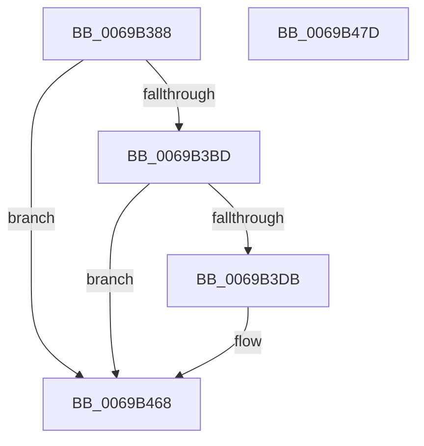

# UcpLogUnexpectedCodePathEvent

- RVA: `0x0069B388`–`0x0069B47E` (길이 `246` bytes)
- VA: `0x000000014069B388`
- 실행 섹션: `.text`
- PDB 이름 있음: `예`; PDB Function 태그: `아니요`
- unwind 정보 RVA: `0x000BAEE4`
- 디코드: `56`개 명령, `246/246` bytes 표시
- 미해석 바이트: `0` (있으면 어셈블리에 `.byte`로 보존)

> 이 문서는 커널 이미지의 기계어와 PDB 기호를 분석해 생성했습니다. 4번과 5번은 함수 원형과 자료형을 바이너리 사용 방식에서 추정한 C 해석이며 원본 소스 복구 결과는 아닙니다.

## 1. Dependencies

- 직접 호출 지점: **3**; 고유 호출 대상: **3**
- 직접 호출자로 확인된 함수: **2**
- RIP 상대 이미지 참조: **3**

### Outgoing calls
- `0x0069B3CE` → [tlgKeywordOn](../42/tlgKeywordOn_function_0042EAA0.md) (function, `0x0042EAA0`)
- `0x0069B463` → [tlgWriteTransfer_EtwWriteTransfer](../42/tlgWriteTransfer_EtwWriteTransfer_function_004260E0.md) (function, `0x004260E0`)
- `0x0069B46F` → [_security_check_cookie](../6A/_security_check_cookie_function_006AC640.md) (function, `0x006AC640`)

### Direct callers
- [UcInitialize](UcInitialize_function_0069AD9C.md) at `0x0069AE8A`
- [UcpLogEventGenerateDump](UcpLogEventGenerateDump_function_0069B2C0.md) at `0x0069B31A`

### Static image references
- `0x0069B396` → RVA `0x00E0A740` (`.data`; read)
- `0x0069B3AD` → RVA `0x00E0A090` (`.data`; read)
- `0x0069B441` → RVA `0x0005A6B6` (`.rdata`; read)

## 2. Other-region calls and transfers

- 다른 실행 섹션으로 향하는 call: **0**
- 별도 외부 분기/꼬리 이동을 확인하지 못했습니다.

## 3. Assembly (complete function range)

```asm
0069B388  40 55                           push rbp
0069B38A  48 8D 6C 24 A9                  lea rbp, [rsp - 0x57]
0069B38F  48 81 EC D0 00 00 00            sub rsp, 0xd0
0069B396  48 8B 05 A3 F3 76 00            mov rax, qword ptr [rip + 0x76f3a3]
0069B39D  48 33 C4                        xor rax, rsp
0069B3A0  48 89 45 47                     mov qword ptr [rbp + 0x47], rax
0069B3A4  41 BA 04 00 00 00               mov r10d, 4
0069B3AA  44 8B CA                        mov r9d, edx
0069B3AD  44 39 15 DC EC 76 00            cmp dword ptr [rip + 0x76ecdc], r10d
0069B3B4  4C 8B C1                        mov r8, rcx
0069B3B7  0F 86 AB 00 00 00               jbe 0x14069b468
0069B3BD  48 BA 00 00 00 00 00 40 00 00   movabs rdx, 0x400000000000
0069B3C7  48 8D 0D C2 EC 76 00            lea rcx, [rip + 0x76ecc2]
0069B3CE  E8 CD 36 D9 FF                  call 0x14042eaa0
0069B3D3  84 C0                           test al, al
0069B3D5  0F 84 8D 00 00 00               je 0x14069b468
0069B3DB  41 8B 00                        mov eax, dword ptr [r8]
0069B3DE  48 89 45 C7                     mov qword ptr [rbp - 0x39], rax
0069B3E2  48 8D 45 C7                     lea rax, [rbp - 0x39]
0069B3E6  48 89 45 F7                     mov qword ptr [rbp - 9], rax
0069B3EA  41 8B 40 04                     mov eax, dword ptr [r8 + 4]
0069B3EE  89 45 B7                        mov dword ptr [rbp - 0x49], eax
0069B3F1  48 8D 45 B7                     lea rax, [rbp - 0x49]
0069B3F5  48 89 45 07                     mov qword ptr [rbp + 7], rax
0069B3F9  41 8B 40 08                     mov eax, dword ptr [r8 + 8]
0069B3FD  89 45 BB                        mov dword ptr [rbp - 0x45], eax
0069B400  48 8D 45 BB                     lea rax, [rbp - 0x45]
0069B404  48 89 45 17                     mov qword ptr [rbp + 0x17], rax
0069B408  48 8D 45 BF                     lea rax, [rbp - 0x41]
0069B40C  48 89 45 27                     mov qword ptr [rbp + 0x27], rax
0069B410  48 C7 45 FF 08 00 00 00         mov qword ptr [rbp - 1], 8
0069B418  4C 89 55 0F                     mov qword ptr [rbp + 0xf], r10
0069B41C  4C 89 55 1F                     mov qword ptr [rbp + 0x1f], r10
0069B420  44 89 4D BF                     mov dword ptr [rbp - 0x41], r9d
0069B424  4C 89 55 2F                     mov qword ptr [rbp + 0x2f], r10
0069B428  44 0F 20 C0                     mov rax, cr8
0069B42C  0F B6 D0                        movzx edx, al
0069B42F  48 8D 0D 5A EC 76 00            lea rcx, [rip + 0x76ec5a]
0069B436  48 8D 45 C3                     lea rax, [rbp - 0x3d]
0069B43A  89 55 C3                        mov dword ptr [rbp - 0x3d], edx
0069B43D  48 89 45 37                     mov qword ptr [rbp + 0x37], rax
0069B441  48 8D 15 6E F2 9B FF            lea rdx, [rip - 0x640d92]
0069B448  48 8D 45 D7                     lea rax, [rbp - 0x29]
0069B44C  4C 89 55 3F                     mov qword ptr [rbp + 0x3f], r10
0069B450  48 89 44 24 28                  mov qword ptr [rsp + 0x28], rax
0069B455  45 33 C9                        xor r9d, r9d
0069B458  45 33 C0                        xor r8d, r8d
0069B45B  C7 44 24 20 07 00 00 00         mov dword ptr [rsp + 0x20], 7
0069B463  E8 78 AC D8 FF                  call 0x1404260e0
0069B468  48 8B 4D 47                     mov rcx, qword ptr [rbp + 0x47]
0069B46C  48 33 CC                        xor rcx, rsp
0069B46F  E8 CC 11 01 00                  call 0x1406ac640
0069B474  48 81 C4 D0 00 00 00            add rsp, 0xd0
0069B47B  5D                              pop rbp
0069B47C  C3                              ret
0069B47D  CC                              int3
```

## 4. C-style interpretation (structured pseudocode)

```c
__int64 __fastcall UcpLogUnexpectedCodePathEvent(__int64 a1, int a2)
{
    __int64 result;
    __int64 v_rsp;
    unsigned __int64 v_stack_m18;
    unsigned __int64 v_stack_m20;
    unsigned __int64 v_stack_m28;
    unsigned __int64 v_stack_m30;
    unsigned __int64 v_stack_m38;
    unsigned __int64 v_stack_m40;
    unsigned __int64 v_stack_m48;
    unsigned __int64 v_stack_m50;
    unsigned __int64 v_stack_m58;
    unsigned __int64 v_stack_m5F;
    unsigned __int64 v_stack_m60;
    unsigned __int64 v_stack_m68;
    unsigned __int64 v_stack_m88;
    unsigned __int64 v_stack_m98;
    unsigned __int64 v_stack_m9C;
    unsigned __int64 v_stack_mA0;
    unsigned int v_stack_mA4;
    unsigned int v_stack_mA8;
    unsigned __int64 v_stack_mB0;
    unsigned int v_stack_mB8;

    v_rsp = (v_rsp) - (208);
    result = (*(unsigned __int64 *)(v_rip + 7795619)) ^ (v_rsp);
    v_stack_m18 = result;
    if ((*(unsigned int *)(v_rip + 7793884)) <= 4) goto loc_0069B468;
    result = tlgKeywordOn(v_rip + 7793858, a2, a1, (unsigned int)(a2));
    if ((unsigned __int8)(result) != 0) {
        result = *(unsigned int *)(a1);
        v_stack_m98 = result;
        result = v_stack_m98;
        v_stack_m68 = result;
        result = *(unsigned int *)(a1 + 4);
        v_stack_mA8 = (unsigned int)(result);
        result = v_stack_mA8;
        v_stack_m58 = result;
        result = *(unsigned int *)(a1 + 8);
        v_stack_mA4 = (unsigned int)(result);
        result = v_stack_mA4;
        v_stack_m48 = result;
        result = v_stack_mA0;
        v_stack_m38 = result;
        v_stack_m60 = 8;
        v_stack_m50 = 4;
        v_stack_m40 = 4;
        v_stack_mA0 = (unsigned int)((unsigned int)(a2));
        v_stack_m30 = 4;
        result = v_cr8;
        a2 = (unsigned __int8)(result);
        a1 = v_rip + 7793754;
        result = v_stack_m9C;
        v_stack_m9C = a2;
        v_stack_m28 = result;
        a2 = v_rip - 6557074;
        result = v_stack_m88;
        v_stack_m20 = 4;
        v_stack_mB0 = result;
        a4 = 0;
        a3 = 0;
        v_stack_mB8 = 7;
        result = tlgWriteTransfer_EtwWriteTransfer(a1, a2, a3, a4);
    }
    a1 = (v_stack_m18) ^ (v_rsp);
    result = _security_check_cookie(a1, a2, a3, a4);
    v_rsp = (v_rsp) + (208);
    return result;
}
```

## 5. (Beta) C Style

```c
int64_t UcpLogUnexpectedCodePathEvent(int64_t Arg1, int32_t Arg2)
{
    int64_t result;
    int64_t local_rsp;
    uint64_t v_stack_m18;
    uint64_t v_stack_m20;
    uint64_t v_stack_m28;
    uint64_t v_stack_m30;
    uint64_t v_stack_m38;
    uint64_t v_stack_m40;
    uint64_t v_stack_m48;
    uint64_t v_stack_m50;
    uint64_t v_stack_m58;
    uint64_t v_stack_m5F;
    uint64_t v_stack_m60;
    uint64_t v_stack_m68;
    uint64_t v_stack_m88;
    uint64_t v_stack_m98;
    uint64_t v_stack_m9C;
    uint64_t v_stack_mA0;
    uint32_t v_stack_mA4;
    uint32_t v_stack_mA8;
    uint64_t v_stack_mB0;
    uint32_t v_stack_mB8;

    local_rsp = (local_rsp) - (208);
    result = (*(uint64_t *)(v_rip + 0x76F3A3)) ^ (local_rsp);
    v_stack_m18 = result;
    if ((*(uint32_t *)(v_rip + 0x76ECDC)) <= 4) goto loc_0069B468;
    result = tlgKeywordOn(v_rip + 7793858, Arg2, Arg1, (uint32_t)(Arg2));
    if ((uint8_t)(result) != 0) {
        result = *(uint32_t *)(Arg1);
        v_stack_m98 = result;
        result = v_stack_m98;
        v_stack_m68 = result;
        result = *(uint32_t *)(Arg1 + 0x4);
        v_stack_mA8 = (uint32_t)(result);
        result = v_stack_mA8;
        v_stack_m58 = result;
        result = *(uint32_t *)(Arg1 + 0x8);
        v_stack_mA4 = (uint32_t)(result);
        result = v_stack_mA4;
        v_stack_m48 = result;
        result = v_stack_mA0;
        v_stack_m38 = result;
        v_stack_m60 = 8;
        v_stack_m50 = 4;
        v_stack_m40 = 4;
        v_stack_mA0 = (uint32_t)((uint32_t)(Arg2));
        v_stack_m30 = 4;
        result = v_cr8;
        Arg2 = (uint8_t)(result);
        Arg1 = v_rip + 7793754;
        result = v_stack_m9C;
        v_stack_m9C = Arg2;
        v_stack_m28 = result;
        Arg2 = v_rip - 6557074;
        result = v_stack_m88;
        v_stack_m20 = 4;
        v_stack_mB0 = result;
        a4 = 0;
        a3 = 0;
        v_stack_mB8 = 7;
        result = tlgWriteTransfer_EtwWriteTransfer(Arg1, Arg2, a3, a4);
    }
    Arg1 = (v_stack_m18) ^ (local_rsp);
    result = _security_check_cookie(Arg1, Arg2, a3, a4);
    local_rsp = (local_rsp) + (208);
    return result;
}
```

## 6. Execution-region graph

[열기: 2D/3D 그래프와 함수 탐색 컨트롤 패널](../../../control-panel.html?section=text&rva=0x0069B388&view=graph)

- 2D 그래프는 위에서 아래로 흐르고, 3D 그래프는 빈 공간을 드래그해 회전합니다. Shift+드래그는 이동, 휠은 확대·축소, 함수 노드 선택은 대상 보고서 이동입니다.

### Static fallback


