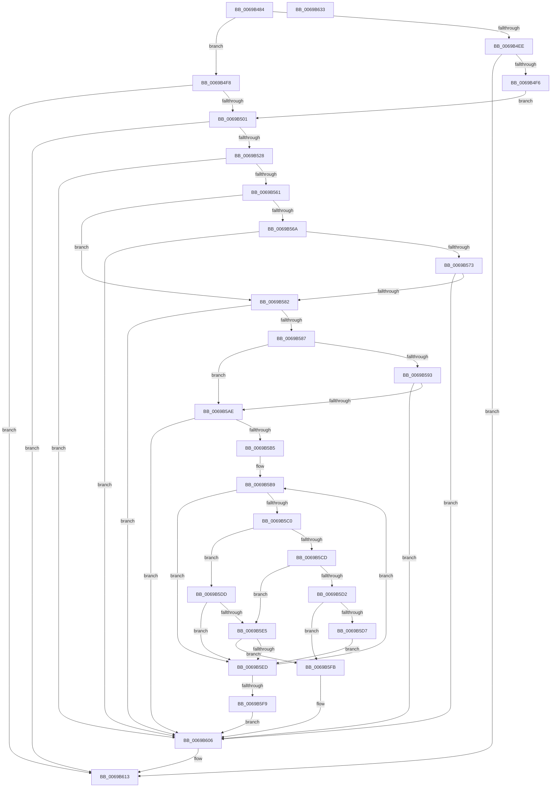

# UcpRetrieveCurrentConfigSettings

- RVA: `0x0069B484`–`0x0069B634` (길이 `432` bytes)
- VA: `0x000000014069B484`
- 실행 섹션: `.text`
- PDB 이름 있음: `예`; PDB Function 태그: `아니요`
- unwind 정보 RVA: `0x000D9758`
- 디코드: `127`개 명령, `432/432` bytes 표시
- 미해석 바이트: `0` (있으면 어셈블리에 `.byte`로 보존)

> 이 문서는 커널 이미지의 기계어와 PDB 기호를 분석해 생성했습니다. 4번과 5번은 함수 원형과 자료형을 바이너리 사용 방식에서 추정한 C 해석이며 원본 소스 복구 결과는 아닙니다.

## 1. Dependencies

- 직접 호출 지점: **9**; 고유 호출 대상: **6**
- 직접 호출자로 확인된 함수: **1**
- RIP 상대 이미지 참조: **4**

### Outgoing calls
- `0x0069B4DD` → [ZwQueryWnfStateData](../6A/ZwQueryWnfStateData_function_006AFEF0.md) (function, `0x006AFEF0`)
- `0x0069B4E2` → [Feature_573990203__private_IsEnabledDeviceUsageNoInline](Feature_573990203__private_IsEnabledDeviceUsageNoInline_function_0069AD48.md) (function, `0x0069AD48`)
- `0x0069B517` → [ExAllocatePool2](../../poolcode/B8/ExAllocatePool2_function_00B820F0.md) (function, `0x00B820F0`)
- `0x0069B531` → [memset](../6C/memset_function_006C6C40.md) (function, `0x006C6C40`)
- `0x0069B554` → [ZwQueryWnfStateData](../6A/ZwQueryWnfStateData_function_006AFEF0.md) (function, `0x006AFEF0`)
- `0x0069B561` → [Feature_573990203__private_IsEnabledDeviceUsageNoInline](Feature_573990203__private_IsEnabledDeviceUsageNoInline_function_0069AD48.md) (function, `0x0069AD48`)
- `0x0069B58A` → [Feature_573990203__private_IsEnabledDeviceUsageNoInline](Feature_573990203__private_IsEnabledDeviceUsageNoInline_function_0069AD48.md) (function, `0x0069AD48`)
- `0x0069B60E` → [ExFreePoolWithTag](../../poolcode/B8/ExFreePoolWithTag_function_00B82870.md) (function, `0x00B82870`)
- `0x0069B61A` → [_security_check_cookie](../6A/_security_check_cookie_function_006AC640.md) (function, `0x006AC640`)

### Direct callers
- [UcpLogEventGenerateDump](UcpLogEventGenerateDump_function_0069B2C0.md) at `0x0069B2F9`

### Static image references
- `0x0069B497` → RVA `0x00E0A740` (`.data`; read)
- `0x0069B4A5` → RVA `0x00020B78` (`.rdata`; read)
- `0x0069B511` → RVA `0x00EF0E40` (`.data`; write)
- `0x0069B576` → RVA `0x00EF0E40` (`.data`; read)

## 2. Other-region calls and transfers

- 다른 실행 섹션으로 향하는 call: **2**
  - `0x0069B517` → [ExAllocatePool2](../../poolcode/B8/ExAllocatePool2_function_00B820F0.md) (`.text` → `POOLCODE`)
  - `0x0069B60E` → [ExFreePoolWithTag](../../poolcode/B8/ExFreePoolWithTag_function_00B82870.md) (`.text` → `POOLCODE`)
- 별도 외부 분기/꼬리 이동을 확인하지 못했습니다.

## 3. Assembly (complete function range)

```asm
0069B484  48 89 5C 24 08                  mov qword ptr [rsp + 8], rbx
0069B489  55                              push rbp
0069B48A  56                              push rsi
0069B48B  57                              push rdi
0069B48C  41 56                           push r14
0069B48E  41 57                           push r15
0069B490  48 8B EC                        mov rbp, rsp
0069B493  48 83 EC 50                     sub rsp, 0x50
0069B497  48 8B 05 A2 F2 76 00            mov rax, qword ptr [rip + 0x76f2a2]
0069B49E  48 33 C4                        xor rax, rsp
0069B4A1  48 89 45 F0                     mov qword ptr [rbp - 0x10], rax
0069B4A5  48 8B 05 CC 56 98 FF            mov rax, qword ptr [rip - 0x67a934]
0069B4AC  4C 8D 4D E4                     lea r9, [rbp - 0x1c]
0069B4B0  83 65 E0 00                     and dword ptr [rbp - 0x20], 0
0069B4B4  4D 8B F0                        mov r14, r8
0069B4B7  83 65 E4 00                     and dword ptr [rbp - 0x1c], 0
0069B4BB  4C 8B FA                        mov r15, rdx
0069B4BE  48 89 45 E8                     mov qword ptr [rbp - 0x18], rax
0069B4C2  48 8B F1                        mov rsi, rcx
0069B4C5  48 8D 45 E0                     lea rax, [rbp - 0x20]
0069B4C9  45 33 C0                        xor r8d, r8d
0069B4CC  48 89 44 24 28                  mov qword ptr [rsp + 0x28], rax
0069B4D1  48 8D 4D E8                     lea rcx, [rbp - 0x18]
0069B4D5  48 83 64 24 20 00               and qword ptr [rsp + 0x20], 0
0069B4DB  33 D2                           xor edx, edx
0069B4DD  E8 0E 4A 01 00                  call 0x1406afef0
0069B4E2  E8 61 F8 FF FF                  call 0x14069ad48
0069B4E7  8B 4D E0                        mov ecx, dword ptr [rbp - 0x20]
0069B4EA  85 C0                           test eax, eax
0069B4EC  75 0A                           jne 0x14069b4f8
0069B4EE  85 C9                           test ecx, ecx
0069B4F0  0F 84 1D 01 00 00               je 0x14069b613
0069B4F6  EB 09                           jmp 0x14069b501
0069B4F8  83 F9 08                        cmp ecx, 8
0069B4FB  0F 82 12 01 00 00               jb 0x14069b613
0069B501  8B 45 E4                        mov eax, dword ptr [rbp - 0x1c]
0069B504  41 B8 55 63 65 72               mov r8d, 0x72656355
0069B50A  8B D1                           mov edx, ecx
0069B50C  B9 40 00 00 00                  mov ecx, 0x40
0069B511  89 05 29 59 85 00               mov dword ptr [rip + 0x855929], eax
0069B517  E8 D4 6B 4E 00                  call 0x140b820f0
0069B51C  48 8B D8                        mov rbx, rax
0069B51F  48 85 C0                        test rax, rax
0069B522  0F 84 EB 00 00 00               je 0x14069b613
0069B528  44 8B 45 E0                     mov r8d, dword ptr [rbp - 0x20]
0069B52C  33 D2                           xor edx, edx
0069B52E  48 8B C8                        mov rcx, rax
0069B531  E8 0A B7 02 00                  call 0x1406c6c40
0069B536  8B 7D E0                        mov edi, dword ptr [rbp - 0x20]
0069B539  48 8D 45 E0                     lea rax, [rbp - 0x20]
0069B53D  48 89 44 24 28                  mov qword ptr [rsp + 0x28], rax
0069B542  4C 8D 4D E4                     lea r9, [rbp - 0x1c]
0069B546  45 33 C0                        xor r8d, r8d
0069B549  48 89 5C 24 20                  mov qword ptr [rsp + 0x20], rbx
0069B54E  33 D2                           xor edx, edx
0069B550  48 8D 4D E8                     lea rcx, [rbp - 0x18]
0069B554  E8 97 49 01 00                  call 0x1406afef0
0069B559  85 C0                           test eax, eax
0069B55B  0F 88 A5 00 00 00               js 0x14069b606
0069B561  E8 E2 F7 FF FF                  call 0x14069ad48
0069B566  85 C0                           test eax, eax
0069B568  74 18                           je 0x14069b582
0069B56A  39 7D E0                        cmp dword ptr [rbp - 0x20], edi
0069B56D  0F 85 93 00 00 00               jne 0x14069b606
0069B573  8B 45 E4                        mov eax, dword ptr [rbp - 0x1c]
0069B576  39 05 C4 58 85 00               cmp dword ptr [rip + 0x8558c4], eax
0069B57C  0F 85 84 00 00 00               jne 0x14069b606
0069B582  83 3B 01                        cmp dword ptr [rbx], 1
0069B585  75 7F                           jne 0x14069b606
0069B587  8B 7B 04                        mov edi, dword ptr [rbx + 4]
0069B58A  E8 B9 F7 FF FF                  call 0x14069ad48
0069B58F  85 C0                           test eax, eax
0069B591  74 1B                           je 0x14069b5ae
0069B593  8B 4D E0                        mov ecx, dword ptr [rbp - 0x20]
0069B596  48 B8 CD CC CC CC CC CC CC CC   movabs rax, 0xcccccccccccccccd
0069B5A0  83 C1 F8                        add ecx, -8
0069B5A3  48 F7 E1                        mul rcx
0069B5A6  48 C1 EA 04                     shr rdx, 4
0069B5AA  3B FA                           cmp edi, edx
0069B5AC  77 58                           ja 0x14069b606
0069B5AE  45 33 C0                        xor r8d, r8d
0069B5B1  85 FF                           test edi, edi
0069B5B3  74 51                           je 0x14069b606
0069B5B5  48 8D 4B 14                     lea rcx, [rbx + 0x14]
0069B5B9  8B 06                           mov eax, dword ptr [rsi]
0069B5BB  39 41 F4                        cmp dword ptr [rcx - 0xc], eax
0069B5BE  75 2D                           jne 0x14069b5ed
0069B5C0  8A 41 05                        mov al, byte ptr [rcx + 5]
0069B5C3  41 88 07                        mov byte ptr [r15], al
0069B5C6  8B 11                           mov edx, dword ptr [rcx]
0069B5C8  83 EA 01                        sub edx, 1
0069B5CB  74 10                           je 0x14069b5dd
0069B5CD  83 EA 01                        sub edx, 1
0069B5D0  74 13                           je 0x14069b5e5
0069B5D2  83 FA 02                        cmp edx, 2
0069B5D5  74 24                           je 0x14069b5fb
0069B5D7  41 C6 06 00                     mov byte ptr [r14], 0
0069B5DB  EB 10                           jmp 0x14069b5ed
0069B5DD  8B 46 08                        mov eax, dword ptr [rsi + 8]
0069B5E0  39 41 FC                        cmp dword ptr [rcx - 4], eax
0069B5E3  75 08                           jne 0x14069b5ed
0069B5E5  8B 46 04                        mov eax, dword ptr [rsi + 4]
0069B5E8  39 41 F8                        cmp dword ptr [rcx - 8], eax
0069B5EB  74 0E                           je 0x14069b5fb
0069B5ED  41 FF C0                        inc r8d
0069B5F0  48 83 C1 14                     add rcx, 0x14
0069B5F4  44 3B C7                        cmp r8d, edi
0069B5F7  72 C0                           jb 0x14069b5b9
0069B5F9  EB 0B                           jmp 0x14069b606
0069B5FB  4B 8D 0C 80                     lea rcx, [r8 + r8*4]
0069B5FF  8A 44 8B 18                     mov al, byte ptr [rbx + rcx*4 + 0x18]
0069B603  41 88 06                        mov byte ptr [r14], al
0069B606  BA 55 63 65 72                  mov edx, 0x72656355
0069B60B  48 8B CB                        mov rcx, rbx
0069B60E  E8 5D 72 4E 00                  call 0x140b82870
0069B613  48 8B 4D F0                     mov rcx, qword ptr [rbp - 0x10]
0069B617  48 33 CC                        xor rcx, rsp
0069B61A  E8 21 10 01 00                  call 0x1406ac640
0069B61F  48 8B 9C 24 80 00 00 00         mov rbx, qword ptr [rsp + 0x80]
0069B627  48 83 C4 50                     add rsp, 0x50
0069B62B  41 5F                           pop r15
0069B62D  41 5E                           pop r14
0069B62F  5F                              pop rdi
0069B630  5E                              pop rsi
0069B631  5D                              pop rbp
0069B632  C3                              ret
0069B633  CC                              int3
```

## 4. C-style interpretation (structured pseudocode)

```c
__int64 __fastcall UcpRetrieveCurrentConfigSettings(__int64 a1, __int64 a2, __int64 a3)
{
    __int64 result;
    __int64 v_rsp;
    unsigned __int64 v_stack_m38;
    unsigned __int64 v_stack_m40;
    unsigned __int64 v_stack_m44;
    unsigned int v_stack_m48;
    unsigned __int64 v_stack_m50;
    unsigned __int64 v_stack_m58;
    unsigned __int64 v_stack_p8;

    v_stack_p8 = v_rbx;
    v_rsp = (v_rsp) - (80);
    result = (*(unsigned __int64 *)(v_rip + 7795362)) ^ (v_rsp);
    v_stack_m38 = result;
    v_stack_m40 = *(unsigned __int64 *)(v_rip - 6793524);
    a3 = 0;
    v_stack_m50 = v_stack_m48;
    a2 = 0;
    result = ZwQueryWnfStateData(v_stack_m40, a2, a3, v_stack_m44);
    result = Feature_573990203__private_IsEnabledDeviceUsageNoInline(v_stack_m40, a2, a3, v_stack_m44);
    if ((unsigned int)(result) != 0) goto loc_0069B4F8;
    if ((unsigned int)((unsigned int)(v_stack_m48)) == 0) goto loc_0069B613;
    goto loc_0069B501;
loc_0069B4F8:
    if (((unsigned int)((unsigned int)(v_stack_m48))) < 8) goto loc_0069B613;
loc_0069B501:
    *(unsigned int *)(v_rip + 8739113) = (unsigned int)((unsigned int)(v_stack_m44));
    result = ExAllocatePool2(64, (unsigned int)((unsigned int)((unsigned int)(v_stack_m48))), (unsigned int)(0x72656355ULL), v_stack_m44);
    if (result == 0) goto loc_0069B613;
    a2 = 0;
    result = memset(result, a2, (unsigned int)(v_stack_m48), v_stack_m44);
    v_stack_m50 = v_stack_m48;
    a3 = 0;
    v_stack_m58 = result;
    a2 = 0;
    result = ZwQueryWnfStateData(v_stack_m40, a2, a3, v_stack_m44);
    if (sign_flag) goto loc_0069B606;
    result = Feature_573990203__private_IsEnabledDeviceUsageNoInline(v_stack_m40, a2, a3, v_stack_m44);
    if ((unsigned int)(result) == 0) goto loc_0069B582;
    if (v_stack_m48 != ((unsigned int)((unsigned int)(v_stack_m48)))) goto loc_0069B606;
    if ((*(unsigned int *)(v_rip + 8739012)) != ((unsigned int)((unsigned int)(v_stack_m44)))) goto loc_0069B606;
loc_0069B582:
    if ((*(unsigned int *)(result)) != 1) goto loc_0069B606;
    result = Feature_573990203__private_IsEnabledDeviceUsageNoInline(v_stack_m40, a2, a3, v_stack_m44);
    if ((unsigned int)(result) == 0) goto loc_0069B5AE;
    a1 = (unsigned int)(((unsigned int)(v_stack_m48)) + (-8));
    a2 = (a2) >> (4);
    if (((unsigned int)((unsigned int)(*(unsigned int *)(result + 4)))) > ((unsigned int)(a2))) goto loc_0069B606;
loc_0069B5AE:
    a3 = 0;
    if ((unsigned int)((unsigned int)(*(unsigned int *)(result + 4))) == 0) goto loc_0069B606;
loc_0069B5B9:
    if ((*(unsigned int *)(result + 20 - 12)) != ((unsigned int)((unsigned int)(*(unsigned int *)(a1))))) goto loc_0069B5ED;
    *(unsigned __int8 *)(a2) = (unsigned __int8)(*(unsigned __int8 *)(result + 20 + 5));
    a2 = (unsigned int)(((unsigned int)(*(unsigned int *)(result + 20))) - (1));
    if (condition_is_equal) goto loc_0069B5DD;
    a2 = (unsigned int)((a2) - (1));
    if (condition_is_equal) goto loc_0069B5E5;
    if (((unsigned int)(a2)) == 2) goto loc_0069B5FB;
    *(unsigned __int8 *)(a3) = 0;
    goto loc_0069B5ED;
loc_0069B5DD:
    if ((*(unsigned int *)(result + 20 - 4)) != ((unsigned int)((unsigned int)(*(unsigned int *)(a1 + 8))))) goto loc_0069B5ED;
loc_0069B5E5:
    if ((*(unsigned int *)(result + 20 - 8)) == ((unsigned int)((unsigned int)(*(unsigned int *)(a1 + 4))))) goto loc_0069B5FB;
loc_0069B5ED:
    a3 = (unsigned int)((a3) + 1);
    a1 = (result + 20) + (20);
    if (((unsigned int)(a3)) < ((unsigned int)((unsigned int)(*(unsigned int *)(result + 4))))) goto loc_0069B5B9;
    goto loc_0069B606;
loc_0069B5FB:
    *(unsigned __int8 *)(a3) = (unsigned __int8)(*(unsigned __int8 *)(result + a3 + a3 * 4 * 4 + 24));
loc_0069B606:
    result = ExFreePoolWithTag(result, (unsigned int)(0x72656355ULL), a3, v_stack_m44);
loc_0069B613:
    a1 = (v_stack_m38) ^ (v_rsp);
    result = _security_check_cookie(a1, (unsigned int)(0x72656355ULL), a3, v_stack_m44);
    v_rsp = (v_rsp) + (80);
    return result;
}
```

## 5. (Beta) C Style

```c
int64_t UcpRetrieveCurrentConfigSettings(void *Arg1, void *Arg2, void *Arg3)
{
    uint8_t *arg1 = (uint8_t *)Arg1;
    uint8_t *arg2 = (uint8_t *)Arg2;
    uint8_t *arg3 = (uint8_t *)Arg3;

    int64_t result;
    int64_t local_rsp;
    uint64_t v_stack_m38;
    uint64_t v_stack_m40;
    uint64_t v_stack_m44;
    uint32_t v_stack_m48;
    uint64_t v_stack_m50;
    uint64_t v_stack_m58;
    uint64_t v_stack_p8;

    v_stack_p8 = local_rbx;
    local_rsp = (local_rsp) - (80);
    result = (*(uint64_t *)(v_rip + 0x76F2A2)) ^ (local_rsp);
    v_stack_m38 = result;
    v_stack_m40 = *(uint64_t *)(v_rip - 0x67A934);
    Arg3 = 0;
    v_stack_m50 = v_stack_m48;
    Arg2 = 0;
    result = ZwQueryWnfStateData(v_stack_m40, Arg2, Arg3, v_stack_m44);
    result = Feature_573990203__private_IsEnabledDeviceUsageNoInline(v_stack_m40, Arg2, Arg3, v_stack_m44);
    if ((uint32_t)(result) != 0) goto loc_0069B4F8;
    if ((uint32_t)((uint32_t)(v_stack_m48)) == 0) goto loc_0069B613;
    goto loc_0069B501;
loc_0069B4F8:
    if (((uint32_t)((uint32_t)(v_stack_m48))) < 8) goto loc_0069B613;
loc_0069B501:
    *(uint32_t *)(v_rip + 0x855929) = (uint32_t)((uint32_t)(v_stack_m44));
    result = ExAllocatePool2(64, (uint32_t)((uint32_t)((uint32_t)(v_stack_m48))), (uint32_t)(0x72656355ULL), v_stack_m44);
    if (result == 0) goto loc_0069B613;
    Arg2 = 0;
    result = memset(result, Arg2, (uint32_t)(v_stack_m48), v_stack_m44);
    v_stack_m50 = v_stack_m48;
    Arg3 = 0;
    v_stack_m58 = result;
    Arg2 = 0;
    result = ZwQueryWnfStateData(v_stack_m40, Arg2, Arg3, v_stack_m44);
    if (sign_flag) goto loc_0069B606;
    result = Feature_573990203__private_IsEnabledDeviceUsageNoInline(v_stack_m40, Arg2, Arg3, v_stack_m44);
    if ((uint32_t)(result) == 0) goto loc_0069B582;
    if (v_stack_m48 != ((uint32_t)((uint32_t)(v_stack_m48)))) goto loc_0069B606;
    if ((*(uint32_t *)(v_rip + 0x8558C4)) != ((uint32_t)((uint32_t)(v_stack_m44)))) goto loc_0069B606;
loc_0069B582:
    if ((*(uint32_t *)(result)) != 1) goto loc_0069B606;
    result = Feature_573990203__private_IsEnabledDeviceUsageNoInline(v_stack_m40, Arg2, Arg3, v_stack_m44);
    if ((uint32_t)(result) == 0) goto loc_0069B5AE;
    Arg1 = (uint32_t)(((uint32_t)(v_stack_m48)) + (-8));
    Arg2 = (Arg2) >> (4);
    if (((uint32_t)((uint32_t)(*(uint32_t *)(result + 0x4)))) > ((uint32_t)(Arg2))) goto loc_0069B606;
loc_0069B5AE:
    Arg3 = 0;
    if ((uint32_t)((uint32_t)(*(uint32_t *)(result + 0x4))) == 0) goto loc_0069B606;
loc_0069B5B9:
    if ((*(uint32_t *)(result + 0x14 - 0xC)) != ((uint32_t)((uint32_t)(*(uint32_t *)(arg1))))) goto loc_0069B5ED;
    *(uint8_t *)(arg2) = (uint8_t)(*(uint8_t *)(result + 0x14 + 0x5));
    Arg2 = (uint32_t)(((uint32_t)(*(uint32_t *)(result + 0x14))) - (1));
    if (condition_is_equal) goto loc_0069B5DD;
    Arg2 = (uint32_t)((Arg2) - (1));
    if (condition_is_equal) goto loc_0069B5E5;
    if (((uint32_t)(Arg2)) == 2) goto loc_0069B5FB;
    *(uint8_t *)(arg3) = 0;
    goto loc_0069B5ED;
loc_0069B5DD:
    if ((*(uint32_t *)(result + 0x14 - 0x4)) != ((uint32_t)((uint32_t)(*(uint32_t *)(arg1 + 0x8))))) goto loc_0069B5ED;
loc_0069B5E5:
    if ((*(uint32_t *)(result + 0x14 - 0x8)) == ((uint32_t)((uint32_t)(*(uint32_t *)(arg1 + 0x4))))) goto loc_0069B5FB;
loc_0069B5ED:
    Arg3 = (uint32_t)((Arg3) + 1);
    Arg1 = (result + 20) + (20);
    if (((uint32_t)(Arg3)) < ((uint32_t)((uint32_t)(*(uint32_t *)(result + 0x4))))) goto loc_0069B5B9;
    goto loc_0069B606;
loc_0069B5FB:
    *(uint8_t *)(arg3) = (uint8_t)(*(uint8_t *)(result + arg3 + arg3 * 4 * 4 + 0x18));
loc_0069B606:
    result = ExFreePoolWithTag(result, (uint32_t)(0x72656355ULL), Arg3, v_stack_m44);
loc_0069B613:
    Arg1 = (v_stack_m38) ^ (local_rsp);
    result = _security_check_cookie(Arg1, (uint32_t)(0x72656355ULL), Arg3, v_stack_m44);
    local_rsp = (local_rsp) + (80);
    return result;
}
```

### 관측된 메모리 오프셋

구조체 형식이 확인되지 않은 접근은 인자 기준의 오프셋으로만 기록했습니다.

| 기준 인자 | 오프셋 표현 | 폭 (bit) | 접근 |
|---|---:|---:|---|
| `Arg1` | `+ 0x0` | `32` | `R` |
| `Arg1` | `+ 0x4` | `32` | `R` |
| `Arg1` | `+ 0x8` | `32` | `R` |
| `Arg2` | `+ 0x0` | `8` | `W` |
| `Arg3` | `+ 0x0` | `8` | `W` |

## 6. Execution-region graph

[열기: 2D/3D 그래프와 함수 탐색 컨트롤 패널](../../../control-panel.html?section=text&rva=0x0069B484&view=graph)

- 2D 그래프는 위에서 아래로 흐르고, 3D 그래프는 빈 공간을 드래그해 회전합니다. Shift+드래그는 이동, 휠은 확대·축소, 함수 노드 선택은 대상 보고서 이동입니다.

### Static fallback


