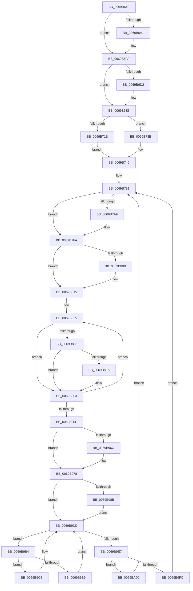

# sub_0069B640

- RVA: `0x0069B640`–`0x0069BA28` (길이 `1,000` bytes)
- VA: `0x000000014069B640`
- 실행 섹션: `.text`
- PDB 이름 있음: `아니요`; PDB Function 태그: `아니요`
- unwind 정보 RVA: `0x000D97A8`
- 디코드: `277`개 명령, `1,000/1,000` bytes 표시
- 미해석 바이트: `0` (있으면 어셈블리에 `.byte`로 보존)

> 이 문서는 커널 이미지의 기계어와 PDB 기호를 분석해 생성했습니다. 4번과 5번은 함수 원형과 자료형을 바이너리 사용 방식에서 추정한 C 해석이며 원본 소스 복구 결과는 아닙니다.

## 1. Dependencies

- 직접 호출 지점: **18**; 고유 호출 대상: **10**
- 직접 호출자로 확인된 함수: **0**
- RIP 상대 이미지 참조: **3**

### Outgoing calls
- `0x0069B657` → [KeExitRetpoline](../46/KeExitRetpoline_function_00468E7C.md) (function, `0x00468E7C`)
- `0x0069B65C` → [PsQueryThreadTerminationPort](../../page/70/PsQueryThreadTerminationPort_function_00706290.md) (function, `0x00706290`)
- `0x0069B66B` → [ExGenRandom](../41/ExGenRandom_function_0041B010.md) (function, `0x0041B010`)
- `0x0069B6AA` → [KeRundownApcQueues](../../page/90/KeRundownApcQueues_function_00905C44.md) (function, `0x00905C44`)
- `0x0069B6B1` → [ExGenRandom](../41/ExGenRandom_function_0041B010.md) (function, `0x0041B010`)
- `0x0069B6F9` → [KeWaitForSingleObject](../20/KeWaitForSingleObject_function_0020E6B0.md) (function, `0x0020E6B0`)
- `0x0069B700` → [ExGenRandom](../41/ExGenRandom_function_0041B010.md) (function, `0x0041B010`)
- `0x0069B741` → [KeResetEvent](../24/KeResetEvent_function_00248350.md) (function, `0x00248350`)
- `0x0069B754` → [ExGenRandom](../41/ExGenRandom_function_0041B010.md) (function, `0x0041B010`)
- `0x0069B7D4` → [guard_dispatch_icall](../6B/guard_dispatch_icall_function_006BAAD0.md) (function, `0x006BAAD0`)
- `0x0069B810` → [KiRaiseIrqlProcessIrqlFlags](../4F/KiRaiseIrqlProcessIrqlFlags_function_004F56FC.md) (function, `0x004F56FC`)
- `0x0069B95E` → [guard_dispatch_icall](../6B/guard_dispatch_icall_function_006BAAD0.md) (function, `0x006BAAD0`)
- `0x0069B973` → [KiLowerIrqlProcessIrqlFlags](../4F/KiLowerIrqlProcessIrqlFlags_function_004F5698.md) (function, `0x004F5698`)
- `0x0069B99D` → [guard_dispatch_icall](../6B/guard_dispatch_icall_function_006BAAD0.md) (function, `0x006BAAD0`)
- `0x0069B9BF` → [KeDelayExecutionThread](../20/KeDelayExecutionThread_function_00209550.md) (function, `0x00209550`)
- `0x0069B9D8` → [KeWaitForSingleObject](../20/KeWaitForSingleObject_function_0020E6B0.md) (function, `0x0020E6B0`)
- `0x0069BA02` → [KeDelayExecutionThread](../20/KeDelayExecutionThread_function_00209550.md) (function, `0x00209550`)
- `0x0069BA1E` → [KeWaitForSingleObject](../20/KeWaitForSingleObject_function_0020E6B0.md) (function, `0x0020E6B0`)

### Direct callers
- 이 함수 시작 RVA로 연결되는 직접 call은 확인되지 않았습니다. 간접 호출은 완전히 역산할 수 없습니다.

### Static image references
- `0x0069B802` → RVA `0x00FC6D20` (`ALMOSTRO`; read)
- `0x0069B855` → RVA `0x00FC6F78` (`ALMOSTRO`; read)
- `0x0069B880` → RVA `0x00FC7250` (`ALMOSTRO`; read)

## 2. Other-region calls and transfers

- 다른 실행 섹션으로 향하는 call: **2**
  - `0x0069B65C` → [PsQueryThreadTerminationPort](../../page/70/PsQueryThreadTerminationPort_function_00706290.md) (`.text` → `PAGE`)
  - `0x0069B6AA` → [KeRundownApcQueues](../../page/90/KeRundownApcQueues_function_00905C44.md) (`.text` → `PAGE`)
- 별도 외부 분기/꼬리 이동을 확인하지 못했습니다.

## 3. Assembly (complete function range)

```asm
0069B640  40 55                           push rbp
0069B642  53                              push rbx
0069B643  56                              push rsi
0069B644  57                              push rdi
0069B645  41 54                           push r12
0069B647  41 55                           push r13
0069B649  41 56                           push r14
0069B64B  41 57                           push r15
0069B64D  48 8B EC                        mov rbp, rsp
0069B650  48 83 EC 68                     sub rsp, 0x68
0069B654  48 8B D9                        mov rbx, rcx
0069B657  E8 20 D8 DC FF                  call 0x140468e7c
0069B65C  E8 2F AC 06 00                  call 0x140706290
0069B661  BE 01 00 00 00                  mov esi, 1
0069B666  4C 8B F0                        mov r14, rax
0069B669  8B CE                           mov ecx, esi
0069B66B  E8 A0 F9 D7 FF                  call 0x14041b010
0069B670  8B F8                           mov edi, eax
0069B672  48 C7 C1 00 74 79 B8            mov rcx, 0xffffffffb8797400
0069B679  48 B8 FD CE 61 84 11 77 CC AB   movabs rax, 0xabcc77118461cefd
0069B683  48 F7 E7                        mul rdi
0069B686  48 C1 EA 1A                     shr rdx, 0x1a
0069B68A  48 69 D2 00 E1 F5 05            imul rdx, rdx, 0x5f5e100
0069B691  48 2B FA                        sub rdi, rdx
0069B694  48 2B CF                        sub rcx, rdi
0069B697  48 89 4D 58                     mov qword ptr [rbp + 0x58], rcx
0069B69B  48 39 73 08                     cmp qword ptr [rbx + 8], rsi
0069B69F  75 0E                           jne 0x14069b6af
0069B6A1  65 48 8B 0C 25 88 01 00 00      mov rcx, qword ptr gs:[0x188]
0069B6AA  E8 95 A5 26 00                  call 0x140905c44
0069B6AF  8B CE                           mov ecx, esi
0069B6B1  E8 5A F9 D7 FF                  call 0x14041b010
0069B6B6  8B F8                           mov edi, eax
0069B6B8  41 BD CD CC CC CC               mov r13d, 0xcccccccd
0069B6BE  41 8B C5                        mov eax, r13d
0069B6C1  F7 E7                           mul edi
0069B6C3  C1 EA 03                        shr edx, 3
0069B6C6  8D 0C 92                        lea ecx, [rdx + rdx*4]
0069B6C9  03 C9                           add ecx, ecx
0069B6CB  2B F9                           sub edi, ecx
0069B6CD  83 FF 03                        cmp edi, 3
0069B6D0  73 11                           jae 0x14069b6e3
0069B6D2  65 48 8B 04 25 88 01 00 00      mov rax, qword ptr gs:[0x188]
0069B6DB  66 FF 88 E6 01 00 00            dec word ptr [rax + 0x1e6]
0069B6E2  90                              nop
0069B6E3  4C 8B 3B                        mov r15, qword ptr [rbx]
0069B6E6  45 33 E4                        xor r12d, r12d
0069B6E9  49 8B CF                        mov rcx, r15
0069B6EC  4C 89 64 24 20                  mov qword ptr [rsp + 0x20], r12
0069B6F1  45 33 C9                        xor r9d, r9d
0069B6F4  45 33 C0                        xor r8d, r8d
0069B6F7  33 D2                           xor edx, edx
0069B6F9  E8 B2 2F B7 FF                  call 0x14020e6b0
0069B6FE  8B CE                           mov ecx, esi
0069B700  E8 0B F9 D7 FF                  call 0x14041b010
0069B705  8B F8                           mov edi, eax
0069B707  41 8B C5                        mov eax, r13d
0069B70A  F7 E7                           mul edi
0069B70C  C1 EA 03                        shr edx, 3
0069B70F  8D 0C 92                        lea ecx, [rdx + rdx*4]
0069B712  03 C9                           add ecx, ecx
0069B714  2B F9                           sub edi, ecx
0069B716  83 FF 05                        cmp edi, 5
0069B719  73 23                           jae 0x14069b73e
0069B71B  48 8D 45 E0                     lea rax, [rbp - 0x20]
0069B71F  66 44 89 65 D8                  mov word ptr [rbp - 0x28], r12w
0069B724  48 89 45 E8                     mov qword ptr [rbp - 0x18], rax
0069B728  4C 8D 7D D8                     lea r15, [rbp - 0x28]
0069B72C  48 8D 45 E0                     lea rax, [rbp - 0x20]
0069B730  C6 45 DA 06                     mov byte ptr [rbp - 0x26], 6
0069B734  48 89 45 E0                     mov qword ptr [rbp - 0x20], rax
0069B738  44 89 65 DC                     mov dword ptr [rbp - 0x24], r12d
0069B73C  EB 08                           jmp 0x14069b746
0069B73E  49 8B CF                        mov rcx, r15
0069B741  E8 0A CC BA FF                  call 0x140248350
0069B746  48 8B 7B 10                     mov rdi, qword ptr [rbx + 0x10]
0069B74A  8B CE                           mov ecx, esi
0069B74C  4C 89 63 10                     mov qword ptr [rbx + 0x10], r12
0069B750  48 8B 5F 20                     mov rbx, qword ptr [rdi + 0x20]
0069B754  E8 B7 F8 D7 FF                  call 0x14041b010
0069B759  8B F0                           mov esi, eax
0069B75B  48 B8 DB 27 2A BC 17 A2 15 6A   movabs rax, 0x6a15a217bc2a27db
0069B765  48 33 F0                        xor rsi, rax
0069B768  4D 89 26                        mov qword ptr [r14], r12
0069B76B  4C 8B EE                        mov r13, rsi
0069B76E  48 8B C6                        mov rax, rsi
0069B771  48 33 C7                        xor rax, rdi
0069B774  48 89 45 48                     mov qword ptr [rbp + 0x48], rax
0069B778  48 8B C6                        mov rax, rsi
0069B77B  48 33 C3                        xor rax, rbx
0069B77E  48 8B 5D 48                     mov rbx, qword ptr [rbp + 0x48]
0069B782  41 83 E5 01                     and r13d, 1
0069B786  48 89 45 50                     mov qword ptr [rbp + 0x50], rax
0069B78A  4C 89 6D 60                     mov qword ptr [rbp + 0x60], r13
0069B78E  48 8B F8                        mov rdi, rax
0069B791  48 8B C6                        mov rax, rsi
0069B794  B9 02 00 00 00                  mov ecx, 2
0069B799  48 33 C7                        xor rax, rdi
0069B79C  48 C1 F8 2F                     sar rax, 0x2f
0069B7A0  48 FF C0                        inc rax
0069B7A3  48 83 F8 01                     cmp rax, 1
0069B7A7  77 51                           ja 0x14069b7fa
0069B7A9  48 8B C6                        mov rax, rsi
0069B7AC  48 33 C3                        xor rax, rbx
0069B7AF  48 89 45 48                     mov qword ptr [rbp + 0x48], rax
0069B7B3  48 8B C6                        mov rax, rsi
0069B7B6  48 33 C7                        xor rax, rdi
0069B7B9  48 8B 7D 48                     mov rdi, qword ptr [rbp + 0x48]
0069B7BD  48 89 45 50                     mov qword ptr [rbp + 0x50], rax
0069B7C1  48 8B CF                        mov rcx, rdi
0069B7C4  48 8B 55 50                     mov rdx, qword ptr [rbp + 0x50]
0069B7C8  48 8B 47 18                     mov rax, qword ptr [rdi + 0x18]
0069B7CC  4C 8B 4F 30                     mov r9, qword ptr [rdi + 0x30]
0069B7D0  4C 8B 47 28                     mov r8, qword ptr [rdi + 0x28]
0069B7D4  E8 F7 F2 01 00                  call 0x1406baad0
0069B7D9  48 8B C6                        mov rax, rsi
0069B7DC  B9 02 00 00 00                  mov ecx, 2
0069B7E1  48 33 47 20                     xor rax, qword ptr [rdi + 0x20]
0069B7E5  48 89 45 50                     mov qword ptr [rbp + 0x50], rax
0069B7E9  48 8B C6                        mov rax, rsi
0069B7EC  48 33 C7                        xor rax, rdi
0069B7EF  48 8B 7D 50                     mov rdi, qword ptr [rbp + 0x50]
0069B7F3  48 89 45 48                     mov qword ptr [rbp + 0x48], rax
0069B7F7  48 8B D8                        mov rbx, rax
0069B7FA  45 0F 20 C4                     mov r12, cr8
0069B7FE  44 0F 22 C1                     mov cr8, rcx
0069B802  83 3D 17 B5 92 00 00            cmp dword ptr [rip + 0x92b517], 0
0069B809  74 0A                           je 0x14069b815
0069B80B  8A D1                           mov dl, cl
0069B80D  41 8A CC                        mov cl, r12b
0069B810  E8 E7 9E E5 FF                  call 0x1404f56fc
0069B815  48 8B C6                        mov rax, rsi
0069B818  4C 8B D6                        mov r10, rsi
0069B81B  48 33 C3                        xor rax, rbx
0069B81E  41 BB 19 00 00 00               mov r11d, 0x19
0069B824  49 BD 52 4C 04 52 4C 14 82 0B   movabs r13, 0xb82144c52044c52
0069B82E  4C 33 50 40                     xor r10, qword ptr [rax + 0x40]
0069B832  48 B8 00 00 00 00 00 80 FF FF   movabs rax, 0xffff800000000000
0069B83C  4C 33 D7                        xor r10, rdi
0069B83F  4C 0B D0                        or r10, rax
0069B842  41 8A CA                        mov cl, r10b
0069B845  49 8B DA                        mov rbx, r10
0069B848  80 E1 3F                        and cl, 0x3f
0069B84B  48 D3 CB                        ror rbx, cl
0069B84E  45 33 C9                        xor r9d, r9d
0069B851  4D 8D 42 F8                     lea r8, [r10 - 8]
0069B855  48 8B 0D 1C B7 92 00            mov rcx, qword ptr [rip + 0x92b71c]
0069B85C  49 8D 40 08                     lea rax, [r8 + 8]
0069B860  48 8B 38                        mov rdi, qword ptr [rax]
0069B863  4C 8D 00                        lea r8, [rax]
0069B866  48 8B C7                        mov rax, rdi
0069B869  BA C8 00 00 00                  mov edx, 0xc8
0069B86E  48 33 C1                        xor rax, rcx
0069B871  41 2B D1                        sub edx, r9d
0069B874  48 D3 C0                        rol rax, cl
0069B877  48 33 C3                        xor rax, rbx
0069B87A  41 8B C9                        mov ecx, r9d
0069B87D  48 0F C8                        bswap rax
0069B880  48 33 05 C9 B9 92 00            xor rax, qword ptr [rip + 0x92b9c9]
0069B887  49 03 C2                        add rax, r10
0069B88A  48 03 C8                        add rcx, rax
0069B88D  41 8B C1                        mov eax, r9d
0069B890  49 89 08                        mov qword ptr [r8], rcx
0069B893  48 33 D0                        xor rdx, rax
0069B896  8B CF                           mov ecx, edi
0069B898  40 80 F7 FA                     xor dil, 0xfa
0069B89C  F7 D1                           not ecx
0069B89E  40 80 E7 3F                     and dil, 0x3f
0069B8A2  83 E1 3F                        and ecx, 0x3f
0069B8A5  48 D3 CA                        ror rdx, cl
0069B8A8  40 8A CF                        mov cl, dil
0069B8AB  48 33 DA                        xor rbx, rdx
0069B8AE  48 D3 C3                        rol rbx, cl
0069B8B1  49 03 DA                        add rbx, r10
0069B8B4  48 81 F3 FF 68 80 2F            xor rbx, 0x2f8068ff
0069B8BB  41 83 F9 18                     cmp r9d, 0x18
0069B8BF  75 42                           jne 0x14069b903
0069B8C1  4C 89 6D 48                     mov qword ptr [rbp + 0x48], r13
0069B8C5  48 8B 4D 48                     mov rcx, qword ptr [rbp + 0x48]
0069B8C9  48 8B 45 48                     mov rax, qword ptr [rbp + 0x48]
0069B8CD  48 C1 E0 0A                     shl rax, 0xa
0069B8D1  48 C1 E9 36                     shr rcx, 0x36
0069B8D5  48 0B C1                        or rax, rcx
0069B8D8  48 89 45 48                     mov qword ptr [rbp + 0x48], rax
0069B8DC  48 8B 45 48                     mov rax, qword ptr [rbp + 0x48]
0069B8E0  49 3B 02                        cmp rax, qword ptr [r10]
0069B8E3  74 1E                           je 0x14069b903
0069B8E5  48 8B 45 48                     mov rax, qword ptr [rbp + 0x48]
0069B8E9  49 33 00                        xor rax, qword ptr [r8]
0069B8EC  49 33 02                        xor rax, qword ptr [r10]
0069B8EF  49 89 00                        mov qword ptr [r8], rax
0069B8F2  48 8B 45 48                     mov rax, qword ptr [rbp + 0x48]
0069B8F6  49 33 00                        xor rax, qword ptr [r8]
0069B8F9  45 03 58 04                     add r11d, dword ptr [r8 + 4]
0069B8FD  49 33 02                        xor rax, qword ptr [r10]
0069B900  49 89 00                        mov qword ptr [r8], rax
0069B903  41 FF C1                        inc r9d
0069B906  45 3B CB                        cmp r9d, r11d
0069B909  0F 82 46 FF FF FF               jb 0x14069b855
0069B90F  4C 8B 6D 60                     mov r13, qword ptr [rbp + 0x60]
0069B913  48 B8 52 4C 04 52 4C 14 82 0B   movabs rax, 0xb82144c52044c52
0069B91D  48 89 45 48                     mov qword ptr [rbp + 0x48], rax
0069B921  45 33 C9                        xor r9d, r9d
0069B924  48 8B 4D 48                     mov rcx, qword ptr [rbp + 0x48]
0069B928  45 33 C0                        xor r8d, r8d
0069B92B  48 8B 45 48                     mov rax, qword ptr [rbp + 0x48]
0069B92F  48 C1 E0 0A                     shl rax, 0xa
0069B933  48 C1 E9 36                     shr rcx, 0x36
0069B937  48 0B C1                        or rax, rcx
0069B93A  49 8B CA                        mov rcx, r10
0069B93D  48 89 45 48                     mov qword ptr [rbp + 0x48], rax
0069B941  49 8B C2                        mov rax, r10
0069B944  48 8B 55 48                     mov rdx, qword ptr [rbp + 0x48]
0069B948  49 33 12                        xor rdx, qword ptr [r10]
0069B94B  41 C6 42 03 11                  mov byte ptr [r10 + 3], 0x11
0069B950  41 C6 42 02 31                  mov byte ptr [r10 + 2], 0x31
0069B955  41 C6 42 01 48                  mov byte ptr [r10 + 1], 0x48
0069B95A  41 C6 02 2E                     mov byte ptr [r10], 0x2e
0069B95E  E8 6D F1 01 00                  call 0x1406baad0
0069B963  83 3D B6 B3 92 00 00            cmp dword ptr [rip + 0x92b3b6], 0
0069B96A  74 0C                           je 0x14069b978
0069B96C  44 0F 20 C1                     mov rcx, cr8
0069B970  41 8A D4                        mov dl, r12b
0069B973  E8 20 9D E5 FF                  call 0x1404f5698
0069B978  41 0F B6 C4                     movzx eax, r12b
0069B97C  44 0F 22 C0                     mov cr8, rax
0069B980  49 8B 3E                        mov rdi, qword ptr [r14]
0069B983  45 33 E4                        xor r12d, r12d
0069B986  48 85 FF                        test rdi, rdi
0069B989  7E 52                           jle 0x14069b9dd
0069B98B  48 F7 DF                        neg rdi
0069B98E  4D 89 26                        mov qword ptr [r14], r12
0069B991  48 89 7D C8                     mov qword ptr [rbp - 0x38], rdi
0069B995  48 8B 47 10                     mov rax, qword ptr [rdi + 0x10]
0069B999  48 8B 4F 18                     mov rcx, qword ptr [rdi + 0x18]
0069B99D  E8 2E F1 01 00                  call 0x1406baad0
0069B9A2  33 C0                           xor eax, eax
0069B9A4  8D 48 20                        lea ecx, [rax + 0x20]
0069B9A7  F3 AA                           rep stosb byte ptr [rdi], al
0069B9A9  48 8D 7D C8                     lea rdi, [rbp - 0x38]
0069B9AD  8D 48 08                        lea ecx, [rax + 8]
0069B9B0  F3 AA                           rep stosb byte ptr [rdi], al
0069B9B2  EB 29                           jmp 0x14069b9dd
0069B9B4  4D 85 ED                        test r13, r13
0069B9B7  74 0D                           je 0x14069b9c6
0069B9B9  4C 8D 45 58                     lea r8, [rbp + 0x58]
0069B9BD  33 C9                           xor ecx, ecx
0069B9BF  E8 8C DB B6 FF                  call 0x140209550
0069B9C4  EB 17                           jmp 0x14069b9dd
0069B9C6  48 8D 45 58                     lea rax, [rbp + 0x58]
0069B9CA  45 33 C9                        xor r9d, r9d
0069B9CD  45 33 C0                        xor r8d, r8d
0069B9D0  48 89 44 24 20                  mov qword ptr [rsp + 0x20], rax
0069B9D5  49 8B CF                        mov rcx, r15
0069B9D8  E8 D3 2C B7 FF                  call 0x14020e6b0
0069B9DD  49 8B 06                        mov rax, qword ptr [r14]
0069B9E0  33 D2                           xor edx, edx
0069B9E2  48 85 C0                        test rax, rax
0069B9E5  74 CD                           je 0x14069b9b4
0069B9E7  48 8B D8                        mov rbx, rax
0069B9EA  48 8B FE                        mov rdi, rsi
0069B9ED  48 33 78 20                     xor rdi, qword ptr [rax + 0x20]
0069B9F1  48 33 DE                        xor rbx, rsi
0069B9F4  4D 89 26                        mov qword ptr [r14], r12
0069B9F7  4D 85 ED                        test r13, r13
0069B9FA  74 10                           je 0x14069ba0c
0069B9FC  4C 8D 45 58                     lea r8, [rbp + 0x58]
0069BA00  33 C9                           xor ecx, ecx
0069BA02  E8 49 DB B6 FF                  call 0x140209550
0069BA07  E9 85 FD FF FF                  jmp 0x14069b791
0069BA0C  48 8D 45 58                     lea rax, [rbp + 0x58]
0069BA10  45 33 C9                        xor r9d, r9d
0069BA13  45 33 C0                        xor r8d, r8d
0069BA16  48 89 44 24 20                  mov qword ptr [rsp + 0x20], rax
0069BA1B  49 8B CF                        mov rcx, r15
0069BA1E  E8 8D 2C B7 FF                  call 0x14020e6b0
0069BA23  E9 69 FD FF FF                  jmp 0x14069b791
```

## 4. C-style interpretation (structured pseudocode)

```c
__int64 __fastcall sub_0069B640(__int64 a1, __int64 a2, int a3, int a4)
{
    __int64 result;
    __int64 v_r10;
    __int64 v_r11;
    __int64 v_r12;
    __int64 v_r13;
    __int64 v_rbx;
    __int64 v_rdi;
    __int64 v_rsi;
    __int64 v_rsp;
    unsigned __int64 v_stack_m58;
    unsigned __int64 v_stack_m60;
    unsigned int v_stack_m64;
    unsigned __int8 v_stack_m66;
    unsigned __int16 v_stack_m68;
    unsigned __int64 v_stack_m78;
    unsigned __int64 v_stack_m88;
    unsigned __int64 v_stack_p10;
    unsigned __int64 v_stack_p18;
    unsigned __int64 v_stack_p20;
    unsigned __int64 v_stack_p8;

    v_rsp = (v_rsp) - (104);
    result = KeExitRetpoline(a1, a2, a3, a4);
    result = PsQueryThreadTerminationPort(a1, a2, a3, a4);
    result = ExGenRandom(1, a2, a3, a4);
    a2 = (a2) >> (26);
    a2 = (a2) * (a2);
    v_rdi = ((unsigned int)((unsigned int)(result))) - (a2);
    a1 = (0xFFFFFFFFB8797400ULL) - (v_rdi);
    v_stack_p18 = a1;
    if ((*(unsigned __int64 *)(a1 + 8)) == 1) {
        a1 = *(unsigned __int64 *)(gs_base + (0 + 392));
        result = KeRundownApcQueues(a1, a2, a3, a4);
    }
    result = ExGenRandom(1, a2, a3, a4);
    a2 = (unsigned int)((a2) >> (3));
    a1 = (unsigned int)((a2 + a2 * 4) + ((unsigned int)(a2 + a2 * 4)));
    v_rdi = (unsigned int)(((unsigned int)((unsigned int)(result))) - ((unsigned int)(a1)));
    result = (unsigned int)((unsigned int)((unsigned int)(0xCCCCCCCDULL)));
    if (((unsigned int)(v_rdi)) < 3) {
        result = *(unsigned __int64 *)(gs_base + (0 + 392));
    }
    v_r12 = 0;
    v_stack_m88 = 0;
    a4 = 0;
    a3 = 0;
    a2 = 0;
    result = KeWaitForSingleObject(*(unsigned __int64 *)(a1), a2, a3, a4);
    result = ExGenRandom(1, a2, a3, a4);
    a2 = (unsigned int)((a2) >> (3));
    a1 = (unsigned int)((a2 + a2 * 4) + ((unsigned int)(a2 + a2 * 4)));
    v_rdi = (unsigned int)(((unsigned int)((unsigned int)(result))) - ((unsigned int)(a1)));
    if (((unsigned int)(v_rdi)) >= 5) goto loc_0069B73E;
    v_stack_m68 = 0;
    v_stack_m58 = v_stack_m60;
    v_stack_m66 = 6;
    v_stack_m60 = v_stack_m60;
    v_stack_m64 = 0;
    goto loc_0069B746;
loc_0069B73E:
    result = KeResetEvent(v_stack_m68, a2, a3, a4);
loc_0069B746:
    *(unsigned __int64 *)(a1 + 16) = 0;
    result = ExGenRandom(1, a2, a3, a4);
    v_rsi = ((unsigned int)((unsigned int)(result))) ^ (result);
    *(unsigned __int64 *)(result) = 0;
    result = (v_rsi) ^ (*(unsigned __int64 *)(a1 + 16));
    v_stack_p8 = result;
    result = (v_rsi) ^ (*(unsigned __int64 *)(*(unsigned __int64 *)(a1 + 16) + 32));
    v_r13 = (unsigned int)((v_rsi) & (1));
    v_stack_p10 = result;
    v_stack_p20 = v_r13;
loc_0069B791:
    result = (v_rsi) ^ (result);
    result = (result) >> (47);
    result = (result) + 1;
    v_rbx = v_stack_p8;
    v_rdi = result;
    if (result <= 1) {
        result = v_rsi;
        result = (result) ^ (v_stack_p8);
        v_stack_p8 = result;
        result = v_rsi;
        result = (result) ^ (result);
        v_rdi = v_stack_p8;
        v_stack_p10 = result;
        a1 = v_rdi;
        a2 = v_stack_p10;
        result = *(unsigned __int64 *)(v_rdi + 24);
        a4 = *(unsigned __int64 *)(v_rdi + 48);
        a3 = *(unsigned __int64 *)(v_rdi + 40);
        result = guard_dispatch_icall(a1, a2, a3, a4);
        result = v_rsi;
        a1 = 2;
        result = (result) ^ (*(unsigned __int64 *)(v_rdi + 32));
        v_stack_p10 = result;
        result = v_rsi;
        result = (result) ^ (v_rdi);
        v_rdi = v_stack_p10;
        v_stack_p8 = result;
        v_rbx = result;
    }
    if ((*(unsigned int *)(v_rip + 9614615)) != 0) {
        a2 = (unsigned __int8)(a1);
        a1 = (unsigned __int8)(v_cr8);
        result = KiRaiseIrqlProcessIrqlFlags(a1, a2, a3, a4);
    }
    result = (v_rsi) ^ (v_rbx);
    v_r10 = (v_rsi) ^ (*(unsigned __int64 *)(result + 64));
    v_r10 = (v_r10) ^ (v_rdi);
    v_r10 = (v_r10) | (result);
    a1 = (unsigned __int8)(((unsigned __int8)(v_r10)) & (63));
    a4 = 0;
loc_0069B855:
    result = (*(unsigned __int64 *)(v_r10 - 8 + 8)) ^ (*(unsigned __int64 *)(v_rip + 9615132));
    a2 = (unsigned int)((200) - (0));
    result = (result) ^ (v_r10);
    result = (result) ^ (*(unsigned __int64 *)(v_rip + 9615817));
    result = (result) + (v_r10);
    a1 = (0) + (result);
    *(unsigned __int64 *)(v_r10 - 8 + 8) = a1;
    a2 = (a2) ^ (0);
    v_rdi = (unsigned __int8)((*(unsigned __int64 *)(v_r10 - 8 + 8)) ^ (250));
    a1 = (unsigned int)(~((unsigned int)((unsigned int)(*(unsigned __int64 *)(v_r10 - 8 + 8)))));
    v_rdi = (unsigned __int8)((v_rdi) & (63));
    a1 = (unsigned int)((a1) & (63));
    v_rbx = (v_r10) ^ (a2);
    v_rbx = (v_rbx) + (v_r10);
    v_rbx = (v_rbx) ^ (0x2F8068FFULL);
    if (0 != 24) goto loc_0069B903;
    v_stack_p8 = v_r13;
    result = (v_stack_p8) << (10);
    a1 = (v_stack_p8) >> (54);
    result = (result) | (a1);
    v_stack_p8 = result;
    result = v_stack_p8;
    v_r11 = 25;
    if (v_stack_p8 != (*(unsigned __int64 *)(v_r10))) {
        result = v_stack_p8;
        result = (result) ^ (*(unsigned __int64 *)(v_r10 - 8 + 8));
        result = (result) ^ (*(unsigned __int64 *)(v_r10));
        *(unsigned __int64 *)(v_r10 - 8 + 8) = result;
        result = v_stack_p8;
        result = (result) ^ (*(unsigned __int64 *)(v_r10 - 8 + 8));
        v_r11 = (unsigned int)((25) + (*(unsigned int *)(v_r10 - 8 + 8 + 4)));
        result = (result) ^ (*(unsigned __int64 *)(v_r10));
        *(unsigned __int64 *)(v_r10 - 8 + 8) = result;
    }
    a4 = (unsigned int)((a4) + 1);
    if (a4 < ((unsigned int)(v_r11))) goto loc_0069B855;
    v_stack_p8 = result;
    a4 = 0;
    a3 = 0;
    result = (v_stack_p8) << (10);
    a1 = (v_stack_p8) >> (54);
    result = (result) | (a1);
    v_stack_p8 = result;
    a2 = (v_stack_p8) ^ (*(unsigned __int64 *)(v_r10));
    *(unsigned __int8 *)(v_r10 + 3) = 17;
    *(unsigned __int8 *)(v_r10 + 2) = 49;
    *(unsigned __int8 *)(v_r10 + 1) = 72;
    *(unsigned __int8 *)(v_r10) = 46;
    result = guard_dispatch_icall(v_r10, a2, a3, a4);
    if ((*(unsigned int *)(v_rip + 9614262)) != 0) {
        a1 = a1;
        a2 = (unsigned __int8)(v_cr8);
        result = KiLowerIrqlProcessIrqlFlags(a1, a2, a3, a4);
    }
    v_r12 = 0;
    if (condition_is_less_or_equal) goto loc_0069B9DD;
    v_rdi = -(*(unsigned __int64 *)(result));
    *(unsigned __int64 *)(result) = 0;
    v_stack_m78 = v_rdi;
    result = guard_dispatch_icall(*(unsigned __int64 *)(v_rdi + 24), a2, a3, a4);
    result = 0;
    goto loc_0069B9DD;
loc_0069B9B4:
    if (v_stack_p20 == 0) goto loc_0069B9C6;
    a1 = 0;
    result = KeDelayExecutionThread(a1, a2, v_stack_p18, a4);
    goto loc_0069B9DD;
loc_0069B9C6:
    a4 = 0;
    a3 = 0;
    v_stack_m88 = v_stack_p18;
    result = KeWaitForSingleObject(v_stack_m68, a2, a3, a4);
loc_0069B9DD:
    a2 = 0;
    if (*(unsigned __int64 *)(result) == 0) goto loc_0069B9B4;
    v_rdi = (v_rsi) ^ (*(unsigned __int64 *)(*(unsigned __int64 *)(result) + 32));
    v_rbx = (*(unsigned __int64 *)(result)) ^ (v_rsi);
    *(unsigned __int64 *)(result) = 0;
    if (v_stack_p20 == 0) goto loc_0069BA0C;
    a1 = 0;
    result = KeDelayExecutionThread(a1, a2, v_stack_p18, a4);
    goto loc_0069B791;
loc_0069BA0C:
    a4 = 0;
    a3 = 0;
    v_stack_m88 = v_stack_p18;
    result = KeWaitForSingleObject(v_stack_m68, a2, a3, a4);
    goto loc_0069B791;
}
```

## 5. (Beta) C Style

```c
int64_t sub_0069B640(void *Arg1, int64_t Arg2, int32_t Arg3, int32_t Arg4)
{
    uint8_t *arg1 = (uint8_t *)Arg1;

    int64_t result;
    int64_t local_r10;
    int64_t local_r11;
    int64_t local_r12;
    int64_t local_r13;
    int64_t local_rbx;
    int64_t local_rdi;
    int64_t local_rsi;
    int64_t local_rsp;
    uint64_t v_stack_m58;
    uint64_t v_stack_m60;
    uint32_t v_stack_m64;
    uint8_t v_stack_m66;
    uint16_t v_stack_m68;
    uint64_t v_stack_m78;
    uint64_t v_stack_m88;
    uint64_t v_stack_p10;
    uint64_t v_stack_p18;
    uint64_t v_stack_p20;
    uint64_t v_stack_p8;

    local_rsp = (local_rsp) - (104);
    result = KeExitRetpoline(Arg1, Arg2, Arg3, Arg4);
    result = PsQueryThreadTerminationPort(Arg1, Arg2, Arg3, Arg4);
    result = ExGenRandom(1, Arg2, Arg3, Arg4);
    Arg2 = (Arg2) >> (26);
    Arg2 = (Arg2) * (Arg2);
    local_rdi = ((uint32_t)((uint32_t)(result))) - (Arg2);
    Arg1 = (0xFFFFFFFFB8797400ULL) - (local_rdi);
    v_stack_p18 = Arg1;
    if ((*(uint64_t *)(arg1 + 0x8)) == 1) {
        Arg1 = *(uint64_t *)(gs_base + (0 + 0x188));
        result = KeRundownApcQueues(Arg1, Arg2, Arg3, Arg4);
    }
    result = ExGenRandom(1, Arg2, Arg3, Arg4);
    Arg2 = (uint32_t)((Arg2) >> (3));
    Arg1 = (uint32_t)((Arg2 + Arg2 * 4) + ((uint32_t)(Arg2 + Arg2 * 4)));
    local_rdi = (uint32_t)(((uint32_t)((uint32_t)(result))) - ((uint32_t)(Arg1)));
    result = (uint32_t)((uint32_t)((uint32_t)(0xCCCCCCCDULL)));
    if (((uint32_t)(local_rdi)) < 3) {
        result = *(uint64_t *)(gs_base + (0 + 0x188));
    }
    local_r12 = 0;
    v_stack_m88 = 0;
    Arg4 = 0;
    Arg3 = 0;
    Arg2 = 0;
    result = KeWaitForSingleObject(*(uint64_t *)(arg1), Arg2, Arg3, Arg4);
    result = ExGenRandom(1, Arg2, Arg3, Arg4);
    Arg2 = (uint32_t)((Arg2) >> (3));
    Arg1 = (uint32_t)((Arg2 + Arg2 * 4) + ((uint32_t)(Arg2 + Arg2 * 4)));
    local_rdi = (uint32_t)(((uint32_t)((uint32_t)(result))) - ((uint32_t)(Arg1)));
    if (((uint32_t)(local_rdi)) >= 5) goto loc_0069B73E;
    v_stack_m68 = 0;
    v_stack_m58 = v_stack_m60;
    v_stack_m66 = 6;
    v_stack_m60 = v_stack_m60;
    v_stack_m64 = 0;
    goto loc_0069B746;
loc_0069B73E:
    result = KeResetEvent(v_stack_m68, Arg2, Arg3, Arg4);
loc_0069B746:
    *(uint64_t *)(arg1 + 0x10) = 0;
    result = ExGenRandom(1, Arg2, Arg3, Arg4);
    local_rsi = ((uint32_t)((uint32_t)(result))) ^ (result);
    *(uint64_t *)(result) = 0;
    result = (local_rsi) ^ (*(uint64_t *)(arg1 + 0x10));
    v_stack_p8 = result;
    result = (local_rsi) ^ (*(uint64_t *)(*(uint64_t *)(arg1 + 0x10) + 0x20));
    local_r13 = (uint32_t)((local_rsi) & (1));
    v_stack_p10 = result;
    v_stack_p20 = local_r13;
loc_0069B791:
    result = (local_rsi) ^ (result);
    result = (result) >> (47);
    result = (result) + 1;
    local_rbx = v_stack_p8;
    local_rdi = result;
    if (result <= 1) {
        result = local_rsi;
        result = (result) ^ (v_stack_p8);
        v_stack_p8 = result;
        result = local_rsi;
        result = (result) ^ (result);
        local_rdi = v_stack_p8;
        v_stack_p10 = result;
        Arg1 = local_rdi;
        Arg2 = v_stack_p10;
        result = *(uint64_t *)(local_rdi + 0x18);
        Arg4 = *(uint64_t *)(local_rdi + 0x30);
        Arg3 = *(uint64_t *)(local_rdi + 0x28);
        result = guard_dispatch_icall(Arg1, Arg2, Arg3, Arg4);
        result = local_rsi;
        Arg1 = 2;
        result = (result) ^ (*(uint64_t *)(local_rdi + 0x20));
        v_stack_p10 = result;
        result = local_rsi;
        result = (result) ^ (local_rdi);
        local_rdi = v_stack_p10;
        v_stack_p8 = result;
        local_rbx = result;
    }
    if ((*(uint32_t *)(v_rip + 0x92B517)) != 0) {
        Arg2 = (uint8_t)(Arg1);
        Arg1 = (uint8_t)(v_cr8);
        result = KiRaiseIrqlProcessIrqlFlags(Arg1, Arg2, Arg3, Arg4);
    }
    result = (local_rsi) ^ (local_rbx);
    local_r10 = (local_rsi) ^ (*(uint64_t *)(result + 0x40));
    local_r10 = (local_r10) ^ (local_rdi);
    local_r10 = (local_r10) | (result);
    Arg1 = (uint8_t)(((uint8_t)(local_r10)) & (63));
    Arg4 = 0;
loc_0069B855:
    result = (*(uint64_t *)(local_r10 - 0x8 + 0x8)) ^ (*(uint64_t *)(v_rip + 0x92B71C));
    Arg2 = (uint32_t)((200) - (0));
    result = (result) ^ (local_r10);
    result = (result) ^ (*(uint64_t *)(v_rip + 0x92B9C9));
    result = (result) + (local_r10);
    Arg1 = (0) + (result);
    *(void **)(local_r10 - 0x8 + 0x8) = Arg1;
    Arg2 = (Arg2) ^ (0);
    local_rdi = (uint8_t)((*(uint64_t *)(local_r10 - 0x8 + 0x8)) ^ (250));
    Arg1 = (uint32_t)(~((uint32_t)((uint32_t)(*(uint64_t *)(local_r10 - 0x8 + 0x8)))));
    local_rdi = (uint8_t)((local_rdi) & (63));
    Arg1 = (uint32_t)((Arg1) & (63));
    local_rbx = (local_r10) ^ (Arg2);
    local_rbx = (local_rbx) + (local_r10);
    local_rbx = (local_rbx) ^ (0x2F8068FFULL);
    if (0 != 24) goto loc_0069B903;
    v_stack_p8 = local_r13;
    result = (v_stack_p8) << (10);
    Arg1 = (v_stack_p8) >> (54);
    result = (result) | (Arg1);
    v_stack_p8 = result;
    result = v_stack_p8;
    local_r11 = 25;
    if (v_stack_p8 != (*(uint64_t *)(local_r10))) {
        result = v_stack_p8;
        result = (result) ^ (*(uint64_t *)(local_r10 - 0x8 + 0x8));
        result = (result) ^ (*(uint64_t *)(local_r10));
        *(uint64_t *)(local_r10 - 0x8 + 0x8) = result;
        result = v_stack_p8;
        result = (result) ^ (*(uint64_t *)(local_r10 - 0x8 + 0x8));
        local_r11 = (uint32_t)((25) + (*(uint32_t *)(local_r10 - 0x8 + 0x8 + 0x4)));
        result = (result) ^ (*(uint64_t *)(local_r10));
        *(uint64_t *)(local_r10 - 0x8 + 0x8) = result;
    }
    Arg4 = (uint32_t)((Arg4) + 1);
    if (Arg4 < ((uint32_t)(local_r11))) goto loc_0069B855;
    v_stack_p8 = result;
    Arg4 = 0;
    Arg3 = 0;
    result = (v_stack_p8) << (10);
    Arg1 = (v_stack_p8) >> (54);
    result = (result) | (Arg1);
    v_stack_p8 = result;
    Arg2 = (v_stack_p8) ^ (*(uint64_t *)(local_r10));
    *(uint8_t *)(local_r10 + 0x3) = 17;
    *(uint8_t *)(local_r10 + 0x2) = 49;
    *(uint8_t *)(local_r10 + 0x1) = 72;
    *(uint8_t *)(local_r10) = 46;
    result = guard_dispatch_icall(local_r10, Arg2, Arg3, Arg4);
    if ((*(uint32_t *)(v_rip + 0x92B3B6)) != 0) {
        Arg1 = Arg1;
        Arg2 = (uint8_t)(v_cr8);
        result = KiLowerIrqlProcessIrqlFlags(Arg1, Arg2, Arg3, Arg4);
    }
    local_r12 = 0;
    if (condition_is_less_or_equal) goto loc_0069B9DD;
    local_rdi = -(*(uint64_t *)(result));
    *(uint64_t *)(result) = 0;
    v_stack_m78 = local_rdi;
    result = guard_dispatch_icall(*(uint64_t *)(local_rdi + 0x18), Arg2, Arg3, Arg4);
    result = 0;
    goto loc_0069B9DD;
loc_0069B9B4:
    if (v_stack_p20 == 0) goto loc_0069B9C6;
    Arg1 = 0;
    result = KeDelayExecutionThread(Arg1, Arg2, v_stack_p18, Arg4);
    goto loc_0069B9DD;
loc_0069B9C6:
    Arg4 = 0;
    Arg3 = 0;
    v_stack_m88 = v_stack_p18;
    result = KeWaitForSingleObject(v_stack_m68, Arg2, Arg3, Arg4);
loc_0069B9DD:
    Arg2 = 0;
    if (*(uint64_t *)(result) == 0) goto loc_0069B9B4;
    local_rdi = (local_rsi) ^ (*(uint64_t *)(*(uint64_t *)(result) + 0x20));
    local_rbx = (*(uint64_t *)(result)) ^ (local_rsi);
    *(uint64_t *)(result) = 0;
    if (v_stack_p20 == 0) goto loc_0069BA0C;
    Arg1 = 0;
    result = KeDelayExecutionThread(Arg1, Arg2, v_stack_p18, Arg4);
    goto loc_0069B791;
loc_0069BA0C:
    Arg4 = 0;
    Arg3 = 0;
    v_stack_m88 = v_stack_p18;
    result = KeWaitForSingleObject(v_stack_m68, Arg2, Arg3, Arg4);
    goto loc_0069B791;
}
```

### 관측된 메모리 오프셋

구조체 형식이 확인되지 않은 접근은 인자 기준의 오프셋으로만 기록했습니다.

| 기준 인자 | 오프셋 표현 | 폭 (bit) | 접근 |
|---|---:|---:|---|
| `Arg1` | `+ 0x0` | `64` | `R` |
| `Arg1` | `+ 0x8` | `64` | `R` |
| `Arg1` | `+ 0x10` | `64` | `R` |
| `Arg1` | `+ 0x10` | `64` | `W` |

## 6. Execution-region graph

[열기: 2D/3D 그래프와 함수 탐색 컨트롤 패널](../../../control-panel.html?section=text&rva=0x0069B640&view=graph)

- 2D 그래프는 위에서 아래로 흐르고, 3D 그래프는 빈 공간을 드래그해 회전합니다. Shift+드래그는 이동, 휠은 확대·축소, 함수 노드 선택은 대상 보고서 이동입니다.

### Static fallback


