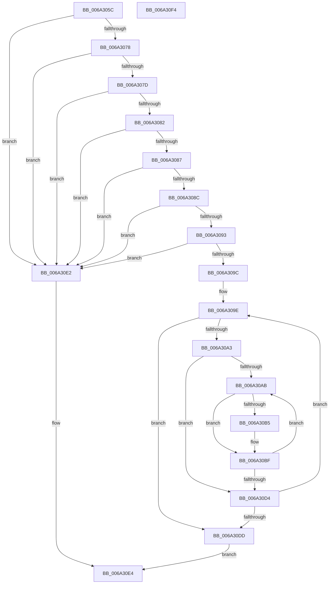

# ArrayContains

- RVA: `0x006A305C`–`0x006A30F5` (길이 `153` bytes)
- VA: `0x00000001406A305C`
- 실행 섹션: `.text`
- PDB 이름 있음: `예`; PDB Function 태그: `아니요`
- unwind 정보 RVA: `0x00069588`
- 디코드: `50`개 명령, `153/153` bytes 표시
- 미해석 바이트: `0` (있으면 어셈블리에 `.byte`로 보존)

> 이 문서는 커널 이미지의 기계어와 PDB 기호를 분석해 생성했습니다. 4번과 5번은 함수 원형과 자료형을 바이너리 사용 방식에서 추정한 C 해석이며 원본 소스 복구 결과는 아닙니다.

## 1. Dependencies

- 직접 호출 지점: **0**; 고유 호출 대상: **0**
- 직접 호출자로 확인된 함수: **1**
- RIP 상대 이미지 참조: **0**

### Outgoing calls
- 직접 디코드된 call 명령이 없습니다.

### Direct callers
- [PropertyEval](../../page/9C/PropertyEval_function_009CB300.md) at `0x009CFDFC`

### Static image references
- 디코드된 RIP-relative 메모리 참조가 없습니다.

## 2. Other-region calls and transfers

- 다른 실행 섹션으로 향하는 call: **0**
- 별도 외부 분기/꼬리 이동을 확인하지 못했습니다.

## 3. Assembly (complete function range)

```asm
006A305C  48 89 5C 24 08                  mov qword ptr [rsp + 8], rbx
006A3061  48 89 74 24 10                  mov qword ptr [rsp + 0x10], rsi
006A3066  48 89 7C 24 18                  mov qword ptr [rsp + 0x18], rdi
006A306B  45 33 D2                        xor r10d, r10d
006A306E  49 8B F8                        mov rdi, r8
006A3071  48 8B F1                        mov rsi, rcx
006A3074  85 D2                           test edx, edx
006A3076  74 6A                           je 0x1406a30e2
006A3078  45 85 C9                        test r9d, r9d
006A307B  74 65                           je 0x1406a30e2
006A307D  48 85 C9                        test rcx, rcx
006A3080  74 60                           je 0x1406a30e2
006A3082  4D 85 C0                        test r8, r8
006A3085  74 5B                           je 0x1406a30e2
006A3087  44 3B CA                        cmp r9d, edx
006A308A  77 56                           ja 0x1406a30e2
006A308C  8B DA                           mov ebx, edx
006A308E  F6 C2 0F                        test dl, 0xf
006A3091  75 4F                           jne 0x1406a30e2
006A3093  45 8B D9                        mov r11d, r9d
006A3096  41 F6 C1 0F                     test r9b, 0xf
006A309A  75 46                           jne 0x1406a30e2
006A309C  33 C9                           xor ecx, ecx
006A309E  48 3B CB                        cmp rcx, rbx
006A30A1  73 3A                           jae 0x1406a30dd
006A30A3  45 33 C0                        xor r8d, r8d
006A30A6  45 85 C9                        test r9d, r9d
006A30A9  74 29                           je 0x1406a30d4
006A30AB  48 8B 14 0E                     mov rdx, qword ptr [rsi + rcx]
006A30AF  49 2B 14 38                     sub rdx, qword ptr [r8 + rdi]
006A30B3  75 0A                           jne 0x1406a30bf
006A30B5  48 8B 54 0E 08                  mov rdx, qword ptr [rsi + rcx + 8]
006A30BA  49 2B 54 38 08                  sub rdx, qword ptr [r8 + rdi + 8]
006A30BF  48 85 D2                        test rdx, rdx
006A30C2  B8 01 00 00 00                  mov eax, 1
006A30C7  44 0F 44 D0                     cmove r10d, eax
006A30CB  49 83 C0 10                     add r8, 0x10
006A30CF  4D 3B C3                        cmp r8, r11
006A30D2  72 D7                           jb 0x1406a30ab
006A30D4  48 83 C1 10                     add rcx, 0x10
006A30D8  45 85 D2                        test r10d, r10d
006A30DB  74 C1                           je 0x1406a309e
006A30DD  41 8B C2                        mov eax, r10d
006A30E0  EB 02                           jmp 0x1406a30e4
006A30E2  33 C0                           xor eax, eax
006A30E4  48 8B 5C 24 08                  mov rbx, qword ptr [rsp + 8]
006A30E9  48 8B 74 24 10                  mov rsi, qword ptr [rsp + 0x10]
006A30EE  48 8B 7C 24 18                  mov rdi, qword ptr [rsp + 0x18]
006A30F3  C3                              ret
006A30F4  CC                              int3
```

## 4. C-style interpretation (structured pseudocode)

```c
__int64 __fastcall ArrayContains(__int64 a1, int a2, __int64 a3, int a4)
{
    __int64 result;
    __int64 v_r10;
    unsigned __int64 v_stack_p10;
    unsigned __int64 v_stack_p18;
    unsigned __int64 v_stack_p8;

    v_stack_p8 = v_rbx;
    v_stack_p10 = v_rsi;
    v_stack_p18 = v_rdi;
    v_r10 = 0;
    if (a2 == 0) goto loc_006A30E2;
    if (a4 == 0) goto loc_006A30E2;
    if (a1 == 0) goto loc_006A30E2;
    if (a3 == 0) goto loc_006A30E2;
    if (a4 > a2) goto loc_006A30E2;
    if ((((unsigned __int8)(a2)) & (15)) != 0) goto loc_006A30E2;
    if ((((unsigned __int8)(a4)) & (15)) != 0) goto loc_006A30E2;
    a1 = 0;
loc_006A309E:
    if (0 >= ((unsigned int)(a2))) goto loc_006A30DD;
    a3 = 0;
    if (a4 == 0) goto loc_006A30D4;
loc_006A30AB:
    a2 = (*(unsigned __int64 *)(a1 + a1 * 1)) - (*(unsigned __int64 *)(a3 + a3 * 1));
    if (!(condition_is_not_equal)) {
        a2 = *(unsigned __int64 *)(a1 + a1 * 1 + 8);
        a2 = (a2) - (*(unsigned __int64 *)(a3 + a3 * 1 + 8));
    }
    if (a2 == 0) { v_r10 = 1; }
    a3 = (a3) + (16);
    if (a3 < ((unsigned int)(a4))) goto loc_006A30AB;
loc_006A30D4:
    a1 = (a1) + (16);
    if ((unsigned int)(v_r10) == 0) goto loc_006A309E;
loc_006A30DD:
    goto loc_006A30E4;
loc_006A30E2:
    result = 0;
loc_006A30E4:
    return result;
}
```

## 5. (Beta) C Style

```c
int64_t ArrayContains(void *Arg1, int32_t Arg2, int64_t Arg3, int32_t Arg4)
{
    uint8_t *arg1 = (uint8_t *)Arg1;

    int64_t result;
    int64_t local_r10;
    uint64_t v_stack_p10;
    uint64_t v_stack_p18;
    uint64_t v_stack_p8;

    v_stack_p8 = local_rbx;
    v_stack_p10 = local_rsi;
    v_stack_p18 = local_rdi;
    local_r10 = 0;
    if (Arg2 == 0) goto loc_006A30E2;
    if (Arg4 == 0) goto loc_006A30E2;
    if (Arg1 == NULL) goto loc_006A30E2;
    if (Arg3 == 0) goto loc_006A30E2;
    if (Arg4 > Arg2) goto loc_006A30E2;
    if ((((uint8_t)(Arg2)) & (15)) != 0) goto loc_006A30E2;
    if ((((uint8_t)(Arg4)) & (15)) != 0) goto loc_006A30E2;
    Arg1 = 0;
loc_006A309E:
    if (0 >= ((uint32_t)(Arg2))) goto loc_006A30DD;
    Arg3 = 0;
    if (Arg4 == 0) goto loc_006A30D4;
loc_006A30AB:
    Arg2 = (*(uint64_t *)(arg1 + arg1 * 1)) - (*(uint64_t *)(Arg3 + Arg3 * 1));
    if (!(condition_is_not_equal)) {
        Arg2 = *(uint64_t *)(arg1 + arg1 * 1 + 0x8);
        Arg2 = (Arg2) - (*(uint64_t *)(Arg3 + Arg3 * 1 + 0x8));
    }
    if (Arg2 == 0) { local_r10 = 1; }
    Arg3 = (Arg3) + (16);
    if (Arg3 < ((uint32_t)(Arg4))) goto loc_006A30AB;
loc_006A30D4:
    Arg1 = (Arg1) + (16);
    if ((uint32_t)(local_r10) == 0) goto loc_006A309E;
loc_006A30DD:
    goto loc_006A30E4;
loc_006A30E2:
    result = 0;
loc_006A30E4:
    return result;
}
```

### 관측된 메모리 오프셋

구조체 형식이 확인되지 않은 접근은 인자 기준의 오프셋으로만 기록했습니다.

| 기준 인자 | 오프셋 표현 | 폭 (bit) | 접근 |
|---|---:|---:|---|
| `Arg1` | `+ 0x0 + rcx*1` | `64` | `R` |
| `Arg1` | `+ 0x8 + rcx*1` | `64` | `R` |

## 6. Execution-region graph

[열기: 2D/3D 그래프와 함수 탐색 컨트롤 패널](../../../control-panel.html?section=text&rva=0x006A305C&view=graph)

- 2D 그래프는 위에서 아래로 흐르고, 3D 그래프는 빈 공간을 드래그해 회전합니다. Shift+드래그는 이동, 휠은 확대·축소, 함수 노드 선택은 대상 보고서 이동입니다.

### Static fallback


