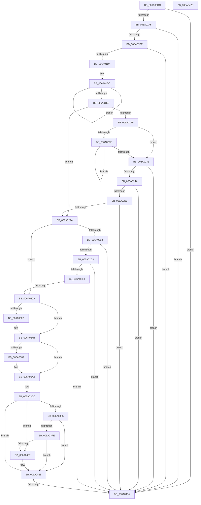

# BcpDisplayErrorInformationModernized

- RVA: `0x006A00DC`–`0x006A0474` (길이 `920` bytes)
- VA: `0x00000001406A00DC`
- 실행 섹션: `.text`
- PDB 이름 있음: `예`; PDB Function 태그: `아니요`
- unwind 정보 RVA: `0x000DA5D0`
- 디코드: `223`개 명령, `920/920` bytes 표시
- 미해석 바이트: `0` (있으면 어셈블리에 `.byte`로 보존)

> 이 문서는 커널 이미지의 기계어와 PDB 기호를 분석해 생성했습니다. 4번과 5번은 함수 원형과 자료형을 바이너리 사용 방식에서 추정한 C 해석이며 원본 소스 복구 결과는 아닙니다.

## 1. Dependencies

- 직접 호출 지점: **23**; 고유 호출 대상: **8**
- 직접 호출자로 확인된 함수: **1**
- RIP 상대 이미지 참조: **15**

### Outgoing calls
- `0x006A0198` → [RtlAppendUnicodeStringToString](../40/RtlAppendUnicodeStringToString_function_0040FA50.md) (function, `0x0040FA50`)
- `0x006A01B1` → [RtlAppendUnicodeToString](../40/RtlAppendUnicodeToString_function_0040F990.md) (function, `0x0040F990`)
- `0x006A01C7` → [RtlAppendUnicodeStringToString](../40/RtlAppendUnicodeStringToString_function_0040FA50.md) (function, `0x0040FA50`)
- `0x006A023D` → [RtlAppendUnicodeToString](../40/RtlAppendUnicodeToString_function_0040F990.md) (function, `0x0040F990`)
- `0x006A0254` → [RtlAppendUnicodeStringToString](../40/RtlAppendUnicodeStringToString_function_0040FA50.md) (function, `0x0040FA50`)
- `0x006A026D` → [RtlAppendUnicodeToString](../40/RtlAppendUnicodeToString_function_0040F990.md) (function, `0x0040F990`)
- `0x006A029C` → [BcpSanitizeDriverName](BcpSanitizeDriverName_function_006A0C9C.md) (function, `0x006A0C9C`)
- `0x006A02CD` → [RtlAppendUnicodeStringToString](../40/RtlAppendUnicodeStringToString_function_0040FA50.md) (function, `0x0040FA50`)
- `0x006A02E6` → [RtlAppendUnicodeToString](../40/RtlAppendUnicodeToString_function_0040F990.md) (function, `0x0040F990`)
- `0x006A02FD` → [RtlAppendUnicodeStringToString](../40/RtlAppendUnicodeStringToString_function_0040FA50.md) (function, `0x0040FA50`)
- `0x006A031D` → [BcpDisplayCriticalStringCentered](../69/BcpDisplayCriticalStringCentered_function_0069FAB8.md) (function, `0x0069FAB8`)
- `0x006A0336` → [BcpSetCursorPosition](BcpSetCursorPosition_function_006A0D50.md) (function, `0x006A0D50`)
- `0x006A0346` → [BcpDisplayCriticalStringCentered](../69/BcpDisplayCriticalStringCentered_function_0069FAB8.md) (function, `0x0069FAB8`)
- `0x006A0368` → [BcpSetCursorPosition](BcpSetCursorPosition_function_006A0D50.md) (function, `0x006A0D50`)
- `0x006A0378` → [BcpDisplayCriticalStringCentered](../69/BcpDisplayCriticalStringCentered_function_0069FAB8.md) (function, `0x0069FAB8`)
- `0x006A038D` → [BcpSetCursorPosition](BcpSetCursorPosition_function_006A0D50.md) (function, `0x006A0D50`)
- `0x006A039D` → [BcpDisplayCriticalStringCentered](../69/BcpDisplayCriticalStringCentered_function_0069FAB8.md) (function, `0x0069FAB8`)
- `0x006A03D2` → [BcpSetCursorPosition](BcpSetCursorPosition_function_006A0D50.md) (function, `0x006A0D50`)
- `0x006A03E7` → [BcpConvertBugDataToString](../69/BcpConvertBugDataToString_function_0069F4E4.md) (function, `0x0069F4E4`)
- `0x006A0413` → [BcpDisplayCriticalString](../69/BcpDisplayCriticalString_function_0069F754.md) (function, `0x0069F754`)
- `0x006A0423` → [BcpSetCursorPosition](BcpSetCursorPosition_function_006A0D50.md) (function, `0x006A0D50`)
- `0x006A0447` → [BcpSetCursorPosition](BcpSetCursorPosition_function_006A0D50.md) (function, `0x006A0D50`)
- `0x006A0453` → [_security_check_cookie](_security_check_cookie_function_006AC640.md) (function, `0x006AC640`)

### Direct callers
- [BgpFwDisplayBugCheckScreenModernized](BgpFwDisplayBugCheckScreenModernized_function_006A1338.md) at `0x006A1778`

### Static image references
- `0x006A00F8` → RVA `0x00E0A740` (`.data`; read)
- `0x006A010D` → RVA `0x00E0EF60` (`.data`; read)
- `0x006A012D` → RVA `0x00EEFEF8` (`.data`; read)
- `0x006A0135` → RVA `0x00E3EB30` (`.data`; read)
- `0x006A0164` → RVA `0x00EEFF00` (`.data`; read)
- `0x006A018C` → RVA `0x00E3EBA8` (`.data`; read)
- `0x006A01A5` → RVA `0x006CB4E0` (` ?? ::FNODOBFM::`string'`; read)
- `0x006A0212` → RVA `0x006D1080` (` ?? ::FNODOBFM::`string'`; read)
- `0x006A0231` → RVA `0x006D10B0` (` ?? ::FNODOBFM::`string'`; read)
- `0x006A0261` → RVA `0x006D10C0` (` ?? ::FNODOBFM::`string'`; read)
- `0x006A02A1` → RVA `0x00E3EBC8` (`.data`; read)
- `0x006A02A8` → RVA `0x00E3EB20` (`.data`; read)
- `0x006A02C1` → RVA `0x00E3EBC0` (`.data`; read)
- `0x006A0312` → RVA `0x00EF0450` (`.data`; read/write)
- `0x006A03EC` → RVA `0x00EEFF18` (`.data`; read)

## 2. Other-region calls and transfers

- 다른 실행 섹션으로 향하는 call: **0**
- 별도 외부 분기/꼬리 이동을 확인하지 못했습니다.

## 3. Assembly (complete function range)

```asm
006A00DC  48 89 5C 24 10                  mov qword ptr [rsp + 0x10], rbx
006A00E1  55                              push rbp
006A00E2  56                              push rsi
006A00E3  57                              push rdi
006A00E4  41 54                           push r12
006A00E6  41 55                           push r13
006A00E8  41 56                           push r14
006A00EA  41 57                           push r15
006A00EC  48 8D 6C 24 C0                  lea rbp, [rsp - 0x40]
006A00F1  48 81 EC 40 01 00 00            sub rsp, 0x140
006A00F8  48 8B 05 41 A6 76 00            mov rax, qword ptr [rip + 0x76a641]
006A00FF  48 33 C4                        xor rax, rsp
006A0102  48 89 45 30                     mov qword ptr [rbp + 0x30], rax
006A0106  4C 8B B5 A0 00 00 00            mov r14, qword ptr [rbp + 0xa0]
006A010D  48 8D 05 4C EE 76 00            lea rax, [rip + 0x76ee4c]
006A0114  33 FF                           xor edi, edi
006A0116  4C 63 F9                        movsxd r15, ecx
006A0119  0F 57 C0                        xorps xmm0, xmm0
006A011C  4C 89 75 88                     mov qword ptr [rbp - 0x78], r14
006A0120  0F 11 44 24 40                  movups xmmword ptr [rsp + 0x40], xmm0
006A0125  48 8D 4C 24 30                  lea rcx, [rsp + 0x30]
006A012A  44 8B EA                        mov r13d, edx
006A012D  F2 0F 10 05 C3 FD 84 00         movsd xmm0, qword ptr [rip + 0x84fdc3]
006A0135  48 8D 15 F4 E9 79 00            lea rdx, [rip + 0x79e9f4]
006A013C  F2 0F 11 44 24 20               movsd qword ptr [rsp + 0x20], xmm0
006A0142  49 8B F1                        mov rsi, r9
006A0145  0F 57 C0                        xorps xmm0, xmm0
006A0148  48 89 7C 24 5C                  mov qword ptr [rsp + 0x5c], rdi
006A014D  0F 11 44 24 30                  movups xmmword ptr [rsp + 0x30], xmm0
006A0152  4D 8B E0                        mov r12, r8
006A0155  89 7C 24 6C                     mov dword ptr [rsp + 0x6c], edi
006A0159  49 6B DF 54                     imul rbx, r15, 0x54
006A015D  89 7C 24 7C                     mov dword ptr [rsp + 0x7c], edi
006A0161  48 03 D8                        add rbx, rax
006A0164  8B 05 96 FD 84 00               mov eax, dword ptr [rip + 0x84fd96]
006A016A  89 44 24 50                     mov dword ptr [rsp + 0x50], eax
006A016E  89 44 24 28                     mov dword ptr [rsp + 0x28], eax
006A0172  8D 47 12                        lea eax, [rdi + 0x12]
006A0175  66 89 44 24 7A                  mov word ptr [rsp + 0x7a], ax
006A017A  48 8D 45 90                     lea rax, [rbp - 0x70]
006A017E  48 89 45 80                     mov qword ptr [rbp - 0x80], rax
006A0182  B8 00 04 00 00                  mov eax, 0x400
006A0187  66 89 44 24 32                  mov word ptr [rsp + 0x32], ax
006A018C  48 8B 05 15 EA 79 00            mov rax, qword ptr [rip + 0x79ea15]
006A0193  48 89 44 24 38                  mov qword ptr [rsp + 0x38], rax
006A0198  E8 B3 F8 D6 FF                  call 0x14040fa50
006A019D  85 C0                           test eax, eax
006A019F  0F 88 95 02 00 00               js 0x1406a043a
006A01A5  48 8D 15 34 B3 02 00            lea rdx, [rip + 0x2b334]
006A01AC  48 8D 4C 24 30                  lea rcx, [rsp + 0x30]
006A01B1  E8 DA F7 D6 FF                  call 0x14040f990
006A01B6  85 C0                           test eax, eax
006A01B8  0F 88 7C 02 00 00               js 0x1406a043a
006A01BE  49 8D 56 10                     lea rdx, [r14 + 0x10]
006A01C2  48 8D 4C 24 30                  lea rcx, [rsp + 0x30]
006A01C7  E8 84 F8 D6 FF                  call 0x14040fa50
006A01CC  85 C0                           test eax, eax
006A01CE  0F 88 66 02 00 00               js 0x1406a043a
006A01D4  45 8B C5                        mov r8d, r13d
006A01D7  8B D7                           mov edx, edi
006A01D9  41 8B C5                        mov eax, r13d
006A01DC  C1 E8 04                        shr eax, 4
006A01DF  FF C2                           inc edx
006A01E1  85 C0                           test eax, eax
006A01E3  75 F7                           jne 0x1406a01dc
006A01E5  8D 4A 01                        lea ecx, [rdx + 1]
006A01E8  48 03 C9                        add rcx, rcx
006A01EB  48 83 F9 12                     cmp rcx, 0x12
006A01EF  0F 87 85 00 00 00               ja 0x1406a027a
006A01F5  0F B7 C2                        movzx eax, dx
006A01F8  48 8D 4D 90                     lea rcx, [rbp - 0x70]
006A01FC  66 03 C0                        add ax, ax
006A01FF  48 8D 0C 51                     lea rcx, [rcx + rdx*2]
006A0203  66 89 39                        mov word ptr [rcx], di
006A0206  66 89 44 24 78                  mov word ptr [rsp + 0x78], ax
006A020B  85 D2                           test edx, edx
006A020D  74 22                           je 0x1406a0231
006A020F  41 8B C0                        mov eax, r8d
006A0212  4C 8D 0D 67 0E 03 00            lea r9, [rip + 0x30e67]
006A0219  83 E0 0F                        and eax, 0xf
006A021C  41 C1 E8 04                     shr r8d, 4
006A0220  48 8D 49 FE                     lea rcx, [rcx - 2]
006A0224  41 0F B7 04 41                  movzx eax, word ptr [r9 + rax*2]
006A0229  66 89 01                        mov word ptr [rcx], ax
006A022C  83 C2 FF                        add edx, -1
006A022F  75 DE                           jne 0x1406a020f
006A0231  48 8D 15 78 0E 03 00            lea rdx, [rip + 0x30e78]
006A0238  48 8D 4C 24 30                  lea rcx, [rsp + 0x30]
006A023D  E8 4E F7 D6 FF                  call 0x14040f990
006A0242  85 C0                           test eax, eax
006A0244  0F 88 F0 01 00 00               js 0x1406a043a
006A024A  48 8D 54 24 78                  lea rdx, [rsp + 0x78]
006A024F  48 8D 4C 24 30                  lea rcx, [rsp + 0x30]
006A0254  E8 F7 F7 D6 FF                  call 0x14040fa50
006A0259  85 C0                           test eax, eax
006A025B  0F 88 D9 01 00 00               js 0x1406a043a
006A0261  48 8D 15 58 0E 03 00            lea rdx, [rip + 0x30e58]
006A0268  48 8D 4C 24 30                  lea rcx, [rsp + 0x30]
006A026D  E8 1E F7 D6 FF                  call 0x14040f990
006A0272  85 C0                           test eax, eax
006A0274  0F 88 C0 01 00 00               js 0x1406a043a
006A027A  48 85 F6                        test rsi, rsi
006A027D  0F 84 87 00 00 00               je 0x1406a030a
006A0283  48 8D 45 B0                     lea rax, [rbp - 0x50]
006A0287  C7 44 24 68 00 00 80 00         mov dword ptr [rsp + 0x68], 0x800000
006A028F  48 8D 54 24 68                  lea rdx, [rsp + 0x68]
006A0294  48 89 44 24 70                  mov qword ptr [rsp + 0x70], rax
006A0299  48 8B CE                        mov rcx, rsi
006A029C  E8 FB 09 00 00                  call 0x1406a0c9c
006A02A1  0F B7 05 20 E9 79 00            movzx eax, word ptr [rip + 0x79e920]
006A02A8  48 8D 15 71 E8 79 00            lea rdx, [rip + 0x79e871]
006A02AF  0F 57 C0                        xorps xmm0, xmm0
006A02B2  48 8D 4C 24 40                  lea rcx, [rsp + 0x40]
006A02B7  0F 11 44 24 40                  movups xmmword ptr [rsp + 0x40], xmm0
006A02BC  66 89 44 24 42                  mov word ptr [rsp + 0x42], ax
006A02C1  48 8B 05 F8 E8 79 00            mov rax, qword ptr [rip + 0x79e8f8]
006A02C8  48 89 44 24 48                  mov qword ptr [rsp + 0x48], rax
006A02CD  E8 7E F7 D6 FF                  call 0x14040fa50
006A02D2  85 C0                           test eax, eax
006A02D4  0F 88 60 01 00 00               js 0x1406a043a
006A02DA  48 8D 15 FF B1 02 00            lea rdx, [rip + 0x2b1ff]
006A02E1  48 8D 4C 24 40                  lea rcx, [rsp + 0x40]
006A02E6  E8 A5 F6 D6 FF                  call 0x14040f990
006A02EB  85 C0                           test eax, eax
006A02ED  0F 88 47 01 00 00               js 0x1406a043a
006A02F3  48 8D 54 24 68                  lea rdx, [rsp + 0x68]
006A02F8  48 8D 4C 24 40                  lea rcx, [rsp + 0x40]
006A02FD  E8 4E F7 D6 FF                  call 0x14040fa50
006A0302  85 C0                           test eax, eax
006A0304  0F 88 30 01 00 00               js 0x1406a043a
006A030A  8B 53 04                        mov edx, dword ptr [rbx + 4]
006A030D  48 8D 4C 24 30                  lea rcx, [rsp + 0x30]
006A0312  0F BA 2D 36 01 85 00 18         bts dword ptr [rip + 0x850136], 0x18
006A031A  45 8B CF                        mov r9d, r15d
006A031D  E8 96 F7 FF FF                  call 0x14069fab8
006A0322  8B 7C 24 20                     mov edi, dword ptr [rsp + 0x20]
006A0326  48 85 F6                        test rsi, rsi
006A0329  74 20                           je 0x1406a034b
006A032B  8B 15 CF FB 84 00               mov edx, dword ptr [rip + 0x84fbcf]
006A0331  45 33 C0                        xor r8d, r8d
006A0334  8B CF                           mov ecx, edi
006A0336  E8 15 0A 00 00                  call 0x1406a0d50
006A033B  8B 53 04                        mov edx, dword ptr [rbx + 4]
006A033E  48 8D 4C 24 40                  lea rcx, [rsp + 0x40]
006A0343  45 8B CF                        mov r9d, r15d
006A0346  E8 6D F7 FF FF                  call 0x14069fab8
006A034B  8B 53 1C                        mov edx, dword ptr [rbx + 0x1c]
006A034E  45 33 C0                        xor r8d, r8d
006A0351  03 53 14                        add edx, dword ptr [rbx + 0x14]
006A0354  8B CF                           mov ecx, edi
006A0356  2B 15 A4 FB 84 00               sub edx, dword ptr [rip + 0x84fba4]
006A035C  03 54 24 50                     add edx, dword ptr [rsp + 0x50]
006A0360  0F BA 35 E8 00 85 00 18         btr dword ptr [rip + 0x8500e8], 0x18
006A0368  E8 E3 09 00 00                  call 0x1406a0d50
006A036D  8B 53 04                        mov edx, dword ptr [rbx + 4]
006A0370  48 8D 4C 24 30                  lea rcx, [rsp + 0x30]
006A0375  45 8B CF                        mov r9d, r15d
006A0378  E8 3B F7 FF FF                  call 0x14069fab8
006A037D  48 85 F6                        test rsi, rsi
006A0380  74 20                           je 0x1406a03a2
006A0382  8B 15 78 FB 84 00               mov edx, dword ptr [rip + 0x84fb78]
006A0388  45 33 C0                        xor r8d, r8d
006A038B  8B CF                           mov ecx, edi
006A038D  E8 BE 09 00 00                  call 0x1406a0d50
006A0392  8B 53 04                        mov edx, dword ptr [rbx + 4]
006A0395  48 8D 4C 24 40                  lea rcx, [rsp + 0x40]
006A039A  45 8B CF                        mov r9d, r15d
006A039D  E8 16 F7 FF FF                  call 0x14069fab8
006A03A2  F2 0F 10 05 4E FB 84 00         movsd xmm0, qword ptr [rip + 0x84fb4e]
006A03AA  4C 8D 44 24 60                  lea r8, [rsp + 0x60]
006A03AF  8B 05 4B FB 84 00               mov eax, dword ptr [rip + 0x84fb4b]
006A03B5  33 D2                           xor edx, edx
006A03B7  83 64 24 58 00                  and dword ptr [rsp + 0x58], 0
006A03BC  33 C9                           xor ecx, ecx
006A03BE  83 64 24 5C 00                  and dword ptr [rsp + 0x5c], 0
006A03C3  83 64 24 60 00                  and dword ptr [rsp + 0x60], 0
006A03C8  F2 0F 11 44 24 20               movsd qword ptr [rsp + 0x20], xmm0
006A03CE  89 44 24 28                     mov dword ptr [rsp + 0x28], eax
006A03D2  E8 79 09 00 00                  call 0x1406a0d50
006A03D7  33 FF                           xor edi, edi
006A03D9  8D 72 04                        lea esi, [rdx + 4]
006A03DC  49 8B 0C 24                     mov rcx, qword ptr [r12]
006A03E0  48 8D 57 20                     lea rdx, [rdi + 0x20]
006A03E4  49 03 D6                        add rdx, r14
006A03E7  E8 F8 F0 FF FF                  call 0x14069f4e4
006A03EC  80 3D 25 FB 84 00 00            cmp byte ptr [rip + 0x84fb25], 0
006A03F3  75 12                           jne 0x1406a0407
006A03F5  F6 85 A8 00 00 00 08            test byte ptr [rbp + 0xa8], 8
006A03FC  74 2A                           je 0x1406a0428
006A03FE  41 81 FD 3D 01 00 00            cmp r13d, 0x13d
006A0405  75 21                           jne 0x1406a0428
006A0407  8B 13                           mov edx, dword ptr [rbx]
006A0409  48 8D 4F 20                     lea rcx, [rdi + 0x20]
006A040D  49 03 CE                        add rcx, r14
006A0410  45 8B CF                        mov r9d, r15d
006A0413  E8 3C F3 FF FF                  call 0x14069f754
006A0418  8B 15 E2 FA 84 00               mov edx, dword ptr [rip + 0x84fae2]
006A041E  45 33 C0                        xor r8d, r8d
006A0421  33 C9                           xor ecx, ecx
006A0423  E8 28 09 00 00                  call 0x1406a0d50
006A0428  4C 8B 75 88                     mov r14, qword ptr [rbp - 0x78]
006A042C  48 83 C7 10                     add rdi, 0x10
006A0430  49 83 C4 08                     add r12, 8
006A0434  48 83 EE 01                     sub rsi, 1
006A0438  75 A2                           jne 0x1406a03dc
006A043A  8B 54 24 24                     mov edx, dword ptr [rsp + 0x24]
006A043E  4C 8D 44 24 28                  lea r8, [rsp + 0x28]
006A0443  8B 4C 24 20                     mov ecx, dword ptr [rsp + 0x20]
006A0447  E8 04 09 00 00                  call 0x1406a0d50
006A044C  48 8B 4D 30                     mov rcx, qword ptr [rbp + 0x30]
006A0450  48 33 CC                        xor rcx, rsp
006A0453  E8 E8 C1 00 00                  call 0x1406ac640
006A0458  48 8B 9C 24 88 01 00 00         mov rbx, qword ptr [rsp + 0x188]
006A0460  48 81 C4 40 01 00 00            add rsp, 0x140
006A0467  41 5F                           pop r15
006A0469  41 5E                           pop r14
006A046B  41 5D                           pop r13
006A046D  41 5C                           pop r12
006A046F  5F                              pop rdi
006A0470  5E                              pop rsi
006A0471  5D                              pop rbp
006A0472  C3                              ret
006A0473  CC                              int3
```

## 4. C-style interpretation (structured pseudocode)

```c
__int64 __fastcall BcpDisplayErrorInformationModernized(int a1, int a2, __int64 a3, __int64 a4, __int64 a5, unsigned __int8 a6)
{
    __int64 result;
    __int64 v_r12;
    __int64 v_rbx;
    __int64 v_rdi;
    __int64 v_rsi;
    __int64 v_rsp;
    unsigned __int16 v_stack_m100;
    unsigned __int64 v_stack_m108;
    unsigned int v_stack_m10C;
    unsigned int v_stack_m110;
    unsigned __int64 v_stack_m118;
    unsigned __int64 v_stack_m11C;
    unsigned int v_stack_m120;
    unsigned int v_stack_m128;
    unsigned __int64 v_stack_m130;
    unsigned __int16 v_stack_m136;
    unsigned __int64 v_stack_m138;
    unsigned __int64 v_stack_m140;
    unsigned __int16 v_stack_m146;
    unsigned __int64 v_stack_m148;
    unsigned int v_stack_m150;
    unsigned int v_stack_m154;
    unsigned __int64 v_stack_m158;
    unsigned __int64 v_stack_m48;
    unsigned __int64 v_stack_m78;
    unsigned __int64 v_stack_mC8;
    unsigned __int64 v_stack_mE8;
    unsigned __int64 v_stack_mF0;
    unsigned __int64 v_stack_mF8;
    unsigned int v_stack_mFC;
    unsigned __int16 v_stack_mFE;
    unsigned __int64 v_stack_p10;

    v_stack_p10 = v_rbx;
    v_rsp = (v_rsp) - (320);
    result = (*(unsigned __int64 *)(v_rip + 7775809)) ^ (v_rsp);
    v_stack_m48 = result;
    v_rdi = 0;
    v_stack_mF0 = a5;
    v_stack_m138 = v_xmm0;
    v_stack_m158 = v_xmm0;
    v_stack_m11C = 0;
    v_stack_m148 = v_xmm0;
    v_stack_m10C = 0;
    v_rbx = (v_rbx) * ((int)(a1));
    v_stack_mFC = 0;
    v_rbx = (v_rbx) + (v_rip + 7794252);
    v_stack_m128 = (unsigned int)((unsigned int)(*(unsigned int *)(v_rip + 8715670)));
    v_stack_m150 = (unsigned int)((unsigned int)(*(unsigned int *)(v_rip + 8715670)));
    v_stack_mFE = (unsigned __int16)(v_rdi + 18);
    v_stack_mF8 = v_stack_mE8;
    v_stack_m146 = (unsigned __int16)((unsigned int)(0x400ULL));
    v_stack_m140 = *(unsigned __int64 *)(v_rip + 7989781);
    result = RtlAppendUnicodeStringToString(v_stack_m148, v_rip + 7989748, a3, a4);
    if (sign_flag) goto loc_006A043A;
    result = RtlAppendUnicodeToString(v_stack_m148, v_rip + 176948, a3, a4);
    if (sign_flag) goto loc_006A043A;
    result = RtlAppendUnicodeStringToString(v_stack_m148, a5 + 16, a3, a4);
    if (sign_flag) goto loc_006A043A;
loc_006A01DC:
    result = (unsigned int)(((unsigned int)((unsigned int)((unsigned int)(a2)))) >> (4));
    a2 = (unsigned int)((0) + 1);
    if ((unsigned int)(result) != 0) goto loc_006A01DC;
    a1 = (a2 + 1) + (a2 + 1);
    if (a1 > 18) goto loc_006A027A;
    result = (unsigned __int16)(((unsigned __int16)(a2)) + ((unsigned __int16)((unsigned __int16)(a2))));
    *(unsigned __int16 *)(v_stack_mE8 + a2 * 2) = 0;
    v_stack_m100 = (unsigned __int16)(result);
    if (a2 == 0) goto loc_006A0231;
loc_006A020F:
    result = (unsigned int)(((unsigned int)((unsigned int)((unsigned int)((unsigned int)((unsigned int)(a2)))))) & (15));
    a3 = (unsigned int)(((unsigned int)((unsigned int)((unsigned int)(a2)))) >> (4));
    *(unsigned __int16 *)(v_stack_mE8 + a2 * 2 - 2) = (unsigned __int16)(*(unsigned __int16 *)(v_rip + 200295 + result * 2));
    a2 = (unsigned int)((a2) + (-1));
    if (condition_is_not_equal) goto loc_006A020F;
loc_006A0231:
    result = RtlAppendUnicodeToString(v_stack_m148, v_rip + 200312, a3, v_rip + 200295);
    if (sign_flag) goto loc_006A043A;
    result = RtlAppendUnicodeStringToString(v_stack_m148, v_stack_m100, a3, v_rip + 200295);
    if (sign_flag) goto loc_006A043A;
    result = RtlAppendUnicodeToString(v_stack_m148, v_rip + 200280, a3, v_rip + 200295);
    if (sign_flag) goto loc_006A043A;
loc_006A027A:
    if (a4 == 0) goto loc_006A030A;
    v_stack_m110 = 0x800000ULL;
    v_stack_m108 = v_stack_mC8;
    result = BcpSanitizeDriverName(a4, v_stack_m110, a3, v_rip + 200295);
    v_stack_m138 = v_xmm0;
    v_stack_m136 = (unsigned __int16)(*(unsigned __int16 *)(v_rip + 7989536));
    v_stack_m130 = *(unsigned __int64 *)(v_rip + 7989496);
    result = RtlAppendUnicodeStringToString(v_stack_m138, v_rip + 7989361, a3, v_rip + 200295);
    if (sign_flag) goto loc_006A043A;
    result = RtlAppendUnicodeToString(v_stack_m138, v_rip + 176639, a3, v_rip + 200295);
    if (sign_flag) goto loc_006A043A;
    result = RtlAppendUnicodeStringToString(v_stack_m138, v_stack_m110, a3, v_rip + 200295);
    if (sign_flag) goto loc_006A043A;
loc_006A030A:
    result = BcpDisplayCriticalStringCentered(v_stack_m148, (unsigned int)(*(unsigned int *)(v_rbx + 4)), a3, (unsigned int)((unsigned int)((int)(a1))));
    if (a4 != 0) {
        a2 = *(unsigned int *)(v_rip + 8715215);
        a3 = 0;
        a1 = (unsigned int)((unsigned int)(v_stack_m158));
        result = BcpSetCursorPosition(a1, a2, a3, (unsigned int)((unsigned int)((int)(a1))));
        a2 = *(unsigned int *)(v_rbx + 4);
        a1 = v_stack_m138;
        a4 = (unsigned int)((int)(a1));
        result = BcpDisplayCriticalStringCentered(a1, a2, a3, a4);
    }
    a3 = 0;
    a2 = (unsigned int)(((unsigned int)(*(unsigned int *)(v_rbx + 28))) + (*(unsigned int *)(v_rbx + 20)));
    a2 = (unsigned int)((a2) - (*(unsigned int *)(v_rip + 8715172)));
    a2 = (unsigned int)((a2) + (v_stack_m128));
    result = BcpSetCursorPosition((unsigned int)((unsigned int)((unsigned int)(v_stack_m158))), a2, a3, a4);
    result = BcpDisplayCriticalStringCentered(v_stack_m148, (unsigned int)(*(unsigned int *)(v_rbx + 4)), a3, (unsigned int)((unsigned int)((int)(a1))));
    if (a4 != 0) {
        a2 = *(unsigned int *)(v_rip + 8715128);
        a3 = 0;
        a1 = (unsigned int)((unsigned int)(v_stack_m158));
        result = BcpSetCursorPosition(a1, a2, a3, (unsigned int)((unsigned int)((int)(a1))));
        a2 = *(unsigned int *)(v_rbx + 4);
        a1 = v_stack_m138;
        a4 = (unsigned int)((int)(a1));
        result = BcpDisplayCriticalStringCentered(a1, a2, a3, a4);
    }
    a2 = 0;
    a1 = 0;
    v_stack_m158 = v_xmm0;
    v_stack_m150 = (unsigned int)((unsigned int)(*(unsigned int *)(v_rip + 8715083)));
    result = BcpSetCursorPosition(a1, a2, v_stack_m118, a4);
    v_rdi = 0;
loc_006A03DC:
    a2 = (v_rdi + 32) + (a5);
    result = BcpConvertBugDataToString(*(unsigned __int64 *)(a3), a2, v_stack_m118, a4);
    if ((*(unsigned __int8 *)(v_rip + 8715045)) != 0) goto loc_006A0407;
    if (((a6) & (8)) == 0) goto loc_006A0428;
    if (((unsigned int)((unsigned int)(a2))) == 317) {
        a2 = *(unsigned int *)(v_rbx);
        a1 = v_rdi + 32;
        a1 = (a1) + (a5);
        a4 = (unsigned int)((int)(a1));
        result = BcpDisplayCriticalString(a1, a2, v_stack_m118, a4);
        a2 = *(unsigned int *)(v_rip + 8714978);
        a3 = 0;
        a1 = 0;
        result = BcpSetCursorPosition(a1, a2, a3, a4);
    }
    v_rdi = (v_rdi) + (16);
    v_r12 = (a3) + (8);
    v_rsi = (a2 + 4) - (1);
    if (condition_is_not_equal) goto loc_006A03DC;
loc_006A043A:
    result = BcpSetCursorPosition((unsigned int)(v_stack_m158), (unsigned int)(v_stack_m154), v_stack_m150, a4);
    a1 = (v_stack_m48) ^ (v_rsp);
    result = _security_check_cookie(a1, (unsigned int)(v_stack_m154), v_stack_m150, a4);
    v_rsp = (v_rsp) + (320);
    return result;
}
```

## 5. (Beta) C Style

```c
int64_t BcpDisplayErrorInformationModernized(int32_t Arg1, int32_t Arg2, void *Arg3, int64_t Arg4, void *Arg5, uint8_t Arg6)
{
    uint8_t *arg3 = (uint8_t *)Arg3;
    uint8_t *arg5 = (uint8_t *)Arg5;

    int64_t result;
    int64_t local_r12;
    int64_t local_rbx;
    int64_t local_rdi;
    int64_t local_rsi;
    int64_t local_rsp;
    uint16_t v_stack_m100;
    uint64_t v_stack_m108;
    uint32_t v_stack_m10C;
    uint32_t v_stack_m110;
    uint64_t v_stack_m118;
    uint64_t v_stack_m11C;
    uint32_t v_stack_m120;
    uint32_t v_stack_m128;
    uint64_t v_stack_m130;
    uint16_t v_stack_m136;
    uint64_t v_stack_m138;
    uint64_t v_stack_m140;
    uint16_t v_stack_m146;
    uint64_t v_stack_m148;
    uint32_t v_stack_m150;
    uint32_t v_stack_m154;
    uint64_t v_stack_m158;
    uint64_t v_stack_m48;
    uint64_t v_stack_m78;
    uint64_t v_stack_mC8;
    uint64_t v_stack_mE8;
    uint64_t v_stack_mF0;
    uint64_t v_stack_mF8;
    uint32_t v_stack_mFC;
    uint16_t v_stack_mFE;
    uint64_t v_stack_p10;

    v_stack_p10 = local_rbx;
    local_rsp = (local_rsp) - (320);
    result = (*(uint64_t *)(v_rip + 0x76A641)) ^ (local_rsp);
    v_stack_m48 = result;
    local_rdi = 0;
    v_stack_mF0 = Arg5;
    v_stack_m138 = v_xmm0;
    v_stack_m158 = v_xmm0;
    v_stack_m11C = 0;
    v_stack_m148 = v_xmm0;
    v_stack_m10C = 0;
    local_rbx = (local_rbx) * ((int32_t)(Arg1));
    v_stack_mFC = 0;
    local_rbx = (local_rbx) + (v_rip + 7794252);
    v_stack_m128 = (uint32_t)((uint32_t)(*(uint32_t *)(v_rip + 0x84FD96)));
    v_stack_m150 = (uint32_t)((uint32_t)(*(uint32_t *)(v_rip + 0x84FD96)));
    v_stack_mFE = (uint16_t)(local_rdi + 18);
    v_stack_mF8 = v_stack_mE8;
    v_stack_m146 = (uint16_t)((uint32_t)(0x400ULL));
    v_stack_m140 = *(uint64_t *)(v_rip + 0x79EA15);
    result = RtlAppendUnicodeStringToString(v_stack_m148, v_rip + 7989748, Arg3, Arg4);
    if (sign_flag) goto loc_006A043A;
    result = RtlAppendUnicodeToString(v_stack_m148, v_rip + 176948, Arg3, Arg4);
    if (sign_flag) goto loc_006A043A;
    result = RtlAppendUnicodeStringToString(v_stack_m148, Arg5 + 16, Arg3, Arg4);
    if (sign_flag) goto loc_006A043A;
loc_006A01DC:
    result = (uint32_t)(((uint32_t)((uint32_t)((uint32_t)(Arg2)))) >> (4));
    Arg2 = (uint32_t)((0) + 1);
    if ((uint32_t)(result) != 0) goto loc_006A01DC;
    Arg1 = (Arg2 + 1) + (Arg2 + 1);
    if (Arg1 > 18) goto loc_006A027A;
    result = (uint16_t)(((uint16_t)(Arg2)) + ((uint16_t)((uint16_t)(Arg2))));
    *(uint16_t *)(v_stack_mE8 + Arg2 * 2) = 0;
    v_stack_m100 = (uint16_t)(result);
    if (Arg2 == 0) goto loc_006A0231;
loc_006A020F:
    result = (uint32_t)(((uint32_t)((uint32_t)((uint32_t)((uint32_t)((uint32_t)(Arg2)))))) & (15));
    Arg3 = (uint32_t)(((uint32_t)((uint32_t)((uint32_t)(Arg2)))) >> (4));
    *(uint16_t *)(v_stack_mE8 + Arg2 * 2 - 0x2) = (uint16_t)(*(uint16_t *)(v_rip + 0x30E67 + result * 2));
    Arg2 = (uint32_t)((Arg2) + (-1));
    if (condition_is_not_equal) goto loc_006A020F;
loc_006A0231:
    result = RtlAppendUnicodeToString(v_stack_m148, v_rip + 200312, Arg3, v_rip + 200295);
    if (sign_flag) goto loc_006A043A;
    result = RtlAppendUnicodeStringToString(v_stack_m148, v_stack_m100, Arg3, v_rip + 200295);
    if (sign_flag) goto loc_006A043A;
    result = RtlAppendUnicodeToString(v_stack_m148, v_rip + 200280, Arg3, v_rip + 200295);
    if (sign_flag) goto loc_006A043A;
loc_006A027A:
    if (Arg4 == 0) goto loc_006A030A;
    v_stack_m110 = 0x800000ULL;
    v_stack_m108 = v_stack_mC8;
    result = BcpSanitizeDriverName(Arg4, v_stack_m110, Arg3, v_rip + 200295);
    v_stack_m138 = v_xmm0;
    v_stack_m136 = (uint16_t)(*(uint16_t *)(v_rip + 0x79E920));
    v_stack_m130 = *(uint64_t *)(v_rip + 0x79E8F8);
    result = RtlAppendUnicodeStringToString(v_stack_m138, v_rip + 7989361, Arg3, v_rip + 200295);
    if (sign_flag) goto loc_006A043A;
    result = RtlAppendUnicodeToString(v_stack_m138, v_rip + 176639, Arg3, v_rip + 200295);
    if (sign_flag) goto loc_006A043A;
    result = RtlAppendUnicodeStringToString(v_stack_m138, v_stack_m110, Arg3, v_rip + 200295);
    if (sign_flag) goto loc_006A043A;
loc_006A030A:
    result = BcpDisplayCriticalStringCentered(v_stack_m148, (uint32_t)(*(uint32_t *)(local_rbx + 0x4)), Arg3, (uint32_t)((uint32_t)((int32_t)(Arg1))));
    if (Arg4 != 0) {
        Arg2 = *(uint32_t *)(v_rip + 0x84FBCF);
        Arg3 = 0;
        Arg1 = (uint32_t)((uint32_t)(v_stack_m158));
        result = BcpSetCursorPosition(Arg1, Arg2, Arg3, (uint32_t)((uint32_t)((int32_t)(Arg1))));
        Arg2 = *(uint32_t *)(local_rbx + 0x4);
        Arg1 = v_stack_m138;
        Arg4 = (uint32_t)((int32_t)(Arg1));
        result = BcpDisplayCriticalStringCentered(Arg1, Arg2, Arg3, Arg4);
    }
    Arg3 = 0;
    Arg2 = (uint32_t)(((uint32_t)(*(uint32_t *)(local_rbx + 0x1C))) + (*(uint32_t *)(local_rbx + 0x14)));
    Arg2 = (uint32_t)((Arg2) - (*(uint32_t *)(v_rip + 0x84FBA4)));
    Arg2 = (uint32_t)((Arg2) + (v_stack_m128));
    result = BcpSetCursorPosition((uint32_t)((uint32_t)((uint32_t)(v_stack_m158))), Arg2, Arg3, Arg4);
    result = BcpDisplayCriticalStringCentered(v_stack_m148, (uint32_t)(*(uint32_t *)(local_rbx + 0x4)), Arg3, (uint32_t)((uint32_t)((int32_t)(Arg1))));
    if (Arg4 != 0) {
        Arg2 = *(uint32_t *)(v_rip + 0x84FB78);
        Arg3 = 0;
        Arg1 = (uint32_t)((uint32_t)(v_stack_m158));
        result = BcpSetCursorPosition(Arg1, Arg2, Arg3, (uint32_t)((uint32_t)((int32_t)(Arg1))));
        Arg2 = *(uint32_t *)(local_rbx + 0x4);
        Arg1 = v_stack_m138;
        Arg4 = (uint32_t)((int32_t)(Arg1));
        result = BcpDisplayCriticalStringCentered(Arg1, Arg2, Arg3, Arg4);
    }
    Arg2 = 0;
    Arg1 = 0;
    v_stack_m158 = v_xmm0;
    v_stack_m150 = (uint32_t)((uint32_t)(*(uint32_t *)(v_rip + 0x84FB4B)));
    result = BcpSetCursorPosition(Arg1, Arg2, v_stack_m118, Arg4);
    local_rdi = 0;
loc_006A03DC:
    Arg2 = (local_rdi + 32) + (Arg5);
    result = BcpConvertBugDataToString(*(uint64_t *)(arg3), Arg2, v_stack_m118, Arg4);
    if ((*(uint8_t *)(v_rip + 0x84FB25)) != 0) goto loc_006A0407;
    if (((Arg6) & (8)) == 0) goto loc_006A0428;
    if (((uint32_t)((uint32_t)(Arg2))) == 317) {
        Arg2 = *(uint32_t *)(local_rbx);
        Arg1 = local_rdi + 32;
        Arg1 = (Arg1) + (Arg5);
        Arg4 = (uint32_t)((int32_t)(Arg1));
        result = BcpDisplayCriticalString(Arg1, Arg2, v_stack_m118, Arg4);
        Arg2 = *(uint32_t *)(v_rip + 0x84FAE2);
        Arg3 = 0;
        Arg1 = 0;
        result = BcpSetCursorPosition(Arg1, Arg2, Arg3, Arg4);
    }
    local_rdi = (local_rdi) + (16);
    local_r12 = (Arg3) + (8);
    local_rsi = (Arg2 + 4) - (1);
    if (condition_is_not_equal) goto loc_006A03DC;
loc_006A043A:
    result = BcpSetCursorPosition((uint32_t)(v_stack_m158), (uint32_t)(v_stack_m154), v_stack_m150, Arg4);
    Arg1 = (v_stack_m48) ^ (local_rsp);
    result = _security_check_cookie(Arg1, (uint32_t)(v_stack_m154), v_stack_m150, Arg4);
    local_rsp = (local_rsp) + (320);
    return result;
}
```

### 관측된 메모리 오프셋

구조체 형식이 확인되지 않은 접근은 인자 기준의 오프셋으로만 기록했습니다.

| 기준 인자 | 오프셋 표현 | 폭 (bit) | 접근 |
|---|---:|---:|---|
| `Arg3` | `+ 0x0` | `64` | `R` |
| `Arg5` | `+ 0x10` | `64` | `R` |

## 6. Execution-region graph

[열기: 2D/3D 그래프와 함수 탐색 컨트롤 패널](../../../control-panel.html?section=text&rva=0x006A00DC&view=graph)

- 2D 그래프는 위에서 아래로 흐르고, 3D 그래프는 빈 공간을 드래그해 회전합니다. Shift+드래그는 이동, 휠은 확대·축소, 함수 노드 선택은 대상 보고서 이동입니다.

### Static fallback


