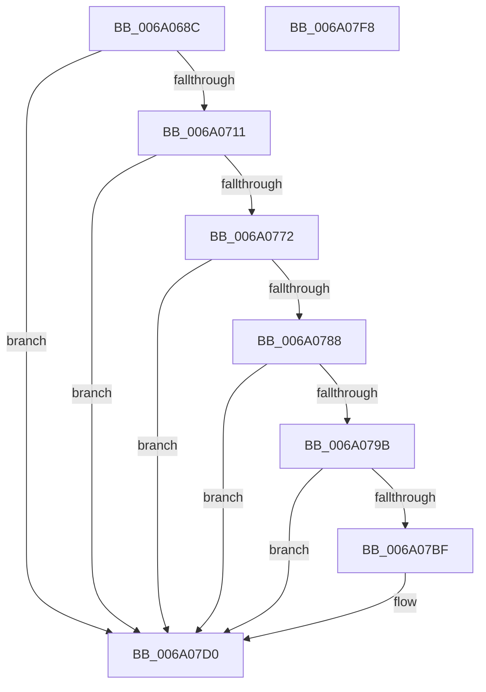

# BcpDisplayProgressModernized

- RVA: `0x006A068C`–`0x006A07F9` (길이 `365` bytes)
- VA: `0x00000001406A068C`
- 실행 섹션: `.text`
- PDB 이름 있음: `예`; PDB Function 태그: `아니요`
- unwind 정보 RVA: `0x000DA580`
- 디코드: `96`개 명령, `365/365` bytes 표시
- 미해석 바이트: `0` (있으면 어셈블리에 `.byte`로 보존)

> 이 문서는 커널 이미지의 기계어와 PDB 기호를 분석해 생성했습니다. 4번과 5번은 함수 원형과 자료형을 바이너리 사용 방식에서 추정한 C 해석이며 원본 소스 복구 결과는 아닙니다.

## 1. Dependencies

- 직접 호출 지점: **8**; 고유 호출 대상: **6**
- 직접 호출자로 확인된 함수: **2**
- RIP 상대 이미지 참조: **11**

### Outgoing calls
- `0x006A0702` → [BcpPrintSpaces](BcpPrintSpaces_function_006A0BF0.md) (function, `0x006A0BF0`)
- `0x006A072F` → [BcpConvertProgressToString](../69/BcpConvertProgressToString_function_0069F574.md) (function, `0x0069F574`)
- `0x006A0767` → [RtlAppendUnicodeStringToString](../40/RtlAppendUnicodeStringToString_function_0040FA50.md) (function, `0x0040FA50`)
- `0x006A077D` → [RtlAppendUnicodeToString](../40/RtlAppendUnicodeToString_function_0040F990.md) (function, `0x0040F990`)
- `0x006A0790` → [RtlAppendUnicodeStringToString](../40/RtlAppendUnicodeStringToString_function_0040FA50.md) (function, `0x0040FA50`)
- `0x006A07B4` → [RtlAppendUnicodeStringToString](../40/RtlAppendUnicodeStringToString_function_0040FA50.md) (function, `0x0040FA50`)
- `0x006A07CB` → [BcpDisplayCriticalStringCentered](../69/BcpDisplayCriticalStringCentered_function_0069FAB8.md) (function, `0x0069FAB8`)
- `0x006A07D9` → [_security_check_cookie](_security_check_cookie_function_006AC640.md) (function, `0x006AC640`)

### Direct callers
- [BgpFwDisplayBugCheckProgressUpdate](BgpFwDisplayBugCheckProgressUpdate_function_006A0E1C.md) at `0x006A0EFF`
- [BgpFwDisplayBugCheckScreenModernized](BgpFwDisplayBugCheckScreenModernized_function_006A1338.md) at `0x006A17A0`

### Static image references
- `0x006A06A7` → RVA `0x00E0A740` (`.data`; read)
- `0x006A06B5` → RVA `0x00EEFEFC` (`.data`; read)
- `0x006A06BC` → RVA `0x00E0EF60` (`.data`; read)
- `0x006A06C9` → RVA `0x00E3EBA0` (`.data`; read)
- `0x006A0734` → RVA `0x00E3EBB8` (`.data`; read)
- `0x006A073B` → RVA `0x00E3EAE0` (`.data`; read)
- `0x006A074E` → RVA `0x00E3EBB0` (`.data`; read)
- `0x006A075C` → RVA `0x00E3EB00` (`.data`; read)
- `0x006A0772` → RVA `0x006CB4E0` (` ?? ::FNODOBFM::`string'`; read)
- `0x006A079B` → RVA `0x00E3EB10` (`.data`; read)
- `0x006A07A5` → RVA `0x00E3EAF0` (`.data`; read)

## 2. Other-region calls and transfers

- 다른 실행 섹션으로 향하는 call: **0**
- 별도 외부 분기/꼬리 이동을 확인하지 못했습니다.

## 3. Assembly (complete function range)

```asm
006A068C  4C 8B DC                        mov r11, rsp
006A068F  49 89 5B 08                     mov qword ptr [r11 + 8], rbx
006A0693  49 89 73 18                     mov qword ptr [r11 + 0x18], rsi
006A0697  49 89 7B 20                     mov qword ptr [r11 + 0x20], rdi
006A069B  55                              push rbp
006A069C  41 56                           push r14
006A069E  41 57                           push r15
006A06A0  48 8B EC                        mov rbp, rsp
006A06A3  48 83 EC 70                     sub rsp, 0x70
006A06A7  48 8B 05 92 A0 76 00            mov rax, qword ptr [rip + 0x76a092]
006A06AE  48 33 C4                        xor rax, rsp
006A06B1  48 89 45 F0                     mov qword ptr [rbp - 0x10], rax
006A06B5  44 8B 0D 40 F8 84 00            mov r9d, dword ptr [rip + 0x84f840]
006A06BC  4C 8D 3D 9D E8 76 00            lea r15, [rip + 0x76e89d]
006A06C3  83 65 C0 00                     and dword ptr [rbp - 0x40], 0
006A06C7  8B F9                           mov edi, ecx
006A06C9  48 8B 0D D0 E4 79 00            mov rcx, qword ptr [rip + 0x79e4d0]
006A06D0  4C 63 F2                        movsxd r14, edx
006A06D3  49 6B F6 54                     imul rsi, r14, 0x54
006A06D7  48 8B 41 18                     mov rax, qword ptr [rcx + 0x18]
006A06DB  44 8B 50 28                     mov r10d, dword ptr [rax + 0x28]
006A06DF  42 8B 44 3E 10                  mov eax, dword ptr [rsi + r15 + 0x10]
006A06E4  42 8B 54 3E 20                  mov edx, dword ptr [rsi + r15 + 0x20]
006A06E9  46 8B 44 3E 18                  mov r8d, dword ptr [rsi + r15 + 0x18]
006A06EE  44 03 C0                        add r8d, eax
006A06F1  44 03 C2                        add r8d, edx
006A06F4  03 D0                           add edx, eax
006A06F6  48 8D 45 C0                     lea rax, [rbp - 0x40]
006A06FA  49 89 43 A0                     mov qword ptr [r11 - 0x60], rax
006A06FE  45 89 53 98                     mov dword ptr [r11 - 0x68], r10d
006A0702  E8 E9 04 00 00                  call 0x1406a0bf0
006A0707  8B D8                           mov ebx, eax
006A0709  85 C0                           test eax, eax
006A070B  0F 88 BF 00 00 00               js 0x1406a07d0
006A0711  B8 08 00 00 00                  mov eax, 8
006A0716  48 8D 55 D8                     lea rdx, [rbp - 0x28]
006A071A  0F 57 C0                        xorps xmm0, xmm0
006A071D  8B CF                           mov ecx, edi
006A071F  0F 11 45 D8                     movups xmmword ptr [rbp - 0x28], xmm0
006A0723  66 89 45 DA                     mov word ptr [rbp - 0x26], ax
006A0727  48 8D 45 E8                     lea rax, [rbp - 0x18]
006A072B  48 89 45 E0                     mov qword ptr [rbp - 0x20], rax
006A072F  E8 40 EE FF FF                  call 0x14069f574
006A0734  0F B7 05 7D E4 79 00            movzx eax, word ptr [rip + 0x79e47d]
006A073B  48 8D 15 9E E3 79 00            lea rdx, [rip + 0x79e39e]
006A0742  0F 11 45 C8                     movups xmmword ptr [rbp - 0x38], xmm0
006A0746  66 89 45 CA                     mov word ptr [rbp - 0x36], ax
006A074A  48 8D 4D C8                     lea rcx, [rbp - 0x38]
006A074E  48 8B 05 5B E4 79 00            mov rax, qword ptr [rip + 0x79e45b]
006A0755  83 FF 01                        cmp edi, 1
006A0758  48 89 45 D0                     mov qword ptr [rbp - 0x30], rax
006A075C  48 8D 05 9D E3 79 00            lea rax, [rip + 0x79e39d]
006A0763  48 0F 45 D0                     cmovne rdx, rax
006A0767  E8 E4 F2 D6 FF                  call 0x14040fa50
006A076C  8B D8                           mov ebx, eax
006A076E  85 C0                           test eax, eax
006A0770  78 5E                           js 0x1406a07d0
006A0772  48 8D 15 67 AD 02 00            lea rdx, [rip + 0x2ad67]
006A0779  48 8D 4D C8                     lea rcx, [rbp - 0x38]
006A077D  E8 0E F2 D6 FF                  call 0x14040f990
006A0782  8B D8                           mov ebx, eax
006A0784  85 C0                           test eax, eax
006A0786  78 48                           js 0x1406a07d0
006A0788  48 8D 55 D8                     lea rdx, [rbp - 0x28]
006A078C  48 8D 4D C8                     lea rcx, [rbp - 0x38]
006A0790  E8 BB F2 D6 FF                  call 0x14040fa50
006A0795  8B D8                           mov ebx, eax
006A0797  85 C0                           test eax, eax
006A0799  78 35                           js 0x1406a07d0
006A079B  48 8D 05 6E E3 79 00            lea rax, [rip + 0x79e36e]
006A07A2  83 FF 01                        cmp edi, 1
006A07A5  48 8D 15 44 E3 79 00            lea rdx, [rip + 0x79e344]
006A07AC  48 0F 45 D0                     cmovne rdx, rax
006A07B0  48 8D 4D C8                     lea rcx, [rbp - 0x38]
006A07B4  E8 97 F2 D6 FF                  call 0x14040fa50
006A07B9  8B D8                           mov ebx, eax
006A07BB  85 C0                           test eax, eax
006A07BD  78 11                           js 0x1406a07d0
006A07BF  42 8B 54 3E 08                  mov edx, dword ptr [rsi + r15 + 8]
006A07C4  48 8D 4D C8                     lea rcx, [rbp - 0x38]
006A07C8  45 8B CE                        mov r9d, r14d
006A07CB  E8 E8 F2 FF FF                  call 0x14069fab8
006A07D0  8B C3                           mov eax, ebx
006A07D2  48 8B 4D F0                     mov rcx, qword ptr [rbp - 0x10]
006A07D6  48 33 CC                        xor rcx, rsp
006A07D9  E8 62 BE 00 00                  call 0x1406ac640
006A07DE  4C 8D 5C 24 70                  lea r11, [rsp + 0x70]
006A07E3  49 8B 5B 20                     mov rbx, qword ptr [r11 + 0x20]
006A07E7  49 8B 73 30                     mov rsi, qword ptr [r11 + 0x30]
006A07EB  49 8B 7B 38                     mov rdi, qword ptr [r11 + 0x38]
006A07EF  49 8B E3                        mov rsp, r11
006A07F2  41 5F                           pop r15
006A07F4  41 5E                           pop r14
006A07F6  5D                              pop rbp
006A07F7  C3                              ret
006A07F8  CC                              int3
```

## 4. C-style interpretation (structured pseudocode)

```c
__int64 __fastcall BcpDisplayProgressModernized(int a1, int a2)
{
    __int64 result;
    __int64 v_rsi;
    __int64 v_rsp;
    unsigned __int64 v_stack_m18;
    unsigned __int64 v_stack_m28;
    unsigned __int64 v_stack_m30;
    unsigned __int64 v_stack_m38;
    unsigned __int16 v_stack_m3E;
    unsigned __int64 v_stack_m40;
    unsigned __int64 v_stack_m48;
    unsigned __int16 v_stack_m4E;
    unsigned __int64 v_stack_m50;
    unsigned int v_stack_m58;

    *(unsigned __int64 *)(v_rsp + 8) = v_rbx;
    *(unsigned __int64 *)(v_rsp + 24) = v_rsi;
    *(unsigned __int64 *)(v_rsp + 32) = v_rdi;
    v_rsp = (v_rsp) - (112);
    result = (*(unsigned __int64 *)(v_rip + 7774354)) ^ (v_rsp);
    v_stack_m28 = result;
    v_rsi = (v_rsi) * ((int)(a2));
    a3 = (unsigned int)(((unsigned int)(*(unsigned int *)(v_rsi + v_rip + 7792797 * 1 + 24))) + ((unsigned int)((unsigned int)(*(unsigned int *)(v_rsi + v_rip + 7792797 * 1 + 16)))));
    a3 = (unsigned int)((a3) + ((unsigned int)((unsigned int)(*(unsigned int *)(v_rsi + v_rip + 7792797 * 1 + 32)))));
    a2 = (unsigned int)(((unsigned int)(*(unsigned int *)(v_rsi + v_rip + 7792797 * 1 + 32))) + ((unsigned int)((unsigned int)(*(unsigned int *)(v_rsi + v_rip + 7792797 * 1 + 16)))));
    *(unsigned __int64 *)(v_rsp - 96) = v_stack_m58;
    *(unsigned int *)(v_rsp - 104) = (unsigned int)((unsigned int)(*(unsigned int *)(*(unsigned __int64 *)(*(unsigned __int64 *)(v_rip + 7988432) + 24) + 40)));
    result = BcpPrintSpaces(*(unsigned __int64 *)(v_rip + 7988432), a2, a3, (unsigned int)(*(unsigned int *)(v_rip + 8714304)));
    if (sign_flag) goto loc_006A07D0;
    v_stack_m40 = v_xmm0;
    v_stack_m3E = 8;
    v_stack_m38 = v_stack_m30;
    result = BcpConvertProgressToString((unsigned int)((unsigned int)((unsigned int)(a1))), v_stack_m40, a3, (unsigned int)(*(unsigned int *)(v_rip + 8714304)));
    v_stack_m50 = v_xmm0;
    v_stack_m4E = (unsigned __int16)(*(unsigned __int16 *)(v_rip + 7988349));
    v_stack_m48 = *(unsigned __int64 *)(v_rip + 7988315);
    a2 = v_rip + 7988126;
    if (((unsigned int)((unsigned int)(a1))) != 1) { a2 = v_rip + 7988125; }
    result = RtlAppendUnicodeStringToString(v_stack_m50, a2, a3, (unsigned int)(*(unsigned int *)(v_rip + 8714304)));
    if (sign_flag) goto loc_006A07D0;
    result = RtlAppendUnicodeToString(v_stack_m50, v_rip + 175463, a3, (unsigned int)(*(unsigned int *)(v_rip + 8714304)));
    if (sign_flag) goto loc_006A07D0;
    result = RtlAppendUnicodeStringToString(v_stack_m50, v_stack_m40, a3, (unsigned int)(*(unsigned int *)(v_rip + 8714304)));
    if (sign_flag) goto loc_006A07D0;
    a2 = v_rip + 7988036;
    if (((unsigned int)((unsigned int)(a1))) != 1) { a2 = v_rip + 7988078; }
    result = RtlAppendUnicodeStringToString(v_stack_m50, a2, a3, (unsigned int)(*(unsigned int *)(v_rip + 8714304)));
    if (!(sign_flag)) {
        a2 = *(unsigned int *)(v_rsi + v_rip + 7792797 * 1 + 8);
        a1 = v_stack_m50;
        a4 = (unsigned int)((int)(a2));
        result = BcpDisplayCriticalStringCentered(a1, a2, a3, a4);
    }
    a1 = (v_stack_m28) ^ (v_rsp);
    result = _security_check_cookie(a1, a2, a3, a4);
    return result;
}
```

## 5. (Beta) C Style

```c
int64_t BcpDisplayProgressModernized(int32_t Arg1, int32_t Arg2)
{
    int64_t result;
    int64_t local_rsi;
    int64_t local_rsp;
    uint64_t v_stack_m18;
    uint64_t v_stack_m28;
    uint64_t v_stack_m30;
    uint64_t v_stack_m38;
    uint16_t v_stack_m3E;
    uint64_t v_stack_m40;
    uint64_t v_stack_m48;
    uint16_t v_stack_m4E;
    uint64_t v_stack_m50;
    uint32_t v_stack_m58;

    *(uint64_t *)(local_rsp + 0x8) = local_rbx;
    *(uint64_t *)(local_rsp + 0x18) = local_rsi;
    *(uint64_t *)(local_rsp + 0x20) = local_rdi;
    local_rsp = (local_rsp) - (112);
    result = (*(uint64_t *)(v_rip + 0x76A092)) ^ (local_rsp);
    v_stack_m28 = result;
    local_rsi = (local_rsi) * ((int32_t)(Arg2));
    a3 = (uint32_t)(((uint32_t)(*(uint32_t *)(local_rsi + v_rip + 0x76E89D * 1 + 0x18))) + ((uint32_t)((uint32_t)(*(uint32_t *)(local_rsi + v_rip + 0x76E89D * 1 + 0x10)))));
    a3 = (uint32_t)((a3) + ((uint32_t)((uint32_t)(*(uint32_t *)(local_rsi + v_rip + 0x76E89D * 1 + 0x20)))));
    Arg2 = (uint32_t)(((uint32_t)(*(uint32_t *)(local_rsi + v_rip + 0x76E89D * 1 + 0x20))) + ((uint32_t)((uint32_t)(*(uint32_t *)(local_rsi + v_rip + 0x76E89D * 1 + 0x10)))));
    *(uint64_t *)(local_rsp - 0x60) = v_stack_m58;
    *(uint32_t *)(local_rsp - 0x68) = (uint32_t)((uint32_t)(*(uint32_t *)(*(uint64_t *)(*(uint64_t *)(v_rip + 0x79E4D0) + 0x18) + 0x28)));
    result = BcpPrintSpaces(*(uint64_t *)(v_rip + 0x79E4D0), Arg2, a3, (uint32_t)(*(uint32_t *)(v_rip + 0x84F840)));
    if (sign_flag) goto loc_006A07D0;
    v_stack_m40 = v_xmm0;
    v_stack_m3E = 8;
    v_stack_m38 = v_stack_m30;
    result = BcpConvertProgressToString((uint32_t)((uint32_t)((uint32_t)(Arg1))), v_stack_m40, a3, (uint32_t)(*(uint32_t *)(v_rip + 0x84F840)));
    v_stack_m50 = v_xmm0;
    v_stack_m4E = (uint16_t)(*(uint16_t *)(v_rip + 0x79E47D));
    v_stack_m48 = *(uint64_t *)(v_rip + 0x79E45B);
    Arg2 = v_rip + 7988126;
    if (((uint32_t)((uint32_t)(Arg1))) != 1) { Arg2 = v_rip + 7988125; }
    result = RtlAppendUnicodeStringToString(v_stack_m50, Arg2, a3, (uint32_t)(*(uint32_t *)(v_rip + 0x84F840)));
    if (sign_flag) goto loc_006A07D0;
    result = RtlAppendUnicodeToString(v_stack_m50, v_rip + 175463, a3, (uint32_t)(*(uint32_t *)(v_rip + 0x84F840)));
    if (sign_flag) goto loc_006A07D0;
    result = RtlAppendUnicodeStringToString(v_stack_m50, v_stack_m40, a3, (uint32_t)(*(uint32_t *)(v_rip + 0x84F840)));
    if (sign_flag) goto loc_006A07D0;
    Arg2 = v_rip + 7988036;
    if (((uint32_t)((uint32_t)(Arg1))) != 1) { Arg2 = v_rip + 7988078; }
    result = RtlAppendUnicodeStringToString(v_stack_m50, Arg2, a3, (uint32_t)(*(uint32_t *)(v_rip + 0x84F840)));
    if (!(sign_flag)) {
        Arg2 = *(uint32_t *)(local_rsi + v_rip + 0x76E89D * 1 + 0x8);
        Arg1 = v_stack_m50;
        a4 = (uint32_t)((int32_t)(Arg2));
        result = BcpDisplayCriticalStringCentered(Arg1, Arg2, a3, a4);
    }
    Arg1 = (v_stack_m28) ^ (local_rsp);
    result = _security_check_cookie(Arg1, Arg2, a3, a4);
    return result;
}
```

## 6. Execution-region graph

[열기: 2D/3D 그래프와 함수 탐색 컨트롤 패널](../../../control-panel.html?section=text&rva=0x006A068C&view=graph)

- 2D 그래프는 위에서 아래로 흐르고, 3D 그래프는 빈 공간을 드래그해 회전합니다. Shift+드래그는 이동, 휠은 확대·축소, 함수 노드 선택은 대상 보고서 이동입니다.

### Static fallback


