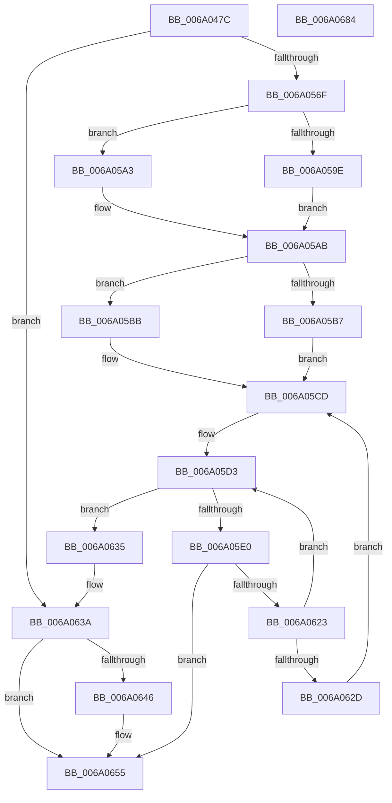

# BcpDisplayProgress

- RVA: `0x006A047C`–`0x006A0685` (길이 `521` bytes)
- VA: `0x00000001406A047C`
- 실행 섹션: `.text`
- PDB 이름 있음: `예`; PDB Function 태그: `아니요`
- unwind 정보 RVA: `0x000DA5A4`
- 디코드: `130`개 명령, `521/521` bytes 표시
- 미해석 바이트: `0` (있으면 어셈블리에 `.byte`로 보존)

> 이 문서는 커널 이미지의 기계어와 PDB 기호를 분석해 생성했습니다. 4번과 5번은 함수 원형과 자료형을 바이너리 사용 방식에서 추정한 C 해석이며 원본 소스 복구 결과는 아닙니다.

## 1. Dependencies

- 직접 호출 지점: **8**; 고유 호출 대상: **5**
- 직접 호출자로 확인된 함수: **3**
- RIP 상대 이미지 참조: **16**

### Outgoing calls
- `0x006A04EB` → [BcpDisplayCriticalString](../69/BcpDisplayCriticalString_function_0069F754.md) (function, `0x0069F754`)
- `0x006A050E` → [BcpConvertProgressToString](../69/BcpConvertProgressToString_function_0069F574.md) (function, `0x0069F574`)
- `0x006A051F` → [BcpDisplayCriticalString](../69/BcpDisplayCriticalString_function_0069F754.md) (function, `0x0069F754`)
- `0x006A0541` → [BcpDisplayCriticalString](../69/BcpDisplayCriticalString_function_0069F754.md) (function, `0x0069F754`)
- `0x006A0562` → [BcpCursorLessThan](../69/BcpCursorLessThan_function_0069F650.md) (function, `0x0069F650`)
- `0x006A05D7` → [BcpCursorLessThan](../69/BcpCursorLessThan_function_0069F650.md) (function, `0x0069F650`)
- `0x006A061A` → [BgpDisplayCharacterEx](../69/BgpDisplayCharacterEx_function_0069EBF4.md) (function, `0x0069EBF4`)
- `0x006A065E` → [_security_check_cookie](_security_check_cookie_function_006AC640.md) (function, `0x006AC640`)

### Direct callers
- [BcpGetComponentOffsets](BcpGetComponentOffsets_function_006A08C8.md) at `0x006A0971`
- [BgpFwDisplayBugCheckProgressUpdate](BgpFwDisplayBugCheckProgressUpdate_function_006A0E1C.md) at `0x006A0F06`
- [BgpFwDisplayBugCheckScreen](BgpFwDisplayBugCheckScreen_function_006A0FE8.md) at `0x006A1296`

### Static image references
- `0x006A049F` → RVA `0x00E0A740` (`.data`; read)
- `0x006A04B1` → RVA `0x00E0EF60` (`.data`; read)
- `0x006A04CB` → RVA `0x00E3EAE0` (`.data`; read)
- `0x006A04D8` → RVA `0x00E3EB00` (`.data`; read)
- `0x006A0529` → RVA `0x00E3EB10` (`.data`; read)
- `0x006A0533` → RVA `0x00E3EAF0` (`.data`; read)
- `0x006A0546` → RVA `0x00EEFEF8` (`.data`; read)
- `0x006A0552` → RVA `0x00EEFF00` (`.data`; read)
- `0x006A056F` → RVA `0x00E3EBA0` (`.data`; read)
- `0x006A057C` → RVA `0x00EEFEFC` (`.data`; read)
- `0x006A0592` → RVA `0x00EEFEF0` (`.data`; read)
- `0x006A05AB` → RVA `0x00EEFF10` (`.data`; read)
- `0x006A05E7` → RVA `0x00EF0360` (`.data`; read)
- `0x006A063A` → RVA `0x00EF0450` (`.data`; read)
- `0x006A0646` → RVA `0x00EF0390` (`.data`; write)
- `0x006A064E` → RVA `0x00EF0398` (`.data`; write)

## 2. Other-region calls and transfers

- 다른 실행 섹션으로 향하는 call: **0**
- 별도 외부 분기/꼬리 이동을 확인하지 못했습니다.

## 3. Assembly (complete function range)

```asm
006A047C  48 8B C4                        mov rax, rsp
006A047F  48 89 58 08                     mov qword ptr [rax + 8], rbx
006A0483  48 89 70 18                     mov qword ptr [rax + 0x18], rsi
006A0487  48 89 78 20                     mov qword ptr [rax + 0x20], rdi
006A048B  55                              push rbp
006A048C  41 54                           push r12
006A048E  41 55                           push r13
006A0490  41 56                           push r14
006A0492  41 57                           push r15
006A0494  48 8D 68 A1                     lea rbp, [rax - 0x5f]
006A0498  48 81 EC 90 00 00 00            sub rsp, 0x90
006A049F  48 8B 05 9A A2 76 00            mov rax, qword ptr [rip + 0x76a29a]
006A04A6  48 33 C4                        xor rax, rsp
006A04A9  48 89 45 27                     mov qword ptr [rbp + 0x27], rax
006A04AD  83 65 F7 00                     and dword ptr [rbp - 9], 0
006A04B1  4C 8D 35 A8 EA 76 00            lea r14, [rip + 0x76eaa8]
006A04B8  83 65 FB 00                     and dword ptr [rbp - 5], 0
006A04BC  33 C0                           xor eax, eax
006A04BE  48 63 FA                        movsxd rdi, edx
006A04C1  8B D9                           mov ebx, ecx
006A04C3  4C 6B FF 54                     imul r15, rdi, 0x54
006A04C7  48 89 45 FF                     mov qword ptr [rbp - 1], rax
006A04CB  48 8D 0D 0E E6 79 00            lea rcx, [rip + 0x79e60e]
006A04D2  89 45 07                        mov dword ptr [rbp + 7], eax
006A04D5  83 FB 01                        cmp ebx, 1
006A04D8  48 8D 05 21 E6 79 00            lea rax, [rip + 0x79e621]
006A04DF  44 8B CF                        mov r9d, edi
006A04E2  48 0F 45 C8                     cmovne rcx, rax
006A04E6  43 8B 54 37 08                  mov edx, dword ptr [r15 + r14 + 8]
006A04EB  E8 64 F2 FF FF                  call 0x14069f754
006A04F0  B8 08 00 00 00                  mov eax, 8
006A04F5  48 8D 55 0F                     lea rdx, [rbp + 0xf]
006A04F9  0F 57 C0                        xorps xmm0, xmm0
006A04FC  8B CB                           mov ecx, ebx
006A04FE  0F 11 45 0F                     movups xmmword ptr [rbp + 0xf], xmm0
006A0502  66 89 45 11                     mov word ptr [rbp + 0x11], ax
006A0506  48 8D 45 1F                     lea rax, [rbp + 0x1f]
006A050A  48 89 45 17                     mov qword ptr [rbp + 0x17], rax
006A050E  E8 61 F0 FF FF                  call 0x14069f574
006A0513  43 8B 54 37 08                  mov edx, dword ptr [r15 + r14 + 8]
006A0518  48 8D 4D 0F                     lea rcx, [rbp + 0xf]
006A051C  44 8B CF                        mov r9d, edi
006A051F  E8 30 F2 FF FF                  call 0x14069f754
006A0524  43 8B 54 37 08                  mov edx, dword ptr [r15 + r14 + 8]
006A0529  48 8D 05 E0 E5 79 00            lea rax, [rip + 0x79e5e0]
006A0530  83 FB 01                        cmp ebx, 1
006A0533  48 8D 0D B6 E5 79 00            lea rcx, [rip + 0x79e5b6]
006A053A  44 8B CF                        mov r9d, edi
006A053D  48 0F 45 C8                     cmovne rcx, rax
006A0541  E8 0E F2 FF FF                  call 0x14069f754
006A0546  F2 0F 10 05 AA F9 84 00         movsd xmm0, qword ptr [rip + 0x84f9aa]
006A054E  48 8D 4D 0F                     lea rcx, [rbp + 0xf]
006A0552  44 8B 2D A7 F9 84 00            mov r13d, dword ptr [rip + 0x84f9a7]
006A0559  F2 0F 11 45 0F                  movsd qword ptr [rbp + 0xf], xmm0
006A055E  44 89 6D 17                     mov dword ptr [rbp + 0x17], r13d
006A0562  E8 E9 F0 FF FF                  call 0x14069f650
006A0567  84 C0                           test al, al
006A0569  0F 84 CB 00 00 00               je 0x1406a063a
006A056F  48 8B 05 2A E6 79 00            mov rax, qword ptr [rip + 0x79e62a]
006A0576  8B 1D 7C F9 84 00               mov ebx, dword ptr [rip + 0x84f97c]
006A057C  8B 35 7A F9 84 00               mov esi, dword ptr [rip + 0x84f97a]
006A0582  48 8B 48 18                     mov rcx, qword ptr [rax + 0x18]
006A0586  4B 8D 04 37                     lea rax, [r15 + r14]
006A058A  44 8B 61 28                     mov r12d, dword ptr [rcx + 0x28]
006A058E  4B 8D 0C 37                     lea rcx, [r15 + r14]
006A0592  4C 8B 35 57 F9 84 00            mov r14, qword ptr [rip + 0x84f957]
006A0599  4D 85 F6                        test r14, r14
006A059C  74 05                           je 0x1406a05a3
006A059E  45 8B 36                        mov r14d, dword ptr [r14]
006A05A1  EB 08                           jmp 0x1406a05ab
006A05A3  44 8B 70 20                     mov r14d, dword ptr [rax + 0x20]
006A05A7  44 03 71 10                     add r14d, dword ptr [rcx + 0x10]
006A05AB  48 8B 3D 5E F9 84 00            mov rdi, qword ptr [rip + 0x84f95e]
006A05B2  48 85 FF                        test rdi, rdi
006A05B5  74 04                           je 0x1406a05bb
006A05B7  8B 3F                           mov edi, dword ptr [rdi]
006A05B9  EB 12                           jmp 0x1406a05cd
006A05BB  48 8D 3D 9E E9 76 00            lea rdi, [rip + 0x76e99e]
006A05C2  41 8B 7C 3F 18                  mov edi, dword ptr [r15 + rdi + 0x18]
006A05C7  03 79 10                        add edi, dword ptr [rcx + 0x10]
006A05CA  03 78 20                        add edi, dword ptr [rax + 0x20]
006A05CD  89 75 03                        mov dword ptr [rbp + 3], esi
006A05D0  89 5D FF                        mov dword ptr [rbp - 1], ebx
006A05D3  48 8D 4D FF                     lea rcx, [rbp - 1]
006A05D7  E8 74 F0 FF FF                  call 0x14069f650
006A05DC  84 C0                           test al, al
006A05DE  74 55                           je 0x1406a0635
006A05E0  48 8B 15 B9 E5 79 00            mov rdx, qword ptr [rip + 0x79e5b9]
006A05E7  48 8D 05 72 FD 84 00            lea rax, [rip + 0x84fd72]
006A05EE  48 89 44 24 48                  mov qword ptr [rsp + 0x48], rax
006A05F3  B9 20 00 00 00                  mov ecx, 0x20
006A05F8  48 8D 45 FB                     lea rax, [rbp - 5]
006A05FC  44 8B CE                        mov r9d, esi
006A05FF  48 89 44 24 38                  mov qword ptr [rsp + 0x38], rax
006A0604  44 8B C3                        mov r8d, ebx
006A0607  48 8D 45 F7                     lea rax, [rbp - 9]
006A060B  48 89 44 24 30                  mov qword ptr [rsp + 0x30], rax
006A0610  44 89 64 24 28                  mov dword ptr [rsp + 0x28], r12d
006A0615  44 89 64 24 20                  mov dword ptr [rsp + 0x20], r12d
006A061A  E8 D5 E5 FF FF                  call 0x14069ebf4
006A061F  85 C0                           test eax, eax
006A0621  78 32                           js 0x1406a0655
006A0623  03 5D F7                        add ebx, dword ptr [rbp - 9]
006A0626  89 5D FF                        mov dword ptr [rbp - 1], ebx
006A0629  3B DF                           cmp ebx, edi
006A062B  76 A6                           jbe 0x1406a05d3
006A062D  03 75 FB                        add esi, dword ptr [rbp - 5]
006A0630  41 8B DE                        mov ebx, r14d
006A0633  EB 98                           jmp 0x1406a05cd
006A0635  F2 0F 10 45 0F                  movsd xmm0, qword ptr [rbp + 0xf]
006A063A  F7 05 0C FE 84 00 00 00 00 01   test dword ptr [rip + 0x84fe0c], 0x1000000
006A0644  75 0F                           jne 0x1406a0655
006A0646  F2 0F 11 05 42 FD 84 00         movsd qword ptr [rip + 0x84fd42], xmm0
006A064E  44 89 2D 43 FD 84 00            mov dword ptr [rip + 0x84fd43], r13d
006A0655  33 C0                           xor eax, eax
006A0657  48 8B 4D 27                     mov rcx, qword ptr [rbp + 0x27]
006A065B  48 33 CC                        xor rcx, rsp
006A065E  E8 DD BF 00 00                  call 0x1406ac640
006A0663  4C 8D 9C 24 90 00 00 00         lea r11, [rsp + 0x90]
006A066B  49 8B 5B 30                     mov rbx, qword ptr [r11 + 0x30]
006A066F  49 8B 73 40                     mov rsi, qword ptr [r11 + 0x40]
006A0673  49 8B 7B 48                     mov rdi, qword ptr [r11 + 0x48]
006A0677  49 8B E3                        mov rsp, r11
006A067A  41 5F                           pop r15
006A067C  41 5E                           pop r14
006A067E  41 5D                           pop r13
006A0680  41 5C                           pop r12
006A0682  5D                              pop rbp
006A0683  C3                              ret
006A0684  CC                              int3
```

## 4. C-style interpretation (structured pseudocode)

```c
__int64 __fastcall BcpDisplayProgress(int a1, int a2)
{
    __int64 result;
    __int64 v_r14;
    __int64 v_r15;
    __int64 v_rbx;
    __int64 v_rdi;
    __int64 v_rsi;
    __int64 v_rsp;
    unsigned __int64 v_stack_m28;
    unsigned __int64 v_stack_m70;
    unsigned __int64 v_stack_m80;
    unsigned __int64 v_stack_m88;
    unsigned int v_stack_m90;
    unsigned int v_stack_m98;

    *(unsigned __int64 *)(v_rsp + 8) = v_rbx;
    *(unsigned __int64 *)(v_rsp + 24) = v_rsi;
    *(unsigned __int64 *)(v_rsp + 32) = v_rdi;
    v_rsp = (v_rsp) - (144);
    result = (*(unsigned __int64 *)(v_rip + 7774874)) ^ (v_rsp);
    *(unsigned __int64 *)(v_rsp - 95 + 39) = result;
    result = 0;
    v_r15 = (v_r15) * ((int)(a2));
    *(unsigned __int64 *)(v_rsp - 95 - 1) = 0;
    *(unsigned int *)(v_rsp - 95 + 7) = 0;
    a1 = v_rip + 7988750;
    if (((unsigned int)((unsigned int)(a1))) != 1) { a1 = v_rip + 7988769; }
    result = BcpDisplayCriticalString(a1, (unsigned int)(*(unsigned int *)(v_r15 + v_rip + 7793320 * 1 + 8)), a3, (unsigned int)((unsigned int)((int)(a2))));
    *(unsigned __int64 *)(v_rsp - 95 + 15) = v_xmm0;
    *(unsigned __int16 *)(v_rsp - 95 + 17) = 8;
    *(unsigned __int64 *)(v_rsp - 95 + 23) = v_rsp - 95 + 31;
    result = BcpConvertProgressToString((unsigned int)((unsigned int)((unsigned int)(a1))), v_rsp - 95 + 15, a3, (unsigned int)((unsigned int)((int)(a2))));
    result = BcpDisplayCriticalString(v_rsp - 95 + 15, (unsigned int)(*(unsigned int *)(v_r15 + v_rip + 7793320 * 1 + 8)), a3, (unsigned int)((unsigned int)((int)(a2))));
    a1 = v_rip + 7988662;
    if (((unsigned int)((unsigned int)(a1))) != 1) { a1 = v_rip + 7988704; }
    result = BcpDisplayCriticalString(a1, (unsigned int)(*(unsigned int *)(v_r15 + v_rip + 7793320 * 1 + 8)), a3, (unsigned int)((unsigned int)((int)(a2))));
    *(unsigned __int64 *)(v_rsp - 95 + 15) = v_xmm0;
    *(unsigned int *)(v_rsp - 95 + 23) = (unsigned int)((unsigned int)(*(unsigned int *)(v_rip + 8714663)));
    result = BcpCursorLessThan(v_rsp - 95 + 15, (unsigned int)(*(unsigned int *)(v_r15 + v_rip + 7793320 * 1 + 8)), a3, (unsigned int)((unsigned int)((int)(a2))));
    if ((unsigned __int8)(result) == 0) goto loc_006A063A;
    if (*(unsigned __int64 *)(v_rip + 8714583) == 0) goto loc_006A05A3;
    goto loc_006A05AB;
loc_006A05A3:
    v_r14 = (unsigned int)(((unsigned int)(*(unsigned int *)(v_r15 + v_rip + 7793320 * 1 + 32))) + (*(unsigned int *)(v_r15 + v_rip + 7793320 * 1 + 16)));
loc_006A05AB:
    if (*(unsigned __int64 *)(v_rip + 8714590) == 0) goto loc_006A05BB;
    goto loc_006A05CD;
loc_006A05BB:
    v_rdi = (unsigned int)(((unsigned int)(*(unsigned int *)(v_r15 + v_rip + 7793054 * 1 + 24))) + (*(unsigned int *)(v_r15 + v_rip + 7793320 * 1 + 16)));
    v_rdi = (unsigned int)((v_rdi) + (*(unsigned int *)(v_r15 + v_rip + 7793320 * 1 + 32)));
loc_006A05CD:
    *(unsigned int *)(v_rsp - 95 + 3) = (unsigned int)((unsigned int)(*(unsigned int *)(v_rip + 8714618)));
    *(unsigned int *)(v_rsp - 95 - 1) = (unsigned int)((unsigned int)(*(unsigned int *)(v_rip + 8714620)));
loc_006A05D3:
    result = BcpCursorLessThan(v_rsp - 95 - 1, (unsigned int)(*(unsigned int *)(v_r15 + v_rip + 7793320 * 1 + 8)), a3, (unsigned int)((unsigned int)((int)(a2))));
    if ((unsigned __int8)(result) == 0) goto loc_006A0635;
    v_stack_m70 = v_rip + 8715634;
    v_stack_m80 = v_rsp - 95 - 5;
    v_stack_m88 = v_rsp - 95 - 9;
    v_stack_m90 = (unsigned int)((unsigned int)(*(unsigned int *)(*(unsigned __int64 *)(*(unsigned __int64 *)(v_rip + 7988778) + 24) + 40)));
    v_stack_m98 = (unsigned int)((unsigned int)(*(unsigned int *)(*(unsigned __int64 *)(*(unsigned __int64 *)(v_rip + 7988778) + 24) + 40)));
    result = BgpDisplayCharacterEx(32, *(unsigned __int64 *)(v_rip + 7988665), (unsigned int)((unsigned int)((unsigned int)(*(unsigned int *)(v_rip + 8714620)))), (unsigned int)((unsigned int)((unsigned int)(*(unsigned int *)(v_rip + 8714618)))));
    if (sign_flag) goto loc_006A0655;
    v_rbx = (unsigned int)(((unsigned int)(*(unsigned int *)(v_rip + 8714620))) + (*(unsigned int *)(v_rsp - 95 - 9)));
    *(unsigned int *)(v_rsp - 95 - 1) = (unsigned int)(v_rbx);
    if (((unsigned int)(v_rbx)) <= ((unsigned int)(v_rdi))) goto loc_006A05D3;
    v_rsi = (unsigned int)(((unsigned int)(*(unsigned int *)(v_rip + 8714618))) + (*(unsigned int *)(v_rsp - 95 - 5)));
    goto loc_006A05CD;
loc_006A0635:
loc_006A063A:
    if (((*(unsigned int *)(v_rip + 8715788)) & (0x1000000ULL)) == 0) {
        *(unsigned __int64 *)(v_rip + 8715586) = v_xmm0;
        *(unsigned int *)(v_rip + 8715587) = (unsigned int)((unsigned int)(*(unsigned int *)(v_rip + 8714663)));
    }
    result = 0;
    a1 = (*(unsigned __int64 *)(v_rsp - 95 + 39)) ^ (v_rsp);
    result = _security_check_cookie(a1, *(unsigned __int64 *)(v_rip + 7988665), (unsigned int)((unsigned int)((unsigned int)(*(unsigned int *)(v_rip + 8714620)))), (unsigned int)((unsigned int)((unsigned int)(*(unsigned int *)(v_rip + 8714618)))));
    return result;
}
```

## 5. (Beta) C Style

```c
int64_t BcpDisplayProgress(int32_t Arg1, int32_t Arg2)
{
    int64_t result;
    int64_t local_r14;
    int64_t local_r15;
    int64_t local_rbx;
    int64_t local_rdi;
    int64_t local_rsi;
    int64_t local_rsp;
    uint64_t v_stack_m28;
    uint64_t v_stack_m70;
    uint64_t v_stack_m80;
    uint64_t v_stack_m88;
    uint32_t v_stack_m90;
    uint32_t v_stack_m98;

    *(uint64_t *)(local_rsp + 0x8) = local_rbx;
    *(uint64_t *)(local_rsp + 0x18) = local_rsi;
    *(uint64_t *)(local_rsp + 0x20) = local_rdi;
    local_rsp = (local_rsp) - (144);
    result = (*(uint64_t *)(v_rip + 0x76A29A)) ^ (local_rsp);
    *(uint64_t *)(local_rsp - 0x5F + 0x27) = result;
    result = 0;
    local_r15 = (local_r15) * ((int32_t)(Arg2));
    *(uint64_t *)(local_rsp - 0x5F - 0x1) = 0;
    *(uint32_t *)(local_rsp - 0x5F + 0x7) = 0;
    Arg1 = v_rip + 7988750;
    if (((uint32_t)((uint32_t)(Arg1))) != 1) { Arg1 = v_rip + 7988769; }
    result = BcpDisplayCriticalString(Arg1, (uint32_t)(*(uint32_t *)(local_r15 + v_rip + 0x76EAA8 * 1 + 0x8)), a3, (uint32_t)((uint32_t)((int32_t)(Arg2))));
    *(uint64_t *)(local_rsp - 0x5F + 0xF) = v_xmm0;
    *(uint16_t *)(local_rsp - 0x5F + 0x11) = 8;
    *(uint64_t *)(local_rsp - 0x5F + 0x17) = local_rsp - 95 + 31;
    result = BcpConvertProgressToString((uint32_t)((uint32_t)((uint32_t)(Arg1))), local_rsp - 95 + 15, a3, (uint32_t)((uint32_t)((int32_t)(Arg2))));
    result = BcpDisplayCriticalString(local_rsp - 95 + 15, (uint32_t)(*(uint32_t *)(local_r15 + v_rip + 0x76EAA8 * 1 + 0x8)), a3, (uint32_t)((uint32_t)((int32_t)(Arg2))));
    Arg1 = v_rip + 7988662;
    if (((uint32_t)((uint32_t)(Arg1))) != 1) { Arg1 = v_rip + 7988704; }
    result = BcpDisplayCriticalString(Arg1, (uint32_t)(*(uint32_t *)(local_r15 + v_rip + 0x76EAA8 * 1 + 0x8)), a3, (uint32_t)((uint32_t)((int32_t)(Arg2))));
    *(uint64_t *)(local_rsp - 0x5F + 0xF) = v_xmm0;
    *(uint32_t *)(local_rsp - 0x5F + 0x17) = (uint32_t)((uint32_t)(*(uint32_t *)(v_rip + 0x84F9A7)));
    result = BcpCursorLessThan(local_rsp - 95 + 15, (uint32_t)(*(uint32_t *)(local_r15 + v_rip + 0x76EAA8 * 1 + 0x8)), a3, (uint32_t)((uint32_t)((int32_t)(Arg2))));
    if ((uint8_t)(result) == 0) goto loc_006A063A;
    if (*(uint64_t *)(v_rip + 0x84F957) == 0) goto loc_006A05A3;
    goto loc_006A05AB;
loc_006A05A3:
    local_r14 = (uint32_t)(((uint32_t)(*(uint32_t *)(local_r15 + v_rip + 0x76EAA8 * 1 + 0x20))) + (*(uint32_t *)(local_r15 + v_rip + 0x76EAA8 * 1 + 0x10)));
loc_006A05AB:
    if (*(uint64_t *)(v_rip + 0x84F95E) == 0) goto loc_006A05BB;
    goto loc_006A05CD;
loc_006A05BB:
    local_rdi = (uint32_t)(((uint32_t)(*(uint32_t *)(local_r15 + v_rip + 0x76E99E * 1 + 0x18))) + (*(uint32_t *)(local_r15 + v_rip + 0x76EAA8 * 1 + 0x10)));
    local_rdi = (uint32_t)((local_rdi) + (*(uint32_t *)(local_r15 + v_rip + 0x76EAA8 * 1 + 0x20)));
loc_006A05CD:
    *(uint32_t *)(local_rsp - 0x5F + 0x3) = (uint32_t)((uint32_t)(*(uint32_t *)(v_rip + 0x84F97A)));
    *(uint32_t *)(local_rsp - 0x5F - 0x1) = (uint32_t)((uint32_t)(*(uint32_t *)(v_rip + 0x84F97C)));
loc_006A05D3:
    result = BcpCursorLessThan(local_rsp - 95 - 1, (uint32_t)(*(uint32_t *)(local_r15 + v_rip + 0x76EAA8 * 1 + 0x8)), a3, (uint32_t)((uint32_t)((int32_t)(Arg2))));
    if ((uint8_t)(result) == 0) goto loc_006A0635;
    v_stack_m70 = v_rip + 8715634;
    v_stack_m80 = local_rsp - 95 - 5;
    v_stack_m88 = local_rsp - 95 - 9;
    v_stack_m90 = (uint32_t)((uint32_t)(*(uint32_t *)(*(uint64_t *)(*(uint64_t *)(v_rip + 0x79E62A) + 0x18) + 0x28)));
    v_stack_m98 = (uint32_t)((uint32_t)(*(uint32_t *)(*(uint64_t *)(*(uint64_t *)(v_rip + 0x79E62A) + 0x18) + 0x28)));
    result = BgpDisplayCharacterEx(32, *(uint64_t *)(v_rip + 0x79E5B9), (uint32_t)((uint32_t)((uint32_t)(*(uint32_t *)(v_rip + 0x84F97C)))), (uint32_t)((uint32_t)((uint32_t)(*(uint32_t *)(v_rip + 0x84F97A)))));
    if (sign_flag) goto loc_006A0655;
    local_rbx = (uint32_t)(((uint32_t)(*(uint32_t *)(v_rip + 0x84F97C))) + (*(uint32_t *)(local_rsp - 0x5F - 0x9)));
    *(uint32_t *)(local_rsp - 0x5F - 0x1) = (uint32_t)(local_rbx);
    if (((uint32_t)(local_rbx)) <= ((uint32_t)(local_rdi))) goto loc_006A05D3;
    local_rsi = (uint32_t)(((uint32_t)(*(uint32_t *)(v_rip + 0x84F97A))) + (*(uint32_t *)(local_rsp - 0x5F - 0x5)));
    goto loc_006A05CD;
loc_006A0635:
loc_006A063A:
    if (((*(uint32_t *)(v_rip + 0x84FE0C)) & (0x1000000ULL)) == 0) {
        *(uint64_t *)(v_rip + 0x84FD42) = v_xmm0;
        *(uint32_t *)(v_rip + 0x84FD43) = (uint32_t)((uint32_t)(*(uint32_t *)(v_rip + 0x84F9A7)));
    }
    result = 0;
    Arg1 = (*(uint64_t *)(local_rsp - 0x5F + 0x27)) ^ (local_rsp);
    result = _security_check_cookie(Arg1, *(uint64_t *)(v_rip + 0x79E5B9), (uint32_t)((uint32_t)((uint32_t)(*(uint32_t *)(v_rip + 0x84F97C)))), (uint32_t)((uint32_t)((uint32_t)(*(uint32_t *)(v_rip + 0x84F97A)))));
    return result;
}
```

## 6. Execution-region graph

[열기: 2D/3D 그래프와 함수 탐색 컨트롤 패널](../../../control-panel.html?section=text&rva=0x006A047C&view=graph)

- 2D 그래프는 위에서 아래로 흐르고, 3D 그래프는 빈 공간을 드래그해 회전합니다. Shift+드래그는 이동, 휠은 확대·축소, 함수 노드 선택은 대상 보고서 이동입니다.

### Static fallback


