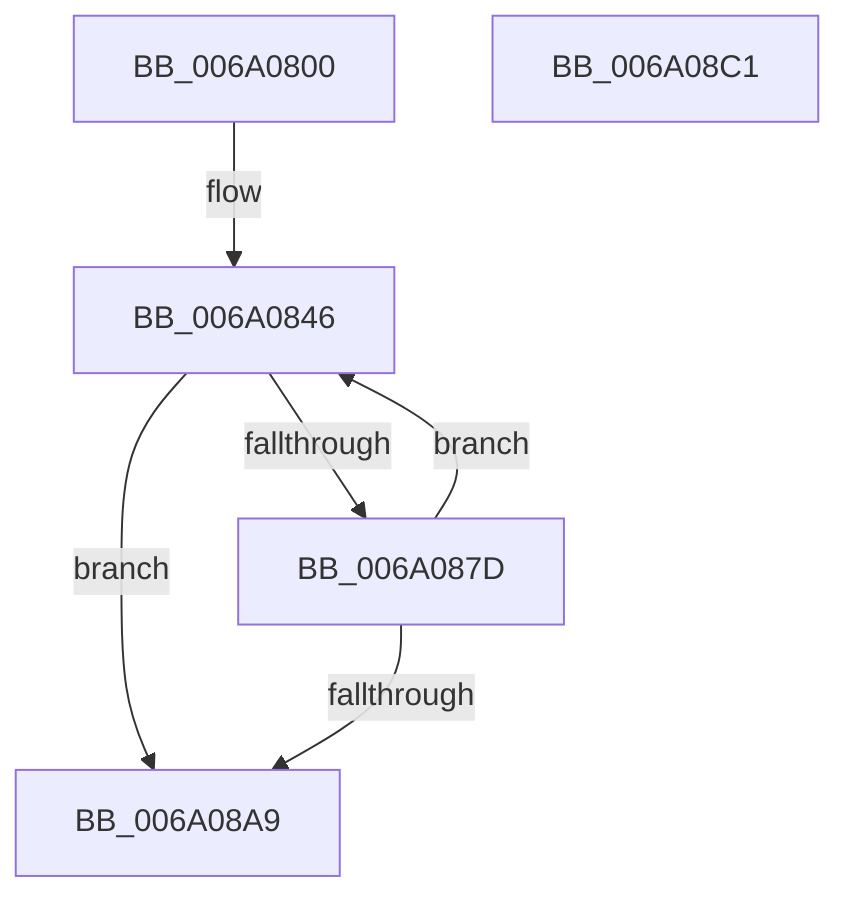

# BcpGetCharacterMaxResourceProfile

- RVA: `0x006A0800`–`0x006A08C2` (길이 `194` bytes)
- VA: `0x00000001406A0800`
- 실행 섹션: `.text`
- PDB 이름 있음: `예`; PDB Function 태그: `아니요`
- unwind 정보 RVA: `0x000D0064`
- 디코드: `59`개 명령, `194/194` bytes 표시
- 미해석 바이트: `0` (있으면 어셈블리에 `.byte`로 보존)

> 이 문서는 커널 이미지의 기계어와 PDB 기호를 분석해 생성했습니다. 4번과 5번은 함수 원형과 자료형을 바이너리 사용 방식에서 추정한 C 해석이며 원본 소스 복구 결과는 아닙니다.

## 1. Dependencies

- 직접 호출 지점: **1**; 고유 호출 대상: **1**
- 직접 호출자로 확인된 함수: **1**
- RIP 상대 이미지 참조: **1**

### Outgoing calls
- `0x006A0871` → [RaspGetXExtent](RaspGetXExtent_function_006A1F7C.md) (function, `0x006A1F7C`)

### Direct callers
- [BcpGetMaxResourceProfile](BcpGetMaxResourceProfile_function_006A0A88.md) at `0x006A0AFA`

### Static image references
- `0x006A0823` → RVA `0x00E0EF60` (`.data`; read)

## 2. Other-region calls and transfers

- 다른 실행 섹션으로 향하는 call: **0**
- 별도 외부 분기/꼬리 이동을 확인하지 못했습니다.

## 3. Assembly (complete function range)

```asm
006A0800  48 89 5C 24 08                  mov qword ptr [rsp + 8], rbx
006A0805  48 89 74 24 10                  mov qword ptr [rsp + 0x10], rsi
006A080A  55                              push rbp
006A080B  57                              push rdi
006A080C  41 56                           push r14
006A080E  48 8B EC                        mov rbp, rsp
006A0811  48 83 EC 60                     sub rsp, 0x60
006A0815  41 0F 10 08                     movups xmm1, xmmword ptr [r8]
006A0819  48 63 C2                        movsxd rax, edx
006A081C  44 0F B7 F1                     movzx r14d, cx
006A0820  0F 57 C0                        xorps xmm0, xmm0
006A0823  48 8D 0D 36 E7 76 00            lea rcx, [rip + 0x76e736]
006A082A  0F 11 45 D0                     movups xmmword ptr [rbp - 0x30], xmm0
006A082E  49 8B F9                        mov rdi, r9
006A0831  33 F6                           xor esi, esi
006A0833  F2 41 0F 10 40 10               movsd xmm0, qword ptr [r8 + 0x10]
006A0839  48 8D 1C 81                     lea rbx, [rcx + rax*4]
006A083D  F2 0F 11 45 E0                  movsd qword ptr [rbp - 0x20], xmm0
006A0842  0F 11 4D D0                     movups xmmword ptr [rbp - 0x30], xmm1
006A0846  8B 03                           mov eax, dword ptr [rbx]
006A0848  4C 8D 45 30                     lea r8, [rbp + 0x30]
006A084C  83 65 30 00                     and dword ptr [rbp + 0x30], 0
006A0850  48 8D 55 D0                     lea rdx, [rbp - 0x30]
006A0854  89 45 E0                        mov dword ptr [rbp - 0x20], eax
006A0857  0F 57 C0                        xorps xmm0, xmm0
006A085A  33 C0                           xor eax, eax
006A085C  41 0F B7 CE                     movzx ecx, r14w
006A0860  48 89 45 F8                     mov qword ptr [rbp - 8], rax
006A0864  48 8D 45 E8                     lea rax, [rbp - 0x18]
006A0868  48 89 44 24 28                  mov qword ptr [rsp + 0x28], rax
006A086D  0F 11 45 E8                     movups xmmword ptr [rbp - 0x18], xmm0
006A0871  E8 06 17 00 00                  call 0x1406a1f7c
006A0876  44 8B C8                        mov r9d, eax
006A0879  85 C0                           test eax, eax
006A087B  78 2C                           js 0x1406a08a9
006A087D  8B 4F 08                        mov ecx, dword ptr [rdi + 8]
006A0880  48 8B 07                        mov rax, qword ptr [rdi]
006A0883  8B 55 30                        mov edx, dword ptr [rbp + 0x30]
006A0886  3B CA                           cmp ecx, edx
006A0888  4C 8B 45 F8                     mov r8, qword ptr [rbp - 8]
006A088C  0F 43 D1                        cmovae edx, ecx
006A088F  49 3B C0                        cmp rax, r8
006A0892  89 57 08                        mov dword ptr [rdi + 8], edx
006A0895  4C 0F 43 C0                     cmovae r8, rax
006A0899  48 FF C6                        inc rsi
006A089C  48 83 C3 54                     add rbx, 0x54
006A08A0  4C 89 07                        mov qword ptr [rdi], r8
006A08A3  48 83 FE 05                     cmp rsi, 5
006A08A7  7C 9D                           jl 0x1406a0846
006A08A9  4C 8D 5C 24 60                  lea r11, [rsp + 0x60]
006A08AE  41 8B C1                        mov eax, r9d
006A08B1  49 8B 5B 20                     mov rbx, qword ptr [r11 + 0x20]
006A08B5  49 8B 73 28                     mov rsi, qword ptr [r11 + 0x28]
006A08B9  49 8B E3                        mov rsp, r11
006A08BC  41 5E                           pop r14
006A08BE  5F                              pop rdi
006A08BF  5D                              pop rbp
006A08C0  C3                              ret
006A08C1  CC                              int3
```

## 4. C-style interpretation (structured pseudocode)

```c
__int64 __fastcall BcpGetCharacterMaxResourceProfile(unsigned __int16 a1, int a2, __int64 a3, __int64 a4)
{
    __int64 result;
    __int64 v_rbx;
    __int64 v_rsi;
    __int64 v_rsp;
    unsigned __int64 v_stack_m18;
    unsigned __int64 v_stack_m20;
    unsigned __int64 v_stack_m30;
    unsigned __int64 v_stack_m38;
    unsigned __int64 v_stack_m48;
    unsigned __int64 v_stack_m50;
    unsigned __int64 v_stack_p10;
    unsigned __int64 v_stack_p18;
    unsigned __int64 v_stack_p8;

    v_stack_p8 = v_rbx;
    v_stack_p10 = v_rsi;
    v_rsp = (v_rsp) - (96);
    v_stack_m48 = v_xmm0;
    v_rsi = 0;
    v_stack_m38 = v_xmm0;
    v_stack_m48 = v_xmm1;
loc_006A0846:
    v_stack_m38 = (unsigned int)((unsigned int)(*(unsigned int *)(v_rip + 7792438 + (int)(a2) * 4)));
    result = 0;
    v_stack_m20 = 0;
    v_stack_m50 = v_stack_m30;
    v_stack_m30 = v_xmm0;
    result = RaspGetXExtent(a1, v_stack_m48, v_stack_p18, a4);
    if (sign_flag) goto loc_006A08A9;
    a2 = (unsigned int)(v_stack_p18);
    if (((unsigned int)((unsigned int)(*(unsigned int *)(a4 + 8)))) >= ((unsigned int)((unsigned int)(v_stack_p18)))) { a2 = (unsigned int)((unsigned int)(*(unsigned int *)(a4 + 8))); }
    *(unsigned int *)(a4 + 8) = a2;
    a3 = v_stack_m20;
    if ((*(unsigned __int64 *)(a4)) >= v_stack_m20) { a3 = *(unsigned __int64 *)(a4); }
    v_rsi = (v_rsi) + 1;
    v_rbx = (v_rip + 7792438 + (int)(a2) * 4) + (84);
    *(unsigned __int64 *)(a4) = a3;
    if (v_rsi < 5) goto loc_006A0846;
loc_006A08A9:
    return (unsigned int)((unsigned int)((unsigned int)((unsigned int)(result))));
}
```

## 5. (Beta) C Style

```c
int64_t BcpGetCharacterMaxResourceProfile(uint16_t Arg1, int32_t Arg2, void *Arg3, void *Arg4)
{
    uint8_t *arg3 = (uint8_t *)Arg3;
    uint8_t *arg4 = (uint8_t *)Arg4;

    int64_t result;
    int64_t local_rbx;
    int64_t local_rsi;
    int64_t local_rsp;
    uint64_t v_stack_m18;
    uint64_t v_stack_m20;
    uint64_t v_stack_m30;
    uint64_t v_stack_m38;
    uint64_t v_stack_m48;
    uint64_t v_stack_m50;
    uint64_t v_stack_p10;
    uint64_t v_stack_p18;
    uint64_t v_stack_p8;

    v_stack_p8 = local_rbx;
    v_stack_p10 = local_rsi;
    local_rsp = (local_rsp) - (96);
    v_stack_m48 = v_xmm0;
    local_rsi = 0;
    v_stack_m38 = v_xmm0;
    v_stack_m48 = v_xmm1;
loc_006A0846:
    v_stack_m38 = (uint32_t)((uint32_t)(*(uint32_t *)(v_rip + 0x76E736 + (int32_t)(Arg2) * 4)));
    result = 0;
    v_stack_m20 = 0;
    v_stack_m50 = v_stack_m30;
    v_stack_m30 = v_xmm0;
    result = RaspGetXExtent(Arg1, v_stack_m48, v_stack_p18, Arg4);
    if (sign_flag) goto loc_006A08A9;
    Arg2 = (uint32_t)(v_stack_p18);
    if (((uint32_t)((uint32_t)(*(uint32_t *)(arg4 + 0x8)))) >= ((uint32_t)((uint32_t)(v_stack_p18)))) { Arg2 = (uint32_t)((uint32_t)(*(uint32_t *)(arg4 + 0x8))); }
    *(uint32_t *)(arg4 + 0x8) = Arg2;
    Arg3 = v_stack_m20;
    if ((*(uint64_t *)(arg4)) >= v_stack_m20) { Arg3 = *(uint64_t *)(arg4); }
    local_rsi = (local_rsi) + 1;
    local_rbx = (v_rip + 7792438 + (int32_t)(Arg2) * 4) + (84);
    *(void **)(arg4) = Arg3;
    if (local_rsi < 5) goto loc_006A0846;
loc_006A08A9:
    return (uint32_t)((uint32_t)((uint32_t)((uint32_t)(result))));
}
```

### 관측된 메모리 오프셋

구조체 형식이 확인되지 않은 접근은 인자 기준의 오프셋으로만 기록했습니다.

| 기준 인자 | 오프셋 표현 | 폭 (bit) | 접근 |
|---|---:|---:|---|
| `Arg3` | `+ 0x0` | `128` | `R` |
| `Arg3` | `+ 0x10` | `64` | `R` |
| `Arg4` | `+ 0x0` | `64` | `R` |
| `Arg4` | `+ 0x0` | `64` | `W` |
| `Arg4` | `+ 0x8` | `32` | `R` |
| `Arg4` | `+ 0x8` | `32` | `W` |

## 6. Execution-region graph

[열기: 2D/3D 그래프와 함수 탐색 컨트롤 패널](../../../control-panel.html?section=text&rva=0x006A0800&view=graph)

- 2D 그래프는 위에서 아래로 흐르고, 3D 그래프는 빈 공간을 드래그해 회전합니다. Shift+드래그는 이동, 휠은 확대·축소, 함수 노드 선택은 대상 보고서 이동입니다.

### Static fallback


