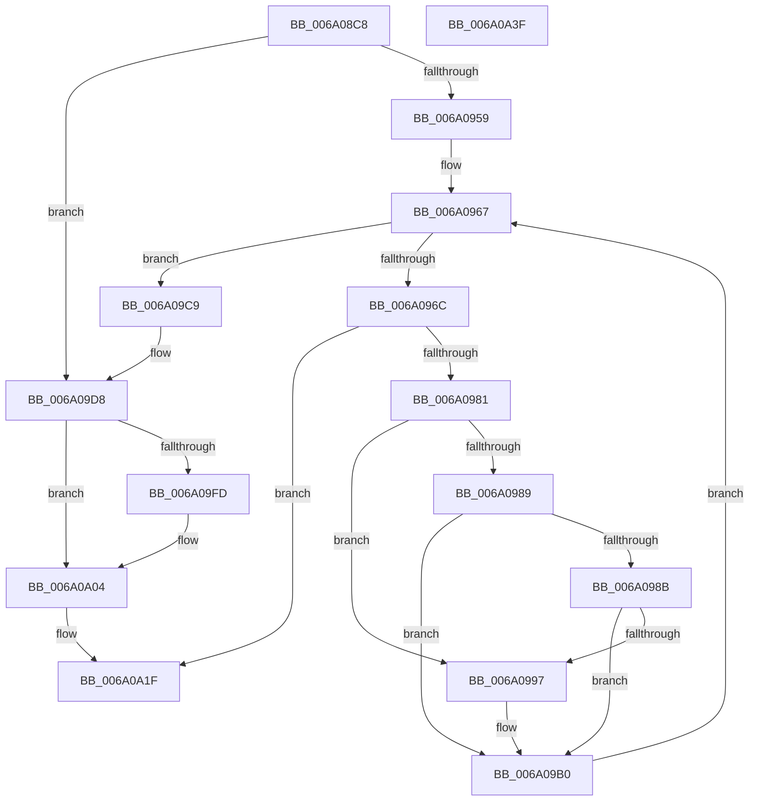

# BcpGetComponentOffsets

- RVA: `0x006A08C8`–`0x006A0A40` (길이 `376` bytes)
- VA: `0x00000001406A08C8`
- 실행 섹션: `.text`
- PDB 이름 있음: `예`; PDB Function 태그: `아니요`
- unwind 정보 RVA: `0x000D1914`
- 디코드: `98`개 명령, `376/376` bytes 표시
- 미해석 바이트: `0` (있으면 어셈블리에 `.byte`로 보존)

> 이 문서는 커널 이미지의 기계어와 PDB 기호를 분석해 생성했습니다. 4번과 5번은 함수 원형과 자료형을 바이너리 사용 방식에서 추정한 C 해석이며 원본 소스 복구 결과는 아닙니다.

## 1. Dependencies

- 직접 호출 지점: **2**; 고유 호출 대상: **2**
- 직접 호출자로 확인된 함수: **1**
- RIP 상대 이미지 참조: **8**

### Outgoing calls
- `0x006A0971` → [BcpDisplayProgress](BcpDisplayProgress_function_006A047C.md) (function, `0x006A047C`)
- `0x006A09BB` → [BcpSetCursorPosition](BcpSetCursorPosition_function_006A0D50.md) (function, `0x006A0D50`)

### Direct callers
- [BgpFwDisplayBugCheckScreen](BgpFwDisplayBugCheckScreen_function_006A0FE8.md) at `0x006A1209`

### Static image references
- `0x006A08E8` → RVA `0x00EEFEF8` (`.data`; read)
- `0x006A08F5` → RVA `0x00EEFEFC` (`.data`; read)
- `0x006A0901` → RVA `0x00E0EF60` (`.data`; read)
- `0x006A090E` → RVA `0x00EEFF00` (`.data`; read)
- `0x006A0959` → RVA `0x00EF0450` (`.data`; read/write)
- `0x006A0981` → RVA `0x00EF0394` (`.data`; read)
- `0x006A098B` → RVA `0x00EF0390` (`.data`; read)
- `0x006A099F` → RVA `0x00EF0398` (`.data`; read)

## 2. Other-region calls and transfers

- 다른 실행 섹션으로 향하는 call: **0**
- 별도 외부 분기/꼬리 이동을 확인하지 못했습니다.

## 3. Assembly (complete function range)

```asm
006A08C8  48 8B C4                        mov rax, rsp
006A08CB  48 89 58 08                     mov qword ptr [rax + 8], rbx
006A08CF  48 89 68 10                     mov qword ptr [rax + 0x10], rbp
006A08D3  48 89 70 18                     mov qword ptr [rax + 0x18], rsi
006A08D7  44 89 48 20                     mov dword ptr [rax + 0x20], r9d
006A08DB  57                              push rdi
006A08DC  41 54                           push r12
006A08DE  41 55                           push r13
006A08E0  41 56                           push r14
006A08E2  41 57                           push r15
006A08E4  48 83 EC 30                     sub rsp, 0x30
006A08E8  8B 05 0A F6 84 00               mov eax, dword ptr [rip + 0x84f60a]
006A08EE  4C 8B F9                        mov r15, rcx
006A08F1  89 01                           mov dword ptr [rcx], eax
006A08F3  33 FF                           xor edi, edi
006A08F5  8B 05 01 F6 84 00               mov eax, dword ptr [rip + 0x84f601]
006A08FB  4D 8B E8                        mov r13, r8
006A08FE  89 41 04                        mov dword ptr [rcx + 4], eax
006A0901  4C 8D 05 58 E6 76 00            lea r8, [rip + 0x76e658]
006A0908  4D 63 D9                        movsxd r11, r9d
006A090B  4C 8B F2                        mov r14, rdx
006A090E  44 8B 0D EB F5 84 00            mov r9d, dword ptr [rip + 0x84f5eb]
006A0915  44 8B D7                        mov r10d, edi
006A0918  44 89 49 08                     mov dword ptr [rcx + 8], r9d
006A091C  49 6B DB 54                     imul rbx, r11, 0x54
006A0920  42 8B 44 03 20                  mov eax, dword ptr [rbx + r8 + 0x20]
006A0925  42 03 44 03 10                  add eax, dword ptr [rbx + r8 + 0x10]
006A092A  89 01                           mov dword ptr [rcx], eax
006A092C  42 8B 4C 03 2C                  mov ecx, dword ptr [rbx + r8 + 0x2c]
006A0931  41 03 C9                        add ecx, r9d
006A0934  41 89 4F 04                     mov dword ptr [r15 + 4], ecx
006A0938  42 03 4C 03 2C                  add ecx, dword ptr [rbx + r8 + 0x2c]
006A093D  44 8B E1                        mov r12d, ecx
006A0940  41 89 4F 08                     mov dword ptr [r15 + 8], ecx
006A0944  F2 41 0F 10 07                  movsd xmm0, qword ptr [r15]
006A0949  F2 0F 11 44 24 20               movsd qword ptr [rsp + 0x20], xmm0
006A094F  40 38 BC 24 88 00 00 00         cmp byte ptr [rsp + 0x88], dil
006A0957  74 7F                           je 0x1406a09d8
006A0959  0F BA 2D EF FA 84 00 18         bts dword ptr [rip + 0x84faef], 0x18
006A0961  8B F7                           mov esi, edi
006A0963  8B 6C 24 24                     mov ebp, dword ptr [rsp + 0x24]
006A0967  83 FE 64                        cmp esi, 0x64
006A096A  77 5D                           ja 0x1406a09c9
006A096C  41 8B D3                        mov edx, r11d
006A096F  8B CE                           mov ecx, esi
006A0971  E8 06 FB FF FF                  call 0x1406a047c
006A0976  44 8B D0                        mov r10d, eax
006A0979  85 C0                           test eax, eax
006A097B  0F 88 9E 00 00 00               js 0x1406a0a1f
006A0981  3B 2D 0D FA 84 00               cmp ebp, dword ptr [rip + 0x84fa0d]
006A0987  72 0E                           jb 0x1406a0997
006A0989  75 25                           jne 0x1406a09b0
006A098B  8B 0D FF F9 84 00               mov ecx, dword ptr [rip + 0x84f9ff]
006A0991  39 4C 24 20                     cmp dword ptr [rsp + 0x20], ecx
006A0995  73 19                           jae 0x1406a09b0
006A0997  F2 0F 10 05 F1 F9 84 00         movsd xmm0, qword ptr [rip + 0x84f9f1]
006A099F  44 8B 25 F2 F9 84 00            mov r12d, dword ptr [rip + 0x84f9f2]
006A09A6  F2 0F 11 44 24 20               movsd qword ptr [rsp + 0x20], xmm0
006A09AC  8B 6C 24 24                     mov ebp, dword ptr [rsp + 0x24]
006A09B0  41 8B 57 04                     mov edx, dword ptr [r15 + 4]
006A09B4  4D 8D 47 08                     lea r8, [r15 + 8]
006A09B8  41 8B 0F                        mov ecx, dword ptr [r15]
006A09BB  E8 90 03 00 00                  call 0x1406a0d50
006A09C0  44 8B 5C 24 78                  mov r11d, dword ptr [rsp + 0x78]
006A09C5  FF C6                           inc esi
006A09C7  EB 9E                           jmp 0x1406a0967
006A09C9  0F BA 35 7F FA 84 00 18         btr dword ptr [rip + 0x84fa7f], 0x18
006A09D1  4C 8D 05 88 E5 76 00            lea r8, [rip + 0x76e588]
006A09D8  42 8B 54 03 10                  mov edx, dword ptr [rbx + r8 + 0x10]
006A09DD  42 03 54 03 20                  add edx, dword ptr [rbx + r8 + 0x20]
006A09E2  41 89 55 00                     mov dword ptr [r13], edx
006A09E6  42 8B 4C 03 34                  mov ecx, dword ptr [rbx + r8 + 0x34]
006A09EB  41 03 CC                        add ecx, r12d
006A09EE  41 89 4D 04                     mov dword ptr [r13 + 4], ecx
006A09F2  8B 8C 24 80 00 00 00            mov ecx, dword ptr [rsp + 0x80]
006A09F9  85 C9                           test ecx, ecx
006A09FB  74 07                           je 0x1406a0a04
006A09FD  42 8B 7C 03 38                  mov edi, dword ptr [rbx + r8 + 0x38]
006A0A02  03 F9                           add edi, ecx
006A0A04  8D 04 3A                        lea eax, [rdx + rdi]
006A0A07  41 89 06                        mov dword ptr [r14], eax
006A0A0A  42 8B 4C 03 3C                  mov ecx, dword ptr [rbx + r8 + 0x3c]
006A0A0F  41 03 CC                        add ecx, r12d
006A0A12  41 89 4E 04                     mov dword ptr [r14 + 4], ecx
006A0A16  42 03 4C 03 2C                  add ecx, dword ptr [rbx + r8 + 0x2c]
006A0A1B  41 89 4E 08                     mov dword ptr [r14 + 8], ecx
006A0A1F  48 8B 5C 24 60                  mov rbx, qword ptr [rsp + 0x60]
006A0A24  41 8B C2                        mov eax, r10d
006A0A27  48 8B 6C 24 68                  mov rbp, qword ptr [rsp + 0x68]
006A0A2C  48 8B 74 24 70                  mov rsi, qword ptr [rsp + 0x70]
006A0A31  48 83 C4 30                     add rsp, 0x30
006A0A35  41 5F                           pop r15
006A0A37  41 5E                           pop r14
006A0A39  41 5D                           pop r13
006A0A3B  41 5C                           pop r12
006A0A3D  5F                              pop rdi
006A0A3E  C3                              ret
006A0A3F  CC                              int3
```

## 4. C-style interpretation (structured pseudocode)

```c
__int64 __fastcall BcpGetComponentOffsets(__int64 a1, __int64 a2, __int64 a3, int a4, unsigned int a5, unsigned __int8 a6)
{
    __int64 result;
    __int64 v_r12;
    __int64 v_rbp;
    __int64 v_rbx;
    __int64 v_rdi;
    __int64 v_rsi;
    __int64 v_rsp;
    unsigned int v_stack_m34;
    unsigned __int64 v_stack_m38;
    unsigned __int64 v_stack_p10;
    unsigned __int64 v_stack_p18;
    unsigned int v_stack_p20;
    unsigned __int64 v_stack_p8;

    *(unsigned __int64 *)(v_rsp + 8) = v_rbx;
    *(unsigned __int64 *)(v_rsp + 16) = v_rbp;
    *(unsigned __int64 *)(v_rsp + 24) = v_rsi;
    *(unsigned int *)(v_rsp + 32) = a4;
    v_rsp = (v_rsp) - (48);
    *(unsigned int *)(a1) = (unsigned int)((unsigned int)(*(unsigned int *)(v_rip + 8713738)));
    v_rdi = 0;
    *(unsigned int *)(a1 + 4) = (unsigned int)((unsigned int)(*(unsigned int *)(v_rip + 8713729)));
    *(unsigned int *)(a1 + 8) = (unsigned int)((unsigned int)(*(unsigned int *)(v_rip + 8713707)));
    v_rbx = (v_rbx) * ((int)(a4));
    result = (unsigned int)(((unsigned int)(*(unsigned int *)(v_rbx + v_rip + 7792216 * 1 + 32))) + (*(unsigned int *)(v_rbx + v_rip + 7792216 * 1 + 16)));
    *(unsigned int *)(a1) = (unsigned int)(result);
    a1 = (unsigned int)(((unsigned int)(*(unsigned int *)(v_rbx + v_rip + 7792216 * 1 + 44))) + ((unsigned int)((unsigned int)(*(unsigned int *)(v_rip + 8713707)))));
    *(unsigned int *)(a1 + 4) = (unsigned int)(a1);
    a1 = (unsigned int)((a1) + (*(unsigned int *)(v_rbx + v_rip + 7792216 * 1 + 44)));
    *(unsigned int *)(a1 + 8) = (unsigned int)(a1);
    v_stack_m38 = v_xmm0;
    if (a6 == 0) goto loc_006A09D8;
loc_006A0967:
    if (0 > 100) goto loc_006A09C9;
    result = BcpDisplayProgress(0, (unsigned int)((unsigned int)((int)(a4))), v_rip + 7792216, (unsigned int)(*(unsigned int *)(v_rip + 8713707)));
    if (sign_flag) goto loc_006A0A1F;
    if (((unsigned int)((unsigned int)(v_stack_m34))) < (*(unsigned int *)(v_rip + 8714765))) goto loc_006A0997;
    if (((unsigned int)((unsigned int)(v_stack_m34))) != (*(unsigned int *)(v_rip + 8714765))) goto loc_006A09B0;
    v_rbp = (unsigned int)(v_stack_m34);
    v_r12 = (unsigned int)((unsigned int)(a1));
    if (v_stack_m38 < ((unsigned int)((unsigned int)(*(unsigned int *)(v_rip + 8714751))))) {
        v_r12 = *(unsigned int *)(v_rip + 8714738);
        v_stack_m38 = v_xmm0;
        v_rbp = v_stack_m34;
    }
    result = BcpSetCursorPosition((unsigned int)(*(unsigned int *)(a1)), (unsigned int)(*(unsigned int *)(a1 + 4)), a1 + 8, (unsigned int)(*(unsigned int *)(v_rip + 8713707)));
    v_rsi = (unsigned int)((0) + 1);
    goto loc_006A0967;
loc_006A09C9:
loc_006A09D8:
    a2 = (unsigned int)(((unsigned int)(*(unsigned int *)(v_rbx + v_rip + 7792008 * 1 + 16))) + (*(unsigned int *)(v_rbx + v_rip + 7792008 * 1 + 32)));
    *(unsigned int *)(a3) = (unsigned int)(a2);
    a1 = (unsigned int)(((unsigned int)(*(unsigned int *)(v_rbx + v_rip + 7792008 * 1 + 52))) + ((unsigned int)(v_r12)));
    *(unsigned int *)(a3 + 4) = (unsigned int)(a1);
    if ((unsigned int)((unsigned int)(a5)) != 0) {
        v_rdi = *(unsigned int *)(v_rbx + v_rip + 7792008 * 1 + 56);
        v_rdi = (unsigned int)((v_rdi) + ((unsigned int)((unsigned int)(a5))));
    }
    *(unsigned int *)(a2) = (unsigned int)(a2 + v_rdi * 1);
    a1 = (unsigned int)(((unsigned int)(*(unsigned int *)(v_rbx + v_rip + 7792008 * 1 + 60))) + ((unsigned int)(v_r12)));
    *(unsigned int *)(a2 + 4) = (unsigned int)(a1);
    a1 = (unsigned int)((a1) + (*(unsigned int *)(v_rbx + v_rip + 7792008 * 1 + 44)));
    *(unsigned int *)(a2 + 8) = (unsigned int)(a1);
loc_006A0A1F:
    v_rsp = (v_rsp) + (48);
    return (unsigned int)((unsigned int)((unsigned int)((unsigned int)(result))));
}
```

## 5. (Beta) C Style

```c
int64_t BcpGetComponentOffsets(void *Arg1, void *Arg2, void *Arg3, int32_t Arg4, uint32_t Arg5, uint8_t Arg6)
{
    uint8_t *arg1 = (uint8_t *)Arg1;
    uint8_t *arg2 = (uint8_t *)Arg2;
    uint8_t *arg3 = (uint8_t *)Arg3;

    int64_t result;
    int64_t local_r12;
    int64_t local_rbp;
    int64_t local_rbx;
    int64_t local_rdi;
    int64_t local_rsi;
    int64_t local_rsp;
    uint32_t v_stack_m34;
    uint64_t v_stack_m38;
    uint64_t v_stack_p10;
    uint64_t v_stack_p18;
    uint32_t v_stack_p20;
    uint64_t v_stack_p8;

    *(uint64_t *)(local_rsp + 0x8) = local_rbx;
    *(uint64_t *)(local_rsp + 0x10) = local_rbp;
    *(uint64_t *)(local_rsp + 0x18) = local_rsi;
    *(uint32_t *)(local_rsp + 0x20) = Arg4;
    local_rsp = (local_rsp) - (48);
    *(uint32_t *)(arg1) = (uint32_t)((uint32_t)(*(uint32_t *)(v_rip + 0x84F60A)));
    local_rdi = 0;
    *(uint32_t *)(arg1 + 0x4) = (uint32_t)((uint32_t)(*(uint32_t *)(v_rip + 0x84F601)));
    *(uint32_t *)(arg1 + 0x8) = (uint32_t)((uint32_t)(*(uint32_t *)(v_rip + 0x84F5EB)));
    local_rbx = (local_rbx) * ((int32_t)(Arg4));
    result = (uint32_t)(((uint32_t)(*(uint32_t *)(local_rbx + v_rip + 0x76E658 * 1 + 0x20))) + (*(uint32_t *)(local_rbx + v_rip + 0x76E658 * 1 + 0x10)));
    *(uint32_t *)(arg1) = (uint32_t)(result);
    Arg1 = (uint32_t)(((uint32_t)(*(uint32_t *)(local_rbx + v_rip + 0x76E658 * 1 + 0x2C))) + ((uint32_t)((uint32_t)(*(uint32_t *)(v_rip + 0x84F5EB)))));
    *(uint32_t *)(arg1 + 0x4) = (uint32_t)(Arg1);
    Arg1 = (uint32_t)((Arg1) + (*(uint32_t *)(local_rbx + v_rip + 0x76E658 * 1 + 0x2C)));
    *(uint32_t *)(arg1 + 0x8) = (uint32_t)(Arg1);
    v_stack_m38 = v_xmm0;
    if (Arg6 == 0) goto loc_006A09D8;
loc_006A0967:
    if (0 > 100) goto loc_006A09C9;
    result = BcpDisplayProgress(0, (uint32_t)((uint32_t)((int32_t)(Arg4))), v_rip + 7792216, (uint32_t)(*(uint32_t *)(v_rip + 0x84F5EB)));
    if (sign_flag) goto loc_006A0A1F;
    if (((uint32_t)((uint32_t)(v_stack_m34))) < (*(uint32_t *)(v_rip + 0x84FA0D))) goto loc_006A0997;
    if (((uint32_t)((uint32_t)(v_stack_m34))) != (*(uint32_t *)(v_rip + 0x84FA0D))) goto loc_006A09B0;
    local_rbp = (uint32_t)(v_stack_m34);
    local_r12 = (uint32_t)((uint32_t)(Arg1));
    if (v_stack_m38 < ((uint32_t)((uint32_t)(*(uint32_t *)(v_rip + 0x84F9FF))))) {
        local_r12 = *(uint32_t *)(v_rip + 0x84F9F2);
        v_stack_m38 = v_xmm0;
        local_rbp = v_stack_m34;
    }
    result = BcpSetCursorPosition((uint32_t)(*(uint32_t *)(arg1)), (uint32_t)(*(uint32_t *)(arg1 + 0x4)), Arg1 + 8, (uint32_t)(*(uint32_t *)(v_rip + 0x84F5EB)));
    local_rsi = (uint32_t)((0) + 1);
    goto loc_006A0967;
loc_006A09C9:
loc_006A09D8:
    Arg2 = (uint32_t)(((uint32_t)(*(uint32_t *)(local_rbx + v_rip + 0x76E588 * 1 + 0x10))) + (*(uint32_t *)(local_rbx + v_rip + 0x76E588 * 1 + 0x20)));
    *(uint32_t *)(arg3) = (uint32_t)(Arg2);
    Arg1 = (uint32_t)(((uint32_t)(*(uint32_t *)(local_rbx + v_rip + 0x76E588 * 1 + 0x34))) + ((uint32_t)(local_r12)));
    *(uint32_t *)(arg3 + 0x4) = (uint32_t)(Arg1);
    if ((uint32_t)((uint32_t)(Arg5)) != 0) {
        local_rdi = *(uint32_t *)(local_rbx + v_rip + 0x76E588 * 1 + 0x38);
        local_rdi = (uint32_t)((local_rdi) + ((uint32_t)((uint32_t)(Arg5))));
    }
    *(uint32_t *)(arg2) = (uint32_t)(Arg2 + local_rdi * 1);
    Arg1 = (uint32_t)(((uint32_t)(*(uint32_t *)(local_rbx + v_rip + 0x76E588 * 1 + 0x3C))) + ((uint32_t)(local_r12)));
    *(uint32_t *)(arg2 + 0x4) = (uint32_t)(Arg1);
    Arg1 = (uint32_t)((Arg1) + (*(uint32_t *)(local_rbx + v_rip + 0x76E588 * 1 + 0x2C)));
    *(uint32_t *)(arg2 + 0x8) = (uint32_t)(Arg1);
loc_006A0A1F:
    local_rsp = (local_rsp) + (48);
    return (uint32_t)((uint32_t)((uint32_t)((uint32_t)(result))));
}
```

### 관측된 메모리 오프셋

구조체 형식이 확인되지 않은 접근은 인자 기준의 오프셋으로만 기록했습니다.

| 기준 인자 | 오프셋 표현 | 폭 (bit) | 접근 |
|---|---:|---:|---|
| `Arg1` | `+ 0x0` | `32` | `R` |
| `Arg1` | `+ 0x0` | `32` | `W` |
| `Arg1` | `+ 0x0` | `64` | `R` |
| `Arg1` | `+ 0x4` | `32` | `R` |
| `Arg1` | `+ 0x4` | `32` | `W` |
| `Arg1` | `+ 0x8` | `32` | `W` |
| `Arg1` | `+ 0x8` | `64` | `R` |
| `Arg2` | `+ 0x0` | `32` | `W` |
| `Arg2` | `+ 0x4` | `32` | `W` |
| `Arg2` | `+ 0x8` | `32` | `W` |
| `Arg3` | `+ 0x0` | `32` | `W` |
| `Arg3` | `+ 0x4` | `32` | `W` |

## 6. Execution-region graph

[열기: 2D/3D 그래프와 함수 탐색 컨트롤 패널](../../../control-panel.html?section=text&rva=0x006A08C8&view=graph)

- 2D 그래프는 위에서 아래로 흐르고, 3D 그래프는 빈 공간을 드래그해 회전합니다. Shift+드래그는 이동, 휠은 확대·축소, 함수 노드 선택은 대상 보고서 이동입니다.

### Static fallback


