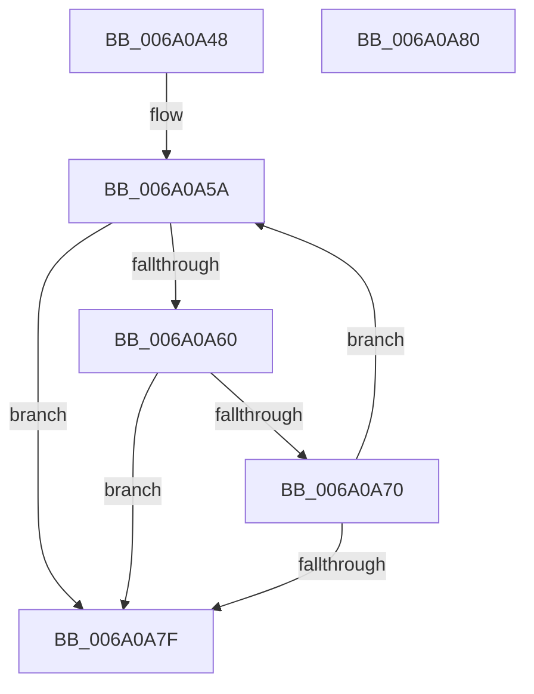

# BcpGetDisplayType

- RVA: `0x006A0A48`–`0x006A0A81` (길이 `57` bytes)
- VA: `0x00000001406A0A48`
- 실행 섹션: `.text`
- PDB 이름 있음: `예`; PDB Function 태그: `아니요`
- unwind 정보 RVA: `0x000DB714`
- 디코드: `17`개 명령, `57/57` bytes 표시
- 미해석 바이트: `0` (있으면 어셈블리에 `.byte`로 보존)

> 이 문서는 커널 이미지의 기계어와 PDB 기호를 분석해 생성했습니다. 4번과 5번은 함수 원형과 자료형을 바이너리 사용 방식에서 추정한 C 해석이며 원본 소스 복구 결과는 아닙니다.

## 1. Dependencies

- 직접 호출 지점: **0**; 고유 호출 대상: **0**
- 직접 호출자로 확인된 함수: **4**
- RIP 상대 이미지 참조: **2**

### Outgoing calls
- 직접 디코드된 call 명령이 없습니다.

### Direct callers
- [BgpDisplaySafeToPowerOffScreen](BgpDisplaySafeToPowerOffScreen_function_006A0D74.md) at `0x006A0DB2`
- [BgpFwDisplayBugCheckProgressUpdate](BgpFwDisplayBugCheckProgressUpdate_function_006A0E1C.md) at `0x006A0ED1`
- [BgpFwDisplayBugCheckScreen](BgpFwDisplayBugCheckScreen_function_006A0FE8.md) at `0x006A107A`
- [BgpFwDisplayBugCheckScreenModernized](BgpFwDisplayBugCheckScreenModernized_function_006A1338.md) at `0x006A13DC`

### Static image references
- `0x006A0A4B` → RVA `0x00E0EFA0` (`.data`; read)
- `0x006A0A60` → RVA `0x00E0EFA4` (`.data`; read)

## 2. Other-region calls and transfers

- 다른 실행 섹션으로 향하는 call: **0**
- 별도 외부 분기/꼬리 이동을 확인하지 못했습니다.

## 3. Assembly (complete function range)

```asm
006A0A48  44 8B 09                        mov r9d, dword ptr [rcx]
006A0A4B  4C 8D 15 4E E5 76 00            lea r10, [rip + 0x76e54e]
006A0A52  33 C0                           xor eax, eax
006A0A54  4C 8B C1                        mov r8, rcx
006A0A57  8D 50 54                        lea edx, [rax + 0x54]
006A0A5A  46 3B 0C 12                     cmp r9d, dword ptr [rdx + r10]
006A0A5E  72 1F                           jb 0x1406a0a7f
006A0A60  48 8D 0D 3D E5 76 00            lea rcx, [rip + 0x76e53d]
006A0A67  8B 0C 0A                        mov ecx, dword ptr [rdx + rcx]
006A0A6A  41 39 48 04                     cmp dword ptr [r8 + 4], ecx
006A0A6E  72 0F                           jb 0x1406a0a7f
006A0A70  FF C0                           inc eax
006A0A72  48 83 C2 54                     add rdx, 0x54
006A0A76  48 81 FA A4 01 00 00            cmp rdx, 0x1a4
006A0A7D  7C DB                           jl 0x1406a0a5a
006A0A7F  C3                              ret
006A0A80  CC                              int3
```

## 4. C-style interpretation (structured pseudocode)

```c
__int64 __fastcall BcpGetDisplayType(__int64 a1)
{
    __int64 result;

    result = 0;
loc_006A0A5A:
    if (((unsigned int)((unsigned int)(*(unsigned int *)(a1)))) < (*(unsigned int *)(result + 84 + v_rip + 7791950 * 1))) goto loc_006A0A7F;
    if ((*(unsigned int *)(a1 + 4)) < ((unsigned int)((unsigned int)(*(unsigned int *)(result + 84 + v_rip + 7791933 * 1))))) goto loc_006A0A7F;
    result = (unsigned int)((result) + 1);
    a2 = (result + 84) + (84);
    if (a2 < 420) goto loc_006A0A5A;
loc_006A0A7F:
    return result;
}
```

## 5. (Beta) C Style

```c
int64_t BcpGetDisplayType(void *Arg1)
{
    uint8_t *arg1 = (uint8_t *)Arg1;

    int64_t result;

    result = 0;
loc_006A0A5A:
    if (((uint32_t)((uint32_t)(*(uint32_t *)(arg1)))) < (*(uint32_t *)(result + 0x54 + v_rip + 0x76E54E * 1))) goto loc_006A0A7F;
    if ((*(uint32_t *)(arg1 + 0x4)) < ((uint32_t)((uint32_t)(*(uint32_t *)(result + 0x54 + v_rip + 0x76E53D * 1))))) goto loc_006A0A7F;
    result = (uint32_t)((result) + 1);
    a2 = (result + 84) + (84);
    if (a2 < 420) goto loc_006A0A5A;
loc_006A0A7F:
    return result;
}
```

### 관측된 메모리 오프셋

구조체 형식이 확인되지 않은 접근은 인자 기준의 오프셋으로만 기록했습니다.

| 기준 인자 | 오프셋 표현 | 폭 (bit) | 접근 |
|---|---:|---:|---|
| `Arg1` | `+ 0x0` | `32` | `R` |
| `Arg1` | `+ 0x4` | `32` | `R` |

## 6. Execution-region graph

[열기: 2D/3D 그래프와 함수 탐색 컨트롤 패널](../../../control-panel.html?section=text&rva=0x006A0A48&view=graph)

- 2D 그래프는 위에서 아래로 흐르고, 3D 그래프는 빈 공간을 드래그해 회전합니다. Shift+드래그는 이동, 휠은 확대·축소, 함수 노드 선택은 대상 보고서 이동입니다.

### Static fallback


