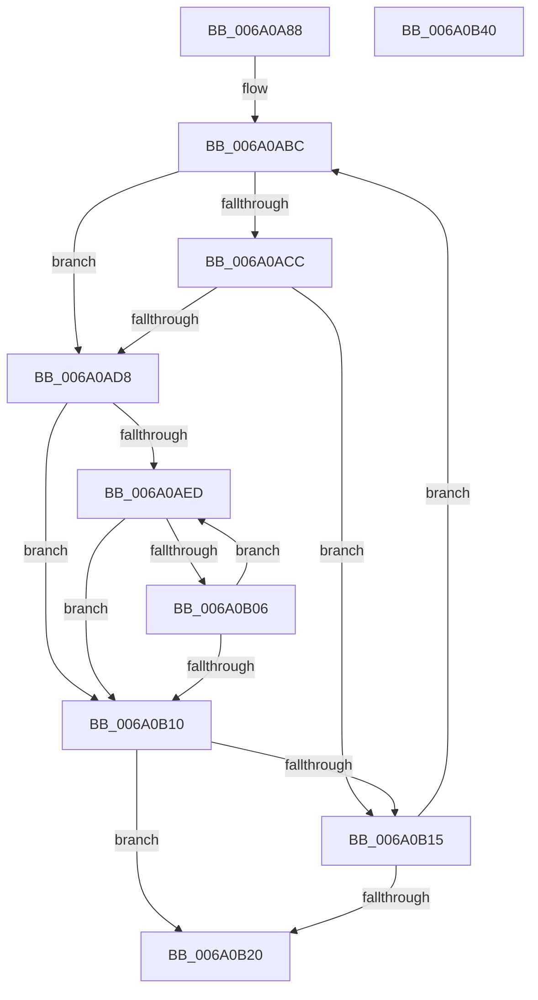

# BcpGetMaxResourceProfile

- RVA: `0x006A0A88`–`0x006A0B41` (길이 `185` bytes)
- VA: `0x00000001406A0A88`
- 실행 섹션: `.text`
- PDB 이름 있음: `예`; PDB Function 태그: `아니요`
- unwind 정보 RVA: `0x00075C18`
- 디코드: `59`개 명령, `185/185` bytes 표시
- 미해석 바이트: `0` (있으면 어셈블리에 `.byte`로 보존)

> 이 문서는 커널 이미지의 기계어와 PDB 기호를 분석해 생성했습니다. 4번과 5번은 함수 원형과 자료형을 바이너리 사용 방식에서 추정한 C 해석이며 원본 소스 복구 결과는 아닙니다.

## 1. Dependencies

- 직접 호출 지점: **1**; 고유 호출 대상: **1**
- 직접 호출자로 확인된 함수: **1**
- RIP 상대 이미지 참조: **3**

### Outgoing calls
- `0x006A0AFA` → [BcpGetCharacterMaxResourceProfile](BcpGetCharacterMaxResourceProfile_function_006A0800.md) (function, `0x006A0800`)

### Direct callers
- [BgpBcInitializeCriticalMode](../../init/C8/BgpBcInitializeCriticalMode_function_00C81454.md) at `0x00C81936`

### Static image references
- `0x006A0AA7` → RVA `0x0000C298` (`.rdata`; read)
- `0x006A0AC0` → RVA `0x0000C278` (`.rdata`; read)
- `0x006A0ACC` → RVA `0x00EF0450` (`.data`; read)

## 2. Other-region calls and transfers

- 다른 실행 섹션으로 향하는 call: **0**
- 별도 외부 분기/꼬리 이동을 확인하지 못했습니다.

## 3. Assembly (complete function range)

```asm
006A0A88  48 89 5C 24 08                  mov qword ptr [rsp + 8], rbx
006A0A8D  48 89 6C 24 10                  mov qword ptr [rsp + 0x10], rbp
006A0A92  48 89 74 24 18                  mov qword ptr [rsp + 0x18], rsi
006A0A97  57                              push rdi
006A0A98  41 54                           push r12
006A0A9A  41 55                           push r13
006A0A9C  41 56                           push r14
006A0A9E  41 57                           push r15
006A0AA0  48 83 EC 20                     sub rsp, 0x20
006A0AA4  45 33 C0                        xor r8d, r8d
006A0AA7  48 8D 1D EA B7 96 FF            lea rbx, [rip - 0x694816]
006A0AAE  0F 57 C0                        xorps xmm0, xmm0
006A0AB1  33 FF                           xor edi, edi
006A0AB3  0F 11 02                        movups xmmword ptr [rdx], xmm0
006A0AB6  4C 8B FA                        mov r15, rdx
006A0AB9  4C 8B E9                        mov r13, rcx
006A0ABC  4C 8B 4B F8                     mov r9, qword ptr [rbx - 8]
006A0AC0  48 8D 05 B1 B7 96 FF            lea rax, [rip - 0x69484f]
006A0AC7  4C 3B C8                        cmp r9, rax
006A0ACA  75 0C                           jne 0x1406a0ad8
006A0ACC  F7 05 7A F9 84 00 00 00 02 00   test dword ptr [rip + 0x84f97a], 0x20000
006A0AD6  75 3D                           jne 0x1406a0b15
006A0AD8  41 0F B7 29                     movzx ebp, word ptr [r9]
006A0ADC  45 33 C0                        xor r8d, r8d
006A0ADF  D1 ED                           shr ebp, 1
006A0AE1  41 8B F0                        mov esi, r8d
006A0AE4  44 8B 23                        mov r12d, dword ptr [rbx]
006A0AE7  4D 8B 71 08                     mov r14, qword ptr [r9 + 8]
006A0AEB  74 23                           je 0x1406a0b10
006A0AED  41 0F B7 0E                     movzx ecx, word ptr [r14]
006A0AF1  4D 8B CF                        mov r9, r15
006A0AF4  4D 8B C5                        mov r8, r13
006A0AF7  41 8B D4                        mov edx, r12d
006A0AFA  E8 01 FD FF FF                  call 0x1406a0800
006A0AFF  44 8B C0                        mov r8d, eax
006A0B02  85 C0                           test eax, eax
006A0B04  78 0A                           js 0x1406a0b10
006A0B06  FF C6                           inc esi
006A0B08  49 83 C6 02                     add r14, 2
006A0B0C  3B F5                           cmp esi, ebp
006A0B0E  72 DD                           jb 0x1406a0aed
006A0B10  45 85 C0                        test r8d, r8d
006A0B13  78 0B                           js 0x1406a0b20
006A0B15  FF C7                           inc edi
006A0B17  48 83 C3 10                     add rbx, 0x10
006A0B1B  83 FF 1A                        cmp edi, 0x1a
006A0B1E  72 9C                           jb 0x1406a0abc
006A0B20  48 8B 5C 24 50                  mov rbx, qword ptr [rsp + 0x50]
006A0B25  41 8B C0                        mov eax, r8d
006A0B28  48 8B 6C 24 58                  mov rbp, qword ptr [rsp + 0x58]
006A0B2D  48 8B 74 24 60                  mov rsi, qword ptr [rsp + 0x60]
006A0B32  48 83 C4 20                     add rsp, 0x20
006A0B36  41 5F                           pop r15
006A0B38  41 5E                           pop r14
006A0B3A  41 5D                           pop r13
006A0B3C  41 5C                           pop r12
006A0B3E  5F                              pop rdi
006A0B3F  C3                              ret
006A0B40  CC                              int3
```

## 4. C-style interpretation (structured pseudocode)

```c
__int64 __fastcall BcpGetMaxResourceProfile(__int64 a1, __int64 a2, int a3)
{
    __int64 result;
    __int64 v_r14;
    __int64 v_rbp;
    __int64 v_rbx;
    __int64 v_rdi;
    __int64 v_rsi;
    __int64 v_rsp;
    unsigned __int64 v_stack_p10;
    unsigned __int64 v_stack_p18;
    unsigned __int64 v_stack_p8;

    v_stack_p8 = v_rbx;
    v_stack_p10 = v_rbp;
    v_stack_p18 = v_rsi;
    v_rsp = (v_rsp) - (32);
    a3 = 0;
    v_rdi = 0;
    *(unsigned __int64 *)(a2) = v_xmm0;
loc_006A0ABC:
    if ((*(unsigned __int64 *)(v_rip - 6899734 - 8)) != (v_rip - 6899791)) goto loc_006A0AD8;
    if (((*(unsigned int *)(v_rip + 8714618)) & (0x20000ULL)) != 0) goto loc_006A0B15;
loc_006A0AD8:
    a3 = 0;
    v_rbp = (unsigned int)((*(unsigned __int16 *)(*(unsigned __int64 *)(v_rip - 6899734 - 8))) >> (1));
    if (condition_is_equal) goto loc_006A0B10;
loc_006A0AED:
    result = BcpGetCharacterMaxResourceProfile(*(unsigned __int16 *)(*(unsigned __int64 *)(*(unsigned __int64 *)(v_rip - 6899734 - 8) + 8)), (unsigned int)((unsigned int)((unsigned int)(*(unsigned int *)(v_rip - 6899734)))), a1, a2);
    if (sign_flag) goto loc_006A0B10;
    v_rsi = (unsigned int)((0) + 1);
    v_r14 = (*(unsigned __int64 *)(*(unsigned __int64 *)(v_rip - 6899734 - 8) + 8)) + (2);
    if (((unsigned int)(v_rsi)) < ((unsigned int)(v_rbp))) goto loc_006A0AED;
loc_006A0B10:
    if (sign_flag) goto loc_006A0B20;
loc_006A0B15:
    v_rdi = (unsigned int)((v_rdi) + 1);
    v_rbx = (v_rip - 6899734) + (16);
    if (((unsigned int)(v_rdi)) < 26) goto loc_006A0ABC;
loc_006A0B20:
    v_rsp = (v_rsp) + (32);
    return (unsigned int)((unsigned int)((unsigned int)((unsigned int)(result))));
}
```

## 5. (Beta) C Style

```c
int64_t BcpGetMaxResourceProfile(int64_t Arg1, void *Arg2, int32_t Arg3)
{
    uint8_t *arg2 = (uint8_t *)Arg2;

    int64_t result;
    int64_t local_r14;
    int64_t local_rbp;
    int64_t local_rbx;
    int64_t local_rdi;
    int64_t local_rsi;
    int64_t local_rsp;
    uint64_t v_stack_p10;
    uint64_t v_stack_p18;
    uint64_t v_stack_p8;

    v_stack_p8 = local_rbx;
    v_stack_p10 = local_rbp;
    v_stack_p18 = local_rsi;
    local_rsp = (local_rsp) - (32);
    Arg3 = 0;
    local_rdi = 0;
    *(uint64_t *)(arg2) = v_xmm0;
loc_006A0ABC:
    if ((*(uint64_t *)(v_rip - 0x694816 - 0x8)) != (v_rip - 6899791)) goto loc_006A0AD8;
    if (((*(uint32_t *)(v_rip + 0x84F97A)) & (0x20000ULL)) != 0) goto loc_006A0B15;
loc_006A0AD8:
    Arg3 = 0;
    local_rbp = (uint32_t)((*(uint16_t *)(*(uint64_t *)(v_rip - 0x694816 - 0x8))) >> (1));
    if (condition_is_equal) goto loc_006A0B10;
loc_006A0AED:
    result = BcpGetCharacterMaxResourceProfile(*(uint16_t *)(*(uint64_t *)(*(uint64_t *)(v_rip - 0x694816 - 0x8) + 0x8)), (uint32_t)((uint32_t)((uint32_t)(*(uint32_t *)(v_rip - 0x694816)))), Arg1, Arg2);
    if (sign_flag) goto loc_006A0B10;
    local_rsi = (uint32_t)((0) + 1);
    local_r14 = (*(uint64_t *)(*(uint64_t *)(v_rip - 0x694816 - 0x8) + 0x8)) + (2);
    if (((uint32_t)(local_rsi)) < ((uint32_t)(local_rbp))) goto loc_006A0AED;
loc_006A0B10:
    if (sign_flag) goto loc_006A0B20;
loc_006A0B15:
    local_rdi = (uint32_t)((local_rdi) + 1);
    local_rbx = (v_rip - 6899734) + (16);
    if (((uint32_t)(local_rdi)) < 26) goto loc_006A0ABC;
loc_006A0B20:
    local_rsp = (local_rsp) + (32);
    return (uint32_t)((uint32_t)((uint32_t)((uint32_t)(result))));
}
```

### 관측된 메모리 오프셋

구조체 형식이 확인되지 않은 접근은 인자 기준의 오프셋으로만 기록했습니다.

| 기준 인자 | 오프셋 표현 | 폭 (bit) | 접근 |
|---|---:|---:|---|
| `Arg2` | `+ 0x0` | `128` | `R` |

## 6. Execution-region graph

[열기: 2D/3D 그래프와 함수 탐색 컨트롤 패널](../../../control-panel.html?section=text&rva=0x006A0A88&view=graph)

- 2D 그래프는 위에서 아래로 흐르고, 3D 그래프는 빈 공간을 드래그해 회전합니다. Shift+드래그는 이동, 휠은 확대·축소, 함수 노드 선택은 대상 보고서 이동입니다.

### Static fallback


