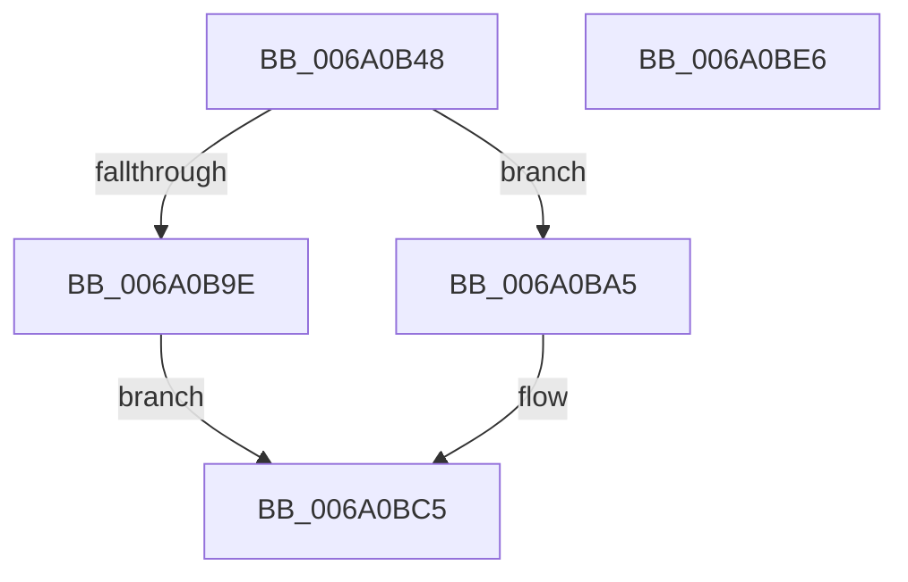

# BcpGetProgressMessages

- RVA: `0x006A0B48`–`0x006A0BE7` (길이 `159` bytes)
- VA: `0x00000001406A0B48`
- 실행 섹션: `.text`
- PDB 이름 있음: `예`; PDB Function 태그: `아니요`
- unwind 정보 RVA: `0x0005FEF8`
- 디코드: `47`개 명령, `159/159` bytes 표시
- 미해석 바이트: `0` (있으면 어셈블리에 `.byte`로 보존)

> 이 문서는 커널 이미지의 기계어와 PDB 기호를 분석해 생성했습니다. 4번과 5번은 함수 원형과 자료형을 바이너리 사용 방식에서 추정한 C 해석이며 원본 소스 복구 결과는 아닙니다.

## 1. Dependencies

- 직접 호출 지점: **4**; 고유 호출 대상: **4**
- 직접 호출자로 확인된 함수: **1**
- RIP 상대 이미지 참조: **1**

### Outgoing calls
- `0x006A0B6B` → [BcpFindMessage](../../init/C8/BcpFindMessage_function_00C81294.md) (function, `0x00C81294`)
- `0x006A0B7D` → [wcsstr](../50/wcsstr_function_00501F80.md) (function, `0x00501F80`)
- `0x006A0B8F` → [BgpFwAllocateMemory](../3E/BgpFwAllocateMemory_function_003E4374.md) (function, `0x003E4374`)
- `0x006A0BAE` → [memcpy](../6C/memcpy_function_006C6840.md) (function, `0x006C6840`)

### Direct callers
- [BgpBcInitializeCriticalMode](../../init/C8/BgpBcInitializeCriticalMode_function_00C81454.md) at `0x00C81715`
- [BgpBcInitializeCriticalMode](../../init/C8/BgpBcInitializeCriticalMode_function_00C81454.md) at `0x00C8174F`

### Static image references
- `0x006A0B70` → RVA `0x006D10D0` (` ?? ::FNODOBFM::`string'`; read)

## 2. Other-region calls and transfers

- 다른 실행 섹션으로 향하는 call: **1**
  - `0x006A0B6B` → [BcpFindMessage](../../init/C8/BcpFindMessage_function_00C81294.md) (`.text` → `INIT`)
- 별도 외부 분기/꼬리 이동을 확인하지 못했습니다.

## 3. Assembly (complete function range)

```asm
006A0B48  48 8B C4                        mov rax, rsp
006A0B4B  48 89 58 08                     mov qword ptr [rax + 8], rbx
006A0B4F  48 89 68 10                     mov qword ptr [rax + 0x10], rbp
006A0B53  48 89 70 18                     mov qword ptr [rax + 0x18], rsi
006A0B57  48 89 78 20                     mov qword ptr [rax + 0x20], rdi
006A0B5B  41 54                           push r12
006A0B5D  41 56                           push r14
006A0B5F  41 57                           push r15
006A0B61  48 83 EC 20                     sub rsp, 0x20
006A0B65  4D 8B F8                        mov r15, r8
006A0B68  4C 8B E2                        mov r12, rdx
006A0B6B  E8 24 07 5E 00                  call 0x140c81294
006A0B70  48 8D 15 59 05 03 00            lea rdx, [rip + 0x30559]
006A0B77  48 8B C8                        mov rcx, rax
006A0B7A  48 8B E8                        mov rbp, rax
006A0B7D  E8 FE 13 E6 FF                  call 0x140501f80
006A0B82  48 8B F8                        mov rdi, rax
006A0B85  4C 8B F0                        mov r14, rax
006A0B88  48 2B FD                        sub rdi, rbp
006A0B8B  48 8D 4F 02                     lea rcx, [rdi + 2]
006A0B8F  E8 E0 37 D4 FF                  call 0x1403e4374
006A0B94  33 DB                           xor ebx, ebx
006A0B96  48 8B F0                        mov rsi, rax
006A0B99  48 85 C0                        test rax, rax
006A0B9C  75 07                           jne 0x1406a0ba5
006A0B9E  BB 17 00 00 C0                  mov ebx, 0xc0000017
006A0BA3  EB 20                           jmp 0x1406a0bc5
006A0BA5  4C 8B C7                        mov r8, rdi
006A0BA8  48 8B D5                        mov rdx, rbp
006A0BAB  48 8B CE                        mov rcx, rsi
006A0BAE  E8 8D 5C 02 00                  call 0x1406c6840
006A0BB3  48 D1 EF                        shr rdi, 1
006A0BB6  49 8D 4E 04                     lea rcx, [r14 + 4]
006A0BBA  49 89 34 24                     mov qword ptr [r12], rsi
006A0BBE  49 89 0F                        mov qword ptr [r15], rcx
006A0BC1  66 89 1C 7E                     mov word ptr [rsi + rdi*2], bx
006A0BC5  48 8B 6C 24 48                  mov rbp, qword ptr [rsp + 0x48]
006A0BCA  8B C3                           mov eax, ebx
006A0BCC  48 8B 5C 24 40                  mov rbx, qword ptr [rsp + 0x40]
006A0BD1  48 8B 74 24 50                  mov rsi, qword ptr [rsp + 0x50]
006A0BD6  48 8B 7C 24 58                  mov rdi, qword ptr [rsp + 0x58]
006A0BDB  48 83 C4 20                     add rsp, 0x20
006A0BDF  41 5F                           pop r15
006A0BE1  41 5E                           pop r14
006A0BE3  41 5C                           pop r12
006A0BE5  C3                              ret
006A0BE6  CC                              int3
```

## 4. C-style interpretation (structured pseudocode)

```c
__int64 __fastcall BcpGetProgressMessages(__int64 a1, __int64 a2, __int64 a3)
{
    __int64 result;
    __int64 v_rbx;
    __int64 v_rdi;
    __int64 v_rsp;
    unsigned __int64 v_stack_p10;
    unsigned __int64 v_stack_p18;
    unsigned __int64 v_stack_p20;
    unsigned __int64 v_stack_p8;

    *(unsigned __int64 *)(v_rsp + 8) = v_rbx;
    *(unsigned __int64 *)(v_rsp + 16) = v_rbp;
    *(unsigned __int64 *)(v_rsp + 24) = v_rsi;
    *(unsigned __int64 *)(v_rsp + 32) = v_rdi;
    v_rsp = (v_rsp) - (32);
    result = BcpFindMessage(a1, a2, a3, a4);
    result = wcsstr(result, v_rip + 197977, a3, a4);
    v_rdi = (result) - (result);
    result = BgpFwAllocateMemory(v_rdi + 2, v_rip + 197977, a3, a4);
    v_rbx = 0;
    if (result != 0) goto loc_006A0BA5;
    goto loc_006A0BC5;
loc_006A0BA5:
    result = memcpy(result, result, v_rdi, a4);
    v_rdi = (v_rdi) >> (1);
    *(unsigned __int64 *)(a2) = result;
    *(unsigned __int64 *)(a3) = result + 4;
    *(unsigned __int16 *)(result + v_rdi * 2) = (unsigned __int16)((unsigned int)(0xC0000017ULL));
loc_006A0BC5:
    v_rsp = (v_rsp) + (32);
    return (unsigned int)((unsigned int)((unsigned int)(0xC0000017ULL)));
}
```

## 5. (Beta) C Style

```c
int64_t BcpGetProgressMessages(int64_t Arg1, void *Arg2, void *Arg3)
{
    uint8_t *arg2 = (uint8_t *)Arg2;
    uint8_t *arg3 = (uint8_t *)Arg3;

    int64_t result;
    int64_t local_rbx;
    int64_t local_rdi;
    int64_t local_rsp;
    uint64_t v_stack_p10;
    uint64_t v_stack_p18;
    uint64_t v_stack_p20;
    uint64_t v_stack_p8;

    *(uint64_t *)(local_rsp + 0x8) = local_rbx;
    *(uint64_t *)(local_rsp + 0x10) = local_rbp;
    *(uint64_t *)(local_rsp + 0x18) = local_rsi;
    *(uint64_t *)(local_rsp + 0x20) = local_rdi;
    local_rsp = (local_rsp) - (32);
    result = BcpFindMessage(Arg1, Arg2, Arg3, a4);
    result = wcsstr(result, v_rip + 197977, Arg3, a4);
    local_rdi = (result) - (result);
    result = BgpFwAllocateMemory(local_rdi + 2, v_rip + 197977, Arg3, a4);
    local_rbx = 0;
    if (result != 0) goto loc_006A0BA5;
    goto loc_006A0BC5;
loc_006A0BA5:
    result = memcpy(result, result, local_rdi, a4);
    local_rdi = (local_rdi) >> (1);
    *(uint64_t *)(arg2) = result;
    *(uint64_t *)(arg3) = result + 4;
    *(uint16_t *)(result + local_rdi * 2) = (uint16_t)((uint32_t)(0xC0000017ULL));
loc_006A0BC5:
    local_rsp = (local_rsp) + (32);
    return (uint32_t)((uint32_t)((uint32_t)(0xC0000017ULL)));
}
```

### 관측된 메모리 오프셋

구조체 형식이 확인되지 않은 접근은 인자 기준의 오프셋으로만 기록했습니다.

| 기준 인자 | 오프셋 표현 | 폭 (bit) | 접근 |
|---|---:|---:|---|
| `Arg2` | `+ 0x0` | `64` | `W` |
| `Arg3` | `+ 0x0` | `64` | `W` |

## 6. Execution-region graph

[열기: 2D/3D 그래프와 함수 탐색 컨트롤 패널](../../../control-panel.html?section=text&rva=0x006A0B48&view=graph)

- 2D 그래프는 위에서 아래로 흐르고, 3D 그래프는 빈 공간을 드래그해 회전합니다. Shift+드래그는 이동, 휠은 확대·축소, 함수 노드 선택은 대상 보고서 이동입니다.

### Static fallback


