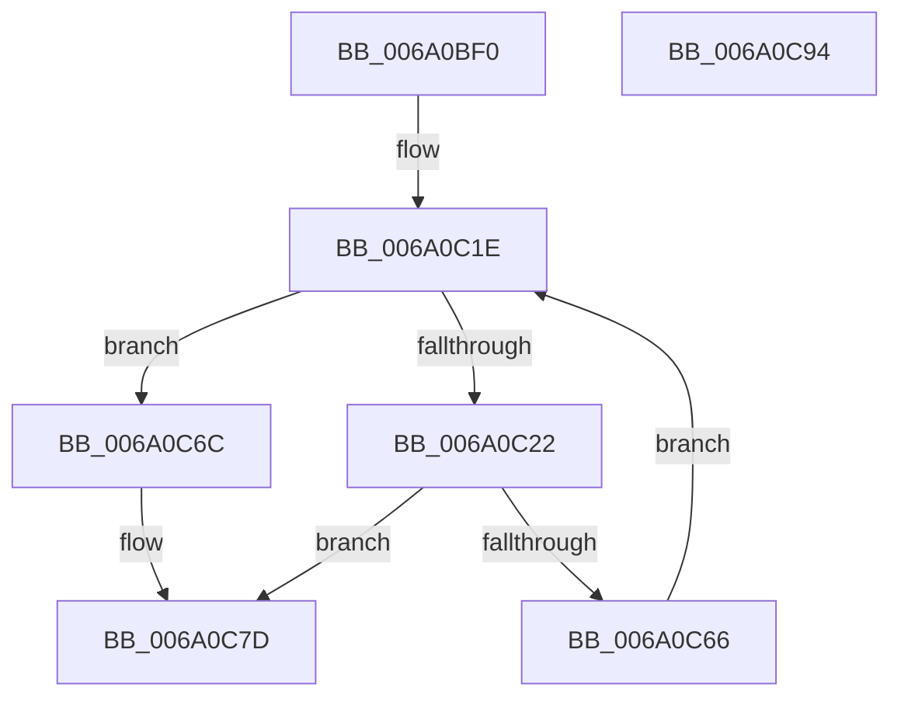

# BcpPrintSpaces

- RVA: `0x006A0BF0`–`0x006A0C95` (길이 `165` bytes)
- VA: `0x00000001406A0BF0`
- 실행 섹션: `.text`
- PDB 이름 있음: `예`; PDB Function 태그: `아니요`
- unwind 정보 RVA: `0x000DA554`
- 디코드: `48`개 명령, `165/165` bytes 표시
- 미해석 바이트: `0` (있으면 어셈블리에 `.byte`로 보존)

> 이 문서는 커널 이미지의 기계어와 PDB 기호를 분석해 생성했습니다. 4번과 5번은 함수 원형과 자료형을 바이너리 사용 방식에서 추정한 C 해석이며 원본 소스 복구 결과는 아닙니다.

## 1. Dependencies

- 직접 호출 지점: **1**; 고유 호출 대상: **1**
- 직접 호출자로 확인된 함수: **3**
- RIP 상대 이미지 참조: **1**

### Outgoing calls
- `0x006A0C5B` → [BgpDisplayCharacterEx](../69/BgpDisplayCharacterEx_function_0069EBF4.md) (function, `0x0069EBF4`)

### Direct callers
- [BcpDisplayCriticalString](../69/BcpDisplayCriticalString_function_0069F754.md) at `0x0069F920`
- [BcpDisplayCriticalString](../69/BcpDisplayCriticalString_function_0069F754.md) at `0x0069F9C1`
- [BcpDisplayCriticalStringCentered](../69/BcpDisplayCriticalStringCentered_function_0069FAB8.md) at `0x0069FCDA`
- [BcpDisplayCriticalStringCentered](../69/BcpDisplayCriticalStringCentered_function_0069FAB8.md) at `0x0069FD79`
- [BcpDisplayProgressModernized](BcpDisplayProgressModernized_function_006A068C.md) at `0x006A0702`

### Static image references
- `0x006A0C22` → RVA `0x00EF0360` (`.data`; read)

## 2. Other-region calls and transfers

- 다른 실행 섹션으로 향하는 call: **0**
- 별도 외부 분기/꼬리 이동을 확인하지 못했습니다.

## 3. Assembly (complete function range)

```asm
006A0BF0  48 8B C4                        mov rax, rsp
006A0BF3  48 89 58 08                     mov qword ptr [rax + 8], rbx
006A0BF7  48 89 68 20                     mov qword ptr [rax + 0x20], rbp
006A0BFB  56                              push rsi
006A0BFC  57                              push rdi
006A0BFD  41 56                           push r14
006A0BFF  48 83 EC 50                     sub rsp, 0x50
006A0C03  83 60 10 00                     and dword ptr [rax + 0x10], 0
006A0C07  8B DA                           mov ebx, edx
006A0C09  8B B4 24 90 00 00 00            mov esi, dword ptr [rsp + 0x90]
006A0C10  33 D2                           xor edx, edx
006A0C12  21 50 18                        and dword ptr [rax + 0x18], edx
006A0C15  41 8B E9                        mov ebp, r9d
006A0C18  41 8B F8                        mov edi, r8d
006A0C1B  4C 8B F1                        mov r14, rcx
006A0C1E  3B DF                           cmp ebx, edi
006A0C20  73 4A                           jae 0x1406a0c6c
006A0C22  48 8D 05 37 F7 84 00            lea rax, [rip + 0x84f737]
006A0C29  B9 20 00 00 00                  mov ecx, 0x20
006A0C2E  48 89 44 24 48                  mov qword ptr [rsp + 0x48], rax
006A0C33  44 8B CD                        mov r9d, ebp
006A0C36  48 8D 84 24 80 00 00 00         lea rax, [rsp + 0x80]
006A0C3E  44 8B C3                        mov r8d, ebx
006A0C41  48 89 44 24 38                  mov qword ptr [rsp + 0x38], rax
006A0C46  49 8B D6                        mov rdx, r14
006A0C49  48 8D 44 24 78                  lea rax, [rsp + 0x78]
006A0C4E  48 89 44 24 30                  mov qword ptr [rsp + 0x30], rax
006A0C53  89 74 24 28                     mov dword ptr [rsp + 0x28], esi
006A0C57  89 74 24 20                     mov dword ptr [rsp + 0x20], esi
006A0C5B  E8 94 DF FF FF                  call 0x14069ebf4
006A0C60  8B D0                           mov edx, eax
006A0C62  85 C0                           test eax, eax
006A0C64  78 17                           js 0x1406a0c7d
006A0C66  03 5C 24 78                     add ebx, dword ptr [rsp + 0x78]
006A0C6A  EB B2                           jmp 0x1406a0c1e
006A0C6C  48 8B 8C 24 98 00 00 00         mov rcx, qword ptr [rsp + 0x98]
006A0C74  8B 84 24 80 00 00 00            mov eax, dword ptr [rsp + 0x80]
006A0C7B  89 01                           mov dword ptr [rcx], eax
006A0C7D  4C 8D 5C 24 50                  lea r11, [rsp + 0x50]
006A0C82  8B C2                           mov eax, edx
006A0C84  49 8B 5B 20                     mov rbx, qword ptr [r11 + 0x20]
006A0C88  49 8B 6B 38                     mov rbp, qword ptr [r11 + 0x38]
006A0C8C  49 8B E3                        mov rsp, r11
006A0C8F  41 5E                           pop r14
006A0C91  5F                              pop rdi
006A0C92  5E                              pop rsi
006A0C93  C3                              ret
006A0C94  CC                              int3
```

## 4. C-style interpretation (structured pseudocode)

```c
__int64 __fastcall BcpPrintSpaces(__int64 a1, int a2, int a3, int a4, unsigned int a5, __int64 a6)
{
    __int64 result;
    __int64 v_rbx;
    __int64 v_rsp;
    unsigned __int64 v_stack_m18;
    unsigned __int64 v_stack_m20;
    unsigned __int64 v_stack_m30;
    unsigned __int64 v_stack_m38;
    unsigned int v_stack_m40;
    unsigned int v_stack_m48;
    unsigned __int64 v_stack_p10;
    unsigned __int64 v_stack_p18;

    *(unsigned __int64 *)(v_rsp + 8) = v_rbx;
    *(unsigned __int64 *)(v_rsp + 32) = v_rbp;
    v_rsp = (v_rsp) - (80);
    a2 = 0;
loc_006A0C1E:
    if (((unsigned int)((unsigned int)(a2))) >= ((unsigned int)((unsigned int)(a3)))) goto loc_006A0C6C;
    v_stack_m20 = v_rip + 8714039;
    v_stack_m30 = v_stack_p18;
    v_stack_m38 = v_stack_p10;
    v_stack_m40 = (unsigned int)((unsigned int)(a5));
    v_stack_m48 = (unsigned int)((unsigned int)(a5));
    result = BgpDisplayCharacterEx(32, a1, (unsigned int)((unsigned int)((unsigned int)(a2))), (unsigned int)((unsigned int)((unsigned int)(a4))));
    if (sign_flag) goto loc_006A0C7D;
    v_rbx = (unsigned int)(((unsigned int)(a2)) + (v_stack_p10));
    goto loc_006A0C1E;
loc_006A0C6C:
    *(unsigned int *)(a6) = (unsigned int)((unsigned int)(v_stack_p18));
loc_006A0C7D:
    return (unsigned int)((unsigned int)((unsigned int)((unsigned int)(result))));
}
```

## 5. (Beta) C Style

```c
int64_t BcpPrintSpaces(int64_t Arg1, int32_t Arg2, int32_t Arg3, int32_t Arg4, uint32_t Arg5, void *Arg6)
{
    uint8_t *arg6 = (uint8_t *)Arg6;

    int64_t result;
    int64_t local_rbx;
    int64_t local_rsp;
    uint64_t v_stack_m18;
    uint64_t v_stack_m20;
    uint64_t v_stack_m30;
    uint64_t v_stack_m38;
    uint32_t v_stack_m40;
    uint32_t v_stack_m48;
    uint64_t v_stack_p10;
    uint64_t v_stack_p18;

    *(uint64_t *)(local_rsp + 0x8) = local_rbx;
    *(uint64_t *)(local_rsp + 0x20) = local_rbp;
    local_rsp = (local_rsp) - (80);
    Arg2 = 0;
loc_006A0C1E:
    if (((uint32_t)((uint32_t)(Arg2))) >= ((uint32_t)((uint32_t)(Arg3)))) goto loc_006A0C6C;
    v_stack_m20 = v_rip + 8714039;
    v_stack_m30 = v_stack_p18;
    v_stack_m38 = v_stack_p10;
    v_stack_m40 = (uint32_t)((uint32_t)(Arg5));
    v_stack_m48 = (uint32_t)((uint32_t)(Arg5));
    result = BgpDisplayCharacterEx(32, Arg1, (uint32_t)((uint32_t)((uint32_t)(Arg2))), (uint32_t)((uint32_t)((uint32_t)(Arg4))));
    if (sign_flag) goto loc_006A0C7D;
    local_rbx = (uint32_t)(((uint32_t)(Arg2)) + (v_stack_p10));
    goto loc_006A0C1E;
loc_006A0C6C:
    *(uint32_t *)(arg6) = (uint32_t)((uint32_t)(v_stack_p18));
loc_006A0C7D:
    return (uint32_t)((uint32_t)((uint32_t)((uint32_t)(result))));
}
```

### 관측된 메모리 오프셋

구조체 형식이 확인되지 않은 접근은 인자 기준의 오프셋으로만 기록했습니다.

| 기준 인자 | 오프셋 표현 | 폭 (bit) | 접근 |
|---|---:|---:|---|
| `Arg6` | `+ 0x0` | `32` | `W` |

## 6. Execution-region graph

[열기: 2D/3D 그래프와 함수 탐색 컨트롤 패널](../../../control-panel.html?section=text&rva=0x006A0BF0&view=graph)

- 2D 그래프는 위에서 아래로 흐르고, 3D 그래프는 빈 공간을 드래그해 회전합니다. Shift+드래그는 이동, 휠은 확대·축소, 함수 노드 선택은 대상 보고서 이동입니다.

### Static fallback


