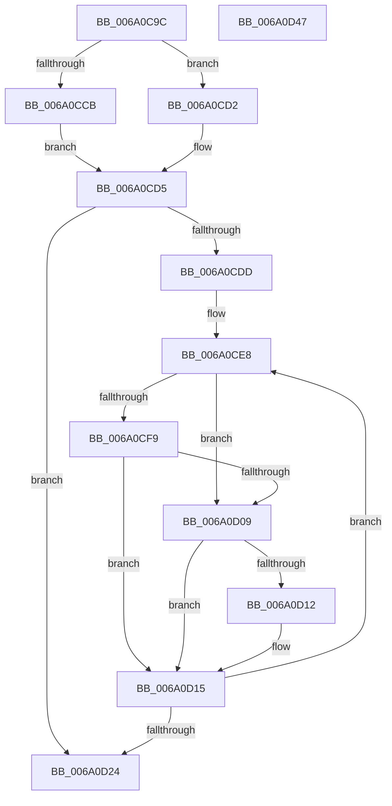

# BcpSanitizeDriverName

- RVA: `0x006A0C9C`–`0x006A0D48` (길이 `172` bytes)
- VA: `0x00000001406A0C9C`
- 실행 섹션: `.text`
- PDB 이름 있음: `예`; PDB Function 태그: `아니요`
- unwind 정보 RVA: `0x000A5A38`
- 디코드: `51`개 명령, `172/172` bytes 표시
- 미해석 바이트: `0` (있으면 어셈블리에 `.byte`로 보존)

> 이 문서는 커널 이미지의 기계어와 PDB 기호를 분석해 생성했습니다. 4번과 5번은 함수 원형과 자료형을 바이너리 사용 방식에서 추정한 C 해석이며 원본 소스 복구 결과는 아닙니다.

## 1. Dependencies

- 직접 호출 지점: **0**; 고유 호출 대상: **0**
- 직접 호출자로 확인된 함수: **2**
- RIP 상대 이미지 참조: **0**

### Outgoing calls
- 직접 디코드된 call 명령이 없습니다.

### Direct callers
- [BcpDisplayErrorInformation](../69/BcpDisplayErrorInformation_function_0069FE74.md) at `0x0069FFE8`
- [BcpDisplayErrorInformationModernized](BcpDisplayErrorInformationModernized_function_006A00DC.md) at `0x006A029C`

### Static image references
- 디코드된 RIP-relative 메모리 참조가 없습니다.

## 2. Other-region calls and transfers

- 다른 실행 섹션으로 향하는 call: **0**
- 별도 외부 분기/꼬리 이동을 확인하지 못했습니다.

## 3. Assembly (complete function range)

```asm
006A0C9C  48 8B C4                        mov rax, rsp
006A0C9F  48 89 58 08                     mov qword ptr [rax + 8], rbx
006A0CA3  48 89 68 10                     mov qword ptr [rax + 0x10], rbp
006A0CA7  48 89 70 18                     mov qword ptr [rax + 0x18], rsi
006A0CAB  48 89 78 20                     mov qword ptr [rax + 0x20], rdi
006A0CAF  0F B7 42 02                     movzx eax, word ptr [rdx + 2]
006A0CB3  4C 8B D2                        mov r10, rdx
006A0CB6  44 0F B7 01                     movzx r8d, word ptr [rcx]
006A0CBA  48 83 E8 02                     sub rax, 2
006A0CBE  48 8B 59 08                     mov rbx, qword ptr [rcx + 8]
006A0CC2  4C 8B 5A 08                     mov r11, qword ptr [rdx + 8]
006A0CC6  4C 3B C0                        cmp r8, rax
006A0CC9  73 07                           jae 0x1406a0cd2
006A0CCB  41 8B C0                        mov eax, r8d
006A0CCE  D1 E8                           shr eax, 1
006A0CD0  EB 03                           jmp 0x1406a0cd5
006A0CD2  48 D1 E8                        shr rax, 1
006A0CD5  33 F6                           xor esi, esi
006A0CD7  8B CE                           mov ecx, esi
006A0CD9  85 C0                           test eax, eax
006A0CDB  74 47                           je 0x1406a0d24
006A0CDD  44 8B C6                        mov r8d, esi
006A0CE0  44 8B C8                        mov r9d, eax
006A0CE3  8B C8                           mov ecx, eax
006A0CE5  8D 6E 20                        lea ebp, [rsi + 0x20]
006A0CE8  41 0F B7 14 18                  movzx edx, word ptr [r8 + rbx]
006A0CED  0F B7 C2                        movzx eax, dx
006A0CF0  66 2B C5                        sub ax, bp
006A0CF3  66 83 F8 3F                     cmp ax, 0x3f
006A0CF7  77 10                           ja 0x1406a0d09
006A0CF9  48 BF 01 40 FF 03 FE FF FF 87   movabs rdi, 0x87fffffe03ff4001
006A0D03  48 0F A3 C7                     bt rdi, rax
006A0D07  72 0C                           jb 0x1406a0d15
006A0D09  8D 42 9F                        lea eax, [rdx - 0x61]
006A0D0C  66 83 F8 19                     cmp ax, 0x19
006A0D10  76 03                           jbe 0x1406a0d15
006A0D12  0F B7 D5                        movzx edx, bp
006A0D15  66 43 89 14 18                  mov word ptr [r8 + r11], dx
006A0D1A  49 83 C0 02                     add r8, 2
006A0D1E  49 83 E9 01                     sub r9, 1
006A0D22  75 C4                           jne 0x1406a0ce8
006A0D24  48 8B 5C 24 08                  mov rbx, qword ptr [rsp + 8]
006A0D29  48 8B 6C 24 10                  mov rbp, qword ptr [rsp + 0x10]
006A0D2E  48 8B 7C 24 20                  mov rdi, qword ptr [rsp + 0x20]
006A0D33  8B C1                           mov eax, ecx
006A0D35  66 03 C9                        add cx, cx
006A0D38  66 41 89 34 43                  mov word ptr [r11 + rax*2], si
006A0D3D  48 8B 74 24 18                  mov rsi, qword ptr [rsp + 0x18]
006A0D42  66 41 89 0A                     mov word ptr [r10], cx
006A0D46  C3                              ret
006A0D47  CC                              int3
```

## 4. C-style interpretation (structured pseudocode)

```c
__int64 __fastcall BcpSanitizeDriverName(__int64 a1, __int64 a2)
{
    __int64 result;
    __int64 v_rsi;
    unsigned __int64 v_stack_p10;
    unsigned __int64 v_stack_p18;
    unsigned __int64 v_stack_p20;
    unsigned __int64 v_stack_p8;

    *(unsigned __int64 *)(v_rsp + 8) = v_rbx;
    *(unsigned __int64 *)(v_rsp + 16) = v_rbp;
    *(unsigned __int64 *)(v_rsp + 24) = v_rsi;
    *(unsigned __int64 *)(v_rsp + 32) = v_rdi;
    result = (*(unsigned __int16 *)(a2 + 2)) - (2);
    if ((*(unsigned __int16 *)(a1)) >= result) goto loc_006A0CD2;
    result = (unsigned int)(((unsigned int)((unsigned int)(*(unsigned __int16 *)(a1)))) >> (1));
    goto loc_006A0CD5;
loc_006A0CD2:
    result = (result) >> (1);
loc_006A0CD5:
    v_rsi = 0;
    if ((unsigned int)(result) == 0) goto loc_006A0D24;
loc_006A0CE8:
    result = (unsigned __int16)(((unsigned __int16)(*(unsigned __int16 *)(0 + *(unsigned __int64 *)(a1 + 8) * 1))) - ((unsigned __int16)(v_rsi + 32)));
    if (((unsigned __int16)(result)) > 63) goto loc_006A0D09;
    if (((unsigned __int16)(result)) < 63) goto loc_006A0D15;
loc_006A0D09:
    if (((unsigned __int16)(*(unsigned __int16 *)(0 + *(unsigned __int64 *)(a1 + 8) * 1) - 97)) >= = 25) {
        a2 = (unsigned __int16)(v_rsi + 32);
    }
    *(unsigned __int16 *)(0 + *(unsigned __int64 *)(a2 + 8) * 1) = (unsigned __int16)(a2);
    a3 = (0) + (2);
    a4 = ((unsigned int)((unsigned int)(result))) - (1);
    if (condition_is_not_equal) goto loc_006A0CE8;
loc_006A0D24:
    a1 = (unsigned __int16)(((unsigned int)((unsigned int)(result))) + ((unsigned __int16)((unsigned int)((unsigned int)(result)))));
    *(unsigned __int16 *)(*(unsigned __int64 *)(a2 + 8) + (unsigned int)((unsigned int)((unsigned int)((unsigned int)(result)))) * 2) = 0;
    *(unsigned __int16 *)(a2) = (unsigned __int16)(a1);
    return (unsigned int)((unsigned int)((unsigned int)((unsigned int)(result))));
}
```

## 5. (Beta) C Style

```c
int64_t BcpSanitizeDriverName(void *Arg1, void *Arg2)
{
    uint8_t *arg1 = (uint8_t *)Arg1;
    uint8_t *arg2 = (uint8_t *)Arg2;

    int64_t result;
    int64_t local_rsi;
    uint64_t v_stack_p10;
    uint64_t v_stack_p18;
    uint64_t v_stack_p20;
    uint64_t v_stack_p8;

    *(uint64_t *)(local_rsp + 0x8) = local_rbx;
    *(uint64_t *)(local_rsp + 0x10) = local_rbp;
    *(uint64_t *)(local_rsp + 0x18) = local_rsi;
    *(uint64_t *)(local_rsp + 0x20) = local_rdi;
    result = (*(uint16_t *)(arg2 + 0x2)) - (2);
    if ((*(uint16_t *)(arg1)) >= result) goto loc_006A0CD2;
    result = (uint32_t)(((uint32_t)((uint32_t)(*(uint16_t *)(arg1)))) >> (1));
    goto loc_006A0CD5;
loc_006A0CD2:
    result = (result) >> (1);
loc_006A0CD5:
    local_rsi = 0;
    if ((uint32_t)(result) == 0) goto loc_006A0D24;
loc_006A0CE8:
    result = (uint16_t)(((uint16_t)(*(uint16_t *)(0 + *(uint64_t *)(arg1 + 0x8) * 1))) - ((uint16_t)(local_rsi + 32)));
    if (((uint16_t)(result)) > 63) goto loc_006A0D09;
    if (((uint16_t)(result)) < 63) goto loc_006A0D15;
loc_006A0D09:
    if (((uint16_t)(*(uint16_t *)(0 + *(uint64_t *)(arg1 + 0x8) * 1) - 97)) >= = 25) {
        Arg2 = (uint16_t)(local_rsi + 32);
    }
    *(uint16_t *)(0 + *(uint64_t *)(arg2 + 0x8) * 1) = (uint16_t)(Arg2);
    a3 = (0) + (2);
    a4 = ((uint32_t)((uint32_t)(result))) - (1);
    if (condition_is_not_equal) goto loc_006A0CE8;
loc_006A0D24:
    Arg1 = (uint16_t)(((uint32_t)((uint32_t)(result))) + ((uint16_t)((uint32_t)((uint32_t)(result)))));
    *(uint16_t *)(*(uint64_t *)(arg2 + 0x8) + (uint32_t)((uint32_t)((uint32_t)((uint32_t)(result)))) * 2) = 0;
    *(uint16_t *)(arg2) = (uint16_t)(Arg1);
    return (uint32_t)((uint32_t)((uint32_t)((uint32_t)(result))));
}
```

### 관측된 메모리 오프셋

구조체 형식이 확인되지 않은 접근은 인자 기준의 오프셋으로만 기록했습니다.

| 기준 인자 | 오프셋 표현 | 폭 (bit) | 접근 |
|---|---:|---:|---|
| `Arg1` | `+ 0x0` | `16` | `R` |
| `Arg1` | `+ 0x8` | `64` | `R` |
| `Arg2` | `+ 0x0` | `16` | `W` |
| `Arg2` | `+ 0x2` | `16` | `R` |
| `Arg2` | `+ 0x8` | `64` | `R` |

## 6. Execution-region graph

[열기: 2D/3D 그래프와 함수 탐색 컨트롤 패널](../../../control-panel.html?section=text&rva=0x006A0C9C&view=graph)

- 2D 그래프는 위에서 아래로 흐르고, 3D 그래프는 빈 공간을 드래그해 회전합니다. Shift+드래그는 이동, 휠은 확대·축소, 함수 노드 선택은 대상 보고서 이동입니다.

### Static fallback


