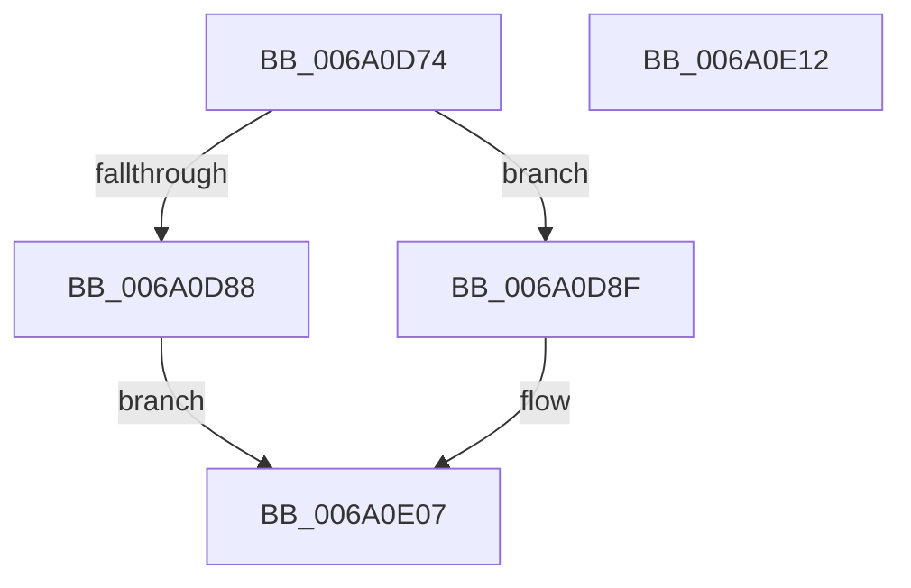

# BgpDisplaySafeToPowerOffScreen

- RVA: `0x006A0D74`–`0x006A0E13` (길이 `159` bytes)
- VA: `0x00000001406A0D74`
- 실행 섹션: `.text`
- PDB 이름 있음: `예`; PDB Function 태그: `아니요`
- unwind 정보 RVA: `0x0006E5F8`
- 디코드: `39`개 명령, `159/159` bytes 표시
- 미해석 바이트: `0` (있으면 어셈블리에 `.byte`로 보존)

> 이 문서는 커널 이미지의 기계어와 PDB 기호를 분석해 생성했습니다. 4번과 5번은 함수 원형과 자료형을 바이너리 사용 방식에서 추정한 C 해석이며 원본 소스 복구 결과는 아닙니다.

## 1. Dependencies

- 직접 호출 지점: **4**; 고유 호출 대상: **4**
- 직접 호출자로 확인된 함수: **1**
- RIP 상대 이미지 참조: **7**

### Outgoing calls
- `0x006A0DB2` → [BcpGetDisplayType](BcpGetDisplayType_function_006A0A48.md) (function, `0x006A0A48`)
- `0x006A0DD1` → [BgpClearScreen](../69/BgpClearScreen_function_0069EAB0.md) (function, `0x0069EAB0`)
- `0x006A0DEC` → [BcpSetCursorPosition](BcpSetCursorPosition_function_006A0D50.md) (function, `0x006A0D50`)
- `0x006A0E00` → [BcpDisplayCriticalString](../69/BcpDisplayCriticalString_function_0069F754.md) (function, `0x0069F754`)

### Direct callers
- [BgDisplaySafeToPowerOffScreen](../69/BgDisplaySafeToPowerOffScreen_function_0069E994.md) at `0x0069E9B0`

### Static image references
- `0x006A0D7E` → RVA `0x00EF0450` (`.data`; read)
- `0x006A0D8F` → RVA `0x00EF03E8` (`.data`; read)
- `0x006A0D9E` → RVA `0x00EF03E4` (`.data`; read)
- `0x006A0DA8` → RVA `0x00EF03EC` (`.data`; read)
- `0x006A0DBF` → RVA `0x00E3EBA0` (`.data`; read)
- `0x006A0DD6` → RVA `0x00E0EF60` (`.data`; read)
- `0x006A0DF6` → RVA `0x00E3EB90` (`.data`; read)

## 2. Other-region calls and transfers

- 다른 실행 섹션으로 향하는 call: **0**
- 별도 외부 분기/꼬리 이동을 확인하지 못했습니다.

## 3. Assembly (complete function range)

```asm
006A0D74  48 89 5C 24 08                  mov qword ptr [rsp + 8], rbx
006A0D79  57                              push rdi
006A0D7A  48 83 EC 30                     sub rsp, 0x30
006A0D7E  8B 05 CC F6 84 00               mov eax, dword ptr [rip + 0x84f6cc]
006A0D84  A8 02                           test al, 2
006A0D86  75 07                           jne 0x1406a0d8f
006A0D88  B8 01 00 00 C0                  mov eax, 0xc0000001
006A0D8D  EB 78                           jmp 0x1406a0e07
006A0D8F  8B 05 53 F6 84 00               mov eax, dword ptr [rip + 0x84f653]
006A0D95  48 8D 4C 24 20                  lea rcx, [rsp + 0x20]
006A0D9A  89 44 24 20                     mov dword ptr [rsp + 0x20], eax
006A0D9E  8B 05 40 F6 84 00               mov eax, dword ptr [rip + 0x84f640]
006A0DA4  89 44 24 24                     mov dword ptr [rsp + 0x24], eax
006A0DA8  8B 05 3E F6 84 00               mov eax, dword ptr [rip + 0x84f63e]
006A0DAE  89 44 24 28                     mov dword ptr [rsp + 0x28], eax
006A0DB2  E8 91 FC FF FF                  call 0x1406a0a48
006A0DB7  48 63 F8                        movsxd rdi, eax
006A0DBA  B9 00 00 00 FF                  mov ecx, 0xff000000
006A0DBF  48 8B 05 DA DD 79 00            mov rax, qword ptr [rip + 0x79ddda]
006A0DC6  48 6B DF 54                     imul rbx, rdi, 0x54
006A0DCA  48 8B 50 18                     mov rdx, qword ptr [rax + 0x18]
006A0DCE  89 4A 28                        mov dword ptr [rdx + 0x28], ecx
006A0DD1  E8 DA DC FF FF                  call 0x14069eab0
006A0DD6  4C 8D 15 83 E1 76 00            lea r10, [rip + 0x76e183]
006A0DDD  42 8B 4C 13 10                  mov ecx, dword ptr [rbx + r10 + 0x10]
006A0DE2  4D 8D 42 14                     lea r8, [r10 + 0x14]
006A0DE6  4C 03 C3                        add r8, rbx
006A0DE9  41 8B 10                        mov edx, dword ptr [r8]
006A0DEC  E8 5F FF FF FF                  call 0x1406a0d50
006A0DF1  42 8B 54 13 08                  mov edx, dword ptr [rbx + r10 + 8]
006A0DF6  48 8D 0D 93 DD 79 00            lea rcx, [rip + 0x79dd93]
006A0DFD  44 8B CF                        mov r9d, edi
006A0E00  E8 4F E9 FF FF                  call 0x14069f754
006A0E05  33 C0                           xor eax, eax
006A0E07  48 8B 5C 24 40                  mov rbx, qword ptr [rsp + 0x40]
006A0E0C  48 83 C4 30                     add rsp, 0x30
006A0E10  5F                              pop rdi
006A0E11  C3                              ret
006A0E12  CC                              int3
```

## 4. C-style interpretation (structured pseudocode)

```c
__int64 __fastcall BgpDisplaySafeToPowerOffScreen(void)
{
    __int64 result;
    __int64 v_rbx;
    __int64 v_rsp;
    unsigned int v_stack_m10;
    unsigned int v_stack_m14;
    unsigned __int64 v_stack_m18;
    unsigned __int64 v_stack_p8;

    v_stack_p8 = v_rbx;
    v_rsp = (v_rsp) - (48);
    if ((((unsigned __int8)((unsigned int)(*(unsigned int *)(v_rip + 8713932)))) & (2)) != 0) goto loc_006A0D8F;
    goto loc_006A0E07;
loc_006A0D8F:
    v_stack_m18 = (unsigned int)((unsigned int)(*(unsigned int *)(v_rip + 8713811)));
    v_stack_m14 = (unsigned int)((unsigned int)(*(unsigned int *)(v_rip + 8713792)));
    v_stack_m10 = (unsigned int)((unsigned int)(*(unsigned int *)(v_rip + 8713790)));
    result = BcpGetDisplayType(v_stack_m18, a2, a3, a4);
    v_rbx = (v_rbx) * ((int)((unsigned int)(result)));
    *(unsigned int *)(*(unsigned __int64 *)(*(unsigned __int64 *)(v_rip + 7986650) + 24) + 40) = (unsigned int)((unsigned int)(0xFF000000ULL));
    result = BgpClearScreen((unsigned int)(0xFF000000ULL), *(unsigned __int64 *)(*(unsigned __int64 *)(v_rip + 7986650) + 24), a3, a4);
    a3 = (v_rip + 7790979 + 20) + (v_rbx);
    result = BcpSetCursorPosition((unsigned int)(*(unsigned int *)(v_rbx + v_rip + 7790979 * 1 + 16)), (unsigned int)(*(unsigned int *)(a3)), a3, a4);
    result = BcpDisplayCriticalString(v_rip + 7986579, (unsigned int)(*(unsigned int *)(v_rbx + v_rip + 7790979 * 1 + 8)), a3, (unsigned int)((unsigned int)((int)((unsigned int)(result)))));
    result = 0;
loc_006A0E07:
    v_rsp = (v_rsp) + (48);
    return result;
}
```

## 5. (Beta) C Style

```c
void BgpDisplaySafeToPowerOffScreen(void)
{
    int64_t result;
    int64_t local_rbx;
    int64_t local_rsp;
    uint32_t v_stack_m10;
    uint32_t v_stack_m14;
    uint64_t v_stack_m18;
    uint64_t v_stack_p8;

    v_stack_p8 = local_rbx;
    local_rsp = (local_rsp) - (48);
    if ((((uint8_t)((uint32_t)(*(uint32_t *)(v_rip + 0x84F6CC)))) & (2)) != 0) goto loc_006A0D8F;
    goto loc_006A0E07;
loc_006A0D8F:
    v_stack_m18 = (uint32_t)((uint32_t)(*(uint32_t *)(v_rip + 0x84F653)));
    v_stack_m14 = (uint32_t)((uint32_t)(*(uint32_t *)(v_rip + 0x84F640)));
    v_stack_m10 = (uint32_t)((uint32_t)(*(uint32_t *)(v_rip + 0x84F63E)));
    result = BcpGetDisplayType(v_stack_m18, a2, a3, a4);
    local_rbx = (local_rbx) * ((int32_t)((uint32_t)(result)));
    *(uint32_t *)(*(uint64_t *)(*(uint64_t *)(v_rip + 0x79DDDA) + 0x18) + 0x28) = (uint32_t)((uint32_t)(0xFF000000ULL));
    result = BgpClearScreen((uint32_t)(0xFF000000ULL), *(uint64_t *)(*(uint64_t *)(v_rip + 0x79DDDA) + 0x18), a3, a4);
    a3 = (v_rip + 7790979 + 20) + (local_rbx);
    result = BcpSetCursorPosition((uint32_t)(*(uint32_t *)(local_rbx + v_rip + 0x76E183 * 1 + 0x10)), (uint32_t)(*(uint32_t *)(a3)), a3, a4);
    result = BcpDisplayCriticalString(v_rip + 7986579, (uint32_t)(*(uint32_t *)(local_rbx + v_rip + 0x76E183 * 1 + 0x8)), a3, (uint32_t)((uint32_t)((int32_t)((uint32_t)(result)))));
    result = 0;
loc_006A0E07:
    local_rsp = (local_rsp) + (48);
    return result;
}
```

## 6. Execution-region graph

[열기: 2D/3D 그래프와 함수 탐색 컨트롤 패널](../../../control-panel.html?section=text&rva=0x006A0D74&view=graph)

- 2D 그래프는 위에서 아래로 흐르고, 3D 그래프는 빈 공간을 드래그해 회전합니다. Shift+드래그는 이동, 휠은 확대·축소, 함수 노드 선택은 대상 보고서 이동입니다.

### Static fallback


